# TreeHouse 기술 문서

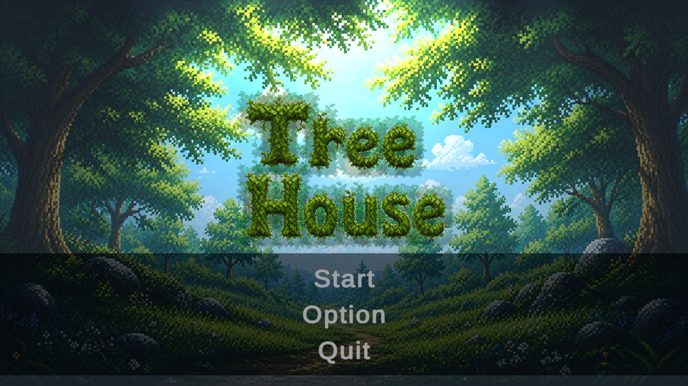

| 항목 | 내용 |
|---|---|
| 장르 | 2D 탐험 + 디펜스 |
| 개발 기간 | 2주 (개인 프로젝트) |
| 개발 인원 | 1인 |
| 개발 환경 | Unity 6000.3.15f1 (URP 2D, New Input System, TextMeshPro) |
| 주요 기술 | A* 길찾기 · 구역별 그리드 · FSM 몬스터 AI · ScriptableObject 데이터 분리 |
| 레퍼런스 | *Dave the Diver* · *운빨존많겜* · *전략적 팀 전투* |
| 링크 | [GitHub](https://github.com/KooHoo-Dev/3rd-2D-Project-SaGiKun4) · [시연 영상](https://youtu.be/rVk8w-42GYg) |

---

## 1. 개요

### 1.1 무엇을 만들었나 (What)

*Dave the Diver*의 "낮에는 심해 잠수, 밤에는 초밥집 경영" 구조를 **"낮에는 하늘 탐험, 밤에는 둥지 방어"** 로 재해석한 2D 게임입니다.
플레이어는 새가 되어 하늘을 탐험하며 다른 새를 사냥해 깃털을 모으고, 밤에는 모은 깃털로 유닛을 강화해 둥지를 노리는 야생동물을 막습니다.

**핵심 루프**

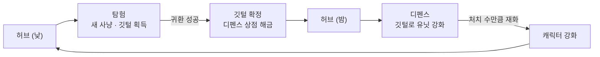

**레퍼런스와 다른 점**

| 레퍼런스 | 가져온 것 | 바꾼 것 |
|---|---|---|
| *Dave the Diver* | 낮/밤 두 모드 구조, 산소(체력) 압박, 작살 조준 | 바다 → 하늘, 작살로 끌어오기 → 깃털 발사 공격, 사망 시 아이템 1개 유지 → 전부 소실 |
| *운빨존많겜* + *전략적 팀 전투* | *운빨존많겜*: 몬스터가 필드 가장자리를 순환하는 디펜스 판 / *전략적 팀 전투*: 운과 재화 활용이 섞인 상점·리롤 | *운빨존많겜*의 완전 무작위 소환을 *전략적 팀 전투*식 상점 구매로 대체, 상점에는 탐험에서 해금한 깃털만 등장 |

**조작법**

| 장면 | 입력 | 동작 |
|---|---|---|
| 허브 | A·D / ←·→ | 좌우 이동 |
| 허브·탐험 | Space | 입장 지점·귀환 지점(Pod) 상호작용 |
| 탐험 | WASD / 방향키 | 이동 |
| 탐험 | Left Shift | 달리기 (체력이 더 빨리 감소) |
| 탐험 | 좌클릭 | 근접 공격 |
| 탐험 | 우클릭 유지 + 좌클릭 | 조준(이동 정지, 시야 이동) 후 깃털 발사 |
| 디펜스 | 좌클릭 | 유닛 선택(사거리 표시) |
| 디펜스 | 우클릭 | 선택한 유닛을 다른 슬롯으로 이동·교체 |
| 디펜스 | 깃털 드래그 → 유닛 | 깃털 장착 (렌치를 드래그하면 해제) |
| 공통 | ESC | 옵션(일시정지) |

### 1.2 왜 만들었나 (Why)

이 게임의 핵심 재미는 **"탐험"** 입니다. 디펜스는 탐험의 재미를 확장하는 수단으로 두었습니다.

- **탐험**: 리스크를 감수하며 미지의 공간을 개척하고, 아이템을 발견하는 재미
- **디펜스**: 탐험에서 얻은 자원으로 효율적인 전략을 구성하는 재미

두 모드가 이어져야 하나의 게임이 완성되도록, 탐험에서 귀환에 성공해야만 깃털이 디펜스에 반영되는 구조로 설계했습니다.
또한 몬스터 길찾기에 A*를 쓴다는 이야기는 많이 들었고 이론도 공부했지만 실제로 적용해 본 적이 없었기 때문에, **A*가 실제 게임에서 얼마나 무거운지 직접 확인하는 것**도 이 프로젝트의 기술적 목표였습니다.

### 1.3 이 문서에서 다루는 내용

- 2장: 탐험·디펜스의 구성요소와 깃털 데이터의 흐름
- 3장: 몬스터 길찾기, 탐험 압박, 획득물 확정, 유닛 장착, 상점의 동작
- 4장: 구역별 그리드, 임시 인벤토리, 유닛 구조, 깃털 데이터 분리 수준, 플레이어 공격 모션(머리·몸통 분리)에 대한 고민
- 5장: 길찾기 최적화 결과와 트러블슈팅, 아쉬운 점과 개선 계획

---

## 2. 시스템 구조

### 2.1 깃털 데이터의 흐름

두 모드를 잇는 것은 "깃털"입니다. 깃털이 어디서 생기고 어디로 가는지를 기준으로 구조를 나눴습니다.

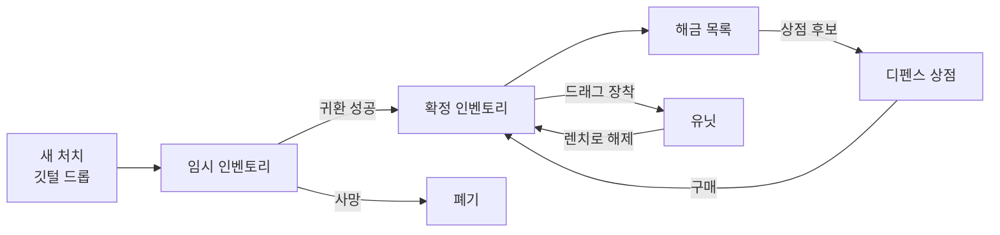

### 2.2 몬스터 AI와 길찾기 구조

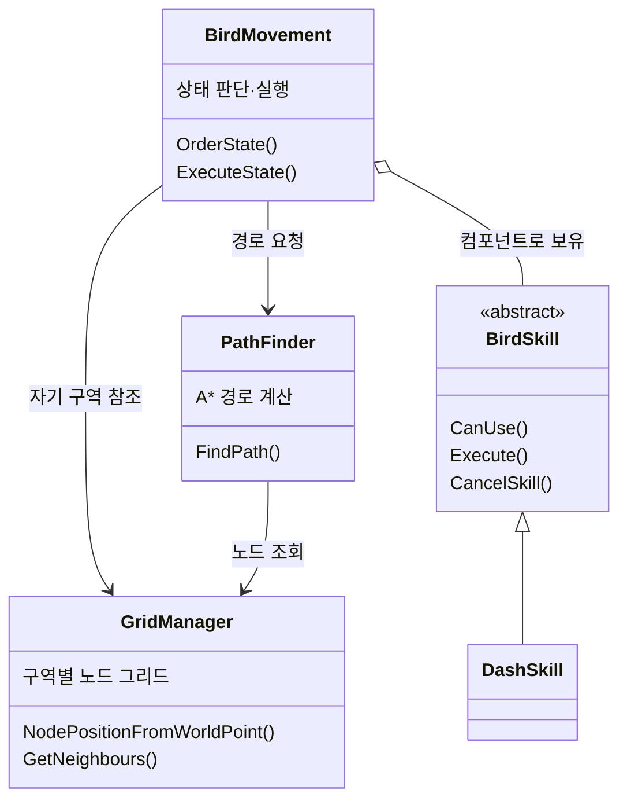

### 2.3 유닛과 깃털 구조

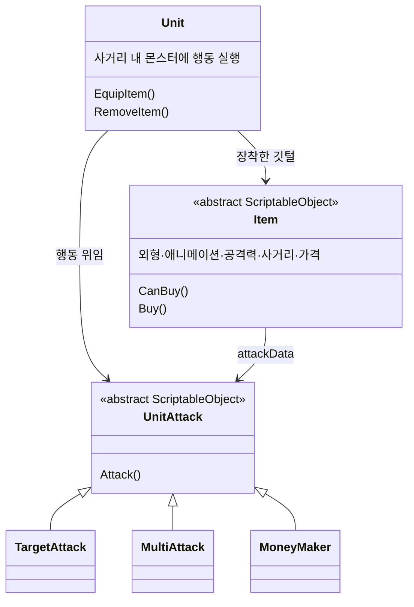

### 2.4 핵심 클래스 역할 분담

| 클래스 | 역할 |
|---|---|
| `PlayerBehaviour` | 플레이어 이동, 조준·공격, 시간에 따른 체력 감소 |
| `BirdMovement` | 몬스터 상태 판단·실행 (휴면 / 배회 / 도망 / 공격 / 복귀) |
| `GridManager` | 몬스터 구역마다 하나씩 두는 노드 그리드. 벽 판정, 좌표 → 노드 변환 |
| `PathFinder` | 그리드를 받아 A* 경로를 계산 (그리드를 갖지 않고 요청마다 받음) |
| `BirdSkill` | 몬스터 스킬의 공통 틀. 몬스터에 컴포넌트로 붙임 |
| `AdventureManager` | 귀환 성공 시 임시 인벤토리 확정, 실패 시 폐기 |
| `InventoryManager` | 확정 인벤토리와 임시 인벤토리 보관 |
| `UnlockManager` | 디펜스 상점에 등장할 수 있는 깃털 목록 |
| `Unit` | 장착한 깃털에 따라 외형·행동이 바뀌는 단일 유닛 |
| `UnitAttack` | 유닛의 행동 방식 (단일 공격 / 범위 공격 / 재화 생산) |
| `RollManager` | 해금된 깃털로 상점 후보를 구성하고 리롤 |
| `GameFlowManager` | 제한 시간, 디펜스 포인트, 승패 판정 |

**이렇게 나눈 이유**

- 그리드를 `PathFinder`가 아니라 구역별 `GridManager`가 갖게 한 것은, 몬스터마다 자기 구역만 탐색하게 해서 탐색 범위를 줄이기 위해서입니다 (4.1).
- `PathFinder`는 이전에 이론으로 공부하며 작성한 A* 코드를 프로젝트에 맞게 조금 고쳐 가져온 것입니다. 책임만 보면 길찾기 판단은 몬스터나 그리드 쪽이 갖는 편이 자연스럽지만, **이론 구조를 그대로 실제 게임에 적용했을 때 어떤 문제가 생기는지 확인하는 것**이 목적이었기 때문에 별도의 `PathFinder.Instance`로 부르는 구조를 일부러 유지했습니다 (개선 계획은 5.4).
- 유닛의 행동을 `Unit` 안에 쓰지 않고 `UnitAttack`으로 분리한 것은, 모든 유닛이 "범위 내 적에게 행동한다"는 같은 구조이고 행동 방식만 다르기 때문입니다 (4.3).
- 확정 인벤토리와 임시 인벤토리를 나눈 것은, 귀환에 성공했을 때만 깃털이 해금되게 하기 위해서입니다 (4.2).

---

## 3. 핵심 기능

### 3.1 몬스터 길찾기

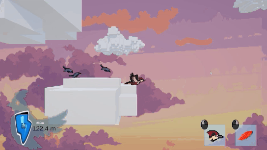

#### 사용법 (API)

```csharp
// 그리드와 시작·목표 좌표를 넘기면 경로(노드 목록)를 돌려준다. 갈 수 없으면 null
List<Node> path = PathFinder.Instance.FindPath(gridManager, transform.position, target);
```

- 몬스터(`BirdMovement`)는 자기 구역의 `GridManager`를 인스펙터에서 지정받고, 경로가 필요할 때 그 그리드를 넘겨 요청합니다.

#### 핵심 동작: 구역 그리드 생성

```csharp
private void CreateGrid()
{
    grid = new Node[gridSizeX, gridSizeY];

    Bounds bounds = area.bounds;

    Vector2 worldBottomLeft = new Vector2(bounds.min.x,bounds.min.y);

    for (int x = 0; x < gridSizeX; x++)
    {
        for (int y = 0; y < gridSizeY; y++)
        {
            float xPos = (x * cellSize) + (cellSize / 2f);
            float yPos = (y * cellSize) + (cellSize / 2f);
            Vector2 nodeWorldPoint = worldBottomLeft + (Vector2.right * xPos) + (Vector2.up * yPos);

            bool walkable = !Physics2D.OverlapBox(nodeWorldPoint, Vector2.one * cellSize, 0f, wallLayer);

            grid[x, y] = new Node(walkable, nodeWorldPoint, x, y);
        }
    }
}
```

- 그리드의 범위는 맵 전체가 아니라 **각 구역의 콜라이더(`area`)** 입니다. 몬스터는 자기 구역 안에서만 탐색합니다.
- 각 칸의 중심에서 벽 레이어와 겹치는지 검사해 이동 가능 여부를 정합니다.

#### 핵심 동작: A* 탐색

```csharp
while (openSet.Count > 0)
{
    Node currentNode = openSet[0];

    for (int i = 1; i < openSet.Count; i++)
    {
        if (openSet[i].totalCost < currentNode.totalCost)
        {
            currentNode = openSet[i];
        }
    }

    openSet.Remove(currentNode);
    closedSet.Add(currentNode);

    if (currentNode == targetNode)
    {
        return RetracePath(startNode, targetNode);
    }
    // ... 이웃 노드의 비용 갱신
}

return null;
```

```csharp
private int GetDistance(Node a, Node b)
{
    int distanceX = Mathf.Abs(a.gridX - b.gridX);
    int distanceY = Mathf.Abs(a.gridY - b.gridY);

    // 에이스타에서 대각선 이동은 14로 근사값을 잡음
    // (실제 거리 기준 직선 거리 1 : 대각선 거리 1.41414...)의 근사값
    // 그거 계산
    if (distanceX > distanceY)
        return 14 * distanceY + 10 * (distanceX - distanceY);

    return 14 * distanceX + 10 * (distanceY - distanceX);
}
```

- 열린 목록에서 총비용(`hereCost + remainCost`)이 가장 작은 노드를 꺼내 확장합니다.
- 열린 목록은 인덱스를 직접 다루고 내부를 점검하기 쉬운 `List`로 구현했습니다 (한계와 개선 계획은 5.4).
- 비용은 직선 10, 대각선 14로 정수 근사해 √2 계산을 피했습니다.

#### 핵심 동작: 연산을 줄이는 상태 판단

```csharp
if (currentState == State.None)
{
    if (Vector3.Distance(transform.position, PlayerBehaviour.Instance.transform.position) < 25f)
    {
        ChangeState(State.Idle);
    }

    return;
}

if (Vector3.Distance(transform.position, PlayerBehaviour.Instance.transform.position) >= 25f)
{
    ChangeState(State.None);
    return;
}
```

```csharp
private bool PlayerNodeChange()
{
    Node currentNode = gridManager.NodePositionFromWorldPoint(Player.position);

    if (currentNode == prevPlayerNode)
        return false;

    prevPlayerNode = currentNode;
    return true;
}
```

- 플레이어와 25 이상 떨어진 몬스터는 휴면(`None`) 상태로 바뀌어 길찾기와 이동을 멈춥니다. 플레이어 시야(10)보다 넓게 잡아, 화면 밖에서도 몬스터가 움직이고 있었다는 느낌을 남겼습니다.
- 추격할 때는 플레이어가 **다른 그리드 노드로 옮겼을 때만** 경로를 다시 계산합니다.

### 3.2 탐험 압박: 체력 = 산소

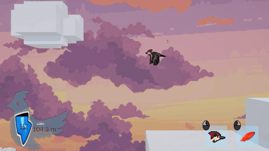

```csharp
float drainPerSecond = 1f / 3f;

if (isRunning)
{
    drainPerSecond = 1f;
}

if (height >= maxHeight)
{
    drainPerSecond = 2f;
}
```

- 체력은 시간에 따라 줄어듭니다. 기본 초당 1/3, 달리기 중 1, 한계 고도를 넘으면 2입니다. 한계 고도는 허브 강화로 늘어납니다.
- 탐험은 리스크를 동반해야 한다고 보고, 플레이어의 움직임을 계속 압박하는 매개체로 원작의 산소 시스템을 가져왔습니다.
- 단순 시간제한만 두면 운 좋게 높은 고도의 새를 잡는 상황이 생기므로, **한계 고도 초과 시 추가 감소**로 구간별 제한을 두었습니다. 사냥에 난이도를 주기 위해 **달리기 시 추가 감소**도 넣었습니다.

### 3.3 조준 시 이동 정지

```csharp
private void FixedUpdate()
{
    if (isAiming)
    {
        rigid.linearVelocity = Vector2.zero;
        return;
    }
    // ... 일반 이동
}
```

- 우클릭으로 조준하는 동안 이동을 멈추고, 마우스 방향으로 카메라를 옮겨 주변을 볼 수 있게 했습니다.
- 이동하면서 멀리 볼 수 있다면 손해 없이 쓸 수 있는 필수 기능이 됩니다. **"멈춰야 볼 수 있다"** 는 비용을 붙여, 전투처럼 목적이 있을 때는 주변 파악 정도로만 쓰고, 목적 없이 탐험할 때만 탐색 수단이 되도록 했습니다.
- 원작의 작살은 물고기를 끌어오지만, "새를 잡아 깃털을 얻는다"는 경험을 강조하려고 깃털을 발사하는 공격으로 바꿨습니다.

### 3.4 귀환과 획득물 확정

#### 사용법 (API)

```csharp
AdventureManager.Instance.QuitAdventure(); // 귀환 지점(Pod)에서 호출: 획득물 확정
AdventureManager.Instance.FailAdventure(); // 체력 0에서 호출: 획득물 폐기
```

#### 핵심 동작

```csharp
public void QuitAdventure()
{
    if (UnlockManager.Instance.GetUnlockedItemCount() == 0 && InventoryManager.Instance.TempInventory.IsEmpty())
    {
        FailAdventure();
        return;
    }

    InventoryManager.Instance.Inventory.Merge(InventoryManager.Instance.TempInventory);
    InventoryManager.Instance.TempInventory.Clear();
    GameManager.Instance.QuitAdventure();
    SceneLoader.Instance.LoadScene("GameMenu");
}

public void FailAdventure()
{
    InventoryManager.Instance.TempInventory.Clear();
    SceneLoader.Instance.LoadScene("GameMenu");
}
```

- 탐험 중 주운 깃털은 임시 인벤토리에만 들어갑니다. 귀환에 성공하면 확정 인벤토리에 병합되고, 병합(`Merge`)하면서 해금 목록에도 등록됩니다.
- **예외 처리**: 해금된 깃털이 하나도 없는데 빈손으로 귀환하면 실패로 처리합니다. 디펜스를 진행하려면 최소 1개의 깃털이 해금되어 있어야 하기 때문입니다.
- 사망하면 이번 탐험의 획득물을 모두 버립니다. 하나라도 남기면 "최대한 높이 올라가 최고 단계 새만 잡고 죽는" 플레이가 최적해가 될 것으로 예상했고, 의도한 탐험의 재미와 거리가 멀어 원작(1개 유지)과 다르게 정했습니다.

### 3.5 유닛 장착

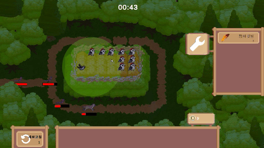

#### 사용법 (API)

```csharp
unit.EquipItem(item); // 깃털 장착 (Infinite 등급인 렌치를 넘기면 해제)
unit.RemoveItem();    // 기본 유닛으로 복원, 깃털은 인벤토리로 돌려줌
```

#### 핵심 동작

```csharp
public void EquipItem(Item item)
{
    if (item.Tier == ItemTier.Infinite)
    {
        RemoveItem();
        return;
    }

    if (HasItem) return;

    EquippedItem = item;
    HasItem = true;

    attackBehaviour = item.attackData;
    sprite.sprite = item.BirdSprite;
    animator.runtimeAnimatorController = item.overrideController;
    detectedObject.localScale = item.detectedArea;
    damage = item.damage;
    mobType = item.Key;

    InventoryManager.Instance.Inventory.RemoveItem(EquippedItem);
}
```

- 유닛 클래스를 종류마다 나누지 않고, 깃털 데이터 하나로 **행동 방식·외형·애니메이션·사거리·공격력**을 한 번에 바꿉니다.
- 렌치(`Infinite` 등급)는 별도 입력을 만들지 않고 같은 장착 경로를 재사용해 해제 동작으로 처리했습니다.
- 유닛 하나에 깃털은 하나만 장착합니다.

```csharp
[CreateAssetMenu(menuName = "Attack/MoneyMaker")]
public class MoneyMaker: UnitAttack
{
    public override void Attack(Unit unit, List<MobState> monsters)
    {
        GameFlowManager.Instance.defencePoint++;
        ContentController.Instance.Refresh();
    }
}
```

- 깃털이 없는 기본 유닛의 행동은 `MoneyMaker`입니다. 공격 대신 디펜스 포인트를 만듭니다 (4.3).

### 3.6 디펜스 상점

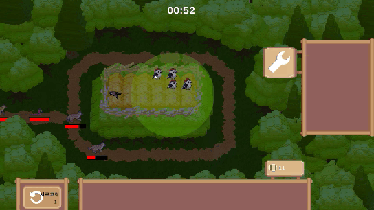

```csharp
foreach (Item defenceItem in allItems)
{
    if (defenceItem.Tier != ItemTier.Unit && !UnlockManager.Instance.IsUnlocked(defenceItem))
        continue;

    if (!tierItems.ContainsKey(defenceItem.Tier))
    {
        tierItems.Add(defenceItem.Tier, new List<Item>());
    }

    tierItems[defenceItem.Tier].Add(defenceItem);
}
```

- 유닛 소환은 항상 상점 후보에 들어가고, 깃털은 **탐험에서 해금한 것만** 들어갑니다. 등급 확률을 굴려 후보 중 하나를 고르고, 디펜스 포인트 1로 리롤합니다.
- 전투 중에도 실시간으로 구매·장착·배치를 바꿀 수 있습니다.
- *운빨존많겜*의 완전 무작위 소환은 랜덤성이 너무 커서, *전략적 팀 전투*처럼 일정량의 운에 재화 활용을 더한 상점을 접목했습니다.
- 탐험 결과만으로 디펜스 전략이 정해지면 탐험이 "발견"이 아니라 특정 깃털을 모으는 파밍으로 변합니다. 그래서 디펜스 안에도 전략을 넓힐 수단(상점)을 두었습니다. 반대로 아직 발견하지 않은 깃털이 상점에 나오면 발견의 가치가 사라지므로, 해금된 깃털만 나오게 했습니다.
- 디펜스는 탐험을 확장하는 수단이므로 난이도를 낮게 잡았습니다. 몬스터는 기믹 없이 순환하고, 오토배틀러처럼 단순히 싸우는 형식입니다.

### 3.7 몬스터 스킬 구조

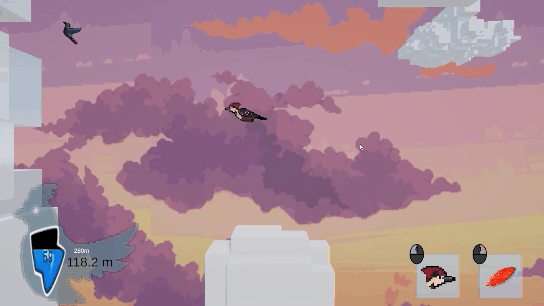

```csharp
foreach (BirdSkill skill in skills)
{
    if (skill.CanUse(this))
    {
        currentSkill = skill;
        currentSkill.CurrentSkillInit(this);
        return;
    }
}

Chase();
```

- 공격 상태에서 몬스터에 붙은 스킬 중 사용 가능한 것을 실행하고, 없으면 추격합니다.
- 스킬을 컴포넌트로 붙인 이유는, Unity 에디터에서 몬스터가 어떤 스킬을 쓸 수 있는지 바로 확인할 수 있어서입니다.
- 현재 스킬은 까마귀의 돌진(`DashSkill`: 3초 차지 → 직선 돌진 → 쿨타임 8초) 하나입니다.

---

## 4. 고민과 선택

### 4.1 몬스터 길찾기: 그리드를 어떻게 나눌 것인가

*Dave the Diver*의 몬스터 움직임을 레퍼런스로 삼으면서, 이 움직임을 이론으로 공부했던 A*로 구현해 보기로 했습니다. 처음에는 공부할 때 작성한 A*를 **맵 전체 하나의 그리드**에 그대로 적용했습니다. 참새 10마리에서 30~50FPS로 떨어졌고, 15~20마리를 넘으면 게임이 동작하지 않았습니다.

| | 대안 A. 그리드·경로 공유 | 대안 B. 구역별 그리드 분할 |
|---|---|---|
| 방식 | 하나의 그리드와 경로를 여러 몬스터가 함께 사용 | 맵을 구역으로 나누고 몬스터마다 자기 구역 그리드만 탐색 |
| 장점 | 계산량이 줄어듦 | 탐색 범위 자체가 줄어듦. 레퍼런스의 "활동 범위 제한 + 이탈 시 복귀" 구조와 맞음 |
| 단점 | 몬스터들이 같은 경로로 한곳에 뭉쳐 움직여 부자연스러움 | 몬스터가 구역 밖으로 플레이어를 쫓지 못함 |

**최종 선택: 대안 B**

- 이유 1: A*를 도입한 목적인 "자연스러운 움직임"을 해치지 않습니다.
- 이유 2: *Dave the Diver*도 몬스터 활동 범위를 제한하고, 벗어나면 안으로 돌아오게 합니다. 구역을 벗어난 몬스터가 돌아가는 복귀(`Return`) 상태를 같은 맥락으로 두었습니다.
- **감수한 단점**: 구역 밖으로 추격하지 못하는 제약은, **"자기 구역을 지키는 새"라는 게임의 정체성**으로 활용했습니다.

**남은 위험에 대한 판단**
목표 지점이 벽이면 A*가 갈 수 있는 노드를 모두 탐색한 뒤 실패하고, 다음 프레임에 다시 탐색한다는 점을 알고 있었습니다.
이를 코드가 아니라 **레벨 구성**으로 줄였습니다. 몬스터 활동 영역 콜라이더를 볼록한 사각형에 가깝게 만들어 랜덤 목표가 벽에 떨어질 확률을 낮췄습니다.
맵 디자인상 1~2곳은 남았지만, 해당 몬스터는 5마리 내외이고 동시에 일어나도 큰 프레임 드랍이 없음을 테스트로 확인해 감수했습니다.

### 4.2 획득한 깃털을 언제 확정할 것인가

깃털을 얻으면 디펜스 상점에 그 깃털이 해금되는 구조입니다.

| | 대안 A. 획득 즉시 반영 | 대안 B. 임시 인벤토리에 보관 후 귀환 시 확정 |
|---|---|---|
| 장점 | 구조가 단순함 | "탐험에 성공해야 디펜스에 반영된다"는 규칙이 지켜짐 |
| 단점 | 실패한 판의 깃털도 해금됨. 높은 등급 깃털을 한 번 터치하고 일부러 죽는 플레이로 여러 깃털을 해금할 수 있음 | 인벤토리를 두 개 관리해야 함 |

**최종 선택: 대안 B**
예를 들어 대안 A에서는 까마귀 깃털을 얻고 실패한 뒤, 다음 판에 참새 깃털로 성공하면 두 깃털이 모두 해금됩니다. 탐험에서 죽든 말든 상관없는 구조로 변하므로, 진행 중 획득물과 확정 획득물을 나눴습니다.

### 4.3 유닛을 종류마다 나눌 것인가

| | 대안 A. 유닛 종류마다 클래스·프리팹 | 대안 B. 유닛 하나 + 깃털 데이터로 교체 |
|---|---|---|
| 장점 | 유닛마다 독립적으로 수정 가능 | 클래스·프리팹이 늘지 않음. 깃털을 바꾸는 것만으로 유닛이 바뀜 |
| 단점 | 행동 구조가 같은데도 클래스·프리팹이 깃털 수만큼 늘어남 | 유닛마다 완전히 다른 행동 구조가 필요해지면 맞지 않음 |

**최종 선택: 대안 B**
모든 유닛의 행동은 "범위 내의 적에게 스킬을 수행한다"로 같고 외형만 다릅니다. 그래서 깃털(`Item`)에 외형·애니메이션·행동 방식(`UnitAttack`)·수치를 담고, 장착할 때 통째로 바꾸는 방식이 더 효율적이라고 판단했습니다.

**이 구조 덕분에 가능했던 것: 기본 유닛의 재화 생산**
대부분의 디펜스 게임에서 기본 유닛은 아무 행동도 하지 않습니다. 이 게임은 디펜스가 어려워 탐험이 막히는 상황을 피하려고 난이도를 낮게 잡았고, 그 방향에 맞춰 기본 유닛이 공격 대신 디펜스 포인트를 만들게 했습니다. 기본 유닛을 많이 소환할수록 게임이 쉬워집니다.
행동 방식을 `UnitAttack`으로 분리해 두었기 때문에, "공격하지 않는 행동"(`MoneyMaker`)도 같은 틀에 그대로 넣을 수 있었습니다.

### 4.4 깃털 데이터를 얼마나 나눌 것인가

깃털 정보는 크게 두 갈래입니다. 탐험에서는 "누가 떨어뜨리는가" 정도로 단순하고, 디펜스에서는 "무엇으로 변신하는가(행동 방식·데미지)", "얼마인가(상점)"처럼 명확히 나뉩니다.

**1차 설계: 상속으로 세 단계 분리**
디펜스 쪽을 상속으로 나누는 것은 좋다고 보았고, "나중에 문제가 될 바엔 미리 분리하자"는 생각으로 탐험 쪽까지 나눴습니다.

- 원본 깃털: 스프라이트·아이디 등 기본 정보
- 탐험 깃털: 플레이어에 닿으면 아이디만 넘기는 단순 구조
- 디펜스 깃털: 디펜스의 주요 정보

**문제를 알아챈 흐름**

1. 디펜스가 끝나면 쓰지 않은 깃털을 인벤토리로 돌려줘야 한다.
2. 그런데 아이디는 상위 계층에 있어서, 디펜스 깃털의 값만으로는 돌려줄 수 없다.
3. 이 깃털이 어떤 원본 깃털과 짝인지 판단하는 스크립트가 새로 필요하다.
4. 상속으로 나눠 읽기 좋게 만들려고 했는데, 스크립트가 늘면서 오히려 읽기 어려워지고 있다.
5. 처음 기대한 장점(가독성)과 멀어졌다 → 합치는 쪽이 낫다.

**최종 선택: 하나의 아이템으로 다시 결합**
통합 스크립트를 실제로 쓰기 전에 판단을 바꿨습니다. 공통 아이디를 두는 방식은 당시에는 생각하지 못했지만, 돌아보면 최상위 계층이 아이디를 두 개 쓰게 되어 역시 가독성이 떨어지므로 택하지 않았을 것입니다.

**배운 점**
분리 수준은 **분리하려는 목적(여기서는 가독성)** 을 기준으로 판단해야 합니다. 미리 나누는 것이 항상 좋은 것은 아니고, 데이터가 실제로 어떻게 흐르는지(탐험 → 인벤토리 → 디펜스 → 인벤토리 복귀)를 먼저 보고 정해야 합니다.

### 4.5 플레이어 근접 공격: 한 장에 그릴 것인가, 머리와 몸통을 나눌 것인가

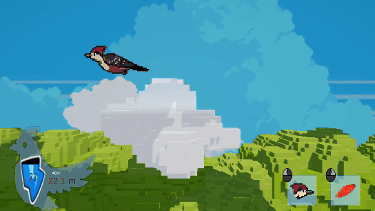

**문제를 알아챈 흐름**
플레이어는 눈에 먼저 보이고 바로 구현할 수 있는 이동 기능을 먼저 완성한 뒤, 그 위에 공격을 붙이는 순서로 개발했습니다. 이동에는 머리와 몸통이 한 장에 그려진 날갯짓 스프라이트(약 10프레임)를 쓰고 있었습니다.
공격을 붙이려고 보니, 공격 상태로 바뀔 때는 히트박스와 함께 공격 애니메이션이 재생되는 것이 자연스러운데, 머리와 날갯짓이 한 장에 담긴 지금의 스프라이트로는 날갯짓을 유지한 채 공격 애니메이션을 넣을 수 없었습니다. 새는 날면서 공격하므로, 날갯짓과 쪼기가 동시에 따로 움직여야 했습니다.

| | 대안 A. 날갯짓 타이밍마다 공격 이미지 | 대안 B. 공격 시 머리를 옮긴 이미지로 교체 | 대안 C. 머리와 몸통을 분리 |
|---|---|---|---|
| 방법 | 날갯짓 10프레임마다 머리 위치별 공격 이미지를 그려 두고 타이밍을 맞춤 | 날갯짓은 유지하고, 공격 시 머리를 최종 위치로 옮긴 이미지를 씀 | 몸통(날갯짓)과 머리(쪼기)를 따로 그려 동시에 재생 |
| 필요한 프레임 (예상) | 약 50 | 약 20 | 10 (몸통 5 + 머리 5) |
| 단점 | 프레임이 가장 많고, 날갯짓과 공격 타이밍을 하나하나 맞춰야 함 | 머리가 부자연스럽게 움직임 | 기존 이동 스프라이트에 맞춰 위치와 피벗을 다시 잡아야 함 |

**최종 선택: 대안 C**
위치와 피벗을 다시 잡는 불편이 있었지만, 결과물이 자연스러운 것이 더 중요하다고 판단해 감수했습니다.
당시에는 디펜스에서 쓸 Idle 상태의 쪼기도 계획하고 있어서, 쪼는 머리를 따로 두는 쪽이 더 유리했습니다. 이후 기본 유닛이 공격 대신 디펜스 포인트를 만들도록 바뀌면서(4.3) Idle 쪼기는 쓰지 않게 되어 삭제했습니다.

**구현**

- **구조**: 몸통이 부모, 머리가 자식 오브젝트라 이동할 때는 함께 움직입니다. Animator는 몸통과 머리에 따로 있고, 앞뒤 순서는 SpriteRenderer의 Sorting Order로 맞췄습니다.
- **공격**: 트리거로 머리의 공격 애니메이션을 재생합니다. 애니메이션이 머리에 단 작은 콜라이더(히트박스)를 켜면서 머리를 앞으로 조금 옮깁니다. 히트박스가 머리에 붙어 있어서 판정도 쪼는 머리와 함께 움직입니다.
- **스프라이트 분리**: Affinity로 기존 날갯짓 스프라이트를 머리와 몸통으로 나누고, 겹쳐 보이는 불필요한 프레임을 줄여 몸통 5프레임과 머리 5프레임을 새로 만들었습니다.
- **목 이음새**: 머리가 앞으로 나갔을 때를 기준으로 몸통의 목 부분을 먼저 늘려 두고, 머리가 돌아왔을 때 튀어나오는 부분을 다시 줄여 다듬었습니다. 그래서 공격 중에도 목에 빈틈이 생기지 않습니다.

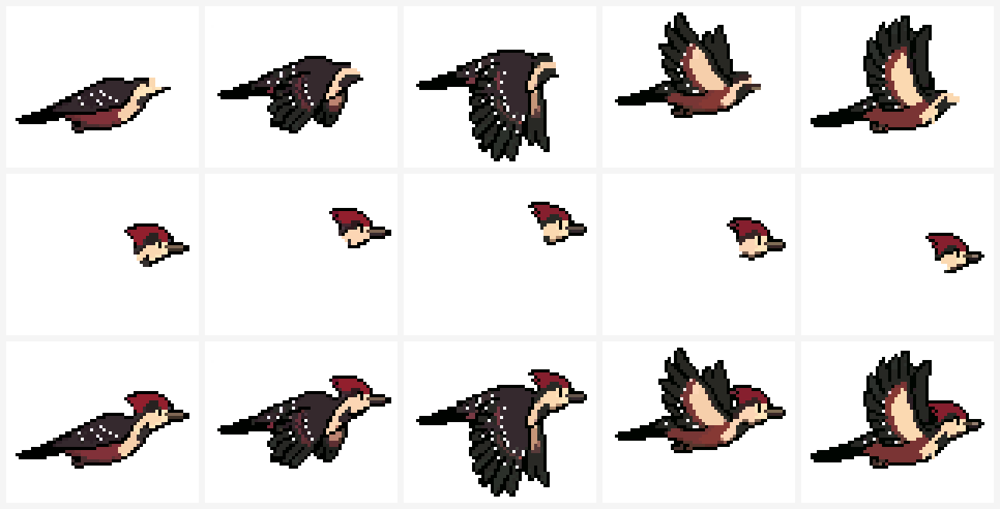

**감수한 것**

- 이미 이동에 쓰던 통합 스프라이트에 맞춰, 나눈 스프라이트의 위치를 다시 조정해야 했습니다.
- 머리가 자연스럽게 움직이도록 머리 스프라이트의 부분별 피벗을 조정해야 했습니다.

**결과**
날갯짓이 끊기지 않은 채 머리만 앞으로 쪼는 공격 모션을 만들었습니다. 스프라이트는 몸통 5 + 머리 5 = 10프레임으로, 대안 A(약 50)와 대안 B(약 20)의 예상보다 적습니다.

---

## 5. 결과 및 배운 점

### 5.1 결과

- 2주 동안 탐험·디펜스 두 모드와, 깃털로 이어지는 순환 구조(획득 → 확정·해금 → 장착 → 재화 → 강화)를 완성했습니다.
- 길찾기 최적화 결과 (Unity Profiler 기준)

| 단계 | 몬스터 수 | 결과 |
|---|---|---|
| 맵 전체 단일 그리드 | 10마리 | 30~50FPS |
| 맵 전체 단일 그리드 | 15~20마리 이상 | 동작 불가 |
| 구역별 그리드 | 32마리 (탐험 씬 전체) | 약 120FPS, 특정 시점 20~30FPS 순간 하락 |
| + 거리 기반 휴면 · 노드 변경 시에만 재탐색 | 32마리 | 약 120FPS, 순간 하락 약 70~80FPS로 완화 |

- 기술적 목표의 달성: 1.2에서 목표로 둔 "A*가 실제 게임에서 얼마나 무거운가"를 위 표처럼 몬스터 수와 그리드 구성별 수치로 확인했습니다. 무거움의 원인은 알고리즘 자체보다 탐색 범위, 동시 호출, 반복 호출 시 남는 상태처럼 이론에서 다루지 않던 부분에 있었습니다 (5.4).

### 5.2 트러블슈팅: 몬스터 길찾기 순간 프레임 하락

| 항목 | 내용 |
|---|---|
| 문제 | 구역별 그리드 적용 후에도 특정 시점에 20~30FPS로 순간 하락 |
| 원인 | 여러 몬스터의 길찾기가 같은 시점에 몰려 실행됨 |
| 해결 | 플레이어와 25 이상 떨어진 몬스터는 휴면 상태로 길찾기 중단, 추격 중에는 플레이어 노드가 바뀔 때만 재탐색 |
| 결과 | 순간 하락이 약 70~80FPS 수준으로 완화. 완전히 사라지지는 않음 (5.4) |

### 5.3 트러블슈팅: 돌진 스킬이 벽을 통과하는 문제

| 항목 | 내용 |
|---|---|
| 문제 | 프로젝트 막바지에, 까마귀가 돌진하면서 벽을 뚫고 나가는 현상을 발견. 당시에는 "돌진과 휴면 상태의 우선순위가 잘못됐다"고 짐작만 하고 수정하지 못함 |
| 원인 | 새의 몸체 콜라이더가 트리거라 벽과 물리적으로 부딪히지 않음. 평소 이동은 A* 그리드가 벽을 피하는 경로를 만들어 줘서 드러나지 않았지만, 돌진은 그리드를 거치지 않고 속도로 직선 이동해 벽을 그대로 통과함. 짐작했던 우선순위 문제도 실제로 있어서, 스킬이 진행되는 동안 상태 판단이 바로 빠져나가 구역을 벗어날 때까지 돌진이 이어짐 |
| 개선 계획 | 돌진 전에 벽 레이어로 레이캐스트해 목표 지점을 벽 앞으로 보정, 또는 벽에 닿으면 스킬 종료. 스킬의 종료·취소 조건(최대 실행 시간 등)을 `BirdSkill` 부모 클래스에서 공통으로 보장 |

```csharp
if (isDash)
{
    bird.Rigidbody2D.linearVelocity = dashDirection * dashSpeed;

    if (Vector2.Distance(transform.position, target) < 0.3f)
    {
        bird.Rigidbody2D.linearVelocity = Vector2.zero;

        isDash = false;

        coolTimeTimer = coolTime;

        FinishSkill();
    }
}
```

- 돌진은 목표에 0.3 이내로 다가가야만 끝납니다. 길찾기를 거치지 않으므로 벽을 피하는 책임이 이 코드에는 없습니다.

**배운 점**: 이동 방식이 여러 개(경로 기반, 직선 속도)일 때 "벽을 막는 책임"이 한 방식에만 있으면, 그 방식을 거치지 않는 이동에서 구멍이 생깁니다.

### 5.4 아쉬운 점과 개선 계획: A* 내부 구현

도입 목적이었던 "A*가 실제로 얼마나 무거운가"에 대한 답은, **이론에서는 다루지 않는 실패 비용, 여러 몬스터의 동시 탐색, 반복 호출 시 남는 상태와 메모리 할당**이었습니다.

| 구분 | 내용 | 개선 계획 |
|---|---|---|
| 의도적으로 유지한 것 | 이론 구조를 그대로 확인하려고 길찾기를 별도의 `PathFinder`(`Instance` 호출)로 둠. 길찾기 판단의 책임이 몬스터·그리드와 떨어져 있음 | 경로 계산을 그리드 쪽으로 옮기거나 상태를 갖지 않는 클래스로 만들어, 몬스터가 자기 그리드에서 직접 경로를 받게 함 |
| 알고 감수한 것 | 목표가 벽이면 전체 탐색 후 실패하고 다음 프레임에 재탐색 (4.1에서 레벨 구성으로 완화) | 목표가 벽이면 가장 가까운 이동 가능 노드로 보정, 또는 실패 시 재시도 대기 시간 |
| 선호로 고른 것 | 열린 목록을 `List`로 구현해 매번 전체를 훑어 최소 비용 노드를 찾음 | 비용 기준 우선순위 큐(최소 힙)로 교체 |
| 놓친 것 | 탐색할 때마다 노드 비용을 초기화하지 않아 이전 탐색 값이 남음 | 탐색 번호로 노드 비용 초기화 |
| 놓친 것 | 인접 노드를 구할 때마다 새 `List`를 만들어 GC 부담 발생 | 인접 노드 리스트 재사용 |

**배운 점**: 알고리즘이 "맞게 동작하는가"뿐 아니라, 여러 번 반복 호출될 때의 비용까지 봐야 합니다.

### 5.5 아쉬운 점과 개선 계획: 매니저 간 직접 참조

- **문제 인식**: 다른 클래스의 인스턴스를 직접 호출하는 곳이 많습니다(33개 파일, 130곳). 예를 들어 디펜스 포인트를 바꾸는 곳 5군데(처치, 생산, 구매 2종, 리롤)가 각자 UI 갱신 함수를 직접 부릅니다. 게임 로직(몬스터·유닛)이 UI를 알아야 하고, 값을 바꾸는 곳이 늘수록 갱신을 빠뜨릴 위험이 커지는 구조입니다.
- **당시 판단**: 이벤트(옵저버) 방식은 알고 있었지만, 2주라는 기간과 당시 실력으로는 원하는 대로 적용하기 어렵다고 판단해 빠르게 작업할 수 있는 직접 참조를 선택했습니다. 개발 중 실제로 갱신이 빠지는 문제는 생기지 않았습니다.
- **개선 계획**: 포인트 변경을 한 곳(추가·사용 메서드)으로 모으고, 값이 바뀌면 이벤트를 발생시켜 UI는 그 이벤트만 구독하게 합니다.
- **이후 실천**: 이 경험을 바탕으로 이후 프로젝트에서 이벤트 방식을 적용해 봤습니다.

### 5.6 정리: 분리 수준을 판단하는 기준

4.4에서는 필요 이상으로 나눠서, 5.5에서는 기간 때문에 나누지 않아서 각각 비용이 생겼습니다.
두 경험에서 얻은 기준은 같습니다. **분리 수준은 목적과 상황(기간, 실력, 데이터의 흐름)을 근거로 정해야 합니다.**
