# TreeHouse 프로젝트 문서

> 새가 되어 낮에는 하늘을 탐험하고, 밤에는 모은 깃털로 둥지를 지키는 2D 탐험 + 디펜스 게임

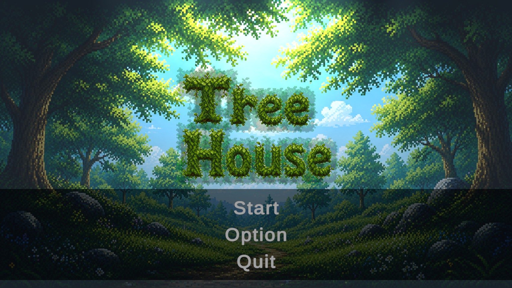

| 항목 | 내용 |
|---|---|
| 장르 | 2D 탐험 + 디펜스 |
| 개발 기간 | 2주 |
| 개발 인원 | 1인 (개인 프로젝트) |
| 개발 환경 | Unity 6000.3.15f1 (URP 2D, New Input System, TextMeshPro) |
| 링크 | [GitHub](https://github.com/KooHoo-Dev/3rd-2D-Project-SaGiKun4) · [시연 영상](https://youtu.be/rVk8w-42GYg) |

---

## 1. 개요

TreeHouse는 플레이어가 새가 되어 하늘을 누비는 2D 게임입니다. 낮에는 하늘을 탐험하며 다른 새를 사냥해 깃털을 모으고, 밤에는 그 깃털로 유닛을 강화해 둥지를 노리는 야생동물을 막습니다. 낮에는 바다에 잠수하고 밤에는 초밥집을 운영하는 게임 *Dave the Diver*의 두 모드 구조를, 바다 대신 하늘과 둥지로 옮겨 온 개인 프로젝트입니다.

두 모드 가운데 중심은 탐험입니다. 디펜스는 탐험에서 얻은 깃털로 전략을 짜 보는, 탐험을 넓혀 주는 쪽에 두었습니다. 그래서 두 모드가 하나의 게임으로 이어지도록, 탐험에서 무사히 돌아와야만 그때 모은 깃털이 디펜스에 쓰이게 만들었습니다. 플레이어가 **위험을 감수하며 낯선 하늘을 개척하고, 그 끝에서 새로운 깃털을 발견하는 경험**을 하기를 바랐습니다.

탐험이 살아 있으려면 하늘의 새들이 하나의 생태계처럼 자연스럽게 움직여야 했습니다. 그래서 몬스터가 벽을 돌아 스스로 길을 찾게 하는 일을 이 프로젝트의 기술적 중심으로 두고, 그 방법으로 A\*(에이스타: 출발점에서 목표까지 가장 짧은 길을 찾는 대표적인 길찾기 방법)를 골랐습니다. 몬스터 길찾기에 A\*를 쓴다는 이야기는 많이 들었고 이론도 공부했지만, 실제 게임에 넣어 본 적은 없었습니다. 그래서 **A\*가 실제 게임에서 얼마나 무거운지 직접 확인해 보는 것**을 개인 목표로 삼았습니다.

이 문서는 개인 목표였던 몬스터 길찾기(3장)와, 탐험을 디펜스로 잇는 깃털의 흐름인 귀환해야 확정되는 깃털(4장)·깃털 하나로 바뀌는 유닛(5장)·날면서 쪼는 공격(6장)을 다룹니다.

---

## 2. 플레이

### 2.1 낮의 탐험과 밤의 방어

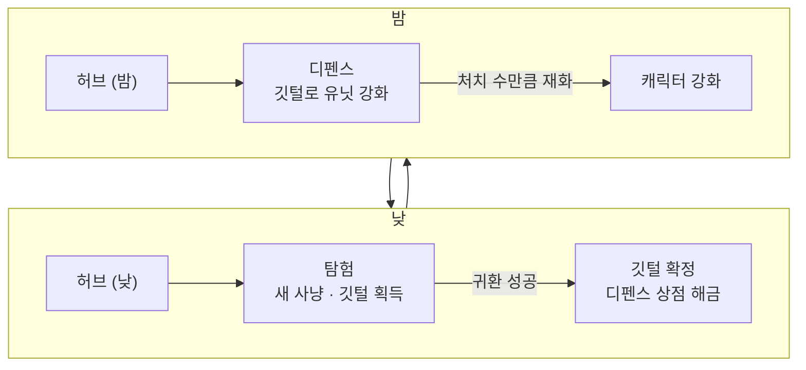

하루는 낮의 탐험에서 시작합니다. 허브에서 탐험에 들어가 새를 사냥하고 깃털을 모은 뒤, 귀환 지점(Pod)까지 돌아오면 그 깃털이 확정되고 디펜스 상점에 나올 수 있게 됩니다. 밤에는 디펜스에서 깃털을 유닛에 달아 야생동물을 막고, 처치한 수만큼 받은 재화로 캐릭터를 강화한 뒤 다시 탐험에 나섭니다.

### 2.2 원작에서 가져온 것과 바꾼 것

| 참고한 게임 | 가져온 것 | 바꾼 것 |
|---|---|---|
| *Dave the Diver* | 낮과 밤 두 모드, 산소(체력)가 줄어드는 압박, 작살 조준 | 바다를 하늘로. 작살로 끌어오는 대신 깃털을 쏘는 공격. 죽으면 아이템 1개를 지키던 규칙을 전부 잃도록 (4.2) |
| *운빨존많겜* | 몬스터가 필드 가장자리를 돌아 나가는 디펜스 판 | 완전히 무작위인 유닛 소환을 상점 구매로 (4.2) |
| *전략적 팀 전투* | 운과 재화 활용이 섞인 상점과 리롤 | 상점에는 탐험에서 해금한 깃털만 나오도록 (4.2) |

### 2.3 조작

| 장면 | 입력 | 동작 |
|---|---|---|
| 허브 | A·D / ←·→ | 좌우 이동 |
| 허브·탐험 | Space | 입장 지점·귀환 지점(Pod)과 상호작용 |
| 탐험 | WASD / 방향키 | 이동 |
| 탐험 | Left Shift | 달리기 (체력이 더 빨리 줄어듦) |
| 탐험 | 좌클릭 | 근접 공격 |
| 탐험 | 우클릭 유지 + 좌클릭 | 멈춰서 조준하고 깃털 발사 |
| 디펜스 | 좌클릭 | 유닛 선택 (사거리 표시) |
| 디펜스 | 우클릭 | 선택한 유닛을 다른 칸으로 옮기거나 맞바꿈 |
| 디펜스 | 깃털을 유닛에 드래그 | 깃털 장착 (렌치를 드래그하면 해제) |
| 공통 | ESC | 옵션 (일시정지) |

---

## 3. 몬스터 길찾기

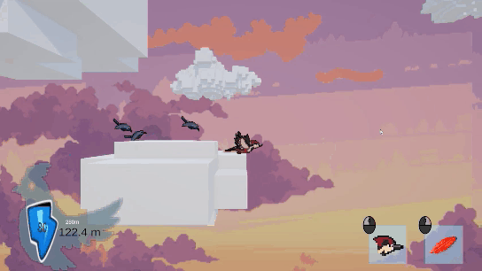

탐험하는 하늘의 새들은 자기 구역 안을 돌아다니다가, 플레이어를 보면 벽을 돌아 쫓아오거나 반대쪽으로 달아납니다. 이 장은 그 움직임을 A\*로 만들면서, **여러 마리가 동시에 길을 찾을 때 생긴 무게**를 어떻게 줄였는지에 대한 이야기입니다.

길찾기 방법을 공부하며 다익스트라·크루스칼 같은 여러 알고리즘을 배웠고, 그중 게임에서 가장 많이 쓰인다고 알고 있던 것이 A\*였습니다. Unity에 들어 있는 길찾기 기능(내비게이션)도 A\*를 바탕으로 한다고 들었습니다. 그래서 그 기능을 가져다 쓰는 대신 A\*를 직접 구현했습니다. 이미 짜인 구조를 쓰는 것보다, 그 구조가 어떻게 돌아가는지 직접 만들어 보며 이해하고 싶었기 때문입니다.

### 3.1 구역마다 따로 둔 그리드

처음에는 공부할 때 작성한 A\* 코드를 그대로 가져와, 맵 전체를 하나의 그리드(맵을 바둑판처럼 칸으로 나눈 것으로, 길찾기는 이 칸을 따라 길을 찾습니다)로 덮고 모든 몬스터가 그 안에서 길을 찾게 했습니다. 참새 10마리만 넣어도 화면이 1초에 30\~50번밖에 그려지지 않았고(30\~50FPS), 15\~20마리를 넘기자 게임이 아예 움직이지 않았습니다.

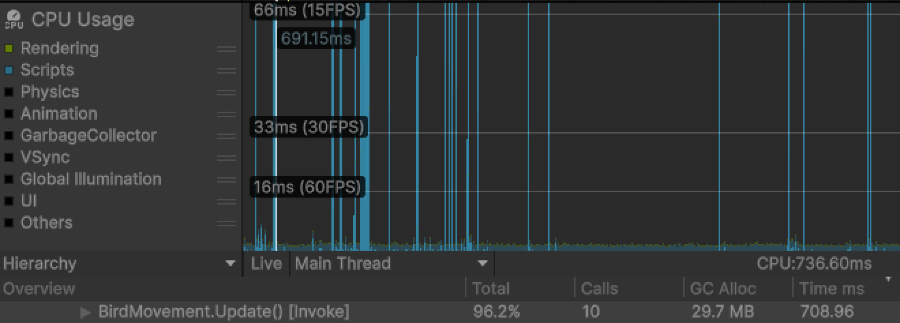

<small>맵 전체를 하나의 그리드로 두고 참새 10마리를 넣었을 때의 Unity Profiler(성능 측정 도구). 가장 오래 걸린 프레임은 736.60ms로 화면이 약 0.7초 멈췄고, 그중 96.2%(708.96ms)가 새 10마리의 이동·길찾기(`BirdMovement.Update`)였습니다. 그 한 프레임의 GC 할당(나중에 정리해야 할 메모리를 새로 만든 양)은 29.7MB였습니다.</small>

계산을 줄이는 방법은 두 가지를 놓고 비교했습니다.

| | 대안 A. 그리드와 경로를 함께 쓰기 | 대안 B. 구역마다 그리드를 따로 두기 |
|---|---|---|
| 방식 | 하나의 그리드와 경로를 여러 몬스터가 나눠 씀 | 맵을 구역으로 나누고, 몬스터는 자기 구역의 그리드만 탐색 |
| 장점 | 계산량이 줄어듦 | 탐색하는 범위 자체가 줄어듦. 원작처럼 활동 범위를 정하고 벗어나면 돌아오게 하는 구조와 맞음 |
| 단점 | 몬스터들이 같은 길로 한곳에 뭉쳐 움직여 부자연스러움 | 몬스터가 구역 밖까지 플레이어를 쫓지 못함 |

대안 B를 골랐습니다. A\*를 넣은 이유가 새들의 자연스러운 움직임이었는데, 대안 A는 바로 그 움직임을 해치기 때문입니다. *Dave the Diver*도 몬스터의 활동 범위를 정해 두고 벗어나면 안으로 돌려보내므로, 구역을 벗어난 몬스터가 시작 위치로 돌아가는 복귀 상태도 같은 생각으로 두었습니다. 구역 밖으로 쫓아오지 못한다는 단점은 고치는 대신 **"자기 구역을 지키는 새"라는 게임의 특징**으로 삼았습니다.

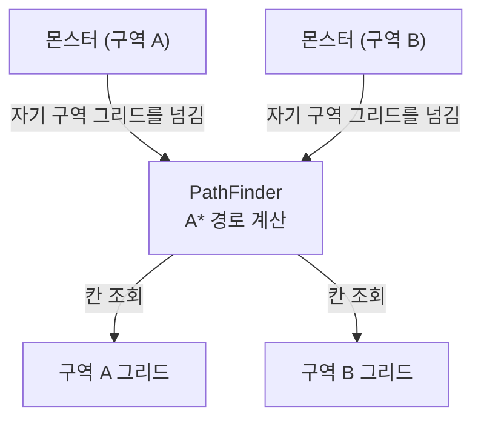

그리드는 구역마다 하나씩(`GridManager`) 두고, 몬스터(`BirdMovement`)는 인스펙터에서 자기 구역의 그리드를 지정받습니다. 길이 필요할 때는 그 그리드를 넘겨 경로를 요청하므로, 길을 계산하는 `PathFinder`는 그리드를 직접 갖지 않습니다.

```csharp
// 그리드와 시작·목표 좌표를 넘기면 경로(노드 목록)를 돌려준다. 갈 수 없으면 null
List<Node> path = PathFinder.Instance.FindPath(gridManager, transform.position, target);

// class GridManager — CreateGrid() 안
Bounds bounds = area.bounds;
// ... 구역 범위 안의 칸마다
bool walkable = !Physics2D.OverlapBox(nodeWorldPoint, Vector2.one * cellSize, 0f, wallLayer);
grid[x, y] = new Node(walkable, nodeWorldPoint, x, y);
```

그리드의 범위는 맵 전체가 아니라 그 구역의 콜라이더(`area`)입니다. 칸마다 중심에서 벽 레이어와 겹치는지 검사해 지나갈 수 있는 칸인지 정합니다.

남은 위험도 하나 알고 있었습니다. 목표 지점이 벽이면 A\*는 갈 수 있는 칸을 모두 뒤진 뒤에야 실패하고, 다음 프레임에 또 같은 탐색을 합니다. 이것은 코드가 아니라 **레벨 구성**으로 줄였습니다. 몬스터 활동 영역의 콜라이더를 볼록한 사각형에 가깝게 만들어, 무작위로 고른 목표가 벽에 떨어질 확률을 낮췄습니다. 맵 디자인 때문에 1\~2곳은 남았지만, 그곳의 몬스터는 5마리 안팎이고 동시에 일어나도 프레임이 크게 떨어지지 않는 것을 테스트로 확인하고 받아들였습니다.

### 3.2 멀리 있는 새는 쉬게 하기

구역별 그리드로 바꾼 뒤 탐험 씬 전체의 32마리를 넣어도 평소에는 약 120FPS가 나왔습니다. 그런데 특정 순간마다 20\~30FPS로 떨어졌고, 가끔은 한 자릿수까지 내려가 화면이 멈칫하는 것이 느껴졌습니다.

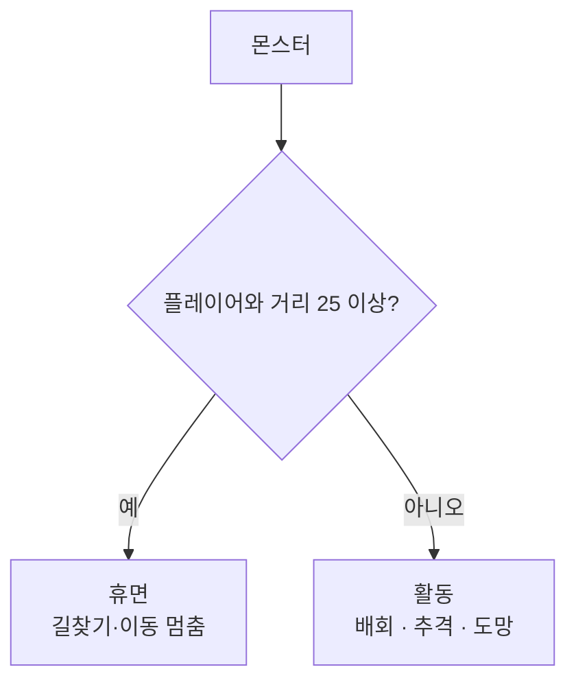

| 항목 | 내용 |
|---|---|
| 문제 | 구역별 그리드에서도 특정 순간에 20\~30FPS로 떨어지고, 가끔 한 자릿수 FPS까지 내려감 |
| 원인 | 여러 몬스터의 길찾기가 같은 순간에 몰려 실행됨 |
| 해결 | 플레이어와 25 이상 떨어진 몬스터는 휴면 상태로 바꿔 길찾기와 이동을 멈춤 |
| 결과 | 순간 하락이 약 70\~80FPS 수준으로 줄어듦. 완전히 사라지지는 않음 (3.4) |

휴면 거리 25는 플레이어의 시야(10)보다 일부러 넓게 잡은 값입니다. 화면 밖에서도 새들이 계속 움직이고 있었다는 느낌을 남기기 위해서입니다.

| Unity Profiler (32마리) | 휴면 전 | 휴면 후 | 줄어든 비율 |
|---|---|---|---|
| 가장 오래 걸린 프레임 | 207.90ms | 62.87ms | 약 70% |
| 그 프레임에서 새 32마리의 처리 (`BirdMovement.Update`) | 197.32ms | 53.76ms | 약 73% |
| 그 프레임의 GC 할당 | 17.1MB | 3.6MB | 약 79% |

두 측정의 조건은 같지 않고, 휴면 후 쪽이 더 불리합니다. 휴면 전은 플레이어가 가만히 있고 새들이 A\*만 쓰는 가벼운 상황입니다. 휴면 후에는 플레이어가 맵을 돌아다니며 새들을 깨워야 했기 때문에, 상호작용이 더해진 무거운 상황입니다. 그래서 실제로 줄어든 폭은 표보다 큽니다. 휴면 후 평소 프레임은 약 9ms(8.72ms)이고, 이때 새 32마리의 처리는 0.09ms입니다.

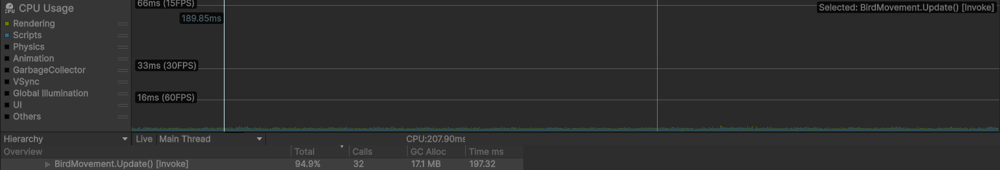

<small>휴면 전: 구역별 그리드 + 32마리, 플레이어가 멈춰 있는 상황. 가장 오래 걸린 프레임(화면이 약 0.2초 멈춤)의 94.9%가 새 32마리의 처리였습니다.</small>

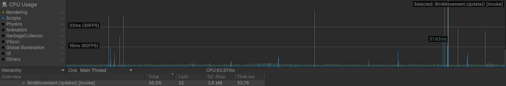

<small>휴면 후: 구역별 그리드 + 32마리, 맵을 돌아다니며 새를 깨우는 상황.</small>

### 3.3 쫓을 때와 도망칠 때

플레이어를 발견한 몬스터는 공격하거나 도망칩니다. 둘 다 경로를 따라 움직이지만, **언제 경로를 다시 계산하는지**는 다르게 정했습니다.

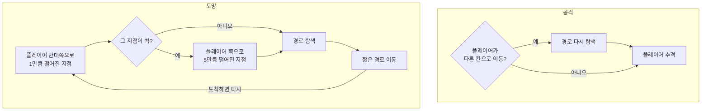

- **쫓을 때**는 플레이어가 **다른 칸으로 옮겼을 때만** 경로를 다시 계산합니다. 같은 칸 안에서 움직이는 동안에는 이미 구한 경로를 그대로 씁니다.
- **도망칠 때**는 플레이어 반대쪽으로 **1만큼 떨어진 가까운 지점**까지만 경로를 잡습니다. 짧은 경로를 다 갈 때마다 그때의 플레이어 위치를 보고 방향을 다시 정하므로, 도망치는 방향이 플레이어의 움직임을 따라 바뀝니다.
- 도망칠 지점이 벽이면 오히려 **플레이어 쪽으로 5만큼 떨어진 지점**을 목표로 삼습니다. *Dave the Diver*에서 벽에 몰린 물고기가 플레이어 쪽으로 빠르게 돌진해 빠져나가는 움직임을 옮겨 온 것입니다.

### 3.4 길찾기 코드 안에 남겨 둔 것

A\* 코드 안쪽에는 일부러 남겨 둔 것, 알고 받아들인 것, 놓친 것이 섞여 있습니다. 휴면을 넣은 뒤에도 순간 하락이 완전히 사라지지 않은 것(3.2)은 이 부분과 관계가 있습니다.

```csharp
// class PathFinder — FindPath() 안
while (openSet.Count > 0)
{
    Node currentNode = openSet[0];

    for (int i = 1; i < openSet.Count; i++)
    {
        if (openSet[i].totalCost < currentNode.totalCost)
        {
            currentNode = openSet[i];
        }
    }

    openSet.Remove(currentNode);
    closedSet.Add(currentNode);
    // ...
}
```

다음에 살펴볼 칸의 목록(열린 목록)을 `List`로 두어, 칸을 하나 꺼낼 때마다 목록 전체를 훑어 비용이 가장 작은 칸을 찾습니다. 인덱스를 직접 다루고 안을 들여다보기 쉬워서 고른 방식입니다.

| 구분 | 내용 | 다음에 바꿀 방법 |
|---|---|---|
| 일부러 남긴 것 | 길찾기를 따로 떨어진 `PathFinder`(`Instance`로 호출)에 둠. 책임만 보면 몬스터나 그리드 쪽이 갖는 편이 자연스럽지만, 이론에서 배운 구조를 그대로 게임에 넣었을 때 무슨 문제가 생기는지 보려고 유지함 | 경로 계산을 그리드 쪽으로 옮기거나 상태를 갖지 않는 클래스로 만들어, 몬스터가 자기 그리드에서 바로 경로를 받게 함 |
| 알고 받아들인 것 | 목표가 벽이면 전부 탐색한 뒤 실패하고 다음 프레임에 다시 탐색 (3.1) | 목표가 벽이면 가장 가까운 갈 수 있는 칸으로 옮기기, 또는 실패하면 다시 시도하기 전에 기다리기 |
| 편해서 고른 것 | 열린 목록을 `List`로 두고 매번 전체를 훑음 | 비용 순으로 꺼내는 우선순위 큐(최소 힙)로 교체 |
| 놓친 것 | 탐색할 때마다 칸의 비용을 초기화하지 않아 이전 탐색 값이 남음 | 탐색 번호를 매겨 칸의 비용 초기화 |
| 놓친 것 | 이웃 칸을 구할 때마다 새 `List`를 만들어 GC 부담이 생김 | 이웃 칸 목록을 재사용 |

---

## 4. 귀환해야 확정되는 깃털

탐험 중에 주운 깃털은 아직 내 것이 아닙니다. 귀환 지점까지 살아서 돌아와야 확정되고, 그때 처음으로 디펜스 상점에 나올 수 있게 됩니다. 도중에 죽으면 그 탐험에서 주운 깃털은 모두 사라집니다.

### 4.1 깃털이 디펜스까지 가는 길

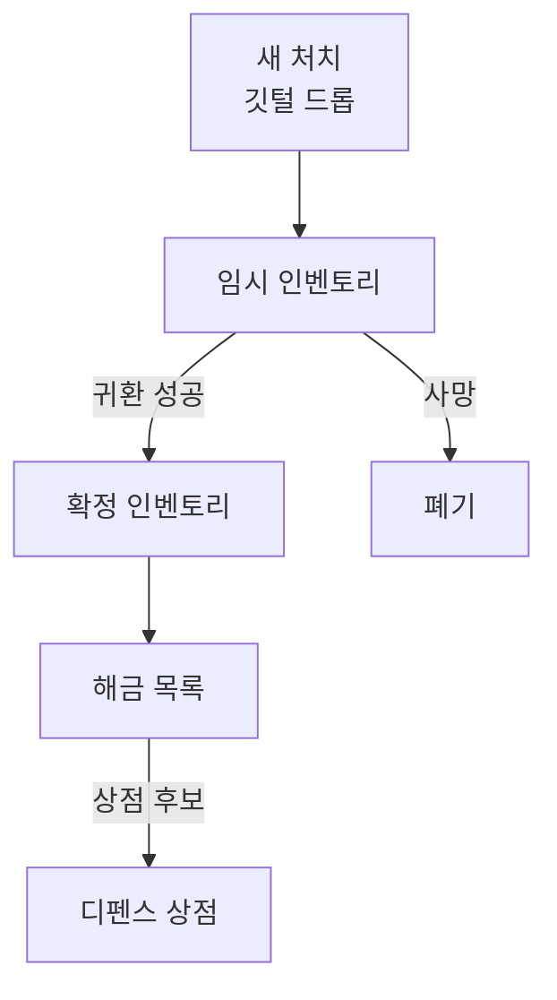

탐험에서 주운 깃털은 임시 인벤토리에만 들어갑니다. 귀환에 성공하면 확정 인벤토리에 합쳐지고, 합치는 순간 해금 목록에도 올라갑니다. 디펜스 상점은 이 해금 목록에서 후보를 고릅니다(4.2).

**언제 확정할 것인가**

| | 대안 A. 줍는 즉시 반영 | 대안 B. 임시로 보관했다가 귀환하면 확정 |
|---|---|---|
| 장점 | 구조가 단순함 | "탐험에 성공해야 디펜스에 반영된다"는 규칙이 지켜짐 |
| 단점 | 실패한 판의 깃털도 해금됨. 높은 등급의 깃털을 한 번 건드리고 일부러 죽는 식으로 여러 깃털을 해금할 수 있음 | 인벤토리를 두 개 관리해야 함 |

대안 B를 골랐습니다. 대안 A라면 까마귀 깃털을 줍고 실패한 뒤, 다음 판에 참새 깃털을 들고 성공해도 두 깃털이 모두 해금됩니다. 그러면 탐험에서 살아 돌아오든 말든 상관없는 구조가 됩니다. 그래서 탐험 중에 얻은 것과 확정된 것을 나눴고, 인벤토리를 두 개 관리하는 수고를 그 대가로 받아들였습니다.

죽었을 때 깃털을 **하나도 남기지 않는 것**도 같은 이유로 원작과 다르게 정했습니다. 원작처럼 하나라도 남긴다면 "최대한 높이 올라가 가장 높은 단계의 새만 잡고 죽는" 플레이가 가장 이득인 방법이 될 것이라고 봤습니다. 그것은 제가 바란 탐험의 재미와 거리가 멀었습니다.

한 가지 예외도 두었습니다. 아직 해금된 깃털이 하나도 없는데 빈손으로 돌아오면 귀환에 성공해도 실패로 처리합니다. 디펜스를 하려면 해금된 깃털이 적어도 하나는 있어야 하기 때문입니다.

### 4.2 상점에는 발견한 깃털만

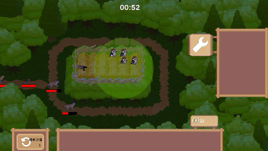

밤의 디펜스에서는 디펜스 포인트로 상점에서 유닛을 소환하거나 깃털을 사고, 포인트 1을 내고 상점 후보를 다시 뽑을(리롤) 수 있습니다. 전투가 진행되는 중에도 구매·장착·배치를 바로 바꿀 수 있습니다.

```csharp
foreach (Item defenceItem in allItems)
{
    if (defenceItem.Tier != ItemTier.Unit && !UnlockManager.Instance.IsUnlocked(defenceItem))
        continue;
    // ... 등급별 후보 목록에 추가
}
```

유닛 소환은 언제나 후보에 들어가고, 깃털은 **탐험에서 해금한 것만** 들어갑니다. 등급 확률을 굴려 후보 중 하나를 고릅니다.

- 상점을 둔 이유: *운빨존많겜*처럼 완전히 무작위로 소환하면 운의 비중이 너무 컸습니다. 그래서 *전략적 팀 전투*처럼 어느 정도의 운에 재화를 쓰는 판단을 더한 상점을 붙였습니다. 또 탐험 결과만으로 디펜스 전략이 정해지면, 탐험이 "발견"이 아니라 특정 깃털을 모으는 반복 작업으로 바뀝니다. 그래서 디펜스 안에서도 전략을 넓힐 수단으로 상점을 두었습니다.
- 해금한 깃털만 나오게 한 이유: 아직 발견하지 않은 깃털이 상점에 나오면, 탐험에서 그 깃털을 발견하는 가치가 사라지기 때문입니다.

---

## 5. 깃털 하나로 바뀌는 유닛

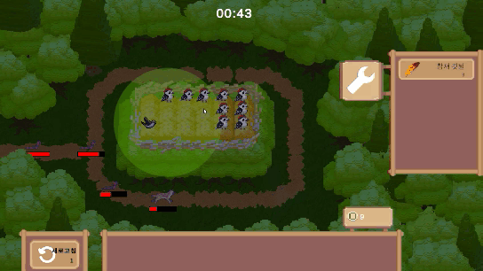

디펜스에서 깃털을 유닛에 끌어다 놓으면, 유닛이 그 깃털의 새로 바뀝니다. 겉모습과 애니메이션뿐 아니라 공격 방식·사거리·공격력까지 함께 바뀝니다. 유닛 하나에는 깃털을 하나만 달 수 있고, 렌치를 끌어다 놓으면 깃털이 빠집니다.

### 5.1 유닛을 종류마다 나눌 것인가

| | 대안 A. 유닛 종류마다 클래스와 프리팹 | 대안 B. 유닛은 하나, 깃털 데이터로 바꿔 끼움 |
|---|---|---|
| 장점 | 유닛마다 따로 고칠 수 있음 | 클래스·프리팹이 늘지 않음. 깃털만 바꾸면 유닛이 바뀜 |
| 단점 | 행동 구조가 같은데도 클래스·프리팹이 깃털 수만큼 늘어남 | 유닛마다 완전히 다른 행동 구조가 필요해지면 맞지 않음 |

대안 B를 골랐습니다. 모든 유닛은 "사거리 안의 적에게 행동한다"는 같은 구조이고, 다른 것은 겉모습과 행동 방식뿐이었습니다. 그래서 깃털(`Item`)에 겉모습·애니메이션·행동 방식·수치를 담아 두고, 장착할 때 통째로 바꿔 끼우는 편이 낫다고 판단했습니다.

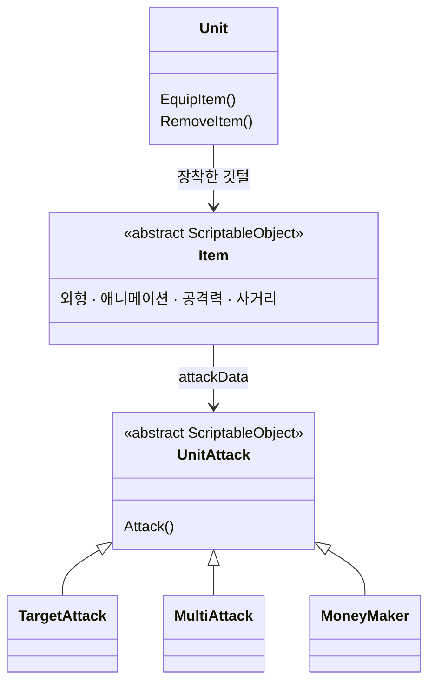

행동 방식은 `UnitAttack`으로 따로 떼어, 단일 공격(`TargetAttack`)·범위 공격(`MultiAttack`)·재화 생산(`MoneyMaker`) 중 하나를 깃털이 가리키게 했습니다.

```csharp
public void EquipItem(Item item)
{
    if (item.Tier == ItemTier.Infinite)
    {
        RemoveItem();
        return;
    }
    // ...
    attackBehaviour = item.attackData;
    sprite.sprite = item.BirdSprite;
    animator.runtimeAnimatorController = item.overrideController;
    detectedObject.localScale = item.detectedArea;
    damage = item.damage;
    mobType = item.Key;
    // ...
}
```

장착은 깃털 데이터 하나로 행동 방식·외형·애니메이션·사거리·공격력을 한 번에 바꿉니다. 렌치(`Infinite` 등급)는 따로 입력을 만들지 않고, 같은 장착 경로를 그대로 써서 해제로 처리했습니다.

### 5.2 공격하지 않는 기본 유닛

대부분의 디펜스 게임에서 깃털이 없는 기본 유닛은 아무것도 하지 않습니다. 이 게임에서는 기본 유닛이 공격 대신 디펜스 포인트를 만듭니다.

```csharp
[CreateAssetMenu(menuName = "Attack/MoneyMaker")]
public class MoneyMaker: UnitAttack
{
    public override void Attack(Unit unit, List<MobState> monsters)
    {
        GameFlowManager.Instance.defencePoint++;
        ContentController.Instance.Refresh();
    }
}
```

디펜스는 탐험을 넓혀 주는 쪽이므로, 디펜스가 어려워서 탐험이 막히는 일이 없도록 난이도를 낮게 잡았습니다. 몬스터는 특별한 기믹 없이 판을 돌고, 유닛은 오토배틀러처럼 알아서 싸웁니다. 기본 유닛이 포인트를 만드는 것도 같은 방향이라, 기본 유닛을 많이 소환할수록 게임이 쉬워집니다. 행동 방식을 `UnitAttack`으로 떼어 두었기 때문에, "공격하지 않는 행동"도 다른 공격과 같은 틀에 그대로 넣을 수 있었습니다.

### 5.3 깃털 데이터를 얼마나 나눌 것인가

깃털 정보는 크게 두 갈래입니다. 탐험에서는 "어느 새가 떨어뜨리는가" 정도로 단순하고, 디펜스에서는 "무엇으로 변신하는가(행동 방식·데미지)"와 "얼마인가(상점)"로 뚜렷하게 나뉩니다.

처음에는 상속으로 세 단계로 나눴습니다. 디펜스 쪽을 나누는 것은 맞다고 봤고, "나중에 문제가 될 바에는 미리 나누자"는 생각으로 탐험 쪽까지 나눴습니다.

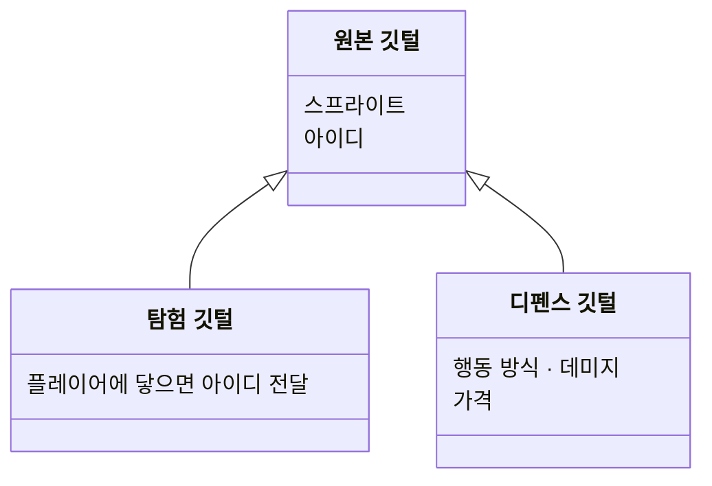

문제는 디펜스가 끝난 뒤에 드러났습니다.

| 단계 | 내용 |
|---|---|
| 필요 | 디펜스가 끝나면 쓰지 않은 깃털을 인벤토리로 돌려줘야 함 |
| 걸림돌 | 아이디가 위 단계(원본 깃털)에 있어서, 디펜스 깃털의 값만으로는 돌려줄 수 없음 |
| 대응 | 이 깃털이 어느 원본 깃털과 짝인지 판단하는 스크립트가 새로 필요함 |
| 부작용 | 가독성을 높이려고 나눴는데, 스크립트가 늘면서 오히려 가독성이 떨어짐 |
| 판단 | 처음 기대한 장점(가독성)과 멀어졌으므로 합치는 편이 나음 |

짝을 맞추는 스크립트를 실제로 쓰기 전에 방향을 바꿔, 깃털을 하나의 아이템(`Item`)으로 다시 합쳤습니다. 지금은 아이디·이름·아이콘·스프라이트·등급과 디펜스 정보(행동 방식·데미지·사거리·애니메이션), 가격이 모두 한 곳에 있습니다. 원본과 디펜스 깃털에 공통 아이디를 두는 방법은 그때는 떠올리지 못했습니다. 다만 돌아보면 맨 위 단계가 아이디를 두 개 쓰게 되어 역시 가독성이 떨어지므로, 알았더라도 고르지 않았을 것입니다.

나누는 정도는 **무엇을 위해 나누는지(여기서는 가독성)**를 기준으로 정해야 한다는 것을 배웠습니다. 미리 나누는 것이 늘 좋은 것은 아니고, 데이터가 실제로 어떻게 흐르는지(탐험 → 인벤토리 → 디펜스 → 인벤토리로 복귀)를 먼저 보고 정해야 합니다.

---

## 6. 날면서 쪼는 공격

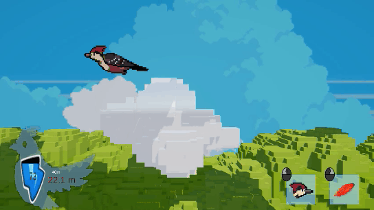

플레이어 새는 날갯짓을 멈추지 않은 채 머리만 앞으로 내밀어 쪼아 공격합니다.

### 6.1 머리와 몸통을 나눌 것인가

플레이어는 눈에 먼저 보이고 바로 만들 수 있는 이동부터 완성한 뒤, 그 위에 공격을 붙이는 순서로 만들었습니다. 이동에는 머리와 몸통이 한 장에 그려진 날갯짓 스프라이트(약 10프레임)를 쓰고 있었습니다.

공격을 붙이려고 보니 문제가 있었습니다. 공격으로 바뀔 때는 히트박스(공격이 닿았는지 판정하는 영역)와 함께 공격 애니메이션이 나오는 것이 자연스러운데, 머리와 날갯짓이 한 장에 담긴 스프라이트로는 날갯짓을 유지한 채 공격 애니메이션을 넣을 수 없었습니다. 새는 날면서 공격하므로, 날갯짓과 쪼기가 동시에 따로 움직여야 했습니다.

| | 대안 A. 날갯짓 타이밍마다 공격 이미지 | 대안 B. 공격할 때 머리를 옮긴 이미지로 교체 | 대안 C. 머리와 몸통을 분리 |
|---|---|---|---|
| 방법 | 날갯짓 10프레임마다 머리 위치별 공격 이미지를 그려 두고 타이밍을 맞춤 | 날갯짓은 그대로 두고, 공격할 때 머리를 최종 위치로 옮긴 이미지를 씀 | 몸통(날갯짓)과 머리(쪼기)를 따로 그려 동시에 재생 |
| 필요한 프레임 (예상) | 약 50 | 약 20 | 10 (몸통 5 + 머리 5) |
| 단점 | 프레임이 가장 많고, 날갯짓과 공격 타이밍을 하나하나 맞춰야 함 | 머리가 부자연스럽게 움직임 | 기존 이동 스프라이트에 맞춰 위치와 피벗(회전·기준점)을 다시 잡아야 함 |

대안 C를 골랐습니다. 위치와 피벗을 다시 잡는 수고가 들지만, 결과물이 자연스러운 쪽이 더 중요하다고 판단했습니다. 그때는 디펜스에서 쓸 가만히 있는 상태의 쪼기도 계획하고 있어서, 쪼는 머리를 따로 두는 편이 더 유리했습니다. 이후 기본 유닛이 공격 대신 디펜스 포인트를 만들도록 바뀌면서(5.2) 그 쪼기는 쓸 곳이 없어져 지웠습니다.

### 6.2 나눈 스프라이트 맞추기

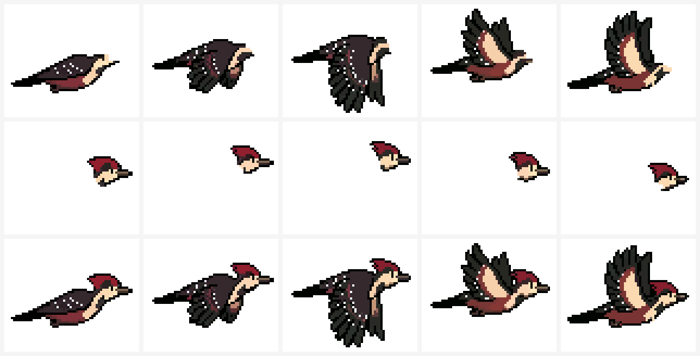

- **구조**: 몸통이 부모, 머리가 자식 오브젝트라 이동할 때는 함께 움직입니다. Animator는 몸통과 머리에 따로 있고, 앞뒤 순서는 SpriteRenderer의 Sorting Order로 맞췄습니다.
- **공격**: 트리거로 머리의 공격 애니메이션을 재생합니다. 애니메이션이 머리에 단 작은 콜라이더(히트박스)를 켜면서 머리를 앞으로 조금 옮깁니다. 히트박스가 머리에 붙어 있으므로 판정도 쪼는 머리를 따라 움직입니다.
- **스프라이트 나누기**: Affinity로 기존 날갯짓 스프라이트를 머리와 몸통으로 나누고, 겹쳐 보이는 불필요한 프레임을 줄여 몸통 5프레임과 머리 5프레임을 새로 만들었습니다.
- **목 이음새**: 머리가 앞으로 나간 때를 기준으로 몸통의 목 부분을 먼저 늘려 두고, 머리가 돌아왔을 때 튀어나오는 부분을 다시 다듬었습니다. 그래서 공격하는 동안에도 목에 빈틈이 생기지 않습니다.

그 대가로, 이미 이동에 쓰던 한 장짜리 스프라이트에 맞춰 나눈 스프라이트의 위치를 다시 맞춰야 했고, 머리가 자연스럽게 움직이도록 머리 스프라이트의 부분별 피벗을 조정해야 했습니다.

결과적으로 날갯짓이 끊기지 않은 채 머리만 앞으로 쪼는 공격을 만들었습니다. 스프라이트는 몸통 5 + 머리 5 = 10프레임으로, 대안 A(약 50)와 대안 B(약 20)를 예상했던 것보다 적습니다.

---

## 7. 그 밖의 기능

### 7.1 체력·조준·몬스터 스킬

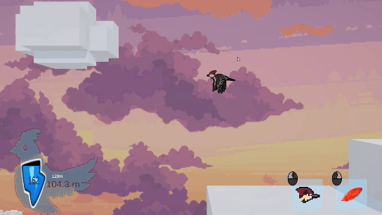

| 기능 | 플레이에서 보이는 것 | 이렇게 정한 이유 |
|---|---|---|
| 체력 = 산소 | 탐험 중 체력이 시간에 따라 줄어듦. 기본 초당 1/3, 달리는 중 1, 한계 고도를 넘으면 2. 한계 고도는 허브 강화로 늘어남 | 탐험에는 위험이 따라야 한다고 보고, 플레이어를 계속 재촉하는 장치로 원작의 산소를 가져옴. 시간제한만 두면 운 좋게 높은 곳의 새를 잡는 경우가 생겨 고도에 따라 구간을 나누고, 사냥을 어렵게 하려고 달릴 때도 더 줄게 함 |
| 조준하면 멈춤 | 우클릭으로 조준하는 동안 이동이 멈추고, 마우스 쪽으로 카메라가 옮겨 가 주변을 볼 수 있음 | 움직이면서 멀리 볼 수 있으면 손해 없이 늘 쓰는 기능이 됨. "멈춰야 볼 수 있다"는 비용을 붙여, 전투처럼 목적이 있을 때는 주변을 살피는 정도로만 쓰고 목적 없이 탐험할 때만 주변을 탐색하는 수단이 되게 함 |
| 몬스터 스킬 | 공격 상태의 몬스터는 쓸 수 있는 스킬이 있으면 쓰고, 없으면 추격함. 지금은 까마귀의 돌진(3초 모으기 → 직선 돌진 → 쿨타임 8초) 하나 | 스킬을 몬스터에 컴포넌트로 붙여, Unity 에디터에서 몬스터가 어떤 스킬을 쓰는지 바로 보이게 함 |

---

## 8. 회고

2주 동안 탐험과 디펜스 두 모드를 만들고, 깃털로 이어지는 순환(획득 → 확정·해금 → 장착 → 재화 → 강화)을 끝까지 완성했습니다.

### 8.1 바랐던 탐험의 경험은 전해졌나

목표는 플레이어가 위험을 감수하며 낯선 하늘로 나아가, 그곳의 새들 속에서 새로운 깃털을 발견하는 경험이었습니다. 하지만 기간과 리소스가 부족해 새는 4종류만 만들었습니다. 맵은 그보다 먼저 넓게 짜 두었기 때문에, 넓은 하늘에 비해 발견할 거리가 적어 탐험의 경험은 다소 부족했습니다.

대신 새를 더하기 쉬운 구조는 갖춰 두었습니다. 새의 정보는 깃털 데이터 하나에 모여 있고(5.1, 5.3), 몬스터 스킬은 컴포넌트로 붙입니다(7.1). 그래서 리소스만 더해지면 새의 종류를 쉽게 늘릴 수 있습니다.

### 8.2 길찾기는 어디서 무거웠나

개인 목표였던 "A\*가 실제 게임에서 얼마나 무거운가"는 몬스터 수와 그리드 구성을 바꿔 가며 수치로 확인했습니다(3.1, 3.2). 무거움은 알고리즘 자체보다, 이론에서는 다루지 않던 곳에서 왔습니다. 갈 수 없는 목표를 향한 탐색의 실패 비용, 여러 몬스터가 한꺼번에 하는 탐색, 반복해서 부를 때 남는 상태와 새로 만드는 메모리입니다(3.4). 알고리즘이 맞게 동작하는지만이 아니라, 여러 번 반복해서 불릴 때의 비용까지 봐야 한다는 것을 배웠습니다.

### 8.3 나눌 것인가, 합칠 것인가

이 프로젝트에서는 나누는 정도 때문에 반대 방향으로 두 번 비용을 치렀습니다. 깃털 데이터는 필요 이상으로 나눠서 비용이 생겼고(5.3), 매니저끼리의 연결은 기간 때문에 나누지 않아서 비용이 남았습니다.

다른 클래스의 인스턴스를 직접 부르는 곳이 33개 파일, 130곳입니다. 예를 들어 디펜스 포인트를 바꾸는 다섯 곳(처치, 생산, 구매 2종, 리롤)이 각자 UI 갱신 함수를 직접 부릅니다. 그래서 몬스터·유닛 같은 게임 로직이 UI를 알아야 하고, 값을 바꾸는 곳이 늘수록 갱신을 빠뜨릴 위험이 커집니다. 이벤트(옵저버) 방식은 알고 있었지만, 2주라는 기간과 그때의 실력으로는 원하는 대로 적용하기 어렵다고 보고 빠르게 작업할 수 있는 직접 참조를 골랐습니다. 개발하는 동안 실제로 갱신이 빠지는 문제는 생기지 않았습니다.

다음에는 포인트를 바꾸는 일을 한 곳(추가·사용 메서드)으로 모으고, 값이 바뀌면 이벤트를 내보내 UI는 그 이벤트만 구독하게 하겠습니다. 이벤트 방식은 수업에서 직접 구현해 봤지만, 아직 제 프로젝트에 적용하지는 못했습니다. 깃털 데이터와 매니저 연결, 두 경험에서 얻은 기준은 같습니다. **나누는 정도는 목적과 상황(기간, 실력, 데이터의 흐름)을 근거로 정해야 합니다.**
