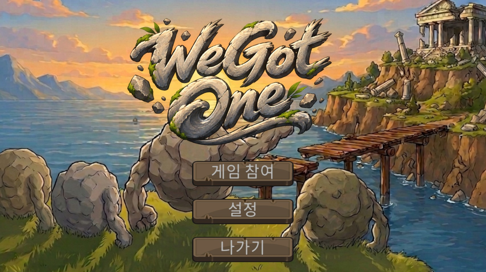
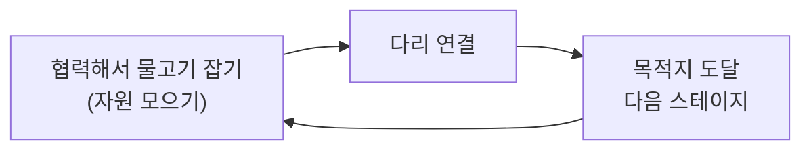
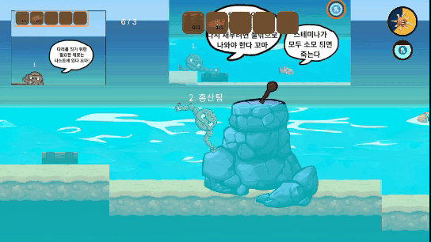
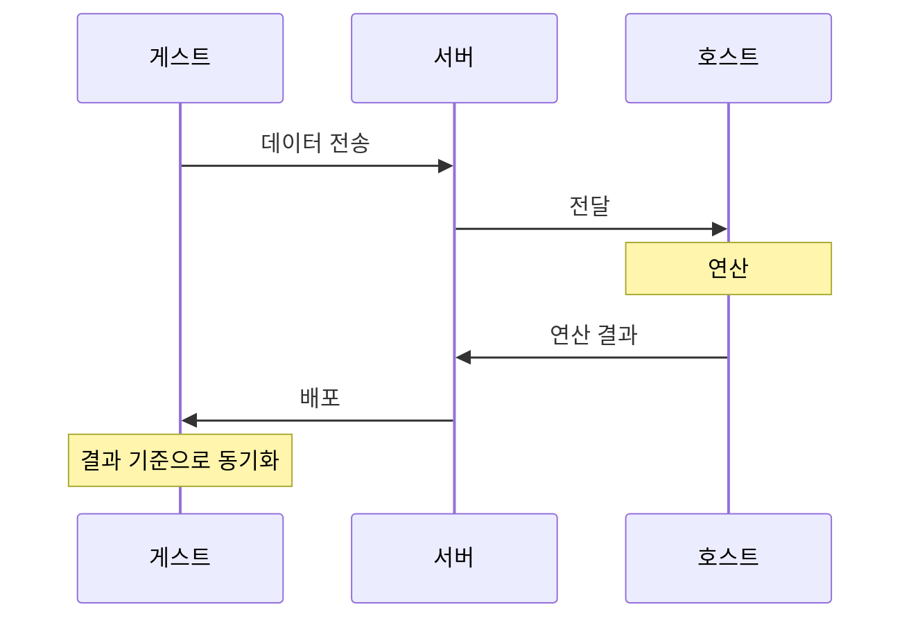
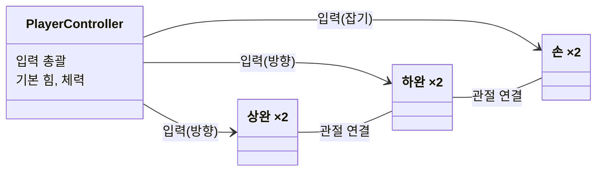
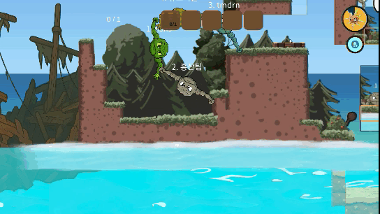
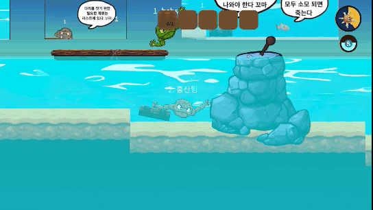
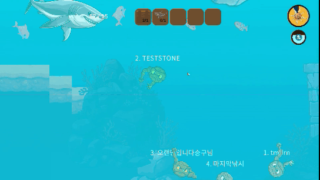

# WeGotOne 기술 문서



| 항목 | 내용 |
|---|---|
| 장르 | 물리 기반 협동 멀티플레이 |
| 개발 기간 | 3주 (팀 프로젝트) |
| 개발 인원 | 4인 |
| 담당 | 플레이어 핵심 조작 · 플레이어 조작의 서버 연결 |
| 개발 환경 | Unity 6000.3.15f1, WebSocket 서버, Git |
| 주요 기술 | AddForce 기반 래그돌 조작 · 사다리형 힘 전달 · 호스트 기반 동기화 · 잡기 대상 리스트 |
| 레퍼런스 | *Heave Ho* |
| 링크 | [GitHub](https://github.com/KooHoo-Dev/3rd-TeamProject-HS) · [시연 영상](https://youtu.be/mJrIw3XvcAM) |

---

## 1. 개요

### 1.1 무엇을 만들었나 (What)

*Heave Ho*의 "불편한 조작 속에서 서로 붙잡고 끌어올리는" 메커니즘을 가져와, **협력해서 자원을 모아야 다음 스테이지로 갈 수 있는 구조**로 재구성한 협동 멀티플레이 게임입니다.

**핵심 루프**



**레퍼런스와 다른 점**

팀원과 함께 *Heave Ho*를 플레이해 보니, 썸네일과 달리 각자 목표 지점에 도착하면 되는 퍼즐 형식이었고, 협동을 한 뒤에는 각자도생하는 싱글 느낌이 강했습니다.

| 레퍼런스 | 가져온 것 | 바꾼 것 |
|---|---|---|
| *Heave Ho* | 불편한 조작 속에서 서로 붙잡고 끌어올리는 협동 메커니즘 | 각자 목표 지점에 도착하는 퍼즐 형식 → 협력해서 자원(물고기)을 모으고, 다 모이면 다음 스테이지로 이동하는 구조. 시간 제한 추가. 좌우 키 이동 유지 |

**조작법**

| 입력 | 동작 |
|---|---|
| WASD / 방향키 | 팔 방향. 양팔에 동시에 들어갑니다. 잡은 손은 그 위치에 고정되고, 잡은 위치를 축으로 몸이 회전합니다 |
| 마우스 왼쪽 / 오른쪽 버튼 | 누르고 있는 동안 왼손 / 오른손으로 잡기 |
| F | 다리 건설 |



손으로 잡은 위치를 축으로 몸을 회전시키며 이동하는 장면입니다.

### 1.2 왜 만들었나 (Why)

이 게임의 목표는 **불편한 조작으로 협동을 강제하고, 그 마찰 속에서 나오는 재미**입니다. 불편한 조작과 강제된 협동 속에서 우스꽝스러운 모습으로 협동하는 것 자체가 재미가 되도록 했습니다.

레퍼런스인 *Heave Ho*를 팀원 모두 재미있게 플레이했고, 이 메커니즘을 그대로 가져가기로 했습니다. 누가 혼자 정한 방향은 아닙니다. 다만 *Heave Ho*에서 느낀 "협동 뒤에는 각자도생"하는 부분을 바꿔, 협력이 메인이 되도록 재구성했습니다.

### 1.3 팀 구성과 내 역할

팀 결성 직후라 팀장이 팀원 간 친밀도나 실력을 아직 판단할 수 없어서, 큰 파트 단위로 업무를 나눴습니다. 이 게임은 플레이어 조작이 전부라서 조작을 하나의 파트로 묶었습니다.

| 파트 | 담당 |
|---|---|
| 서버 | 팀원 A (팀장) |
| **플레이어 핵심 조작** | **본인** |
| 인벤토리·다리 건설 등 게임 플로우 | 팀원 B |
| 물고기 및 레벨 디자인 | 팀원 C |

플레이어 파트는 핵심 시스템이면서 물리적인 움직임을 다루는 파트라 다들 감을 잡지 못하고 망설였습니다. 저는 Unity를 사용해 본 경험이 있었고, 레퍼런스가 정해져 있어 "어떤 움직임이 나와야 하는가"가 명확했습니다. Joint와 AddTorque로 구현하면 되겠다는 생각이 먼저 들었고, 금방 끝날 것 같다는 자신감에 이 파트를 맡았습니다.

> **내 역할 한 줄: 게임의 핵심 시스템 구축**

**담당 범위**

| 구분 | 내용 |
|---|---|
| 메인 | 플레이어의 기본 조작과 역할 |
| 메인 | 플레이어 조작을 서버로 연결: 호스트 기반 구조 제안, 서버 프로토콜과 이를 받아서 처리하는 부분 |
| 서브 | 물고기 종류 확장 일부(먹이사슬 판정), 일부 밤낮 전환, 메인화면 UI, 오디오 매니저 추가, 플레이어 색상 선택 |

**직접 작성하지 않은 것**

- 서버의 기본 흐름은 제공받았습니다. WebSocket으로 데이터를 받아 파싱해 분리하고, 필요한 데이터로 연산한 뒤 다시 배포하는 형식입니다. 여기서부터의 수정은 팀이 했습니다.
- 스냅샷 보간과 원격 플레이어 떨림의 원인은 수업에서 배운 내용입니다.
- 오디오 매니저는 개인 공부 중 유튜브 '골드메탈' 강좌를 보고 따라 만든 코드입니다. 익숙해서 그대로 가져왔습니다.
- 컬러피커는 인터넷 코드에서 필요한 부분만 추출해 Unity 버전에 맞게 약간 수정했습니다.

### 1.4 이 문서에서 다루는 내용

- 2장: 호스트 기반 네트워크 흐름, 7개 파츠 래그돌과 클래스 역할
- 3장: 사다리형 힘 전달, 부위별 동기화, 잡기 대상 리스트, 스태미나와 심장박동, 물고기 먹이사슬 판정의 동작
- 4장: 토크 대신 힘을 고른 판단, 잡은 대상에 따른 힘 구조의 변화, 호스트 기반 선택, 협업 이슈
- 5장: 동기화 트러블슈팅, 힘 전파의 아쉬운 점과 개선 계획

---

## 2. 시스템 구조

### 2.1 네트워크 흐름

기준이 되는 클라이언트 하나(호스트)가 연산하고, 그 결과를 각 클라이언트에 뿌려 동기화합니다. 이 구조를 고른 이유는 4.3에 적었습니다.



이 그림에서 볼 것은 **연산이 서버가 아니라 호스트에서 일어난다**는 점입니다.

### 2.2 플레이어 구조: 7개 파츠 래그돌

플레이어의 움직임을 자연스럽게 하려면 몸통, 팔, 손으로 이루어진 래그돌 형태의 캐릭터가 필요했습니다. 레퍼런스 게임을 해 보며, 팔이 하나로만 이루어져 있으면 플레이어가 원하는 방향이나 위치로 옮기기에 부적절하다고 느꼈습니다. 그래서 팔을 상완과 하완 둘로 나눠, **몸통 1 + 상완 2 + 하완 2 + 손 2 = 7개 파츠**로 구성했습니다.



이 그림에서 볼 것은 **입력은 `PlayerController` 한 곳으로 들어오고, 각 파츠는 그 입력을 내려받아 자기 역할만 한다**는 점입니다.

### 2.3 핵심 클래스 역할 분담

| 클래스 | 역할 |
|---|---|
| `PlayerController` | 플레이어의 기본 힘, 체력 같은 정보를 가지는 1차 클래스. 플레이어의 입력을 받아 팔과 손에 나눠 줌. 몸 전체의 힘 단계 결정(3.1). 플레이어임을 알려 주는 마커 역할도 겸함 |
| 팔 (상완·하완) | 입력에 따라 힘의 방향을 바꿔, 자신과 이어진 손의 위치를 옮김. 이동 방향을 담당 |
| 손 | 물체를 잡는 역할. 손 범위에 들어온 잡기 대상을 리스트로 관리(3.3) |

**이렇게 나눈 이유**

- 이 게임은 Unity 물리를 쓰고, 힘으로 움직이며, 체력이 있습니다. 이런 기본 기능과 플레이어와 상호작용하는 기능(입력)을 `PlayerController` 하나로 분리했습니다.
- 팔이 입력에 따라 힘의 방향을 바꾸면 손이 움직이고, 손이 고정되면 힘이 다시 이동하면서 몸통까지 움직입니다. 즉 팔이 이동 방향을 정합니다. 그래서 **입력은 `PlayerController`가 담당하고, 그 자식인 팔이 입력을 내려받아 방향을 결정하는 것**이 옳다고 판단했습니다.
- 손의 잡기 입력도 같은 이유로 `PlayerController`가 총괄해 받습니다. 나머지 파츠는 움직임과 물체를 잡는 역할만 담당합니다.

---

## 3. 핵심 기능

### 3.1 사다리형 힘 전달



다른 플레이어를 잡아 날리는 동작입니다. 잡은 대상이 플레이어여도 힘이 전달되기 때문에 가능한 동작으로, 이 구조가 여러 플레이어를 거쳐 이어지면 사다리형 힘 전달이 됩니다.

```csharp
private void UpdateArmForce()
{
    if (leftBottomArm.UseForce || rightBottomArm.UseForce)
    {
        currentArmForce = highArmForce;
    }
    else
    {
        currentArmForce = defaultArmForce;

        PlayerController leftTarget = GetTargetPlayer(leftBottomArm.GrabbedTarget);
        if (leftTarget != null && leftTarget.CurrentArmForce == leftTarget.HighArmForce)
            currentArmForce = highArmForce;

        if (currentArmForce != highArmForce)
        {
            PlayerController rightTarget = GetTargetPlayer(rightBottomArm.GrabbedTarget);
            if (rightTarget != null && rightTarget.CurrentArmForce == rightTarget.HighArmForce)
                currentArmForce = highArmForce;
        }
    }

    leftUpperArm.SetCurrentForce(currentArmForce);
    rightUpperArm.SetCurrentForce(currentArmForce);
    leftBottomArm.SetCurrentForce(currentArmForce);
    rightBottomArm.SetCurrentForce(currentArmForce);
}
```

- 다른 플레이어가 무언가를 잡고 있을 때, 그 물체를 잡고 온전히 옮길 수 있는 상태를 만들려고 생각한 구조입니다. 이 구조가 나오기까지의 과정은 4.2에 적었습니다.
- 먼저 왼팔이든 오른팔이든 힘을 쓰고 있는지(고정된 대상을 잡았는지) 확인합니다. 힘을 쓰고 있다면 강한 힘을 씁니다.
- 그렇지 않다면 내가 잡은 플레이어를 확인해, 그 플레이어가 강한 힘을 쓰고 있으면 저도 강한 힘을 씁니다. 이렇게 사용 중인 힘이 잡고 있는 플레이어를 따라 전달됩니다.
- 정해진 힘은 상완·하완 네 곳에 같은 값으로 적용됩니다.
- 이 구조에서 남은 문제는 5.3에 적었습니다.

### 3.2 부위별 동기화

```csharp
// 서버 Protocol.cs — 플레이어 한 명의 상태 (일부)
public class PlayerState
{
    public string Id { get; set; }
    public float CurrentHunger { get; set; }

    public PartState Body { get; set; }
    public PartState LeftArmTop { get; set; }
    public PartState RightArmTop { get; set; }
    public PartState LeftArmBottom { get; set; }
    public PartState RightArmBottom { get; set; }
    public bool IsLeftGrab { get; set; }
    public bool IsRightGrab { get; set; }
}
```

- 몸통만이 아니라 상완·하완까지 부위별 상태와 좌/우 잡기 상태를 함께 보냅니다. 처음에는 Body만 보냈다가 바꾼 구조입니다 (5.2).
- 플레이어 조작에 필요한 프로토콜은 서버 코드까지 직접 수정했습니다 (4.5).

### 3.3 잡기 대상 리스트



① 플레이어가 나무 판자를 잡고 옮기는 중 → ② 판자를 잡은 손이 다른 플레이어와 부딪힘 → ③ 부딪혔는데도 판자를 놓치거나 그 플레이어를 잡지 않고 정상적으로 동작합니다.

```csharp
private void OnTriggerEnter2D(Collider2D other)
{
    // (필터 조건 생략)
    targets.Add(other);
    currentTarget = targets[0];
    ...
}

private void OnTriggerExit2D(Collider2D other)
{
    if (targets.Contains(other))
    {
        targets.Remove(other);
        currentTarget = targets.Count != 0 ? targets[0] : null;
        ...
    }
}
```

- 잡을 대상을 하나만 확정하면 모순이 생깁니다. 나무 판자를 잡고 옮기는 도중 손이 다른 플레이어와 부딪히면, 잡을 대상이 그 플레이어로 바뀌거나, 플레이어가 빠져나간 뒤 대상이 비어 판자를 놓칠 수 있습니다.
- 그래서 잡을 수 있는 대상 전체를 리스트로 관리하고, 이것으로 우선순위를 판별합니다. 먼저 들어온 대상(판자)이 리스트 앞에 있으므로, 다른 플레이어가 들어왔다 나가도 판자를 계속 잡을 대상으로 유지합니다.
- 큐나 스택은 중간에 있는 대상을 제거하기가 번거롭지만, 리스트는 중간 제거가 쉽습니다. 게임 중에는 벽돌 2개, 바닥, 물고기처럼 3개 이상의 다양한 개체와 동시에 상호작용하는 상황이 생기는데, 이때 큐나 스택으로는 처리하기 번거로워 리스트를 택했습니다.

### 3.4 스태미나와 심장박동

- **매달리기에는 추가 소모가 없습니다.** 지형지물에 매달리는 것은 플레이어끼리 서로 끌어올려 주거나 가동 범위를 늘리기 위한 선택지입니다. 협동의 재미를 위해 꼭 필요한 행동이라, 매달려 있는 것만으로는 스태미나가 추가로 줄지 않게 했습니다.
- **심장박동으로 위급함을 알립니다.** 물리를 기반으로 동작하다 보니 실제 게임에서는 급박한 상황이 자주 나옵니다. 게이지를 보지 않고도 이를 알려 줄 무언가가 필요하다고 판단해, 심장박동 주기를 빠르게 해 플레이어에게 급박함을 알리도록 했습니다.

### 3.5 물고기 먹이사슬 판정

- 원래 물고기는 동작이 많지 않았습니다. 물속을 돌아다니다 플레이어에게 잡히는 "물체"에 가까웠습니다. 그런데 플레이어의 협동을 중심에 두려면 물고기가 더 다채로워야 한다는 의견이 나와 갑작스럽게 확장했습니다.
- 모든 물고기는 먹이사슬의 개체입니다. 다만 문어나 갯가재처럼 플레이어를 방해하기만 하고 물고기를 잡아먹지 않는 개체와, 상어처럼 물고기를 잡아먹어 먹이사슬에 직접 영향을 주는 개체가 따로 있습니다.
- 먹이사슬은 배고픔이 일정량 이하가 되었을 때 먹이를 쫓아가 먹는 기능입니다. 물고기별 크기를 지정해 두고, 물고기 본체(상위 계층)에서 서로의 크기를 비교해 먹을 수 있는지 판단합니다. 처음에는 배고픔에 따라 먹이를 쫓는 기능이 상어처럼 플레이어에게 돌진하는 패턴과 상충해, 돌진과 먹이 추적 사이를 무한히 오가는 문제가 있었습니다. 먹이 판정을 상위 계층으로 옮기고 FSM을 조절해 해결했습니다.



상어는 배고프면 물고기를 먹으러 다니지만, 플레이어에게 돌진하는 패턴 중에는 먹이를 쫓지 않습니다.

---

## 4. 고민과 선택

### 4.1 팔을 무엇으로 회전시킬 것인가: 토크 vs 힘

처음에는 Joint로 고정점을 정하고 `AddTorque`로 회전시키면 기대한 느낌을 줄 수 있다고 생각했습니다. 단계마다 감수한 것보다, 토크와 힘 중 무엇을 쓸지에서 감수할 점을 더 눈여겨봤습니다.

| | 대안 A. 토크 (`AddTorque`) | 대안 B. 힘 (`AddForce`) |
|---|---|---|
| 방식 | Joint로 고정점을 정하고 회전값을 직접 줌 | Joint 고정은 그대로, 힘에 따른 이동으로 회전 |
| 장점 | 물리적으로 더 정확한 방향 | Joint와 힘에 의해 회전축이 자연스럽게 생겨 축을 지정할 필요가 없음. 직관적이고 빠르게 구현 가능 |
| 단점 | 힘의 방향에 따라 손목·어깨 두 가상 회전축을 직접 지정해야 해 직관적이지 않음. 완성까지 얼마나 걸릴지 예측하기 어려움 | 직관적이라는 이유로 개발하다 보니 예기치 못한 오류가 생각보다 많았음 (5.3) |

**토크가 직관적이지 않았던 이유**

토크로 회전시키면, 힘이 전달되는 방향에 따라 **무엇을 기준으로 회전할지 제가 직접 축을 지정해 줘야** 했습니다.
- 힘이 **손 → 팔 → 몸통**으로 전달될 때는 손과 하완을 잇는 **손목**을 기준으로 회전해야 합니다.
- 힘의 방향이 **몸통 → 팔 → 손**으로 역전되면, 손이 아니라 플레이어의 **어깨**를 기준으로 회전해야 합니다.
- 손목과 어깨는 실제로 존재하는 오브젝트가 아니라 회전축을 나타내는 가상의 축입니다. 결과적으로 상황에 따라 **2개의 가상 회전축**을 지정해 줘야 했고, 지정해야 하는 축이 늘어나는 이 과정이 직관적이지 않았습니다.

반면 힘을 쓰면 Joint와 힘에 의해 회전축이 자연스럽게 생기기 때문에, 축을 따로 지정해 줄 필요가 없습니다.

당시 첫 커밋 주석에도 이 판단을 남겼습니다. "토크로 하니 회전축을 두 개 구현해야 하는 문제가 생김. 힘 기반이 더 편하고 깔끔해서 AddForce 사용."

**최종 선택: 대안 B**

- 이유 1: 전체 프로젝트 기간을 2주로 정해 놓고 시작했습니다.
- 이유 2: 토크는 생각만큼 직관적인 힘이 아니었습니다.
- 이유 3: 핵심 기능이라 빨리 구현해서 팀원들과 공유해야 했습니다. 직관적이지 않은 토크로 늘어지기보다 빠르게 구현 가능한 직관적인 힘 구조를 택하자는 개인적인 압박이 있었습니다.
- **감수한 단점**: 물리적으로 더 정확한 토크를 포기했습니다. 개인 프로젝트라서 완성하지 못해도 혼자 감당하면 되는 상황이었거나, 시간이 넉넉했다면 토크 구조를 선택했을 것입니다.

### 4.2 잡은 대상에 따라 힘을 어떻게 나눌 것인가

**요구사항**
- 땅을 잡았을 때: 플레이어를 옮길 수 있는 충분한 힘
- 물체를 잡았을 때: 물체를 들 수 있는 정도의 힘만. 팀이 앞서 정한 "물체의 무게에 따른 협동의 강제성" 때문입니다.

| 단계 | 방식 | 결과 |
|---|---|---|
| 1 | `AddTorque`로 회전 | 힘의 방향에 따라 가상 회전축을 2개 지정해야 해 직관적이지 않음 (4.1) |
| 2 | `AddForce` 상수 힘 | 기대한 움직임은 구현됨. 단순 상수값이라 물체를 잡은 채 공중을 날아다닐 수 있음 |
| 3 | 잡은 대상별 힘 계산 | 싱글 플레이 기준으로는 정상 |
| 4 | 사다리형 힘 전달 (3.1) | 멀티플레이에서도 이동이 가능하도록 설계 |

**3단계: 잡은 대상별 힘 계산**

플레이어가 과도한 힘을 받아 공중을 날아다니거나, 반대로 스스로 움직이지 못하는 상황을 막아야 했습니다. 그래서 물체를 잡았을 때 현재 힘을 얼마나 쓸지 정하는 계산을 넣었고, 여기서 정해진 힘값을 래그돌의 상완과 하완 모두에 적용했습니다.
1. 아무것도 잡고 있지 않으면 기본 힘을 씁니다.
2. 잡고 있다면 그 대상이 움직일 수 있는지 판단합니다. 지형처럼 고정된 대상이면 최대 힘을 씁니다.
3. 움직일 수 있는 물체라면 질량에 힘 배율을 곱해 더하되, 최대 힘을 넘지 않게 합니다.

**문제를 알아챈 흐름**

1. 3단계로 문제가 해결된 줄 알았지만, 이는 싱글 플레이를 기준으로 했을 때의 정상 동작이었습니다.
2. 멀티플레이가 도입되면서, 한 플레이어가 Block을 잡고 있을 때 다른 플레이어가 같은 Block을 잡는 상황이 생겼습니다.
3. 이때 Block의 무게는 이미 **Player + Block**입니다.
4. 그래서 바닥을 잡아도 움직일 수 없다는 결론에 다다랐습니다.

**최종 선택: 사다리형 힘 전달**
바닥을 잡았을 때 최대 힘을 주고, 이 최대 힘을 물체를 타고 각 플레이어가 적용받게 했습니다 (3.1). 3단계의 대상별 힘 계산은 이 구조로 대체했습니다.

### 4.3 연산을 어디서 할 것인가: 서버 연산 vs 호스트 기반

프로젝트 시작 전 가장 큰 주제가 "멀티 게임"이었고, 이를 위해 서버 코드를 먼저 제공받았습니다. 그 뒤 서버를 담당한 팀장과 이야기하며 제가 제시한 구조입니다.

| | 대안 A. 서버 연산 | 대안 B. 호스트 기반 |
|---|---|---|
| 연산 위치 | 서버 | 기준이 되는 클라이언트(호스트) |
| 이 게임에서의 문제 | 서버에 Unity가 없어, 물리 연산을 위해 값을 서버로 올리고 다시 내려받아야 함 | 없음. Unity 물리를 클라이언트에서 그대로 씀 |
| 동기화 | — | 호스트 하나가 기준이 되어 모든 클라이언트를 맞춤 |

**최종 선택: 대안 B**

- 이 게임은 Unity 물리를 사용하므로 연산 대부분이 클라이언트에서 끝납니다.
- 서버에는 Unity가 없으므로, 연산을 위해 값을 서버로 올리고 다시 내려받는 것은 잘못된 구조라고 판단했습니다. 그래서 서버 연산 방식은 처음부터 고려하지 않았습니다.
- 하지만 게임 특성상 클라이언트 간 정확한 동기화는 필수였고, 이를 통합해 줄 클라이언트 하나가 필요했습니다.

### 4.4 협업 이슈: 손과 물고기 사이의 API를 합의하지 않았다

**상황**
플레이어 움직임은 제가, 물고기는 팀원 C가 맡았습니다. 물체를 잡는 책임은 플레이어에게 있었으므로, 물고기가 잡혔는지 확인하려면 플레이어 코드에 접근해야 했습니다. 그런데 시작할 때 이런 **API를 먼저 확정하지 않았습니다.** 저는 잡기 상태에 대한 가능성만 열어 두고 내용은 아직 작성하지 않은 상태였고, 팀원 C는 그 부분이 필요한 상황이었습니다.

팀원 C는 저에게 먼저 확인하지 않고 플레이어 코드를 직접 수정해서 사용했습니다. 저는 다음 날 학원에서 작업하다 이를 확인했습니다. 물고기 상태가 손의 내용을 알아야 하는 구조였고, 이 점이 이상하다고 봤습니다.

**대응**
1. 먼저 팀원 C에게 어떤 의도로 작성했는지 물었습니다. "잡기 위해 필요한 부분"이라는 답을 들었습니다.
2. 하나씩 보면서 필요 없는 부분을 짚어 수정했습니다. 결과적으로 팀원 C가 수정한 부분은 사라지고, 제가 내용을 조금 변경했습니다.
3. 이 수정은 학원에서 팀원 C의 계정으로 바로 커밋했습니다. 커밋 메시지에 그 내용이 남아 있습니다. "성건님과 Controller V2 버전 리팩토링 / FishState들의 PlayerHand 의존성을 버리고, 잡기 여부로만 판정하는 것으로 변경"

**배운 점**
이 일은 팀원 C의 문제가 아니었습니다. 팀원 C가 플레이어의 잡기·놓기가 필요했던 것은 정확했고, 저도 필요하다고 생각해서 열어 두는 구조로 짜 두었습니다. 문제는 **"플레이어와 물고기 모두 이것을 사용해서 잡기 여부를 판별한다"는 하나의 API 합의점이 없었다는 것**입니다. 그래서 서로 조금씩 다른 구조가 나왔습니다. 시작할 때 이런 API적인 부분을 합의하는 것이 필요했습니다. 이 프로젝트에서 가장 와닿은 부분입니다.

### 4.5 간단한 서버 프로토콜은 직접 수정

간단한 프로토콜은 서버 코드까지 제가 직접 작업했습니다. 제가 짠 코드라 어떤 프로토콜이 오가야 하는지 명확히 알고 있었고, 당시 서버 담당이 팀장이라 문서 작업도 밀려 있었기 때문입니다.

---

## 5. 결과 및 배운 점

### 5.1 결과

- 팀원들과의 피드백은 전체적으로 긍정적이었습니다. 레벨 디자인이 어렵다는 것 외에는 큰 문제가 없었습니다.
- 제 평가는 **조금 불만족**입니다 (5.3).

### 5.2 트러블슈팅: 클라이언트마다 손 위치가 다름

| 항목 | 내용 |
|---|---|
| 문제 | 손 위치가 가장 중요한 게임인데, 클라이언트마다 손 위치가 맞지 않음 |
| 원인 | 처음에는 Body만 서버에 보내고, 호스트가 Body를 기준으로 연산해 뿌려 주면 위치만 동기화하면 된다고 생각함 |
| 해결 | 부위 전체(몸통, 좌/우 상완·하완)의 상태와 좌/우 잡기 상태를 모두 보내도록 변경 (3.2). 다른 방법은 고려하지 않음 |
| 결과 | 클라이언트 간 위치가 맞음 |

### 5.3 아쉬운 점과 개선 계획: 힘 전파

**현상**: 서로 붙잡고 있으면 지형을 놓아도 강한 힘이 유지됩니다. 논리적으로는 맞지만 게임으로 보면 어색한 부분입니다. 토크에서 힘으로 전환하면서 어쩔 수 없이 생긴 논리적인 문제였습니다.

| 상황 | 개선 계획 |
|---|---|
| 시간이 넉넉하고 프로젝트 책임이 온전히 저에게 있다면 | **토크로 변경합니다.** 처음에는 직관적이지 않아 완성까지 얼마나 걸릴지 예측하기 어렵다는 이유로 힘 기반 회전을 적용했습니다. 그런데 직관적이라는 이유 하나로 개발하다 보니 예기치 못한 오류가 생각보다 많았습니다. |
| 시간이 넉넉하지 않고 지금 구조에서 변경이 크지 않아야 한다면 | **연결된 플레이어들을 하나의 묶음으로 보고, 전체에 하나의 큰 힘값을 분배합니다.** 현재 구조에서는 각 플레이어가 가질 수 있는 힘(물건을 잡았을 때, 고정된 벽이나 바닥을 잡았을 때, 아무것도 잡지 않았을 때)이 분명합니다. 그러니 개별로 계산하지 않고 연결된 전체를 하나로 보고 큰 힘 하나로 제어하는 것이 가장 빠를 것 같습니다. 구조로 작성해 보지 않아 정확한 결과는 모릅니다. |

### 5.4 알고 감수한 것

- **효과음 채널**: 일부러 채널을 넉넉하게 잡아, 실제 플레이 중 효과음이 버려지거나 신경 쓰이는 사운드 버그는 없었습니다.
- **문어 먹물**: 풀링을 쓸 만큼 사용량이 많지 않고 플레이어를 향하는 단순한 구조라, 가볍게 유지하려고 풀링 없이 두었습니다.

### 5.5 정리: 이 프로젝트에서 배운 것

- **구조 선택**: 직관적인 구조를 쫓기보다 **현재 상황에 더 적합한 구조를 찾아 적용하고, 그 구조가 핵심이라면 개발을 그 구조에 맞춰 조정하는 것**이 좋습니다. 직관적이어도, 조금 더 확실한 구조를 잡는 것이 유리합니다 (4.1, 5.3).
- **협업**: 파트 사이에서 쓰는 API는 시작할 때 먼저 합의해야 합니다. 같은 필요를 두고도 합의점이 없으면 서로 조금씩 다른 구조가 나옵니다 (4.4).
