# WeGotOne 프로젝트 문서

> 서로 붙잡고 끌어올리며 함께 물고기를 모아야 다음 스테이지로 갈 수 있는 물리 기반 협동 멀티플레이 게임

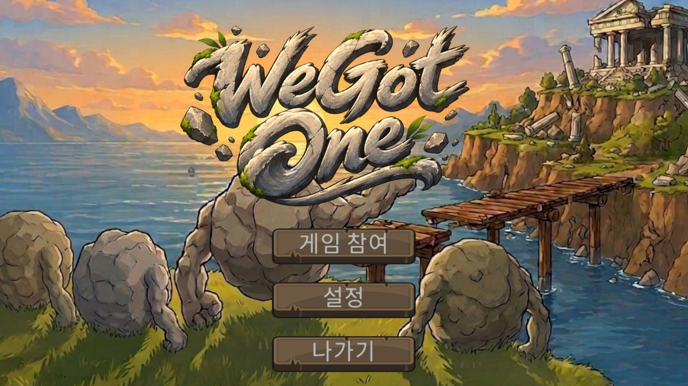

| 항목 | 내용 |
|---|---|
| 장르 | 물리 기반 협동 멀티플레이 |
| 개발 기간 | 2026.08.18 \~ 2026.09.08 (3주) |
| 개발 인원 | 4인 (팀 프로젝트) |
| 내 역할 | 플레이어 핵심 조작 · 플레이어 조작의 서버 연결 |
| 개발 환경 | Unity 6000.3.15f1, WebSocket 서버, Git |
| 주요 기술 | 래그돌 · `AddForce` · 사다리형 힘 전달 · 호스트 기반 동기화 · FSM |
| 링크 | [GitHub](https://github.com/KooHoo-Dev/3rd-TeamProject-HS) · [시연 영상](https://youtu.be/mJrIw3XvcAM) |

---

## 1. 개요

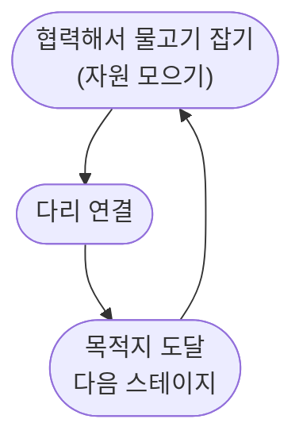

<small>한 스테이지는 이 고리를 한 바퀴 도는 것입니다. 물고기를 함께 모아야 다리를 놓을 수 있고, 다리를 건너야 다음 스테이지가 열립니다.</small>

**WeGotOne**은 여러 플레이어가 각자 팔과 손이 따로 움직이는 캐릭터를 조작해, 서로 붙잡고 끌어올리며 물고기를 모으는 협동 게임입니다.

손으로 벽이나 바닥, 다른 플레이어를 붙잡고 그 자리를 축으로 몸을 흔들어 나아갑니다. 산소(스태미나)가 줄어들기 때문에, 그 안에 물고기를 모아 다리를 놓아야 합니다.

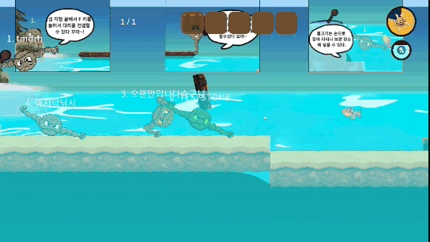

<small>위 고리의 첫 단계인 시작 스테이지입니다. 아직 서로 붙잡기 전이라, 플레이어들이 각자 조작을 익히며 물고기를 모읍니다.</small>

이번 팀 프로젝트의 가장 큰 주제는 '멀티 게임'이었습니다. 팀원 모두가 *Heave Ho*를 재미있게 플레이했고, 그 게임에서 **"불편한 조작 속에서 서로 붙잡고 끌어올리는" 방식**을 가져오기로 함께 정했습니다.

그런데 직접 해 보니 *Heave Ho*는 각자 목표 지점에 도착하면 되는 퍼즐에 가까워서, 한 번 힘을 합친 뒤에는 각자 알아서 살아남는 혼자 하는 게임처럼 느껴졌습니다. 그래서 물고기를 함께 모아야만 다음 스테이지로 갈 수 있게 바꿔, 협력이 중심이 되도록 했습니다.

조작과 몸은 그대로 가져왔습니다. 조작은 *Heave Ho*의 방식 그대로이고, 팔이 위팔과 아래팔로 나뉜 몸도 따랐습니다(3.1). 대신 산소(스태미나)가 줄어드는 제한을 더했습니다.

플레이어가 마음대로 움직이지 않는 몸 때문에 서로 도울 수밖에 없고, **그렇게 우스꽝스러운 모습으로 협동하는 것 자체를 즐기기를** 바랐습니다.

저는 4인 팀에서 플레이어를 움직이는 조작과, 그 움직임을 서버로 연결하는 일을 맡았습니다. 캐릭터가 물리 법칙대로 흔들리며 움직이기 때문에, 이런 캐릭터의 구조를 어떻게 만드는가가 가장 큰 과제였습니다.

팀이 꾸려졌을 때 처음 든 의문은 "내 실력으로 협업이 가능할까?"였습니다. 팀원들과 이야기해 보니 다들 AI를 적극적으로 쓰며 개발하는 쪽이었고, 그래서 의문이 하나로 좁혀졌습니다. **AI를 주로 쓰는 팀원들의 방식을 내가 따라갈 수 있을까?** 이것이 이 프로젝트에서 확인하고 싶었던 것입니다.

| 핵심 기능 | 부딪힌 문제 | 이렇게 풀었다 |
|---|---|---|
| 팔로 몸 움직이기 ([3장](#3-팔에-힘을-줘서-몸-움직이기)) | 토크로 돌리려니 잡은 상태마다 회전축이 바뀜 | 축을 따로 정하지 않아도 되는 힘(`AddForce`)으로 밂 (3.2) |
| 손으로 잡기 ([4장](#4-손으로-잡기)) | 손에 여러 대상이 동시에 닿고, 잡던 대상이 빠져나감 | 닿은 대상을 목록으로 들고, 먼저 닿은 것을 계속 잡게 함 (4.1) |
| 서로 끌어올리기 ([5장](#5-서로-붙잡고-끌어올리기)) | 여럿이 같은 판자를 잡으면 움직이지 못함 | 바닥을 잡은 사람의 강한 힘이 잡은 사람을 따라 전달되게 함 (5.2) |
| 같은 화면 보이기 ([6장](#6-모든-화면에-같은-몸-보이기)) | 래그돌이 화면마다 달라질 수 있음 | 호스트 한 명이 물리를 계산하고, 다섯 조각의 상태를 모두 보냄 (6.1) |
| 물고기 잡기 ([7장](#7-물고기-잡기와-먹이사슬)) | 물고기와 잡기 여부를 미리 맞추지 않음 | 물고기가 손의 내부 대신 잡기 여부만 보도록 고침 (7.1) |

---

## 2. 팀과 내 역할

팀은 팀장이 팀원을 뽑는 드래프트 방식으로 꾸렸고, 전공자 2명(저 포함)과 비전공자 2명이었습니다. 팀을 꾸린 직후라 팀장도 팀원들의 친밀도나 실력을 아직 알 수 없었습니다. 그래서 일을 큰 파트 단위로 나눴고, 이 게임은 플레이어 조작이 거의 전부라 조작을 한 파트로 묶었습니다.

| 파트 | 담당 |
|---|---|
| 서버 | 팀원 A (팀장) |
| **플레이어 핵심 조작** | **본인** |
| 인벤토리·다리 건설 등 게임 흐름 | 팀원 B |
| 물고기와 레벨 디자인 | 팀원 C |

플레이어 파트는 게임의 중심이면서 물리로 움직이는 몸을 다뤄야 하는 파트였습니다. 저는 Unity를 써 본 경험이 있었고, 레퍼런스 덕분에 어떤 움직임이 나와야 하는지가 분명했습니다.

Joint로 잇고 토크로 돌리면 되겠다는 생각이 먼저 들었고, 금방 끝날 것 같다는 자신감도 있어서 이 파트를 맡았습니다. 이 첫 계획은 잡은 상태마다 회전축이 바뀌는 문제에 부딪혀 힘으로 미는 방식으로 바뀌었고(3.2), 이후 잡은 대상과 함께 잡은 사람에 따라 힘의 세기를 정하는 방식으로 이어졌습니다(5장).

| 구분 | 맡은 일 |
|---|---|
| 주 담당 | 플레이어의 기본 조작과 역할 (3장 · 4장 · 5장) |
| 주 담당 | 플레이어 조작을 서버로 연결 — 호스트 기반 구조 제안, 서버 프로토콜과 그것을 받아 처리하는 부분 (6장) |
| 보조 | 물고기 잡기 여부와 먹이사슬 판정 (7장), 밤낮 전환 일부, 메인 화면 UI, 오디오 매니저, 플레이어 색상 선택 (8장) |

서버의 기본 흐름은 수업에서 배운 내용을 활용했습니다. WebSocket으로 데이터를 받아 나누고, 필요한 계산을 한 뒤 다시 나눠 보내는 형식이며, 그 뒤의 수정은 팀이 함께 했습니다.

오디오 매니저와 색상 선택에 쓴 컬러피커는 외부 코드를 게임에 맞게 수정했습니다(8장). 물고기의 행동, 다리 건설, 레벨은 팀원의 작업이라 제 파트를 설명하는 데 필요한 만큼만 언급합니다.

---

## 3. 팔에 힘을 줘서 몸 움직이기

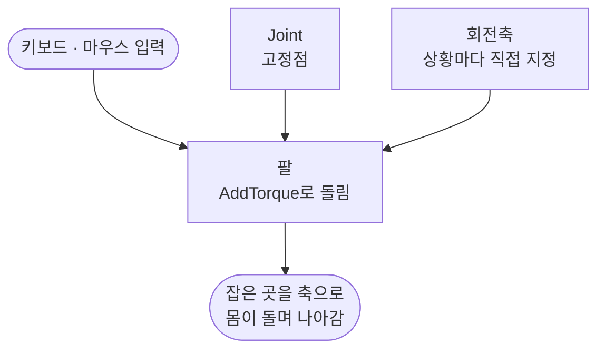

<small>처음 구조. Joint로 고정점을 정하고, 토크로 팔을 돌리려 했습니다. 끝(3.3)의 지금 구조와 비교할 수 있습니다.</small>

우스꽝스러운 협동은 마음대로 움직이지 않는 몸에서 시작합니다. 이 장에서 만드는 것은 **손이 잡은 곳을 축으로 몸을 돌려 나아가는 움직임**이고, 처음에는 Joint로 잇고 `AddTorque`로 팔을 돌리면 되겠다고 보고 시작했습니다.

플레이어는 키보드로 팔을 뻗고, 마우스 버튼을 누르고 있는 동안 손으로 무언가를 붙잡습니다.

| 입력 | 결과 |
|---|---|
| WASD / 방향키 | 팔을 뻗는 방향. 양팔이 함께 움직입니다 |
| 마우스 왼쪽 / 오른쪽 버튼 | 누르고 있는 동안 왼손 / 오른손으로 잡기 |
| F | 다리 건설 |

### 3.1 일곱 조각으로 나눈 몸

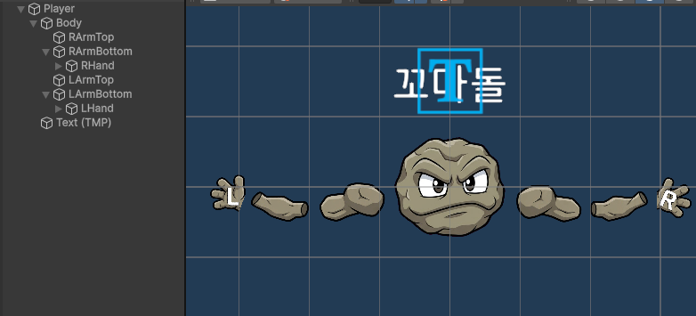

<small>Hierarchy의 Player 아래에 몸통 1 · 상완 2 · 하완 2 · 손 2, 모두 일곱 조각이 있고, Scene 뷰에는 그 조각이 관절로 이어진 몸이 보입니다.</small>

이런 움직임을 내려면 몸이 한 덩어리가 아니라 관절로 이어진 여러 조각이어야 했습니다. 이렇게 조각들이 물리 법칙대로 흔들리며 움직이는 캐릭터를 **래그돌**이라고 부릅니다.

*Heave Ho*의 팔도 위팔과 아래팔로 나뉘어 있습니다. 분석해 보니 팔이 한 토막이면 원하는 방향으로 꺾이지 않아서, 이 구조를 그대로 따라 팔을 위팔(상완)과 아래팔(하완)로 나눠 **일곱 조각**으로 만들었습니다. 조각은 일곱 개지만, 플레이어의 입력은 한 곳으로만 들어옵니다.

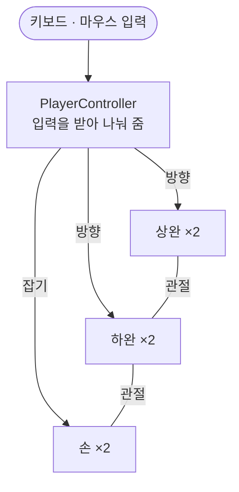

<small>입력은 플레이어 본체(`PlayerController`) 한 곳이 받고, 팔에는 방향을, 손에는 잡기를 넘깁니다. 각 조각은 넘겨받은 입력으로 자기 일만 합니다.</small>

- **이동 방향은 팔이 정합니다.** 팔이 힘의 방향을 바꾸면 손이 움직이고, 손이 어딘가에 고정되면 힘이 몸통 쪽으로 옮겨 가 몸 전체가 움직입니다. 그래서 입력은 몸 전체를 맡는 플레이어 본체가 받고, 그 아래의 팔이 입력을 넘겨받아 방향을 정하게 했습니다.
- **손은 잡는 일만 합니다.** 잡기 입력도 같은 이유로 플레이어 본체가 받아 손에 넘기고, 손은 범위에 들어온 대상을 잡는 일만 합니다(4장).
- **플레이어 본체는 몸 전체의 정보를 맡습니다.** 기본 힘·체력 같은 플레이어 정보와, 몸 전체가 어느 세기의 힘을 쓸지 정하는 일(5.2)입니다. 다른 코드가 "이것이 플레이어인가"를 알아보는 표시 역할도 겸합니다.

### 3.2 팔을 돌릴까, 밀까

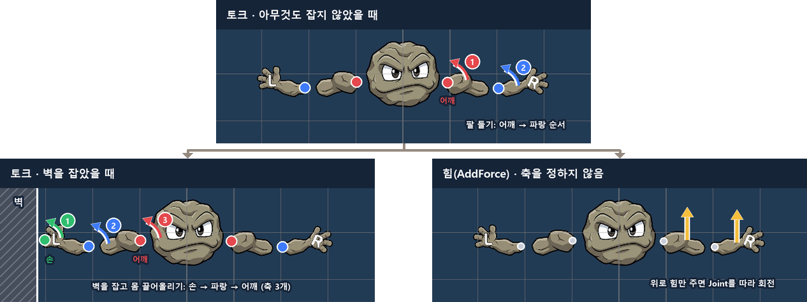

<small>잡은 상태가 바뀔 때마다 돌릴 축과 순서가 늘어납니다. 아무것도 잡지 않으면 어깨(빨강) → 파랑 두 단계, 벽이나 땅을 잡으면 손(초록) → 파랑 → 어깨 세 단계입니다. 오른쪽의 힘은 위로 밀기만 하면 Joint를 따라 돕니다.</small>

처음 계획은 Joint(두 조각을 한 점에서 이어 주는 관절)로 고정점을 정하고, 토크(한 축을 중심으로 돌리는 힘)로 팔을 돌리는 것이었습니다.

처음에는 팔이 돌지 않는 것이 힘이 모자라서라고 보고 회전량만 조절했습니다. 그러다 잡은 상태에 따라 돌리는 방향이 반대로 바뀌어야 한다는 것을 깨달았습니다. 토크로 돌리려면 무엇을 축으로 돌지 제가 직접 정해 줘야 했고, 그 축이 상황마다 바뀌었던 것입니다.

힘이 손 → 팔 → 몸통으로 갈 때는 손을, 몸통 → 팔 → 손으로 갈 때는 어깨를 축으로 돌아야 합니다. 게다가 손과 어깨의 축은 실제 오브젝트가 아닌 가상의 축이어서, 처음 상태에는 없던 축까지 새로 정해야 했습니다.

- **순서를 지키지 않으면 팔이 접혔습니다.** 팔이 올라가기 전에 하완이 안쪽으로 접혔고, 회전 각도를 고정하면 플레이어가 원하는 움직임이 나오지 않았습니다.
- **잡은 대상마다 순서가 달랐습니다.** 물체를 잡을 때와 플레이어를 잡을 때처럼, 순서를 따로 구분해야 했습니다.

| | 토크로 돌리기 | 힘으로 밀기 ✓ |
|---|---|---|
| 회전축 | 잡은 상태마다 축과 돌리는 순서를 직접 지정 | Joint와 힘 때문에 축이 저절로 생김. 위로 힘만 주면 Joint를 따라 돎 |
| 장점 | 물리적으로 더 정확함 | 축을 따로 다루지 않아 빠르고 깔끔하게 만들 수 있음 |
| 단점 | 다루기 어려워 완성까지 얼마나 걸릴지 예측하기 어려움 | 정확함을 포기함 |

**힘(`AddForce`, 한 방향으로 미는 힘)으로 밀기를 골랐습니다.** 프로젝트 기간이 3주로 짧았고, 조작은 핵심 기능이라 빨리 만들어 팀원들과 공유해야 했기 때문입니다.

당시 첫 커밋 주석에도 이 판단이 남아 있습니다. "토크로 하니 회전축을 두 개 구현해야 하는 문제가 생김. 힘 기반이 더 편하고 깔끔해서 AddForce 사용." 주석에는 축이 두 개라고 적었지만, 실제로는 벽을 잡을 때 손의 축이 더해져 세 개까지 늘어났습니다.

**치른 대가**는 물리적으로 더 정확한 토크를 포기한 것입니다. 그리고 직관적이라는 이유로 고른 만큼, 예상하지 못한 오류가 생각보다 많았습니다. 그 가운데 끝까지 남은 것은 여럿이 서로 붙잡을 때 생겼습니다(5.2).

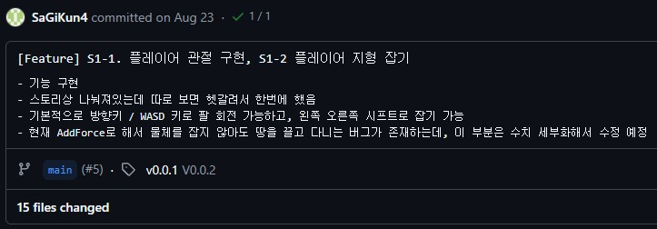

<small>힘으로 바꿔 올린 첫 커밋입니다. 제목 줄의 "플레이어 관절 구현, 플레이어 지형 잡기"와, 방향키로 팔을 돌리고 잡을 수 있다는 셋째 줄을 보면 됩니다. 마지막 줄에는 이때 남은 버그와 고칠 계획도 적었습니다.</small>

### 3.3 축을 Joint에 맡긴 몸

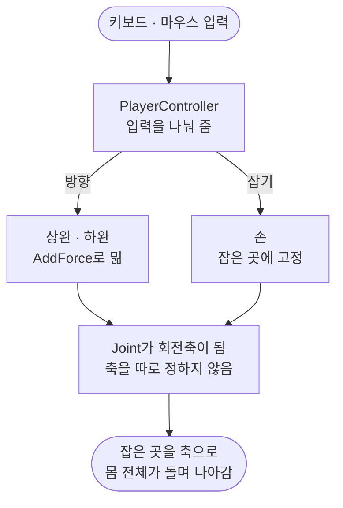

<small>지금 구조. 입력은 플레이어 본체 한 곳으로 들어와 팔과 손으로 나뉘고(3.1), 팔은 토크 대신 힘으로 밀며, 회전축은 직접 정하지 않고 Joint에 맡깁니다(3.2).</small>

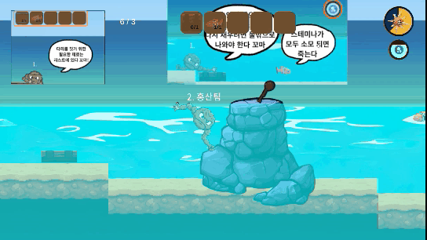

<small>손으로 잡은 곳은 그 자리에 고정되고, 팔을 움직이면 그곳을 축으로 몸이 돌아가며 나아갑니다. 이 움직임을 만드는 것이 제 파트였습니다.</small>

이 구조는 프로젝트를 시작한 지 엿새째인 8월 23일, 팔 관절과 지형 잡기를 담은 첫 커밋으로 팀원들과 공유했습니다.

---

## 4. 손으로 잡기

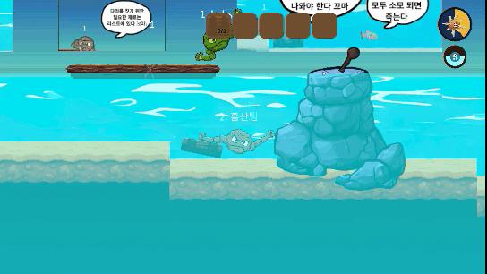

<small>판자를 잡고 옮기던 손이 다른 플레이어와 부딪혀도, 판자를 놓치지도 그 플레이어를 잡지도 않고 계속 옮깁니다.</small>

3장의 움직임에서 축이 되는 것은 손이 잡은 곳입니다. 그래서 손이 지금 무엇을 잡느냐가 곧 어디로 나아가느냐를 정합니다.

손은 범위에 들어온 판자·물고기·벽·다른 플레이어를 잡습니다. 게임 중에는 판자 두 개와 바닥, 물고기처럼 세 개 이상의 대상이 동시에 손에 닿는 일이 자주 생깁니다.

한번 잡은 대상을 놓지 않는다면 잡을 대상이 바뀔 일은 없을 것 같지만, 이 게임에서는 잡고 있던 대상이 손에서 빠져나갈 수 있습니다. 그래서 "지금 무엇을 잡을 것인가"를 정하는 규칙이 필요했습니다.

### 4.1 먼저 잡은 것을 계속 잡는 규칙

| | 잡을 대상을 하나만 기억 | 손에 닿은 대상을 모두 기억하고, 먼저 닿은 것을 우선 ✓ |
|---|---|---|
| 판자를 옮기다 다른 플레이어와 부딪히면 | 잡을 대상이 그 플레이어로 바뀌거나, 플레이어가 빠져나간 뒤 대상이 비어 판자를 놓칠 수 있음 | 판자가 목록 맨 앞에 있으므로, 다른 플레이어가 들어왔다 나가도 판자를 계속 잡음 |
| 물고기를 잡은 손을 땅에 대고 물고기를 놓으면 | 대상이 비어, 손이 땅에 닿아 있는데도 땅을 잡지 못함. 손을 공중으로 들었다가 다시 땅에 대야 잡을 수 있음 | 땅이 목록에 남아 있으므로, 물고기가 빠지면 바로 땅을 잡을 수 있음 |

잡을 대상을 하나로만 정해 두면 위와 같은 모순이 생깁니다. 특히 둘째 경우는 몸을 마음대로 움직이기 어려운 게임이라, 손을 다시 들었다 내리는 일만으로도 크게 번거롭습니다. 그래서 잡을 수 있는 대상을 모두 목록으로 들고 있다가, **먼저 들어온 대상을 우선**하기로 했습니다.

먼저 잡은 것을 계속 잡는 선입선출만 보면 큐가 더 편합니다. 하지만 대상이 꼭 들어온 순서대로 나가지는 않습니다.

| 순서 | 손에 닿은 목록 | 잡는 대상 |
|---|---|---|
| 물고기, 판자, 다른 플레이어 순으로 닿음 | 물고기 · 판자 · 플레이어 | 물고기 |
| 판자가 먼저 빠져나감 | 물고기 · 플레이어 | 물고기 (그대로) |

빠져나간 판자는 목록 가운데에 있어서, 맨 앞에서만 꺼내는 큐로는 바로 뺄 수 없습니다. 이런 경우도 큐 두 개를 쓰면 처리할 수 있지만, 이것저것 종합해 보니 **중간에 있는 대상을 바로 뺄 수 있는 리스트**가 제게는 더 편했습니다.

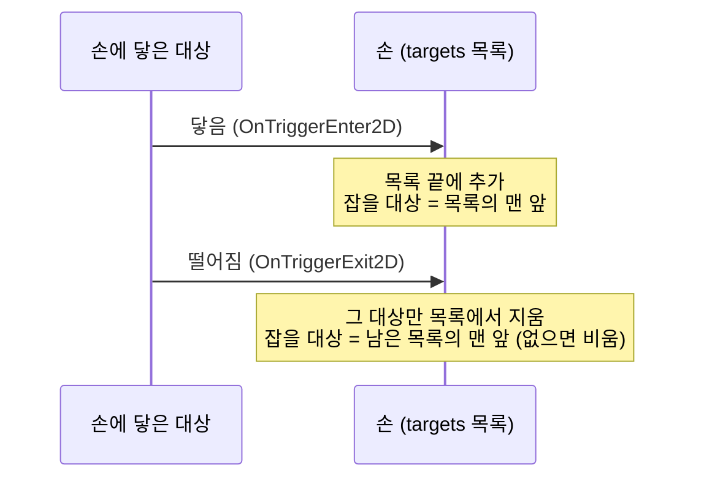

<small>잡을 대상은 언제나 목록의 맨 앞이므로, 나중에 닿은 것이 먼저 잡은 것을 밀어내지 않습니다.</small>

이 목록 규칙으로, 맨 위 장면처럼 손에 무엇이 닿든 먼저 잡은 것을 놓치지 않는 잡기를 구현했습니다.

---

## 5. 서로 붙잡고 끌어올리기

우스꽝스러운 협동은 서로 붙잡고 끌어올리는 데서 나옵니다. 그런데 손이 잡는 대상이 땅·물체·다른 플레이어로 갈리면서, 필요한 힘도 무엇을 잡았느냐에 따라 달랐습니다.

### 5.1 잡은 대상에 따라 달라지는 힘

3장처럼 늘 같은 세기로 밀자, 물체를 잡은 채 공중을 날아다닐 수 있었습니다. 그래서 지금 쓸 힘의 세기를 잡은 대상에 따라 정하는 계산을 넣고, 정한 값을 상완과 하완 모두에 적용했습니다.

| 잡은 대상 | 쓰는 힘 | 이 값을 쓰는 이유 |
|---|---|---|
| 아무것도 잡지 않음 | **기본 힘** | 팔은 움직이지만 공중에 떠오르는 움직임은 나오지 않는 값 |
| 지형처럼 고정된 대상 | **강한 힘** | 플레이어 자신을 옮길 만큼 충분하고, 조작이 바로 반영되는 값 |
| 움직일 수 있는 물체 | 기본 힘 + 질량 × 배율 (강한 힘을 넘지 않음) | 그 물체를 들 정도의 힘만 — 무거운 물체는 함께 들어야 함 |

물체를 잡았을 때 힘을 제한한 것은 팀이 먼저 정한 "물체의 무게에 따른 협동의 강제성", 곧 무거운 물체는 함께 들어야 한다는 규칙 때문입니다. 기본 힘과 강한 힘의 값은 플레이테스트를 거쳐 정했습니다.

### 5.2 함께 잡으면 못 움직이던 문제

| 항목 | 내용 |
|---|---|
| 문제 | 한 플레이어가 판자를 잡고 있을 때 다른 플레이어가 같은 판자를 잡으면, 바닥을 잡아도 움직이지 못함 |
| 원인 | 5.1의 계산은 혼자 할 때가 기준이었음. 두 번째 플레이어에게 그 판자의 무게는 이미 '플레이어 + 판자' |
| 해결 | 바닥을 잡은 플레이어가 강한 힘을 쓰고, 그 강한 힘이 잡고 있는 물체와 플레이어를 타고 차례로 전달되게 함 (사다리형 힘 전달). 5.1의 대상별 계산은 이 구조로 대체 |
| 결과 | 멀티플레이에서도 움직일 수 있는 구조가 됨 |

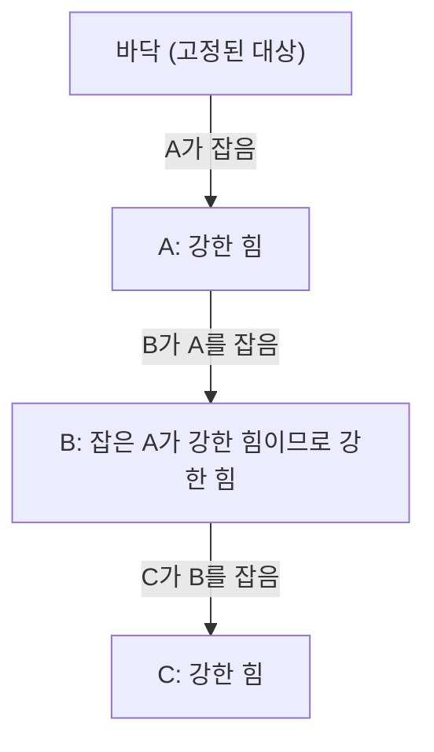

<small>강한 힘은 바닥을 잡은 사람에서 시작해, 그 사람을 잡은 사람에게 한 칸씩 넘어갑니다.</small>

이 전달은 플레이어 본체의 함수 하나가 물리 프레임마다 맡습니다.

```csharp
// PlayerController.cs (발췌) — 강한 힘을 사다리처럼 이어 받기
private void UpdateArmForce()
{
    if (leftBottomArm.UseForce || rightBottomArm.UseForce)
    {
        currentArmForce = highArmForce;
    }
    else
    {
        // 왼팔을 먼저 보고, 아니면 오른팔을 확인
        bool receivesHighForce =
            IsHoldingHighForcePlayer(leftBottomArm) ||
            IsHoldingHighForcePlayer(rightBottomArm);
        currentArmForce = receivesHighForce ? highArmForce : defaultArmForce;
    }
    // (생략) 정한 힘을 상완·하완 네 곳에 같은 값으로 적용
    // SetCurrentForce(currentArmForce)
    // 이 팔이 잡은 대상이 강한 힘을 쓰고 있는 플레이어인지
    bool IsHoldingHighForcePlayer(BottomArmController arm)
    {
        PlayerController target = GetTargetPlayer(arm.GrabbedTarget);
        return target != null
            && target.CurrentArmForce == target.HighArmForce;
    }
}
```

- **바닥을 잡은 사람은 사다리의 맨 아래입니다.** 내 팔 하나라도 고정된 대상을 잡고 있으면 강한 힘을 씁니다.
- **그렇지 않으면 내가 잡은 사람을 봅니다.** 그 사람이 강한 힘을 쓰고 있으면 나도 강한 힘을 쓰고, 아니면 기본 힘으로 돌아갑니다. 이렇게 강한 힘이 잡은 사람을 따라 한 칸씩 올라갑니다.
- **잡은 조각의 부모까지 찾아봅니다.** 몸이 일곱 조각이라, 다른 플레이어의 팔이나 손을 잡으면 플레이어 본체가 그 조각이 아니라 부모에 있기 때문입니다(3.1).

※ **남은 문제** — 서로 붙잡고 있으면, 바닥을 잡았던 플레이어가 지형을 놓아도 강한 힘이 그대로 유지됩니다. 규칙대로라면 맞는 동작이지만 게임으로 보면 어색합니다.

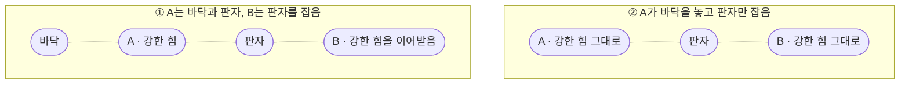

<small>②에서는 바닥을 잡은 사람이 아무도 없는데도 강한 힘이 남습니다. 그래서 둘이 그대로 공중에 뜰 수 있습니다. 판자 없이 서로의 몸을 잡고 있어도 마찬가지입니다.</small>

이 버그는 토크 대신 힘을 고르면서(3.2) 생겼습니다. 힘은 바닥을 잡았는지와 상관없이 몸을 밀어 올리기 때문에, "바닥을 잡은 사람만 강한 힘을 낸다"는 조건을 물리 대신 코드 규칙으로 정해야 했습니다. 규칙은 쓰인 대로 동작하지만, 잡은 상대의 힘만 보고 이어받기 때문에 서로 잡은 두 사람이 서로를 근거로 강한 힘을 유지합니다. 토크였다면 몸을 들어 올리는 힘은 붙잡은 지형에서만 나오므로, 이런 규칙 자체가 필요하지 않았을 것입니다. 개발 시간과 진행도를 생각하면 이미 힘으로 짠 조작을 토크로 되돌리기는 무리였고, 고치는 방향은 돌아보며 정리했습니다(9.1). 어떤 상황에서 생기는지는 찾아냈습니다.

프로젝트가 끝나고 연 시연 시간에는 약 16명이 플레이했고, 저희 팀은 뒤에서 지켜봤습니다. 이 문제는 그때 딱 한 번 나왔습니다. 플레이어와 함께 물체를 옮기던 중 예상보다 높이 떴지만, 플레이어는 이것을 버그가 아니라 물리 때문에 뜬 것으로 받아들였습니다. 물체를 바닥으로 옮겨야 한다는 목표가 분명했기 때문에, 공중을 날아다니지 않고 다시 바닥으로 내려갔습니다.

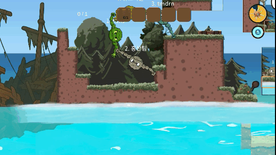

<small>사다리형 힘 전달이 들어간 뒤의 장면입니다. 잡은 대상이 플레이어여도 힘이 전달되어, 잡은 상대를 날려 보낼 수 있습니다.</small>

대상별 힘(5.1)을 사다리형 전달(5.2)로 바꾼 이 구조로, 바닥을 잡은 한 명만 있으면 함께 잡은 사람들이 강한 힘을 이어받아 움직이는 끌어올리기를 구현했습니다. 바닥을 놓아도 강한 힘이 남는 한계는 고치지 못한 채 남았습니다.

---

## 6. 모든 화면에 같은 몸 보이기

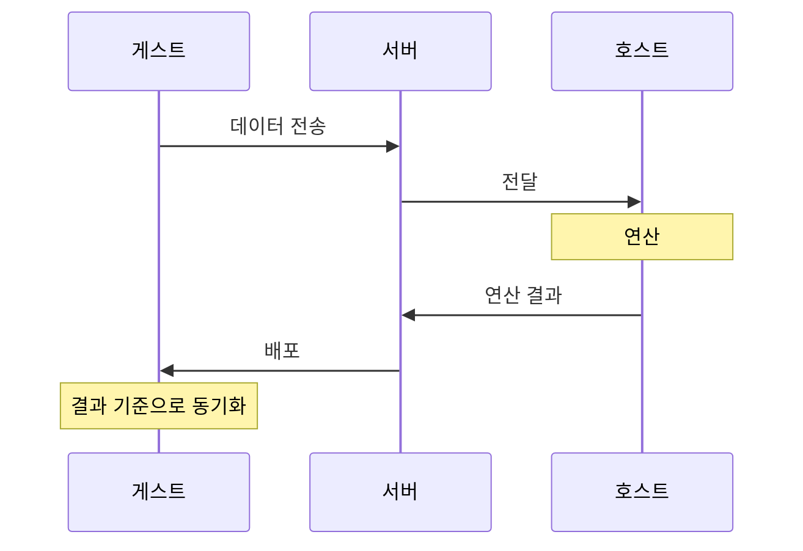

<small>계산은 서버가 아니라 호스트에서 일어납니다. 호스트가 아닌 플레이어(게스트)는 입력을 보내고 결과를 받아 화면을 맞춥니다.</small>

서로 붙잡은 몸은 여러 플레이어가 각자의 화면에서 함께 건드립니다. 내 화면에서는 친구를 잡았는데 친구 화면에서는 손이 빗나가 있다면, 함께 끌어올릴 수 없습니다.

이 게임의 화면에 보이는 것은 거의 전부 물리로 움직이는 래그돌이고, 그중에서도 손의 위치가 가장 중요합니다. 그래서 **모든 플레이어의 화면에서 손이 같은 곳에 있어야** 했습니다.

| 용어 | 뜻 |
|---|---|
| 클라이언트 | 플레이어마다 실행하는 게임 프로그램 |
| 서버 | 클라이언트들 사이에서 데이터를 받아 나눠 주는 프로그램 |
| 호스트 | 기준으로 삼은 클라이언트 하나 |

### 6.1 누가 계산하고, 무엇을 보낼까

수업에서 배운 멀티 게임 서버 구조를 바탕으로, 서버를 맡은 팀장과 이야기하며 이 게임에 맞는 구조로 바꾸자고 제안했습니다. 후보를 하나씩 거른 순서는 아래와 같습니다.

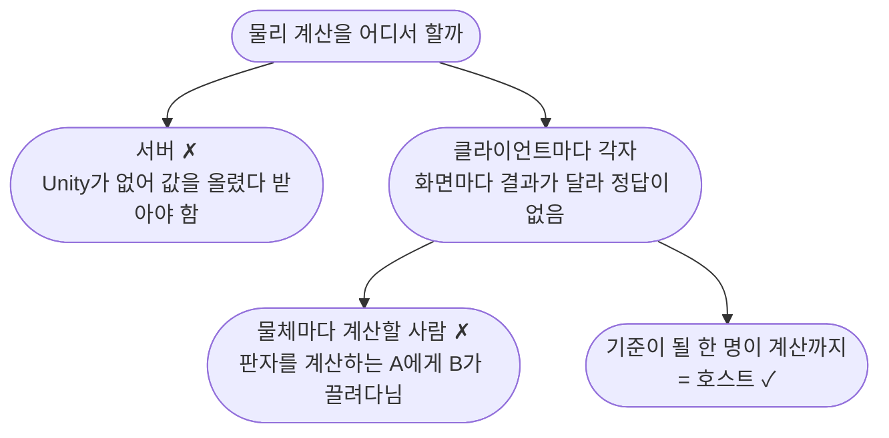

<small>후보가 하나씩 걸러지는 순서입니다. 서버가 빠지고, 각자 계산하면 정답을 정할 사람이 결국 필요해서, 그 한 명이 계산까지 맡는 호스트로 이어집니다.</small>

- **서버 계산은 처음부터 뺐습니다.** 이 게임은 Unity 물리를 쓰므로 계산 대부분이 클라이언트에서 끝납니다. Unity가 없는 서버로 값을 올렸다가 다시 받는 것은 잘못된 구조라고 봤습니다.
- **각자 계산하면 정답이 없습니다.** 판자처럼 여럿이 함께 건드리는 물체의 결과가 화면마다 달라져, 어느 결과로 정할지 결정할 클라이언트를 따로 정해야 했습니다.
- **물체마다 계산할 사람을 정하는 방법도 뺐습니다.** 판자를 잡은 A가 그 판자를 계산하면, 같은 판자를 잡은 B는 힘으로 조작하지 못하고 A에게 끌려다닐 것이라 판단했습니다.

어차피 기준이 될 클라이언트를 정해야 한다면, 그 클라이언트가 물리 계산까지 맡는 편이 더 정확하다고 판단해 **호스트 방식을 골랐습니다.**

**치른 대가**는 게스트의 반응 속도입니다. 호스트는 바로 움직이지만, 게스트는 입력이 서버와 호스트를 거쳐 돌아와야 하므로 인터넷이 좋지 않으면 딜레이가 느껴질 수 있습니다. 다만 인터넷이 나쁘면 다른 방식에서도 감수해야 할 단점이 따로 생기는 것은 마찬가지라, 이 정도는 받아들일 수 있다고 판단했습니다.

구조를 정한 뒤에는 플레이어 조작에 필요한 프로토콜(클라이언트와 서버가 주고받는 데이터의 약속)을 서버 코드까지 제가 직접 고쳤습니다. 조작 코드를 제가 짰으니 무엇이 오가야 하는지 가장 잘 알았고, 당시 서버 담당인 팀장은 문서 작업까지 함께 맡고 있어서 플레이어 쪽 프로토콜은 제가 고치는 편이 빨랐기 때문입니다.

처음에는 몸통의 상태만 보냈습니다. 호스트가 몸통을 기준으로 계산해 뿌려 주면, 다른 화면은 위치만 맞추면 된다고 생각했기 때문입니다. 그런데 화면마다 손 위치가 달라졌습니다. 이 게임에서 **반드시 같아야 하는 것은 몸통이 아니라 손이었습니다.**

| 항목 | 내용 |
|---|---|
| 문제 | 손 위치가 가장 중요한 게임인데, 클라이언트마다 손 위치가 맞지 않음 |
| 원인 | 몸통(Body)만 서버로 보내고, 호스트가 몸통 기준으로 계산해 뿌려 주면 위치만 맞추면 된다고 생각함 |
| 해결 | 몸통과 좌우 상완·하완, 다섯 조각의 상태와 좌우 손의 잡기 상태를 모두 보내도록 바꿈 |

| 조각 | 보내는 것 | 이유 |
|---|---|---|
| 몸통 · 상완 2 · 하완 2 | 위치(X, Y)와 회전 | 물리로 움직이는 조각이라 화면마다 달라질 수 있음 |
| 손 2 | 잡았는지 여부만 | 리지드바디(물리 몸체)와 Joint 없이 닿았는지만 감지하고 하완에 붙어 움직여서, 하완이 맞으면 손도 맞음 |

제가 고친 서버 프로토콜에서, 플레이어 한 명의 상태는 다섯 조각의 상태와 좌우 손의 잡기 여부로 이루어집니다. 조각 하나의 상태(`PartState`)는 월드 위치(X, Y)와 회전(쿼터니언)입니다.

```csharp
// 서버 Protocol.cs (발췌) — 플레이어 한 명의 상태 (조각과 잡기 부분)
public class PlayerState
{
    public PartState Body { get; set; }
    public PartState LeftArmTop { get; set; }
    public PartState RightArmTop { get; set; }
    public PartState LeftArmBottom { get; set; }
    public PartState RightArmBottom { get; set; }
    public bool IsLeftGrab { get; set; }
    public bool IsRightGrab { get; set; }
}

// 조각 하나의 상태 (조각과 관계없는 값은 생략)
public class PartState
{
    public float X { get; set; }
    public float Y { get; set; }
    public Rotation Rotation { get; set; }   // 쿼터니언 X·Y·Z·W
}
```

- **다른 화면은 사이를 부드럽게 채웁니다.** 호스트가 다섯 조각의 상태를 보내면, 다른 클라이언트는 직전 값과 새 값 사이를 채워(보간) 적용합니다. 보간 방법은 수업에서 배운 내용입니다.
- **처음 자세를 되돌리는 데도 씁니다.** 같은 구조로 시작할 때의 자세를 저장해 두고, 리스폰이나 납치 때 처음 자세로 되돌립니다.

### 6.2 다섯 조각을 보내자 맞은 손

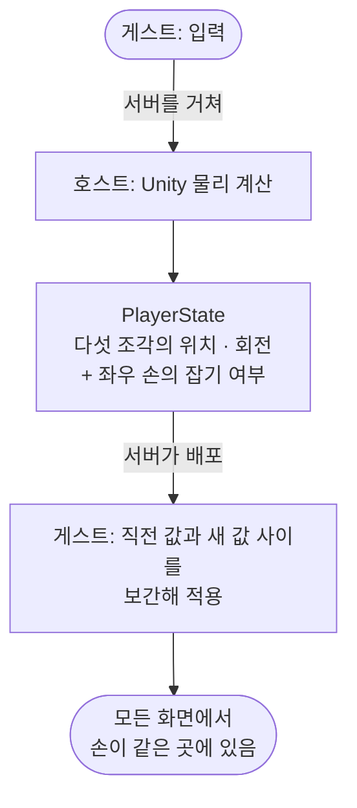

<small>지금 구조. 몸통만 보내던 처음과 달리, 계산은 호스트 한 곳에서만 하고(6.1) 손을 움직이는 다섯 조각을 모두 보내며, 손은 하완을 따라오므로 잡기 여부만 보냅니다(6.1의 몸통만 보내던 문제).</small>

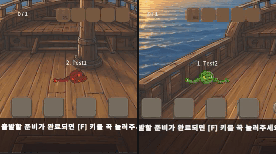

<small>두 클라이언트의 화면을 나란히 놓은 장면입니다. 양쪽 화면에 같은 두 플레이어(Test1 · Test2)가 함께 보이며 움직입니다.</small>

다섯 조각을 모두 보내도록 바꾼 뒤 **클라이언트 사이의 손 위치가 맞았습니다.** 걱정했던 게스트의 딜레이도 학원에서, 그리고 팀원들이 각자 집에서 테스트했을 때 느껴지지 않았습니다.

---

## 7. 물고기 잡기와 먹이사슬

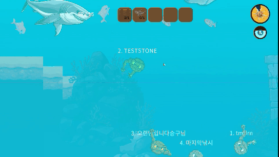

<small>플레이어에게 돌진하는 상어입니다. 돌진하는 동안에는 먹이를 쫓지 않습니다.</small>

함께 움직일 수 있게 되면, 남은 목표는 물고기를 함께 모아 다리를 놓는 것입니다.

물고기의 행동은 팀원 C의 몫이고, 저는 물고기가 손에 잡혔는지 판단하는 부분과 먹이사슬 판정을 맡았습니다.

### 7.1 팀원이 고친 손 코드를 그대로 둘까

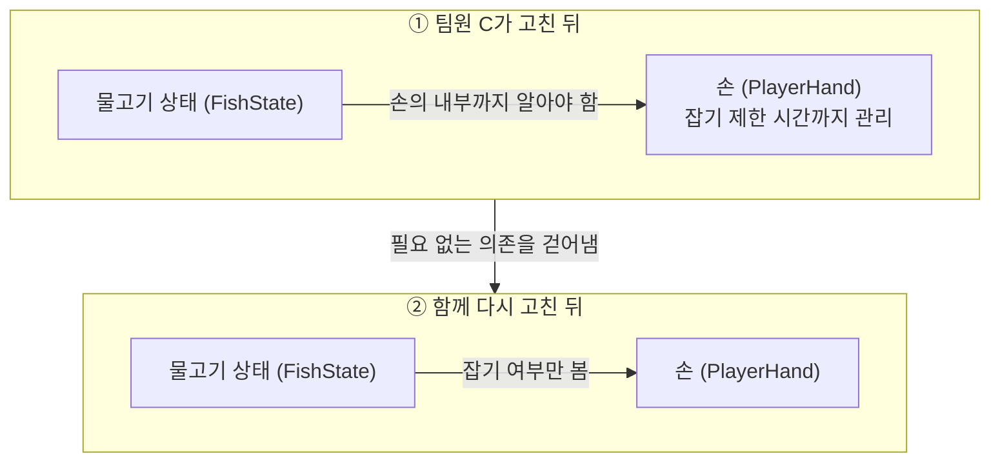

<small>①을 그대로 둘지가 판단할 문제였고, 결과는 ②입니다. 물고기가 손의 내부까지 알아야 하던 구조를 걷어내, 잡기 여부만 보게 했습니다.</small>

물체를 잡는 책임은 플레이어에게 있었으므로, 팀원 C가 맡은 물고기가 "내가 잡혔는가"를 알려면 플레이어 코드를 봐야 했습니다. 그런데 시작할 때 둘 사이에서 쓸 함수와 데이터의 약속(API)을 정하지 않았습니다.

저는 잡기 상태를 나중에 쓸 수 있게 자리만 열어 두고 내용은 아직 쓰지 않은 상태였고, 팀원 C에게는 바로 그 부분이 필요했습니다. 팀원 C는 플레이어 코드를 직접 고쳐서 썼고, 저는 다음 날 학원에서 작업하다 이를 알았습니다.

**판단할 근거는 기록에 있었습니다.** 먼저 팀원 C가 올린 커밋을 봤습니다.

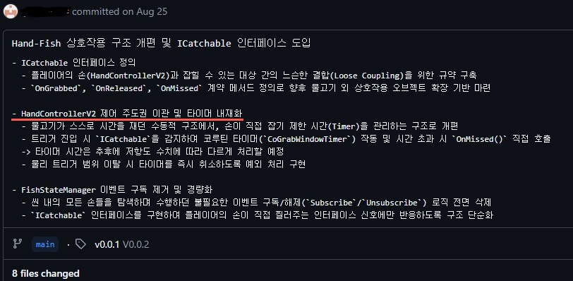

<small>팀원 C가 8월 25일에 올린 커밋입니다. 밑줄 친 "HandControllerV2 제어 주도권 이관"이 바뀐 곳으로, 물고기가 재던 잡기 제한 시간을 손(`HandControllerV2`)이 직접 관리하도록 플레이어 코드를 고쳤습니다.</small>

물고기의 상태가 손의 내부 내용까지 알아야 하는 구조가 되어 있었고, 이 점이 이상하다고 봤습니다. 그다음 팀원 C에게 어떤 의도로 고쳤는지 물었고, "잡기 위해 필요한 부분"이라는 답을 들었습니다. 구현은 자신이 약한 부분이라 AI와 함께 고쳤다고 했습니다.

의도가 "잡기"라면, 물고기가 손에서 알아야 하는 것이 무엇인지 손 코드에서 확인할 수 있었습니다. 손 코드가 밖에 내놓는 것은 아래가 전부입니다.

| 공개 부분 | 하는 일 |
|---|---|
| `IsGrabbing` | 지금 잡고 있는지 |
| `GrabbedTarget` | 지금 잡고 있는 대상 |
| `Grabbed` / `Released` | 잡거나 놓을 때 알리는 이벤트. 팔이 무게 계산용 힘을 더하는 데 씀 |
| `Grab()` / `Release()` | 잡기 / 놓기 |

물고기가 "내가 잡혔는가"를 알려면 이 가운데 `IsGrabbing` 하나면 충분했습니다.

**그래서 그대로 두지 않고 함께 고치기로 했습니다.** AI와 함께 만든 코드라도 그대로 받아들이지 않고, 하나씩 보면서 필요 없는 부분을 짚어 고쳤습니다. 결과적으로 팀원 C가 고친 부분은 사라지고, 제 쪽 내용을 조금 바꿨습니다.

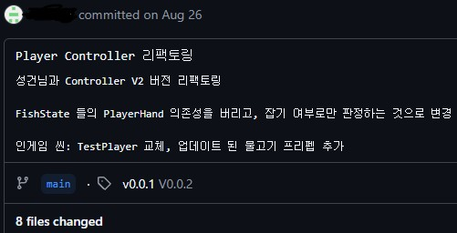

<small>다음 날(8월 26일) 학원에서 팀원 C의 계정으로 함께 고쳐 올린 커밋입니다. "성건님과"라는 줄과, "FishState들의 PlayerHand 의존성을 버리고, 잡기 여부로만 판정하는 것으로 변경"이라는 줄이 보입니다.</small>

고친 뒤 물고기가 손에서 보는 것은 잡기 여부 하나로 줄었습니다. 지금 코드에서도 해마는 손의 잡기 여부(`IsGrabbing`)만 읽습니다.

이 일은 팀원 C의 잘못이 아니었습니다. 팀원 C에게 잡기·놓기가 필요했던 것도 맞고, 저도 필요하다고 생각해 자리를 열어 두었습니다. 문제는 "플레이어와 물고기 모두 이것으로 잡기 여부를 판단한다"는 하나의 합의점이 없었던 것입니다(9.2).

AI와 함께 쓴 코드라도 의도를 묻고 한 줄씩 확인하면 따라갈 수 있었고, 따라가기 어려웠던 것은 코드보다 파트 사이에 약속이 없었던 쪽이었습니다.

### 7.2 물고기 먹이사슬

처음의 물고기는 물속을 돌아다니다 플레이어에게 잡히는 "물체"에 가까웠습니다. 그런데 플레이어의 협동을 중심에 두려면 물고기가 더 다채로워야 한다는 의견이 나와, 물고기를 급히 확장하게 되었습니다. 모든 물고기는 먹이사슬에 속하지만, 하는 일은 종류마다 다릅니다.

| 종류 | 예 | 먹이사슬에서 하는 일 |
|---|---|---|
| 방해만 하는 물고기 | 문어, 갯가재 | 플레이어를 방해하기만 하고 물고기를 먹지 않음 |
| 먹는 물고기 | 상어 | 다른 물고기를 잡아먹어 먹이사슬에 직접 영향을 줌 |

먹는 물고기는 배고픔이 일정량 아래로 내려가면 먹이를 쫓아가 먹습니다. 물고기마다 크기를 정해 두고, 물고기 본체(상위 계층)에서 서로의 크기를 비교해 먹을 수 있는지 판단합니다.

상어의 행동은 FSM(정해 둔 몇 가지 상태 가운데 하나에 머물다가, 조건이 맞으면 다른 상태로 넘어가는 방식)으로 움직입니다.

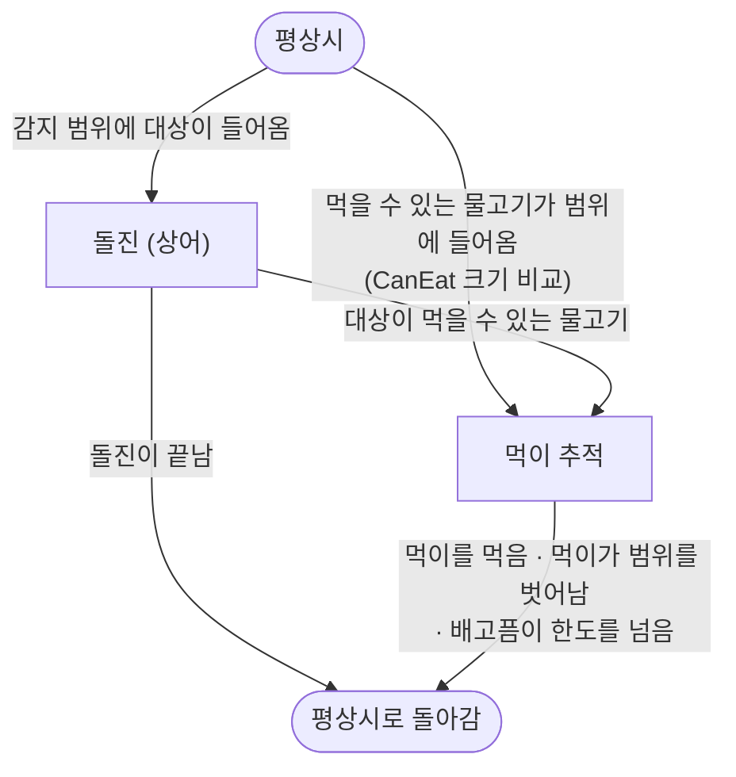

<small>상어에게는 돌진과 먹이 추적이라는 두 행동이 있고, 둘 다 평상시에서 들어갑니다. 아래 문제는 이 두 행동 사이에서 생겼습니다.</small>

### 7.3 돌진과 먹이 사이를 오가던 문제

| 항목 | 내용 |
|---|---|
| 문제 | 상어가 플레이어에게 돌진하는 것과 먹이를 쫓는 것 사이를 끝없이 오감 |
| 원인 | 배고픔에 따라 먹이를 쫓는 기능이, 상어처럼 플레이어에게 돌진하는 패턴과 부딪침 |
| 해결 | 먹이 판정을 물고기 본체(상위 계층)로 옮기고, 상태 사이를 오가는 조건(FSM)을 조절 |

고친 뒤의 상어는 맨 위 장면처럼 플레이어에게 돌진하는 동안에는 먹이를 쫓지 않고, 배가 고프면 물고기를 먹으러 다닙니다. 잡기 여부로 손과 맞춘 판정(7.1)과 크기로 정한 먹이사슬(7.2·7.3)로, 물고기 쪽에서 맡은 부분을 구현했습니다.

---

## 8. 그 밖에 맡은 것

| 항목 | 무엇을 | 이렇게 한 이유 · 출처 |
|---|---|---|
| 매달리기와 스태미나 | 지형에 매달려 있는 것만으로는 스태미나가 더 줄지 않음 | 매달리기는 서로 끌어올려 주거나 팔이 닿는 범위를 넓히는 선택지라, 협동의 재미에 꼭 필요한 행동이기 때문 |
| 심장박동 소리 | 위급할수록 심장박동 효과음이 나오는 간격이 짧아짐 | 물리로 움직이다 보니 급박한 상황이 자주 생기고, 게이지를 보지 않고도 그것을 알려 줄 무언가가 필요했기 때문 |
| 오디오 매니저 | 효과음 채널을 일부러 넉넉하게 잡음. 실제 플레이 중 효과음이 버려지거나 거슬리는 사운드 버그는 없었음 | 개인 공부 중 유튜브 '골드메탈' 강좌를 보고 따라 만든 코드로, 익숙해서 그대로 가져옴 |
| 플레이어 색상 선택 | 컬러피커로 플레이어 색을 고름 | 인터넷 코드에서 필요한 부분만 뽑아 Unity 버전에 맞게 조금 고침 |

---

## 9. 돌아보기

제가 맡은 부분에 대한 제 평가는 **조금 불만족**입니다. 서로 붙잡고 있으면 지형을 놓아도 강한 힘이 유지되는 문제(5.2)를 풀지 못하고 끝냈기 때문입니다.

### 9.1 바란 경험과 질문은 어떻게 됐나

| 개요의 목표와 질문 (1장) | 근거 | 판단 |
|---|---|---|
| **우스꽝스러운 협동** — 마음대로 움직이지 않는 몸으로 서로 붙잡고 끌어올리기 | 사다리형 힘 전달로 함께 잡은 사람들이 강한 힘을 이어받음(5.2). 강한 힘이 남는 오류는 약 16명이 플레이한 시연에서 한 번 나왔고, 플레이어는 물리 때문에 뜬 것으로 받아들임(5.2) | 경험은 지켰지만, 규칙에 논리 오류가 남음 |
| 흔들리는 캐릭터의 구조 | 8월 23일 첫 커밋에 팔 관절과 지형 잡기를 올려 공유함(3.2) | 직관적인 힘을 골라 빨리 공유했지만, 예상하지 못한 오류가 많았음 |
| 모든 화면에 같은 손 | 다섯 조각을 보낸 뒤 손 위치가 맞음. 학원과 팀원들의 집에서 테스트했을 때 딜레이가 느껴지지 않음(6.2) | 몸통이 아니라 손을 기준으로 보낼 것을 정한 것이 맞았음 |
| **AI를 주로 쓰는 팀원들의 방식을 내가 따라갈 수 있을까** | 8월 25일 팀원 C의 커밋과 8월 26일 함께 고친 커밋, 손 코드의 공개 부분(7.1) | 의도를 묻고 코드를 확인하면 따라갈 수 있었음. 어려웠던 것은 파트 사이의 약속(9.2) |

**바랐던 경험은 지켰지만, 오류는 남았습니다.** 이 문제를 고쳤다고 말할 수는 없지만, 어떤 상황에서 생기는지를 찾아냈습니다. 시연에서 한 번 나왔을 때도 플레이어는 버그로 알아차리지 않고 목표를 향해 다시 내려갔습니다(5.2). 그래서 서로 붙잡고 끌어올리며 협동하는 경험이 플레이 중에 눈에 띄게 깨지지는 않았습니다.

다만 이것은 플레이 경험만 본 평가이고, 규칙 자체에 남은 논리 오류이므로 고쳐야 할 문제입니다.

**직관적인 방법이 빠른 방법은 아니었습니다.** 토크는 다루기 어려워 완성까지 얼마나 걸릴지 예측할 수 없었고, 그래서 바로 이해되는 힘을 골랐습니다(3.2). 그런데 직관적이라는 이유 하나로 개발하다 보니 예상하지 못한 오류가 생각보다 많았고, 강한 힘이 남는 문제도 거기서 나왔습니다.

직관적인 구조를 쫓기보다 지금 상황에 더 맞는 구조를 찾아 적용하고, 그 구조가 핵심이라면 개발을 그 구조에 맞춰 조정하는 편이 낫다는 것을 알게 됐습니다. 다시 한다면 상황에 따라 이렇게 하겠습니다.

| 상황 | 다음에는 |
|---|---|
| 시간이 넉넉하고 프로젝트 책임이 온전히 나에게 있을 때 | **토크로 바꿉니다.** 직관적이지 않더라도, 조금 더 확실한 구조를 잡는 편이 유리합니다 |
| 시간이 넉넉하지 않고 지금 구조를 크게 바꾸지 않아야 할 때 | **서로 이어진 플레이어들을 한 묶음으로 보고, 큰 힘 하나를 전체에 나눠 줍니다.** 지금 구조에서는 플레이어 한 명이 가질 수 있는 힘(물건을 잡았을 때 · 벽이나 바닥을 잡았을 때 · 아무것도 잡지 않았을 때)이 분명하므로, 하나하나 계산하지 않고 묶음 전체를 큰 힘 하나로 다루는 것이 가장 빠를 것 같습니다. 아직 만들어 보지 않아 정확한 결과는 모릅니다 |

### 9.2 약속은 코드를 쓰기 전에

AI를 쓰는 팀원들의 방식을 따라갈 수 있을지가 처음의 걱정이었지만, 실제로 부딪힌 것은 다른 곳이었습니다. 물고기와 손 사이에서 잡기 여부를 어떻게 판단할지 정하지 않은 채 시작해, 같은 필요를 두고 서로 다른 구조가 나왔습니다(7.1).

팀원 C에게 잡기·놓기가 필요했던 것도, 제가 그 자리를 열어 둔 것도 맞았습니다. 빠져 있던 것은 "플레이어와 물고기 모두 이것으로 잡기 여부를 판단한다"는 하나의 합의점이었습니다. **다음에는 파트 사이에서 쓸 API를 시작할 때 먼저 합의하겠습니다.**

같은 질문은 다른 장에서도 반복됐습니다. 팔을 돌릴 축을 누가 정할지(3장), 어느 화면을 정답으로 삼을지(6장)도 결국 무엇이 맞아야 하는지를 먼저 정하는 문제였습니다. 웹을 배울 때는 앞단과 뒷단이 데이터를 주고받기만 하면 됐는데, 게임에서는 화면에서 무엇이 같아야 하는지에 따라 데이터를 어떻게 나눠 보낼지를 정해야 한다는 것도 이때 알게 됐습니다.

**코드를 쓰기 전에, 무엇이 맞아야 하는지부터 정하는 것**, 그것이 이 프로젝트에서 얻은 기준입니다.
