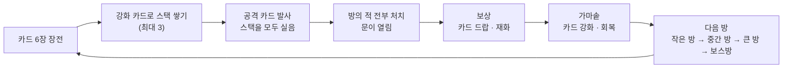
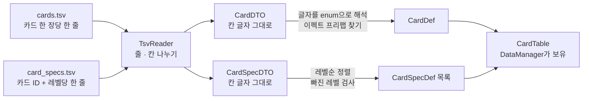
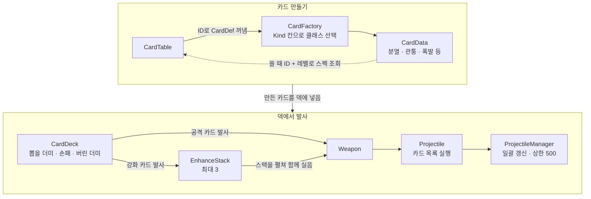
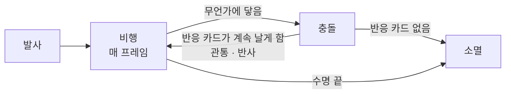
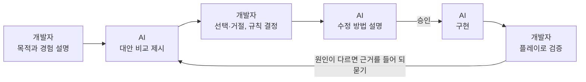

# MagiCard 기술 문서

| 항목 | 내용 |
|---|---|
| 장르 | 3D 덱빌딩 카드 슈터 (1인칭, 싱글 플레이) |
| 개발 기간 | 1차 개발 2주 (1차 프로토타입) · 2차 개발 3주 (진행 중) |
| 개발 인원 | 1인 (개인 프로젝트) |
| 개발 환경 | Unity 6000.3.15f1 (URP, New Input System) · 코드 구현과 모델 작업에 AI 활용 |
| 주요 기술 | 시점·역할 기반 카드 실행 구조 · 발사체 일괄 갱신과 상한 · 이펙트 예산 · TSV 카드 데이터 · 모듈러 맵 생성 |
| 레퍼런스 | *Gunfire Reborn* · *Slay the Spire* · *The Binding of Isaac* |
| 링크 | [GitHub](https://github.com/KooHoo-Dev/3rd_3D_1-3D-Project-SaGiKun4) |

---

## 1. 개요

### 1.1 무엇을 만들었나 (What)

일반적인 총알 대신 **카드를 발사하는** 1인칭 슈터입니다. 카드는 공격 카드와 강화 카드로 나뉩니다.
강화 카드는 발사되면서 자신의 강화 효과를 쌓고(최대 3개), 공격 카드는 쌓인 강화를 모두 실어 발사한 뒤 초기화합니다.
같은 공격 카드라도 어떤 강화를 어떤 순서로 쌓았는지에 따라 공격 결과가 달라집니다.

**핵심 루프**



**레퍼런스에서 가져온 것**

| 레퍼런스 | 가져온 것 |
|---|---|
| *Gunfire Reborn* | 1인칭 조작·이동, 비주얼적인 UI |
| *Slay the Spire* | 카드를 조합해 강력한 덱을 구성하는 재미 |
| *The Binding of Isaac* | 아이템으로 발사체를 강화하는 아이디어 → 아이템 대신 **카드 조합**으로 발사체를 강화 |

**조작법**

| 입력 | 동작 |
|---|---|
| 숫자키 · 마우스 휠 | 리볼버에 장전된 카드 선택 |
| 좌클릭 | 선택한 카드 발사 |
| R | 재장전 (손패가 비면 자동으로 재장전. 버린 더미를 다시 뽑을 더미로 돌림) |

### 1.2 왜 만들었나 (Why)

**게임 목적: 카드 조합으로 압도적인 물량과 강력함을 경험하게 하는 것**

- 목표 경험은 **한 번의 공격으로 다수의 적을 처치하는 쾌감**입니다.
- 중심은 정밀한 조준보다 **덱 구성과 실시간 사용 순서 판단**입니다.

**기술 목적: AI를 활용해 게임을 만들면 어느 정도의 퀄리티가 나오는가**

- 최근 AI로 게임과 소프트웨어 개발이 빨라진다고 하지만, AI 이전부터 소프트웨어를 공부한 제 주변에는 AI를 경계하고 쓰지 않으려는 사람이 더 많았습니다. 저도 이전 2D 프로젝트에서는 AI를 거의 쓰지 않았습니다.
- 이전 프로젝트가 **직접 주도해서 만들었을 때**의 결과를 확인한 것이라면, 이번 프로젝트는 **AI와 함께 만들었을 때** 제 역량을 얼마나 끌어낼 수 있는지 확인하는 실험입니다.
- 역할은 이렇게 나눴습니다. **목적·구조·설계와 판단, 결과 검증은 제가, 코드 구현은 AI가** 맡았습니다.

### 1.3 이 문서에서 다루는 내용

- 2장: 카드 데이터의 흐름, 발사체 안의 카드 실행 순서, 코드 출처 구분과 AI 활용 방식
- 3장: 카드 조합 발사체, 대량 발사체 처리, 킬 그래프의 동작
- 4장: 관통과 반사의 충돌, 분열 상한, 이펙트 제한, 데이터 저장 방식, 책장 배치, 모듈러 맵, 3D 모델 제작 프롬프트에 대한 고민
- 5장: 플레이테스트 결과, 트러블슈팅, AI 협업에서 얻은 교훈

---

## 2. 시스템 구조

### 2.1 카드 데이터의 흐름

카드는 표(TSV)에서 읽은 정의를 거쳐 카드 객체로 만들어지고, 덱을 거쳐 발사체에 실립니다.

먼저 게임을 시작할 때 표를 한 번 읽어 카드 정의로 만듭니다.



표 한 줄은 먼저 칸 글자 그대로 DTO에 담기고, 게임에서 쓰는 값(enum, 이펙트 프리팹)으로 바뀐 Def가 되어 `CardTable`에 보관됩니다.

그다음 정의로 카드 객체를 만들어 덱에 넣고, 발사할 때 발사체에 싣습니다.



`CardFactory`는 정의의 Kind 칸을 보고 맞는 카드 클래스를 만듭니다. 스펙 수치는 카드에 복사하지 않고, 카드가 쓸 때 카드 ID와 스펙 레벨로 `CardTable`에서 찾아옵니다. 스펙 강화는 레벨만 올린 복제본을 만들고, 복제본은 바뀐 레벨로 스펙을 다시 찾습니다.

### 2.2 발사체 안의 카드 실행 순서

카드는 **언제 발동하는가(시점)** 와 **무엇을 하는가(역할)** 두 축을 가집니다.
발사체는 카드를 시점별로 미리 나눠 두고, 같은 시점 안에서는 역할 순서대로, 같은 역할 안에서는 쌓은 순서대로 실행합니다.

시점은 발사체 한 개가 발사되어 소멸할 때까지의 한 주기입니다.



충돌한 뒤 반응 카드(관통·반사)가 계속 날게 하면 다시 비행으로 돌아가고, 반응 카드가 없으면 소멸합니다.

역할은 이 주기의 한 시점 안에서 카드의 실행 순서를 정합니다.

| 순서 | 역할 | 하는 일 | 카드 (기본 시점) |
|---|---|---|---|
| 1 | 반응 | 부딪힌 순간 운동량을 정합니다. 한 충돌은 반응 카드 **한 장만** 맡습니다. | 관통 · 반사 (충돌) |
| 2 | 조향 | 진행 방향을 바꿉니다. | 유도 (비행) · 전이 (충돌) |
| 3 | 효과 | 피해·분열처럼 결과를 만듭니다. | 분열 (발사) · 폭발 (소멸) |

같은 시점에 여러 역할의 카드가 실리면 위에서부터 실행합니다. 효과 카드는 시점 변경으로 충돌에 옮겨 올 수 있어서, 세 역할이 모두 모이는 곳은 충돌입니다.

### 2.3 핵심 클래스 역할 분담

| 클래스 | 역할 |
|---|---|
| `CardData` 계열 | 카드 정의. 발동 시점과 역할을 가짐. **진행 상태를 갖지 않음** |
| `CardFactory` | TSV 표의 카드 정의를 `CardData`로 만듦 |
| `CardDeck` | 뽑을 더미·손패·버린 더미·강화 재료 관리. 바뀌면 이벤트로 UI에 알림 |
| `EnhanceStack` | 공격 전에 쌓인 강화 (최대 3) |
| `Weapon` | 발사할 카드 목록을 구성해 발사 |
| `Projectile` | 카드 목록을 시점·역할 순으로 실행. 카드별 남은 횟수 같은 **진행 상태를 보관** |
| `ProjectileManager` | 살아 있는 모든 발사체를 한곳에서 갱신. 동시 발사체 상한 |
| `CardEnhancer` / `CompositeCardData` | 카드 합성, 시점·대상 변경, 스펙 강화 |
| `AttackTracker` | 한 번의 공격(분열 자식 포함)으로 처치한 수 집계 → 킬 그래프 |
| `EffectBudget` | 프레임당·종류당 이펙트 수 제한 |
| `ModularMapGenerator` / `RoomModule` | 문 위치를 기준으로 방을 이어 붙이는 모듈러 맵 |

**이렇게 나눈 이유**

- 카드는 발사체의 **성질**만 가집니다. 그래서 앞으로 직진만 하는 기본 발사체 하나에, 공격 카드에 실린 강화 스택을 그대로 적용하는 구조로 설계했습니다.
- 같은 카드 객체를 여러 발사체가 함께 쓰기 때문에 카드는 상태를 갖지 않고, 남은 관통 횟수 같은 진행 상태는 발사체 쪽에 둡니다.
- 발사체가 많아지는 것이 이 게임의 주된 경험이므로, 1발만 쏘는 프로토타입 직후 바로 **오브젝트 풀링**을 도입했습니다. 생성 비용과 GC 부담을 줄이기 위해서입니다.

### 2.4 코드 출처 구분

| 구분 | 대상 |
|---|---|
| 수업 제공 코드 | 오브젝트 풀(`ObjectPoolManager`), 전투 처리(`CombatSystem`·`CombatEvent`·`Health`), FSM 틀(`StateMachine`·`IState`), `SimpleInput` |
| 설계: 개발자 / 구현: AI | 그 외 게임 코드 전반 |
| AI 추천을 채택 | 발사체 일괄 갱신(`ProjectileManager`) |

- **발사체 일괄 갱신**: 수업에서 배운 FSM 코드는 상태마다 `Update`를 두지 않고, 상태 머신이 현재 상태의 `Tick`을 대신 호출하는 구조였습니다. 같은 원칙을 발사체에도 적용할 수 있었지만, 발사체를 개별 객체로만 생각하고 풀로 묶으면서 놓친 부분을 AI가 짚어 주었고, 이를 받아들였습니다.

### 2.5 AI 활용 방식

**역할 분담**

| | 개발자 | AI |
|---|---|---|
| 맡은 일 | 목적과 플레이어 경험 정의, 구조 설계, 판단 기준 설정, 결과 검증과 수정 요청 | 코드 구현, 대안 제시와 비교, 정해진 기준에 따른 점검, 이미지 생성·3D 모델 결합 |

**한 기능을 만드는 흐름**



**AI에게 맡기지 않은 것**

- 게임적 허용이 필요한 판단 (관통·반사를 논리가 아니라 역할로 나눈 것, 4.1)
- 플레이어 경험을 정하는 규칙 (킬 그래프의 표시·삭제 규칙, 3.3)

**협업 규칙**

| 규칙 | 이유 |
|---|---|
| 수정 전에 방법을 설명받고 승인, 이해한 부분만 코드로 | AI가 "이렇게 고칠까요?"가 아니라 "필요해 보여서 고쳤습니다"라고 보고하는 일이 몇 번 반복됨. 이것이 경계하던 "개발 주도권을 뺏기는 상황"이라고 판단해, 조금 귀찮더라도 수정 사항을 먼저 확인한 뒤 고치게 함. 이미 혼자 만들어진 코드는 먼저 설명을 듣고 이해한 부분만 코드로 남김 (5.3) |
| 이름으로 찾기 대신 인스펙터 참조 | 이름으로 찾는 방식이 꼭 필요한 곳이 아니라, 인스펙터로 지정할 수 있는 곳이었음. 인스펙터 참조가 어떤 오브젝트와 연결됐는지 바로 보여 가독성이 좋고, 이후 오류를 고치기도 쉬움. 이를 감수하면서까지 비용이 더 큰 이름 찾기를 고수할 이유가 없다고 판단 |
| 사람이 읽기 좋은 문법으로 작성 (여러 줄을 함축한 람다·튜플 반환 최소화) | 코드를 시작점부터 함수를 하나씩 따라가며 읽음 (예: 카드가 나가지 않으면 `Weapon.Fire`에 들어가는 값 → 분기하는 함수 → 나가는 값 → 최종 결과 순으로 확인). 2~3줄을 함축한 람다는 값이 선언과 함께 맨 위에서 정해져 이 흐름으로 읽히지 않고, 튜플은 반환값이 다양해 읽기 어려움. 코드가 1~10줄 정도 늘어나지만 성능 차이가 없는 수준이라 감수 |
| 복잡한 동작은 코드보다 애니메이션으로 | 몬스터 공격 시 콜라이더 활성화처럼 복잡한 구조는, 코드보다 Unity 애니메이션 화면에서 보고 고치는 편이 읽기 좋음. 보상 상자가 떨리거나 열리는 것처럼 단순한 회전·이동은 코드로 구현 |

---

## 3. 핵심 기능

### 3.1 카드 조합 발사체

#### 사용법 (API)

```csharp
// 카드 목록과 기본 피해, 배율, 공격 번호를 넘겨 발사합니다.
projectile.Launch(launchCards, baseDamage, multiplier, attackId, ...);

// 카드 쪽에서 발사체에 요청하는 동작
context.Projectile.TryClaimResponse();          // 이번 충돌의 반응을 맡음 (한 장만 성공)
context.Projectile.PassThrough();               // 관통
context.Projectile.Steer(context, direction);   // 조향
context.Projectile.SpawnSplit(context, rotation); // 분열 자식 생성 (상한이면 false)
```

- 카드는 발사체를 직접 바꾸지 않고, 발사체가 열어 둔 동작만 요청합니다.

#### 핵심 동작: 시점별로 미리 나누기

```csharp
private void BuildTimingSlots()
{
    foreach (List<int> slots in timingSlots) slots.Clear();
    // 역할마다 한 바퀴씩 돌며 담으므로, 같은 역할 안의 쌓은 순서가 그대로 유지됩니다.
    foreach (CardRole role in RoleOrder)
    {
        for (int i = 0; i < cards.Count; i++)
        {
            if (cards[i].Role == role)
                timingSlots[(int)cards[i].Timing].Add(i);
        }
    }
}
```

- 발사할 때 한 번만 나눠 두고, 매 충돌마다 카드 전체를 다시 훑지 않습니다.
- 역할 순서(반응 → 조향 → 효과)로 바깥 반복을 돌기 때문에, 같은 역할 안에서는 플레이어가 쌓은 순서가 그대로 남습니다. 플레이어에게 직관적인 순서를 유지하려는 설계입니다 (4.1).

#### 핵심 동작: 충돌 처리와 반응 한 장

```csharp
CardContext context = new CardContext(this, hit.point, hit.normal, hit.collider, contactKind);
keepFlying = false;
responseClaimed = false;
RunTiming(CardTiming.Hit, context, 0);

if (keepFlying == false) Die(context);
```

```csharp
// 이번 충돌의 반응(관통, 반사 등)을 정할 권리를 가져갑니다. 앞의 반응 카드가 이미 정했으면 false
public bool TryClaimResponse()
{
    if (responseClaimed)
        return false;

    responseClaimed = true;
    keepFlying = true;
    return true;
}
```

```csharp
// 관통 카드: 횟수가 남아 있고 반응 권리를 얻었을 때만 통과
protected override void OnHit(CardContext context)
{
    if (context.Count <= 0)
        return;
    if (TryRespond(context) == false)
        return;

    context.Count--;
    context.Projectile.PassThrough();
}
```

- 충돌마다 "반응을 정했는가"를 초기화하고, 반응 카드가 하나도 권리를 가져가지 않으면 발사체는 소멸합니다.
- 관통의 횟수가 다 떨어지면 권리를 가져가지 않으므로, **뒤에 쌓인 반사 카드가 자연스럽게 이어받습니다.**
- 남은 횟수(`context.Count`)는 카드가 아니라 발사체의 칸(`counts[slot]`)에 저장됩니다.

#### 핵심 동작: 분열 자식은 다음 카드부터

```csharp
// 발사 시점 분열이면 자식은 이 분열 카드 뒤의 발사 시점 카드부터 이어서 실행합니다.
// 충돌, 소멸 시점 분열이면 발사는 이미 끝났으므로 발사 시점 카드는 실행하지 않습니다.
int shootStartIndex = runningTiming == CardTiming.Shoot ? runningIndex : int.MaxValue;

Projectile child = Spawn(Key, this, position, rotation);
child.LaunchSplit(this, context, shootStartIndex);
```

- 자식은 부모의 카드와 화력, 공격 번호를 복사해서 출발합니다. 스택 순서가 자식에게도 그대로 이어집니다.
- 충돌은 물리 콜백 대신 매 프레임 이동 거리만큼 `BoxCast`로 검사합니다.

### 3.2 대량 발사체 처리

| 장치 | 내용 |
|---|---|
| 일괄 갱신 | 발사체마다 `Update`를 두지 않고 `ProjectileManager`가 살아 있는 발사체의 `Tick`을 한곳에서 호출 |
| 동시 발사체 상한 | 500. 넘는 분열은 만들지 않고 부모의 화력으로 흡수 (4.2) |
| 이펙트 예산 | 프레임당 생성 20개, 종류당 동시 40개. 넘으면 이펙트만 생략하고 피해는 그대로 (4.3) |

#### 핵심 동작: 만들지 못한 분열을 화력으로

```csharp
int count = CeilMultiply(ExtraCount, context.Multiplier.Effect);
int absorbed = 0;
for (int i = 0; i < count; i++)
{
    // ... 퍼지는 각도 계산
    if (context.Projectile.SpawnSplit(context, childRotation) == false)
        absorbed++;
}

// 발사체 상한 때문에 만들지 못한 자식은 원본의 화력으로 바꿉니다.
context.Projectile.AbsorbSplits(context, absorbed);
```

```csharp
public void AbsorbSplits(CardContext context, int count)
{
    if (count <= 0)
        return;

    Power = Mathf.Min(Power * (1 + count), MaxPower);
    ApplyPowerScale(); // 크기는 화력의 세제곱근만큼, 최대 2배
    // ...
}
```

#### 핵심 동작: 이펙트 예산

```csharp
public static bool TryUse(string poolKey)
{
    ResetCountIfNewFrame();
    if (spawnedThisFrame >= MaxSpawnsPerFrame)
        return false;

    if (IsKindFull(poolKey))   // 같은 풀에서 꺼낸 이펙트가 40개 이상 살아 있으면
        return false;

    spawnedThisFrame++;
    return true;
}
```

- 이펙트를 만드는 쪽은 `TryUse`가 `false`면 **이펙트만 건너뛰고** 피해 처리는 그대로 합니다. 게임 결과와 연출을 나눈 것입니다.

### 3.3 킬 그래프: 공격 한 번의 처치 수 보여 주기

목표 경험인 "다수의 적을 한 번에 쓸어버리는 쾌감"을 눈으로 확인시키는 장치입니다.

**설계 과정**

- 처음 낸 두 안
  - A. 발사할 때 카드에 번호를 새기고, 그 번호로 처치 수를 세서 가장 높은 값 하나를 이미지로 띄움
  - B. 프로파일러처럼 시간에 따라 흐르는 막대그래프
- AI가 "A는 공격 단위, B는 시간 단위로 측정 대상이 다르다"고 비교했고, 저는 두 안을 합쳤습니다. **막대 하나 = 공격 하나**입니다. 한 공격이 강하면 그 막대 하나만 길게 늘어납니다.

**표시 규칙 (개발자가 정함)**

| 규칙 | 이유 |
|---|---|
| 세로형 막대그래프, 화면 오른쪽 상단, 오른쪽에서 왼쪽으로 길어짐, 최대 5줄 | 강한 공격일수록 그래프가 화면 안쪽으로 자라 임팩트가 생김 |
| 처치 수가 가장 큰 공격을 맨 위에, 처치할 때마다 갱신 | 지금 가장 강한 한 방이 무엇인지 보여 줌 |
| 진행 중인 공격의 줄은 사라지지 않음. 자리가 필요하면 최대 줄을 뺀 가장 오래된 줄부터 밀어냄 | 아직 끝나지 않은 공격(소멸 시 폭발 등)이 나중에 최다 처치가 될 수 있음 |
| 끝난 최대 줄도 밀려날 수 있음 | 끝난 최대 줄이 계속 남아 있으면, 비슷하게 강한 새 공격이 나와도 그래프가 변하는 느낌을 주지 못함 |
| 카드가 소멸한 뒤 막대를 떨게 해 "확정"을 알리고, 1~2초 뒤 사라짐 | 플레이어가 결과를 확인할 시간을 줌 |

**구현**

- 발사 1회에 공격 번호를 붙이고, 분열 자식은 번호를 물려받아 몇 번을 분열해도 같은 공격으로 집계합니다.
- 피해는 이벤트 큐로 늦게 처리되기 때문에, 그 사이 발사체가 풀로 돌아가 다른 공격에 재사용될 수 있습니다. 그래서 **피해를 보내는 순간 공격 번호를 피해 이벤트에 함께 기록**합니다. AI가 코드를 확인하며 짚은 함정입니다.
- 이미 죽은 적은 걸러지므로, 폭발과 직접 충돌이 함께 맞아도 처치가 두 번 세지지 않습니다.

---

## 4. 고민과 선택

### 4.1 관통과 반사: 논리로 풀 수 없는 문제를 역할로 분리

**문제**

분열·폭발·관통·반사 4종으로 발사체 강화 프로토타입을 만들었습니다.
관통과 반사는 **같은 면에 대해 정반대로 동작**합니다. 관통은 면을 무시하고 지나가고, 반사는 면에 닿으면 한 축을 뒤집어 진행합니다.
둘을 함께 강화하면 기대와 다른 동작이 많았습니다. 예를 들어 관통으로 몬스터 몸 안에 들어간 뒤, 그 안에서 반사가 실행됐습니다. 논리적으로는 자연스러운 결과였습니다.

**시도한 방법**

| 시도 | 내용 | 결과 |
|---|---|---|
| 1. 고정 우선순위 | 적과 충돌하면 "관통 → 반사" 순으로 확인 (AI 제안) | 채택 |
| 2. 스택 순서 + 방향 잠금 | 실행 순서는 쌓은 순서로. 앞 카드가 방향을 정하면 뒤 카드는 바꾸지 못하게 하는 플래그 (개발자 제안) | 구현 |
| 3. 대상 제한 | 관통은 적만, 반사는 벽만 반응 | 두 카드가 같은 면에서 겹칠 일을 없앰 |
| 4. 대상 변경 카드 | 반응할 대상을 강화로 바꾸는 카드를 추가 | 같은 경합이 다시 생김 |

**제가 거절한 AI의 제안과 구현**

| AI의 제안·구현 | 판단 |
|---|---|
| 카테고리 우선, 같은 카테고리 안에서는 스택 순서 | 거절 — "실행 순서는 스택에 넣은 순서로 하려고 해. 그래야 사용자에게 직관적이니까." |
| 발사 시점 관통처럼 의미 없는 조합은 구조로 막기 | 거절 — 필요 없는 조합이라는 데는 동의하지만, 어떤 카드를 어느 시점에 쓸 수 있는지는 구조가 아니라 설계자가 정할 문제. 카드 표의 시점 제한 칸(`BlockedTimings`)으로 조정 |
| 관통할 때마다 피해 -30% | 거절 — 플레이어는 자기에게 불리한 조건을 싫어함. 관통에는 이미 횟수 제약이 있는데 피해 감소까지 더하면 제약이 너무 많음 |
| 카드마다 횟수 변수(`splitCount`, `pierceCount`)를 두는 기존 구현 | 거절 — 카드가 늘면 변수도 늘어남 |

반대로 제가 "충돌하면 반대 방향으로 같은 카드를 새로 만들어 발사하자"고 제안했을 때는, AI가 "원본이 매번 소멸하므로 소멸 시 폭발이 반사할 때마다 터진다"고 지적했고 저는 이를 받아들여 철회했습니다.

**전환점: 문제를 다시 정의**

대상 변경 카드로 경합이 다시 생겼을 때, 저는 우선순위를 더 정교하게 만드는 대신 질문을 바꿨습니다.

> "지금 문제가 충돌 카드가 서로 경쟁하는 구조에 있는게 아니라 관통과 반사가 운동량의 변화가 정 반대라서 그런거 같아"

이 두 기능이 꼭 논리적으로 풀려야 하는가를 먼저 생각했고, 서로 상반된 동작이라 논리로는 풀 수 없다고 판단했습니다. 그래서 분리할 기본 상태를 하나 더 두자고 제안했고, AI가 이를 시점과 별개인 **"역할"이라는 축**으로 정리했습니다.

| | 이전 | 이후 |
|---|---|---|
| 구조 | 시점 하나의 축. 충돌 시점 카드끼리 우선순위·잠금·대상 제한으로 경합 조정 | 시점 × 역할 두 축. 반응(관통·반사) → 조향(전이·유도) → 효과(폭발·분열) |
| 충돌 처리 | 여러 카드가 동시에 방향을 정하려 함 | 반응은 한 충돌에 한 장만. 앞 카드의 횟수가 다 떨어지면 다음 카드가 이어받음 |
| 대상 | 관통은 적만, 반사는 벽만으로 제한 | 제한할 필요가 없어짐. 플레이어가 대상 변경 카드로 바꿀 수 있음 |
| 확장 | 새 카드마다 경합 규칙 추가 | 전이·유도 같은 조향 카드가 같은 틀에 바로 들어감 |

**최종 동작**

- 관통 뒤 반사, 반사 뒤 관통이 플레이어 기대대로 명확하게 동작하고, 한쪽 강화가 사라진 듯한 느낌이 없습니다.
- 앞 반응 카드의 횟수가 다 떨어진 뒤에 다음 카드가 이어받습니다. 관통 직후 바로 반사되어 관통이 무의미해지는 경험을 막기 위해서입니다.
- 정리하면, **문제의 원인을 다시 정의한 것은 저였으며, 그것을 구조로 정리한 것은 AI**입니다.

**배운 점**

- **게임 설계**: 게임을 만들 때는 무조건 논리를 따르기보다, 플레이어가 무엇을 기대하는지와 그 기대를 채우려면 어떤 게임적 허용이 필요한지를 먼저 고민해야 합니다.
- **AI 협업**: AI는 주어진 규칙 안에서 논리적으로 맞는 답을 찾는 데 강하지만, "플레이어가 무엇을 기대하는가"라는 기준은 스스로 세우지 못합니다. 이 문제에서 AI는 우선순위·횟수·대상 제한처럼 논리 안의 해법을 계속 제안했지만, 문제는 "두 기능이 왜 부딪히는가"를 다시 정의해야 풀렸습니다. 게임적 허용이 필요한 부분은 설계자가 먼저 기준을 정해야 하고, 그 기준이 명확할 때 AI도 명확하게 구현합니다.

### 4.2 분열 상한: 넘는 만큼을 위력으로 흡수

**문제**

첫 프로토타입 스트레스 테스트에서 분열만 15장 정도 강화해 분열 수를 크게 늘렸습니다. 카드 5~6만 장이 발사될 때 FPS가 한 자릿수로 떨어지고, 10만 장대에서는 게임이 동작하지 않았습니다.
강화 수치상 나오기 어려운 극단적인 빌드지만, 나올 수 있는 경우의 수이고 게임 안정성을 크게 해칩니다.

| | 대안 A. 상한 이상은 생성하지 않음 | 대안 B. 상한을 넘는 만큼을 위력으로 흡수 |
|---|---|---|
| 방식 | 동시 발사체가 상한이면 분열 자식을 버림 | 만들지 못한 자식 수만큼 남은 카드의 위력을 키움 |
| 장점 | 단순함 | 성능을 지키면서 플레이어가 손해 보지 않음 |
| 단점 | 강화한 만큼 손해 보는 느낌 | 카드 수가 압도적으로 늘어나는 비주얼이 조금 흐려짐 |

**최종 선택: 대안 B**

- 동시 발사체 상한 500. 만들지 못한 자식 수만큼 `위력 × (1 + 흡수 수)`, 크기는 위력의 세제곱근으로 최대 2배, 피해 상한으로 오버플로를 막습니다.
- **감수한 것**: 주고 싶던 경험은 카드 수를 압도적으로 늘려 한 번에 여러 적을 쓰러뜨리는 비주얼과 강력함이라, 이 경험이 흐려질까 고민했습니다. 도입해 보니 상한에 가까운 공격에서는 개수의 차이가 의미 없다는 것을 깨닫고 그대로 유지했습니다.
- **검증**: 1차 프로토타입 플레이테스트에서 한 참가자가 분열만 잔뜩 강화해 쐈습니다. FPS는 110대에서 80~90대로 떨어졌지만 게임을 방해할 정도는 아니었고, 참가자는 "분열을 강화했다"는 경험을 그대로 가졌습니다. 카드 수가 줄었다는 이상한 점은 느끼지 못했습니다.

### 4.3 이펙트: 화려함은 살리고, 개수는 카드 수가 대신하게

**의도와 최적화 시점**

- 압도적인 카드 수가 주는 통쾌함은 파티클 같은 이펙트로 더 강하게 연출할 수 있다고 판단했습니다. 단순한 사각형보다 화려한 색감과 연출이 이목을 끕니다.
- 카드를 생성하는 단계까지는 이펙트 같은 무거운 기능이 없었습니다. 이때 스트레스 테스트를 해도 파티클을 넣으면 다시 해야 한다고 판단해, **기반만 갖추고 최적화는 무거운 요소가 들어간 뒤로 미뤘습니다.** 같은 이유로 꼬리선도 에셋을 바로 넣지 않고, AI로 만든 임시 스크립트로 대신해 두었습니다.

**스트레스 테스트 설계**

이펙트가 가장 많이 나오는 조합인 **분열 + 폭발 + 반사**로 구성했습니다. 3장이 반사될 때마다 분열해 9장, 27장으로 기하급수적으로 늘며 이펙트를 발생시킵니다.

| 분열 단계 | 카드 수 | 결과 (관찰값) |
|---|---:|---|
| 3⁵ | 243 | 프레임 드랍이 느껴짐 |
| 3¹⁰ | 59,049 | 약 5초 멈췄다가 복구 |
| 3¹⁵ | 14,348,907 | 10~60초 멈췄다가 복구 (편차가 커서 확실한 값은 아님) |

**선택: 개수 제한, 기준은 플레이 체감**

| | 대안 A. 개수 제한 (예산) | 대안 B. 근처 이펙트 합치기 | 대안 C. 종류별 파티클 하나로 몰아 뿜기 |
|---|---|---|---|
| 방식 | 넘으면 이펙트만 생략 | 가까운 곳의 같은 이펙트를 하나로 크게 | 오브젝트 대신 입자만 방출 |
| 장점 | 가장 간단하고 효과가 큼 | 많이 터진 느낌이 남음 | 가장 가벼움 |
| 단점 | 일부 이펙트가 보이지 않음 | - | 여러 파티클이 겹친 에셋 프리팹은 구조를 맞춰야 해 작업량이 큼 |

- **대안 A를 선택**하고, B·C는 A로 부족할 때만 하기로 했습니다.
- **40이라는 숫자는 플레이로 정했습니다.** 이펙트는 시각적 다채로움을 위해 있는데, 이펙트가 40개를 넘는 상황에서는 **카드 수 자체가 이펙트를 메꿀 만큼 강한 시각적 충격**을 준다는 것을 플레이 중 느꼈습니다. 1차 프로토타입 값으로 정하고 피드백으로 조정할 계획이었습니다.
- **검증**: 플레이테스트에서 이펙트가 부족하다는 지적은 없었고, 오히려 "강화를 중첩해서 한방에 쏘는 재미는 확실하다"는 반응을 받았습니다.

**함께 정리한 것**

- 몬스터 피격 이펙트: 강조하려는 경험은 카드 이펙트라, 어색하지 않을 정도로만 카드 폭발 이펙트와 같은 개수 제한을 적용했습니다.
- 꼬리선: 임시 스크립트를 준비해 둔 에셋으로 교체하면서, 에셋이 라인 렌더러의 정점을 과도하게 찍어 내던 것을 조절했습니다.
- 맵 밖 카드: 맵 밖으로 나간 카드가 파티클을 달고 가는 문제는, 맵을 덮는 경계를 두고 벗어나면 지우는 방식으로 해결했습니다. 경계 크기는 맵 생성기가 방들의 범위로 자동 계산합니다.

### 4.4 데이터 성격에 따라 저장 방식 분리 (카드는 TSV, 맵은 프리팹)

| | 카드 | 맵 |
|---|---|---|
| 데이터 성격 | 단순 능력치 형태, 추가가 상대적으로 빈번 | 고정적. 수정해도 Unity 씬에서 만들어 프리팹으로 저장 |
| 선택 | ScriptableObject 에셋 → **TSV 표 + 일반 클래스**로 전환 | ScriptableObject·프리팹 유지 |
| 이유 | 외부 표로 분리해 추가·수정 준비 | 외부에서 수정할 필요가 없음 |

### 4.5 책장 배치: 책을 하나씩 꽂을 것인가, 꽂힌 책장을 패턴으로 만들 것인가

**문제**

방과 방 사이를 잇는 통로(`Path`)의 책장에 책이 꽂힌 것처럼 꾸미려고, AI에게 책 모델 9종을 선반마다 무작위로 배치하게 했습니다.
책장을 3층으로 쌓아 78개로 늘리자 책 1,574권이 각각 오브젝트로 들어가 **책장과 책의 Renderer가 1,652개**가 됐습니다. `Path`는 방이 이어질 때마다 생성되는 조각이라, 조각 하나의 오브젝트 수가 맵 전체에서 몇 배가 됩니다.

| | 대안 A. 책 개별 배치 + GPU Instancing | 대안 B. 책장과 책을 한 메시로 합친 패턴 반복 |
|---|---|---|
| 방법 | 같은 메시·머티리얼의 책을 한 번에 묶어 그림 | 책이 꽂힌 책장 몇 종을 미리 한 메시로 만들어 돌려 가며 배치 |
| 줄어드는 것 | 그리기 호출 | 그리기 호출 + 생성·관리할 오브젝트와 Renderer 수 |
| 단점 | 방을 생성할 때마다 책 1,574개가 함께 생성됨 | 같은 책장이 반복돼 보일 수 있음. 책 한 권씩 수정할 수 없음 |

**최종 선택: 대안 B (A의 GPU Instancing도 유지)**

- 그리기 호출만이 아니라, 방을 생성할 때마다 만들어지는 개별 책 오브젝트 자체를 없애기 위해서입니다.
- **패턴은 5종**입니다. 책장이 상하좌우로 맞붙기 때문에, 가운데 책장과 상하좌우 4개가 모두 다른 패턴이 되려면 최소 5종이 필요합니다. 결과적으로 인접한 93쌍 중 같은 패턴끼리 붙은 쌍은 0쌍입니다.

**역할 구분**

| 단계 | 담당 |
|---|---|
| 책장 배치 5개 선정·수정 | 개발자 (Unity 씬) |
| 책장과 책을 단일 메시로 결합, 겹치는 정점 병합, 가려지는 면 제거 | AI (Blender) |
| 작업 기준 설계 | 개발자 — ① "겹친다"의 기준은 **지웠을 때 바깥에서 보이는 결과가 바뀌는가** ② 머티리얼 점검 ③ 완성 모델을 원본과 비교해 차이를 보고하고, 고칠 수 있는 차이는 고친 뒤 기술 |
| 원본 비교 검증 | AI가 위 기준으로 비교 렌더링해 책장 모서리의 음영 차이를 찾아 원래 노멀을 복원 |

**결과**

| 항목 | 이전 | 이후 |
|---|---:|---:|
| Path 책장·책 Renderer (같은 3층 78개 기준) | 1,652개 | **78개** |
| 패턴 5종 합계 삼각형 | 15,920 | 14,821 |

- 이 작업만의 효과로 확실히 말할 수 있는 것은 Renderer 1,652 → 78입니다. 그 밖에 책장이 1층(약 30개)일 때는 FPS 20~30 정도로 렉이 느껴졌고, 3층(78개)으로 배치량이 약 2.6배가 된 지금은 약 113FPS입니다. 다만 이전 값은 같은 조건으로 잰 것이 아니고 그 사이 다른 변경도 있었으므로, FPS 개선을 모두 이 작업의 효과로 보지는 않습니다.
- **감수한 것**: 합친 프리팹은 Unity에서 책 한 권씩 옮길 수 없습니다. 고치려면 Blender 원본을 수정해 다시 내보내야 합니다.

**배운 점**

- "이런 모델을 만들어 줘"라고 결과만 요청하기보다, 모델을 정점과 메시 단위로 직접 해석하고 그 해석을 기준으로 요청할 때 완성도가 높았습니다.
- 하나의 작업을 단계로 나누고 단계마다 기준을 정해 AI와 협업하는 방법을 배웠습니다.
- Unity의 Static Batching은 작업이 끝난 뒤에 알게 되어 비교하지 못했습니다. 하지만 정답을 먼저 알았다면 모델을 정점과 메시로 해석해 보는 과정을 거치지 않았을 것이므로, 이 경험이 불필요했다고 보지 않습니다.

### 4.6 모듈러 맵: 코드보다 에셋을 먼저 맞추기

**문제**: 방 프리팹을 문 위치로 이어 붙였는데, 피벗이 정확히 맞지 않아 문끼리 어색하게 겹쳐 보이는 경우가 많았습니다.

**선택**

- 시작 문과 끝 문의 회전을 -90/90에서 90으로 통일해, **위치값만 다른 완벽히 동일한 문 에셋**으로 만들었습니다. 시작·끝은 태그(`StartGateway`, `EndGateway`)로 구분했습니다.
- 그 뒤 AI에게는 "시작 방의 EndGateWay와 새로 붙을 방의 StartGateWay의 위치만 맞춘다"는 한 줄짜리 규칙만 넘겼습니다.

**결과**: 모든 방이 같은 문 에셋을 겹치는 방식이라 이후 문 문제는 없었고, 프리팹만 잘 만들면 됐습니다. 플레이테스트에서도 "맵 구조를 보고 생성 방식인 걸 눈치챘는데 … 실제로 구현해보신 걸 보니 인상깊었음"이라는 반응이 있었습니다.

### 4.7 AI로 3D 모델 만들기: 의도를 맞추는 프롬프트 설계

모델링은 제가 부족한 영역이라, 책장 패턴 결합(4.5)과 장애물 모델 제작에 AI를 활용했습니다.
결과만 요청하면 AI가 저와 다른 사물을 떠올리거나 AI가 선호하는 디자인으로 바꿔 만들기 때문에, **AI가 사용자와 같은 모델을 떠올리게 하는 제작 프롬프트**를 직접 설계했습니다. 이 프롬프트는 다른 AI에게 검수도 받았습니다.

| 핵심 규칙 | 내용 |
|---|---|
| 제작 시작 게이트 | 모델 수준·세부 디테일·재현 수준·사용 조건 4가지가 사용자 확정 또는 위임 상태가 되기 전에는 초안도 만들지 않음 — "AI가 정하지 않는다" |
| 추측과 결정의 분리 | 필수 결정은 사용자가, 언급하지 않은 부위는 AI가 상식으로 채우되 "AI 임시 가정"으로 표시 |
| 이미지 역할 구분 | 참고 이미지마다 형태 / 재질 / 무늬 / 분위기 중 어떤 역할인지 정함. 재질 사진의 형태를 가져오지 않음 |
| 단계별 승인 | 형태 → 세부 형상 → 재질 → 최적화·Unity 반입. 단계마다 결과를 보고 승인 후 진행 |
| 프로젝트 스타일 분석 | 기존 에셋의 폴리곤 규모·텍스처·셰이더를 읽고 "기존 방식에 맞춤"을 첫 선택지로 제안 |
| 사실만 보고 | 실행하지 않은 코드, 확인하지 않은 결과를 완료라고 말하지 않음 |

- 4.1에서 얻은 교훈("기준은 설계자가 먼저 정해야 AI도 명확하게 구현한다")을 **다시 쓸 수 있는 규칙**으로 만든 결과물입니다.

---

## 5. 결과 및 배운 점

### 5.1 결과

- 1차 개발 2주 동안 카드 덱·강화 스택·카드 조합 발사체·모듈러 맵·방 단위 전투·보상과 가마솥 강화·보스방까지 이어지는 1차 프로토타입을 완성했습니다.
- 1차 프로토타입을 공개해 플레이테스트 피드백을 받았습니다. 목표로 한 경험이 전달됐는지를 기준으로 정리했습니다.

| 목표 | 플레이테스트 반응 |
|---|---|
| 한 번의 공격으로 다수를 처치하는 쾌감 | "강화를 중첩해서 한방에 쏘는 재미는 확실하다", "모디파이어 중첩으로 말도 안되는 카드를 만들어서 사기치는 재미가 있었습니다" |
| 카드 조합 슈터라는 컨셉 | "3D 형태로 카드 강화 게임을 한다는 게 신선했습니다", "카드 슈팅은 신선하고 조합의 경험이 재밌습니다" |
| 레퍼런스의 조작감 | "FPS 자체의 시원시원한 조작감은 훌륭히 구현되어있다고 느꼈습니다" |
| 대량 발사체 상황의 안정성 | 분열만 강화한 플레이에서 FPS 110대 → 80~90대, 카드 수가 줄었다는 지적 없음 (4.2) |

- 강화 방식과 카드 정보 전달(UI)에 대한 의견이 많았습니다. 1차 프로토타입에서는 시스템 구축을 우선하고 UI는 임시로 넣은 상태였으며, 이미 인지하고 있던 부분입니다.

### 5.2 트러블슈팅: 이펙트 예산을 넣은 뒤 폭발 이펙트가 나오지 않는 문제

| 항목 | 내용 |
|---|---|
| 문제 | 이펙트 예산을 넣고 테스트하자, 발사체 100개 중 처음 40개만 폭발 이펙트가 나오고 이후로는 이펙트가 꺼져 있는데도 다시 나오지 않음 |
| AI의 첫 진단 | 이펙트 프리팹의 반복 재생(Looping) 때문에 풀로 돌아가지 않는다 |
| 개발자 반박 | Looping은 이미 꺼져 있었고, 재생 시간도 약 2초로 짧아 재생 시간 문제도 아님 → AI가 원인을 잘못 짚었다고 인정 |
| 실제 원인 | 파티클의 종료 동작이 Disable이라, 끝나는 순간 Unity가 오브젝트를 먼저 끔 → 풀 반환을 확인하던 `Update`가 돌지 않아 반환되지 않음 → 풀에서는 "사용 중"으로 남아 40개가 자리를 영원히 차지 |
| 해결 | 이펙트가 꺼질 때(`OnDisable`) 풀로 반환. 정상 반환 때도 `OnDisable`이 불리므로, 풀에 "이미 풀에 있으면 다시 넣지 않는" 확인을 추가 |
| 결과 | 이펙트가 정상적으로 순환. 예산을 넣기 전에는 풀이 비면 새로 만들었기 때문에 드러나지 않았던, **꺼진 이펙트가 풀 밖에 계속 쌓이던 누수**도 함께 해결 |

**배운 점**: AI의 진단은 그럴듯해도 실제 설정과 다를 수 있습니다. 제가 직접 확인한 사실(Looping 꺼짐, 재생 시간)을 근거로 되물었기 때문에 실제 원인에 도달할 수 있었습니다.
반대로 파티클이 가려진다는 AI의 판단에 반박했다가 확인해 보니 AI가 맞았던 경우도 있었습니다. 무조건 거절하는 것이 아니라 **확인한 뒤 판단**하는 것이 기준입니다.

### 5.3 아쉬운 점: AI 협업에서 설계의 주인 자리를 놓친 경험

몬스터 이동(길찾기)은 핵심 기능이 아니어서 이 문서에서 기능을 설명하지 않습니다. 다만 AI 협업에서 가장 크게 배운 경험이라 사례로 남깁니다.

- **카드와의 차이**: 카드 조합은 프로젝트 시작 전부터 어떻게 풀지 계속 고민했기 때문에, 구조에 제 주관이 AI보다 많이 들어갔고 AI는 그 구조를 구현했습니다. 이 경험으로 AI 활용에 자신감이 붙었습니다.
- **길찾기에서 생긴 일**: 목표는 "다수의 몬스터를 위한, 가장 단순하고 가벼운 추적"뿐이었고, 어떤 알고리즘을 어떻게 구현할지는 생각하지 않은 상태였습니다. 카드에서 얻은 자신감에 기대어 방향만 제시했고, AI가 살을 붙이는 방식으로 개발됐습니다.
  - 가벼움이 목표였으므로 **새 기법이 들어올 때마다 무게를 따져 보고, 프로젝트에 비해 무거운 구현은 쳐내는 역할**을 했어야 했는데 하지 못했습니다.
  - 길찾기는 점점 무거워졌지만 기능은 플레이어를 쫓아오는 수준에 머물렀습니다. 기능에 비해 제가 이해해야 할 수준이 너무 높아졌고, 제가 AI에게 질문하고 수업을 받는 듯한 개발 진행을 이어가게 됐습니다.
- **결정적 계기**: 2층의 몬스터가 바닥을 뚫고 경사로로 향하는 문제에서, 저는 "이 부분이 문제다"라고 먼저 지적하지 못하고 "어디가 문제일까?"를 먼저 물었고 AI가 원인을 찾았습니다. 관통·반사(4.1)에서 **제가 해결책을 제시하고 AI가 평가했던 것과 정반대**였고, 이 구조가 제 것이 아니라고 느꼈습니다.
- **깨달은 것**: 기능은 정상 동작해서 그대로 써도 큰 문제는 없습니다. 하지만 이 구조는 이미 제 손을 떠났고, 나중에 문제가 생기면 제가 해결 방안을 마련하지 못합니다.
  "이해한 부분만 코드로 만든다"는 협업 규칙(2.5)도 바로 이 작업 중에 만들었지만, 그것만으로는 막지 못했습니다. **설명을 듣고 이해하는 것보다 먼저, 이 구현이 이 기능에 필요한 무게인가를 판단할 기준**이 있어야 했습니다.
- **개선 계획**: 길찾기를 제가 직접 통제할 수 있는 수준까지 가볍게 만들어 새로 작성합니다.

### 5.4 정리: AI와 함께 만들 때의 기준

관통·반사(4.1)에서는 제가 기준을 세웠기 때문에 AI가 그 기준 안에서 구조를 정리했고, 길찾기(5.3)에서는 기준 없이 방향만 주었기 때문에 구조가 제 손을 떠났습니다.
같은 AI를 썼는데 결과가 달랐던 이유는 하나입니다. **AI가 구현을 맡아도, 문제가 생겼을 때 어디를 봐야 하는지 먼저 말할 수 있어야 그 설계는 제 것입니다.**
