# MagiCard 프로젝트 문서

> 총알 대신 카드를 쏘고, 쌓아 둔 강화 카드의 조합으로 한 발의 위력을 키우는 1인칭 덱빌딩 카드 슈터

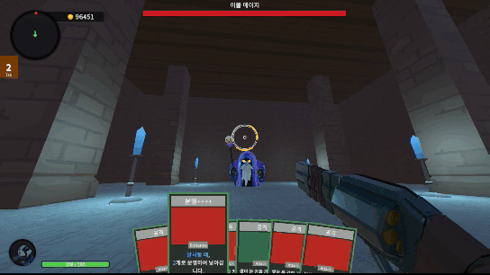

| 항목 | 내용 |
|---|---|
| 장르 | 3D 덱빌딩 카드 슈터 (1인칭, 싱글 플레이) |
| 개발 기간 | 1차 개발 2주 (1차 프로토타입) · 2차 개발 3주 (진행 중) |
| 개발 인원 | 1인 (개인 프로젝트) — 기획 · 구조 설계 · 판단은 직접, 코드 작성과 모델 합치기는 AI 활용 |
| 개발 환경 | Unity 6000.3.15f1 (URP, New Input System) |
| 주요 기술 | 오브젝트 풀링 · TSV 카드 표 · 모듈러 맵 생성 · 이펙트 예산 |
| 링크 | [GitHub](https://github.com/KooHoo-Dev/3rd_3D_1-3D-Project-SaGiKun4) |

---

## 1. 개요

MagiCard는 총알 대신 카드를 쏘는 1인칭 슈터입니다. 강화 카드를 쏘면 강화가 최대 3개까지 쌓이고, 공격 카드를 쏘면 쌓인 강화를 모두 싣고 날아갑니다. 그래서 **같은 공격 카드라도 무엇을 어떤 순서로 쌓았느냐에 따라 결과가 달라집니다.**

목표한 경험은 두 가지입니다.

| 목표 경험 | 뜻 |
|---|---|
| **압도적인 물량** | 카드 조합으로 화면을 가득 채울 만큼 많은 카드를 쏟아 낸다 |
| **한 방의 쾌감** | 한 번의 공격으로 여러 적을 한꺼번에 쓰러뜨린다 |

그래서 정확히 조준하는 실력보다, 어떤 카드로 덱을 꾸리고 그 자리에서 어떤 순서로 쓸지 판단하는 것이 플레이의 중심이 되도록 했습니다.

개발자로서의 목표는 **AI와 함께 만들었을 때 제 역량을 어디까지 끌어낼 수 있는지** 시험하는 것이었습니다. 목적과 구조 설계, 판단과 결과 확인은 제가 맡고 코드 작성은 AI에게 맡겼습니다(7장).

| 핵심 기능 | 부딪힌 문제 | 이렇게 풀었다 |
|---|---|---|
| 카드 조합 발사체 (3장) | 관통과 반사를 함께 쌓으면 같은 면에서 정반대로 움직임 | 실행 순서를 다투게 하는 대신 반응·조향·효과라는 역할로 나눠, 충돌 한 번은 반응 카드 한 장만 맡게 함 (3.3) |
| 쏟아지는 카드 (4장) | 분열을 강화하면 카드가 5\~6만 장 쏟아져 FPS가 한 자릿수로 떨어짐 | 동시 발사체 500을 넘는 분열은 위력으로 바꾸고, 이펙트는 같은 종류 40개까지만 그림 (4.2 · 4.3) |
| 킬 그래프 (5장) | 분열한 카드까지 한 번의 공격으로 세야 함 | 쏠 때 붙인 공격 번호를 분열한 자식과 피해 이벤트에 물려주고, 가장 많이 처치한 공격을 맨 위에 고정 (5.1 · 5.2) |
| 이어 붙이는 맵 (6장) | 문 위치로 방을 이으면 방 전체가 겹침 | 코드가 아니라 문 에셋의 회전 기준을 통일하고, 방 사이에 문 없는 통로를 끼움 (6.1) |
| AI와의 협업 (7장) | AI에게 맡긴 길찾기에서 설계의 주인 자리를 놓침 | 고치기 전에 승인받는 규칙을 만들고, 길찾기는 제가 다룰 수 있는 수준으로 새로 쓰기로 함 (8.2) |

---

## 2. 한 판의 흐름

### 2.1 코어 루프: 방을 비우고 덱을 키운다


<small>통로를 지나 들어간 방 안에 보상 상자와 가마솥이 함께 놓여 있습니다. 방 하나를 비울 때마다 이 자리를 거쳐 다음 방으로 갑니다.</small>

한 판은 방을 하나씩 비우며 나아가는 일입니다. 방의 적을 모두 쓰러뜨리면 문이 열리고, 보상과 가마솥에서 덱을 키운 뒤 다음 방으로 갑니다. 방은 작은 방, 중간 방, 큰 방을 거쳐 보스방으로 이어집니다.

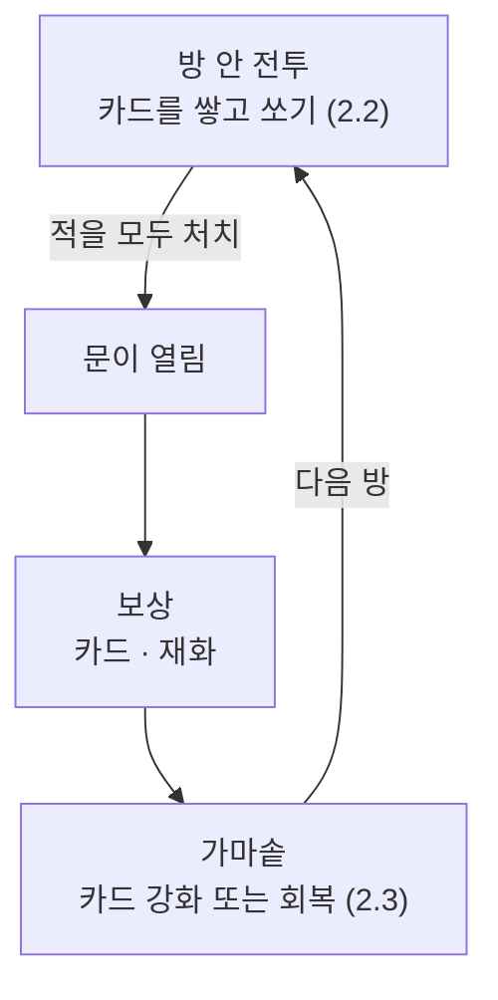

<small>바깥 고리가 한 판 전체의 반복(코어 루프)입니다. 첫 칸 "방 안 전투" 안에는 카드를 쌓고 쏘는 작은 반복이 따로 있고, 그것은 2.2에서 봅니다.</small>

### 2.2 플레이 루프: 강화를 쌓아 한 발에 싣는다


<small>공격 → 분열 → 공격 순서로 쏘면, 가운데 분열 강화가 마지막 공격 카드에 실려 나갑니다. 손패 6장을 다 쓰자 저절로 재장전되어 다시 채워집니다.</small>

방 안에서는 손패에서 카드를 골라 쏩니다. **강화 카드로 쌓아 두었다가 공격 카드 한 장에 모두 실어 보내는 것**이 전투의 반복입니다.

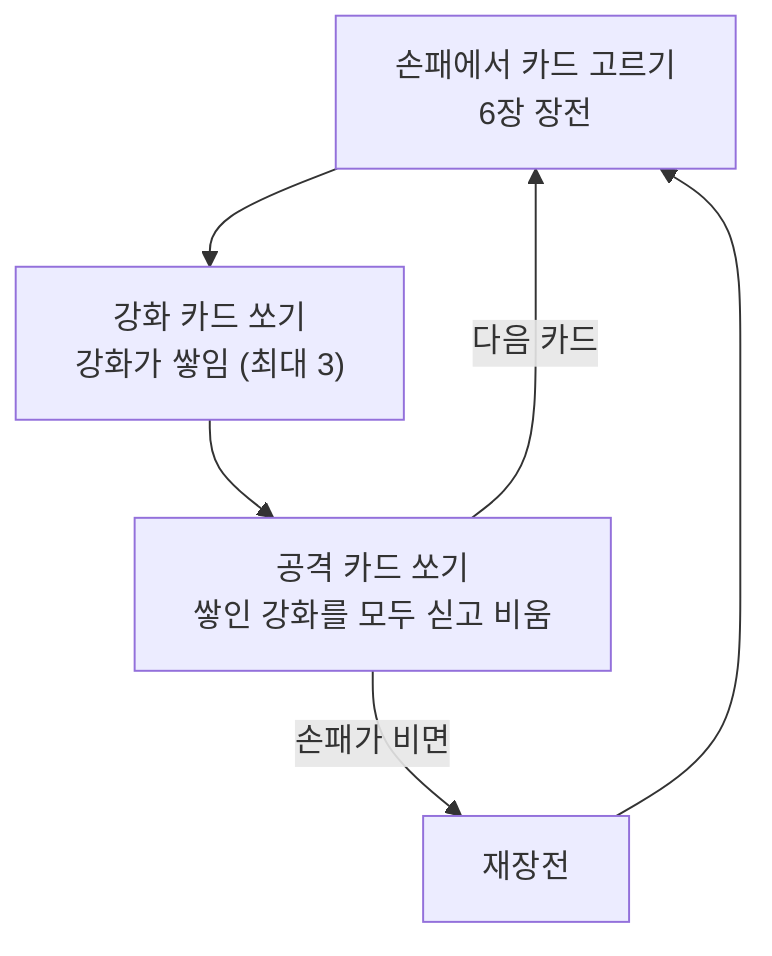

| 입력 | 하는 일 |
|---|---|
| 숫자키 · 마우스 휠 | 리볼버에 장전된 카드 고르기 |
| 좌클릭 | 고른 카드 쏘기 |
| R | 재장전. 버린 카드를 다시 뽑을 카드로 돌림 (손패가 비면 저절로 재장전) |

### 2.3 가마솥: 강화와 회복 중 하나

| 고르기 | 강화 |
|---|---|
| 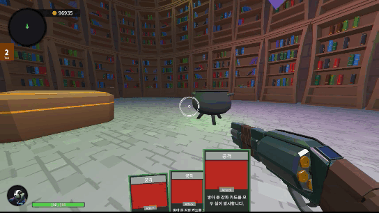 |  |

<small>왼쪽: 가마솥과 상호작용하면 선택 창이 뜨고, 카드 강화와 요리(회복) 중 한 가지만 고릅니다. 오른쪽: 강화 화면에서 카드를 골라 칸에 넣고 강화를 진행하는 과정입니다.</small>

가마솥에서는 카드를 강화할지, 요리로 회복할지 하나를 고릅니다. 강화에서는 강화 카드 여러 장을 한 장으로 합칠 수 있습니다. **합친 카드는 쌓을 때 한 칸만 차지하지만, 쏘면 재료가 된 카드들이 순서대로 실립니다.** 합친 카드를 다시 재료로 넣을 수도 있습니다.

### 2.4 카드의 종류

카드는 하는 일에 따라 세 가지로 나뉩니다. 뒤의 장에서 이 이름들을 그대로 씁니다.

| 종류 | 카드 | 하는 일 |
|---|---|---|
| 공격 | 공격 카드 | 쌓인 강화를 모두 싣고 날아감 |
| 강화 | 분열 · 폭발 · 관통 · 반사 · 유도 · 전이 · 합친 카드 | 쏘면 쌓였다가 다음 공격 카드에 실림 |
| 재료 | 시점 변경 · 대상 변경 · 스펙 강화 | 손패로 뽑히지 않음. 가마솥에서 다른 카드가 **언제 발동할지**(시점), **무엇에 반응할지**(대상)를 바꾸거나 수치 단계를 하나 올림 |

### 2.5 참고한 게임

| 게임 | 가져온 것 | 이 프로젝트에서 |
|---|---|---|
| *Gunfire Reborn* | 1인칭 조작과 이동, 기타 UI | 그대로 참고 |
| *Slay the Spire* | 카드를 조합해 강한 덱을 만드는 재미 | 그대로 참고 |
| *The Binding of Isaac* | 아이템으로 발사체를 강화하는 아이디어 | 아이템 대신 **카드 조합**으로 발사체를 강화 |

---

## 3. 카드 조합: 쌓은 순서가 결과가 된다

같은 공격 카드라도 어떤 강화를 어떤 순서로 쌓았느냐에 따라 결과가 달라집니다. 그래서 **쌓은 순서를 그대로 결과로 옮기는 발사체**가 필요했습니다. 이 장은 그 발사체의 구조(3.1 · 3.2)에서 시작해, 관통과 반사가 부딪힌 일(3.3)과 그 해법을 코드로 옮긴 방법(3.4)으로 이어집니다.

### 3.1 구조: 카드는 성질만, 남은 횟수는 발사체에


<small>손패 맨 앞 카드가 분열 → 폭발 → 공격 순서로 바뀝니다. 앞의 강화 카드 두 장은 쏘아도 쌓이기만 하고, 마지막 공격 카드가 두 강화를 함께 싣고 날아가 벽에서 터집니다.</small>

여러 발사체가 **같은 카드 객체를 함께 씁니다.** 분열한 자식 발사체도 부모의 카드를 그대로 물려받습니다. 그래서 카드에는 "관통한다", "충돌할 때 발동한다" 같은 성질만 두었습니다.

남은 관통 횟수처럼 날아가는 동안 바뀌는 값은 발사체가 따로 들고 있습니다. 발사체는 앞으로 곧게 날아가기만 하는 한 종류이고, **실린 카드 목록이 그 성질을 정합니다.**

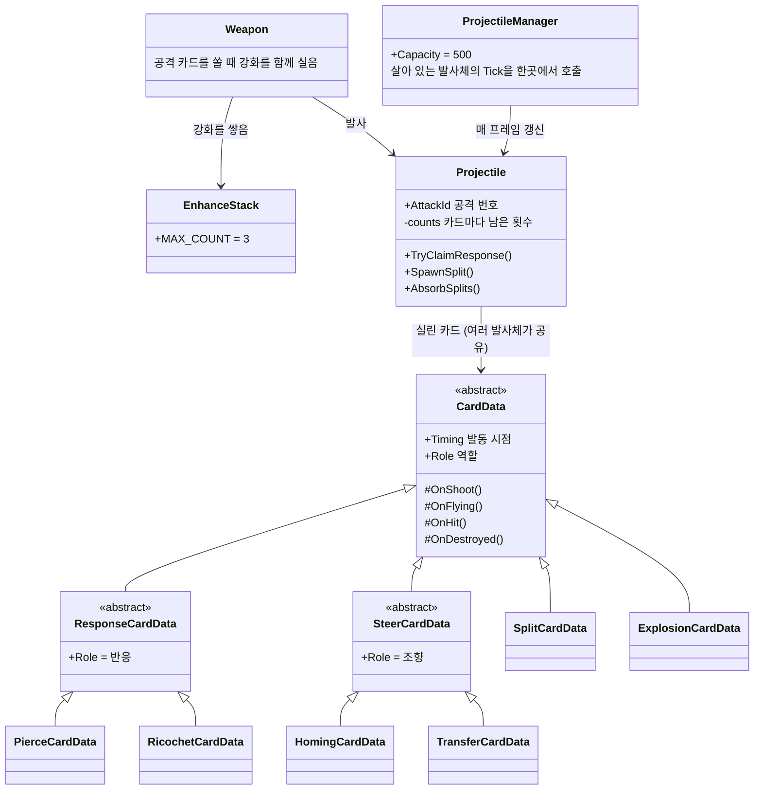

<small>가운데 `Projectile`을 봐 주세요. 카드(`CardData`)는 가리키기만 하고, 카드마다 남은 횟수(`counts`)는 발사체가 갖습니다. 카드 쪽은 역할에 따라 반응(관통·반사)과 조향(유도·전이)으로 갈라집니다. *공격·합친 카드와 재료 카드(시점·대상·스펙)는 생략했습니다.*</small>

### 3.2 카드 수치는 어디에 둘까?

카드 데이터는 처음에 ScriptableObject 에셋으로 만들었습니다. 카드를 새로 추가하는 일이 잦아지면서, 데이터를 어디에 둘지 다시 정해야 했습니다.

| | 카드 | 맵 |
|---|---|---|
| 성격 | 능력치 위주로 단순하고, 새로 추가하는 일이 비교적 잦음 | 고정적. 고치더라도 Unity 씬에서 만들어 프리팹으로 저장 |
| 저장 방식 | ScriptableObject → **TSV 표 + 일반 클래스** ✓ | ScriptableObject·프리팹 유지 |
| 이유 | 외부 표로 떼어 내 추가·수정에 대비 | 밖에서 고칠 일이 없음 |

**카드만 표로 옮겼습니다.** 기준은 "밖에서 자주 고칠 데이터인가"였습니다. 카드 표는 게임 시작 때 한 번 읽습니다.

표는 두 개로 나눴습니다. `cards.tsv`는 카드 한 장에 한 줄, `card_specs.tsv`는 카드 하나의 레벨마다 한 줄입니다.

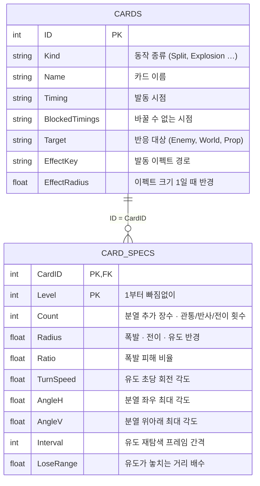

<small>한 카드(`CARDS` 한 줄)에 레벨 줄(`CARD_SPECS`)이 여러 개 붙습니다. 레벨 줄 수가 곧 그 카드의 최대 레벨이고, 레벨 줄이 없는 카드는 강화할 수 없습니다.</small>

실제 표에서 분열과 폭발의 레벨 줄은 이렇습니다.

| 카드 | Level | Count | Radius | Ratio | AngleH · AngleV |
|---|---:|---:|---:|---:|---|
| 분열 | 1 | 1 | – | – | 30 · 10 |
| 분열 | 2 | 2 | – | – | 30 · 10 |
| 분열 | 3 | 3 | – | – | 30 · 10 |
| 폭발 | 1 | – | 5 | 0.8 | – |
| 폭발 | 2 | – | 6 | 1 | – |

- **레벨이 오르면 그 줄의 수치를 씁니다.** 분열은 `Count`(추가 장수)가 1 → 3으로, 폭발은 `Radius`(반경)가 5 → 6으로 커집니다.
- **카드 객체는 수치를 복사해 두지 않습니다.** 쓸 때마다 카드 ID와 레벨로 표에서 찾습니다.
- **스펙 강화는 레벨만 하나 올린 복제본을 만듭니다.** 복제본은 바뀐 레벨로 수치를 다시 찾습니다.

### 3.3 관통과 반사를 함께 쌓을 수 있을까?

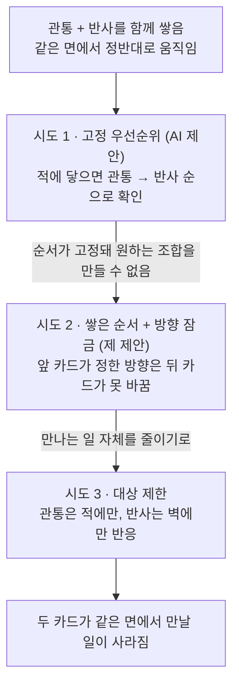

<small>시도 1에서 2로는 플레이어가 쌓은 순서를 살리려고 넘어갔고, 시도 3에서 두 카드가 만날 일은 없어졌습니다. 다만 세 시도 모두 "두 카드가 어떻게 다투지 않게 할까"를 푸는 규칙이라, 시도할수록 막는 규칙만 늘었습니다.</small>

처음 프로토타입의 강화 카드는 분열·폭발·관통·반사 네 종류였습니다. 이 중 관통과 반사는 **같은 면을 만났을 때 정반대로** 움직입니다. 관통은 면을 무시하고 지나가고, 반사는 면에 닿으면 방향을 꺾습니다.

둘을 함께 쌓자 예상과 다른 움직임이 자주 나왔습니다. 관통으로 몬스터 몸 안에 들어간 카드가 그 안에서 반사되는 식이었는데, 논리만 따지면 틀린 동작도 아니었습니다. 위 그림처럼 세 가지를 차례로 시도했고, 대상 제한으로 두 카드가 만나는 일은 사라졌습니다.

그 상태에서 우선순위를 더 촘촘하게 다듬는 대신, 문제를 다르게 보기로 했습니다.

> "지금 문제가 충돌 카드가 서로 경쟁하는 구조에 있는게 아니라 관통과 반사가 운동량의 변화가 정 반대라서 그런거 같아"


<small>위쪽 말풍선이 위 인용문, 곧 제가 문제를 다시 짚은 말입니다. 아래는 그 말을 받아 원인을 다시 정리한 AI의 답입니다. 문제를 "카드끼리의 경쟁"에서 "두 카드의 운동량 변화"로 옮긴 순간입니다.</small>

서로 반대되는 동작이라 논리로는 풀리지 않는다고 판단했습니다. 그래서 다툼을 조정할지, 카드를 나누는 기준을 하나 더 둘지 정해야 했습니다.

| | [A] 다툼을 조정 | [B] 역할이라는 두 번째 기준 ✓ |
|---|---|---|
| 기준 | 발동 시점 하나. 충돌 카드끼리 우선순위·잠금·대상 제한으로 조정 | 시점 × 역할 두 기준 |
| 충돌할 때 | 여러 카드가 한꺼번에 방향을 정하려 함 | 운동량을 정하는 카드는 한 번에 한 장. 앞 카드의 횟수가 다 떨어지면 다음 카드가 이어받음 |
| 반응 대상 | 관통은 적만, 반사는 벽만으로 묶어 둠 | 묶어 둘 필요가 사라짐 |
| 새 카드 | 카드마다 다툼 규칙을 새로 추가 | 유도·전이 같은 카드가 같은 틀에 그대로 들어감 |
| 플레이어가 겪는 것 | 쌓은 조합 중 한쪽 강화가 사라진 것처럼 느껴짐 | 관통 뒤 반사, 반사 뒤 관통이 모두 기대한 대로 움직임 |

**[B]를 골랐습니다.** 기준은 논리가 아니라 "플레이어가 쌓은 대로 움직이는가"였습니다. 문제를 다시 정의한 것은 저였고, 그것을 발동 시점과는 별개인 **"역할"** 이라는 축으로 정리한 것은 AI였습니다.

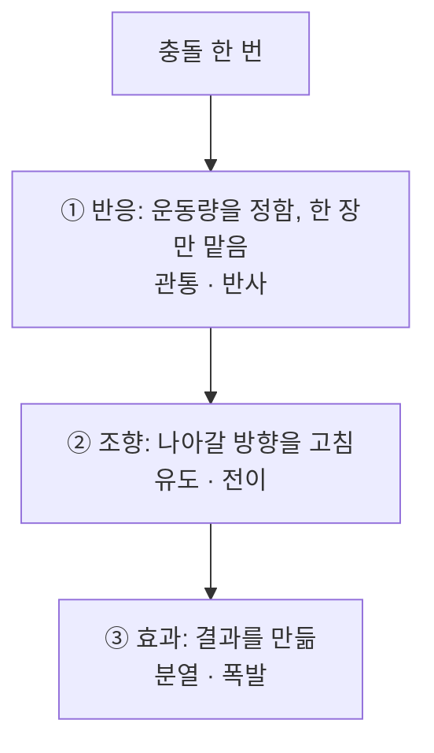

<small>충돌 한 번에서 카드는 반응 → 조향 → 효과 순으로 실행됩니다. 운동량을 정하는 반응은 한 장만 맡으므로, 관통과 반사가 같은 충돌을 두고 다투지 않습니다.</small>

| 순서 | 역할 | 하는 일 | 카드 (기본 시점) |
|---|---|---|---|
| 1 | 반응 | 부딪힌 순간 운동량을 정함. 한 번의 충돌은 한 장만 맡음 | 관통 · 반사 (충돌) |
| 2 | 조향 | 나아갈 방향을 바꿈. 반응 뒤에 실행되므로 반사로 꺾인 방향도 다시 고침 | 유도 (비행) · 전이 (충돌) |
| 3 | 효과 | 피해·분열처럼 결과를 만듦 | 분열 (발사) · 폭발 (소멸) |

- **같은 역할 안에서는 쌓은 순서를 그대로 지킵니다.** 플레이어가 그 자리에서 고른 순서가 직관적으로 결과에 이어지게 하려는 것입니다.
- **반사는 관통의 횟수가 다 떨어진 뒤에야 이어받습니다.** 관통하자마자 반사되어 관통이 의미 없어지는 경험을 막기 위해서입니다.
- **세 역할이 모두 모이는 곳은 충돌입니다.** 효과 카드도 시점 변경으로 충돌 시점에 옮길 수 있기 때문입니다.

그래서 3.3 앞부분에서 걸어 둔 대상 제한은 더 이상 필요하지 않았습니다. 제한을 그냥 없애지 않고 **플레이어가 고를 수 있는 강화로 다시 만들었습니다.** 그것이 대상 변경 카드입니다.

관통은 적, 반사는 벽이라는 기본 대상은 그대로 두고, 대상 변경 카드로 반응할 대상을 넓히면 관통이 벽까지 지나가거나 반사가 적에게도 튕깁니다. **충돌을 막으려고 둔 제한이 조합의 재료가 된 것입니다.**

※ 이 과정에서 받아들이지 않은 제안과 거둬들인 제안도 있습니다.

| 제안 | 누가 | 받아들이지 않은 이유 |
|---|---|---|
| 종류를 먼저 따지고, 같은 종류 안에서만 쌓은 순서대로 | AI | 순서를 시스템이 정하면 플레이어가 원하는 조합을 만들 수 없습니다. 당시 "실행 순서는 스택에 넣은 순서로 하려고 해. 그래야 사용자에게 직관적이니까."라고 답했습니다 |
| 발사 시점 관통처럼 의미 없는 조합은 코드 구조로 막기 | AI | 쓸모없다는 데는 동의했지만, 어느 시점에 쓸 수 있게 할지는 설계하는 사람이 정할 일이라 카드 표의 시점 제한 칸(`BlockedTimings`)으로 조정했습니다 |
| 관통할 때마다 피해 30% 감소 | AI | 관통에는 이미 횟수 제한이 있어, 피해 감소까지 더하면 제약이 지나치게 많아집니다 |
| 카드마다 횟수 변수(`splitCount`, `pierceCount`)를 두는 기존 구현 | AI | 카드가 늘어날수록 변수도 함께 늘어납니다 |
| 부딪히면 같은 카드를 반대 방향으로 새로 만들어 쏘기 | 저 | AI가 "원본이 매번 사라지므로 소멸할 때 터지는 폭발이 반사할 때마다 터진다"고 짚었고, 맞다고 보고 거둬들였습니다 |

### 3.4 충돌 한 번에 반응은 한 장


<small>푸른 꼬리선을 따라가 보세요. 몬스터를 지날 때는 관통이, 뒤쪽 벽에서는 반사가 운동량을 맡습니다. 두 카드가 한 충돌을 두고 다투지 않고 차례로 이어받습니다.</small>

발사체 하나는 발사 → 비행 → 충돌 → 소멸의 한 주기를 거칩니다. 카드의 발동 시점이 바로 이 네 단계입니다. **충돌에서 반응 카드가 계속 날게 하면 다시 비행으로 돌아가고, 맡은 카드가 없으면 사라집니다.**

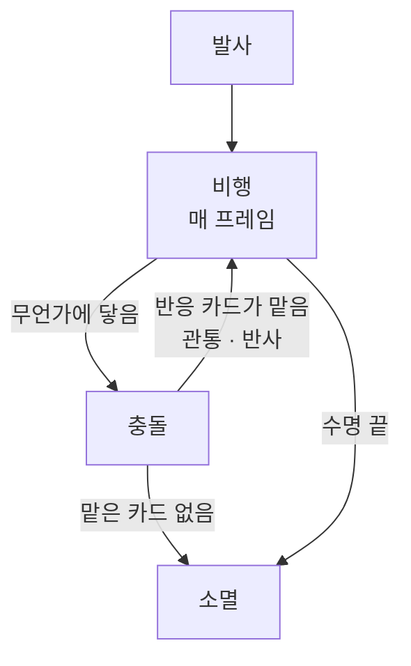

발사할 때 카드 목록을 시점별로 한 번만 나눠 둡니다.

```csharp
// Projectile.cs (발췌) — 발사할 때 카드를 시점별 칸에 역할 순서대로 나눠 담기
private void BuildTimingSlots()
{
    foreach (List<int> slots in timingSlots) slots.Clear();
    // 역할마다 한 바퀴씩 돌며 담으므로, 같은 역할 안의 쌓은 순서가 그대로 유지됩니다.
    foreach (CardRole role in RoleOrder)
    {
        for (int i = 0; i < cards.Count; i++)
        {
            if (cards[i].Role == role)
                timingSlots[(int)cards[i].Timing].Add(i);
        }
    }
}
```

- **역할 순서(반응 → 조향 → 효과)로 바깥 반복을 돕니다.** 그래서 한 시점 칸 안에서 역할 순서가 저절로 지켜집니다.
- **같은 역할 안에서는 쌓은 순서가 그대로 남습니다.** 안쪽 반복이 쌓은 순서대로 카드를 훑기 때문입니다.
- **충돌할 때마다 카드 전체를 다시 훑지 않습니다.** 나눠 둔 칸만 차례로 실행합니다.

"한 번의 충돌은 한 장만 맡는다"는 규칙은 **반응할 권리를 먼저 가져가는 방식**으로 만들었습니다. 충돌마다 권리를 비워 두고, 아무 카드도 권리를 가져가지 않으면 발사체는 사라집니다.

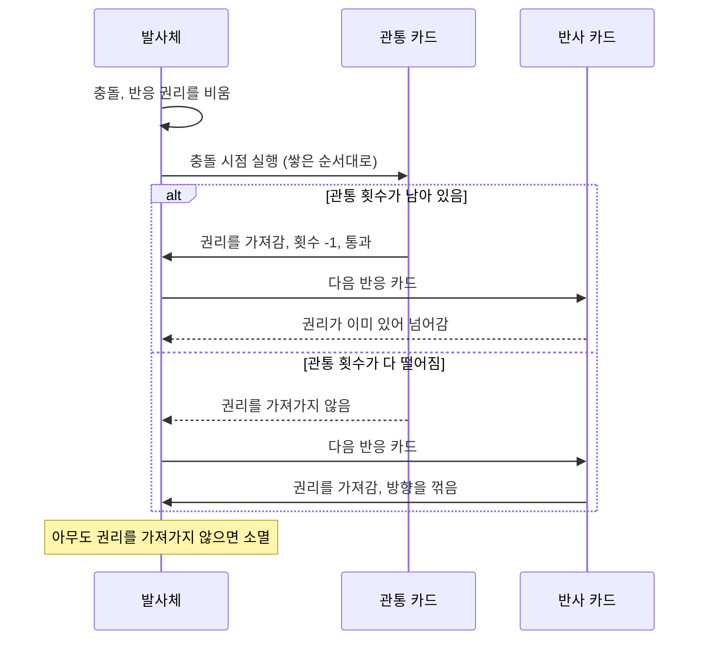

<small>관통 다음 반사를 쌓은 카드가, 두 카드가 모두 반응하는 대상에 부딪혔을 때입니다. 관통 횟수가 남아 있으면 관통이, 다 떨어지면 따로 규칙을 쓰지 않아도 뒤에 쌓인 반사가 이어받습니다. 남은 횟수는 카드가 아니라 발사체 쪽에 저장됩니다(3.1).</small>

분열로 생긴 자식 발사체는 부모의 카드 목록과 위력, 공격 번호를 물려받아 출발하므로, **쌓은 순서가 자식에게도 그대로 이어집니다.**

### 3.5 이 장에서 배운 것

- **게임은 논리보다 플레이어의 기대를 먼저 봅니다.** 플레이어가 무엇을 기대하는지, 그 기대를 채우려면 어디까지 규칙을 봐줘야 하는지를 먼저 생각해야 했습니다.
- **기준은 설계자가 먼저 세웁니다.** AI는 주어진 규칙 안에서 맞는 답을 찾는 데는 강했지만, 우선순위·횟수·대상 제한처럼 논리 안의 해법만 계속 내놓았습니다. 그 기준을 제가 먼저 정하자 AI도 분명하게 구현했습니다.

---

## 4. 쏟아지는 카드 감당하기

3장에서 쌓은 강화는 공격 한 번에 모두 실립니다. 그래서 공격 한 번에서 카드가 수만 장까지 쏟아질 수 있었습니다. 이 장은 **압도적인 물량**을 지키면서 게임이 그 양을 버티게 한 과정입니다. 기준을 정하고(4.1), 그 기준으로 두 가지를 줄이고(4.2 · 4.3), 플레이테스트로 확인했습니다.

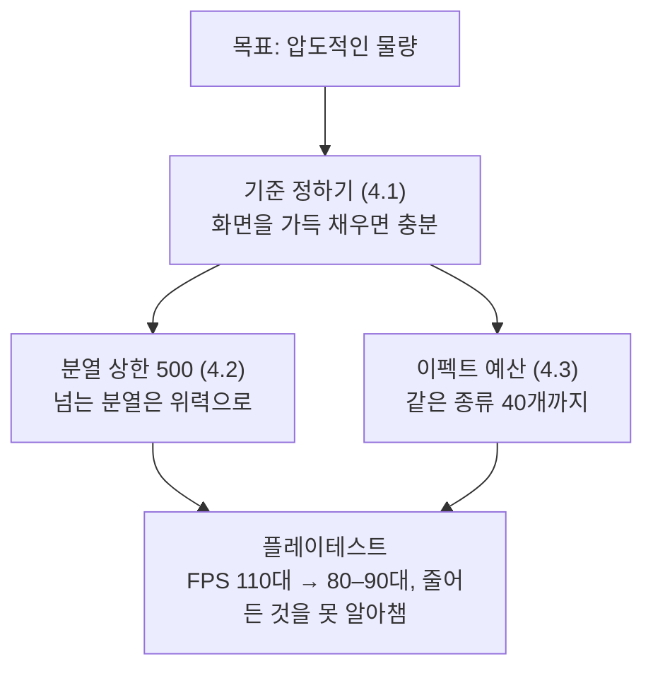

<small>최적화의 출발점이 성능 수치가 아니라 목표 경험이었다는 점을 봐 주세요. 두 장치 모두 같은 기준("화면을 가득 채우면 충분")에서 나왔고, 끝에서 플레이로 확인했습니다.</small>

### 4.1 얼마나 많아야 충분할까?

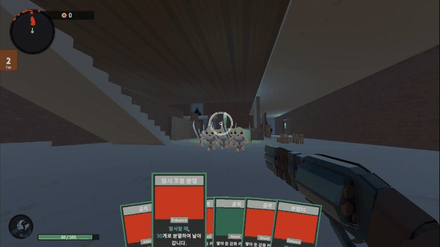

<small>발사하는 순간 약 50장이던 카드가 분열과 반사를 거쳐 약 500장까지 늘어나, 맵에 흩어지며 화면을 가득 채웁니다. "충분히 많다"고 본 기준이 이 장면입니다.</small>

첫 프로토타입에서 분열만 15장 정도 강화해 시험해 보니, **카드가 5\~6만 장 발사될 때 FPS가 한 자릿수로 떨어졌고** 10만 장대에서는 게임이 동작하지 않았습니다. 강화 수치상 나오기 어려운 극단적인 조합이지만, 나올 수 있는 이상 게임 안정성을 크게 해치는 문제였습니다.

그렇다고 무작정 줄일 수는 없었습니다. 물량 자체가 이 게임의 목적이기 때문입니다. 그래서 어디까지 줄여도 되는지를 직접 플레이하며 정했습니다.

분열 카드는 정해진 각도 안에서 무작위 방향으로 퍼지므로, 장수가 늘수록 그 범위가 빈틈없이 채워집니다. **퍼진 카드가 화면을 가득 채우면 충분히 많다**고 봤고, "만든 내가 재미있는가"를 함께 따졌습니다.

많은 발사체를 다룰 장치는 이 기준 전후로 네 가지를 두었습니다.

| 장치 | 하는 일 | 넣은 때 |
|---|---|---|
| 오브젝트 풀링 | 발사체를 매번 새로 만들지 않고 돌려 써 생성 비용과 GC 부담을 줄임 | 1발만 쏘던 프로토타입 직후 |
| 한곳에서 갱신 | 발사체마다 `Update`를 두지 않고, `ProjectileManager`가 살아 있는 발사체의 `Tick`을 한곳에서 호출 | AI가 짚어 줌 (7.1) |
| 동시 발사체 상한 | 넘는 분열은 만들지 않고 위력으로 바꿈 | 4.2 |
| 이펙트 예산 | 넘는 이펙트는 그리지 않고 피해는 그대로 | 4.3 |

### 4.2 상한을 넘는 분열은 어떻게 할까?

동시에 날아다닐 수 있는 발사체 수에 상한을 두기로 했습니다. 상한에 걸려 만들지 못한 분열을 어떻게 처리할지 정해야 했습니다.

| | [A] 상한을 넘으면 만들지 않음 | [B] 넘은 만큼을 위력으로 흡수 ✓ |
|---|---|---|
| 방식 | 상한이면 분열한 자식을 버림 | 만들지 못한 자식 수만큼 남은 카드의 위력을 키움 |
| 장점 | 단순함 | 성능을 지키면서 플레이어가 손해 보지 않음 |
| 단점 | 강화한 만큼 손해 보는 느낌 | 카드 수가 압도적으로 늘어나는 모습이 조금 흐려짐 |

**[B]를 골랐습니다.** 기준은 "강화한 만큼 손해 보지 않는가"였습니다.

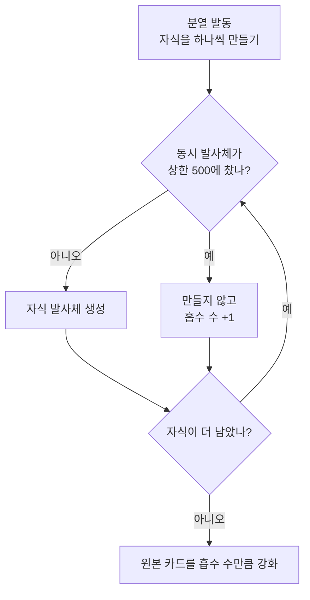

<small>상한에 걸린 자식은 버려지지 않고 "흡수 수"로 모였다가, 마지막에 원본 카드의 위력으로 한꺼번에 바뀝니다.</small>

| 흡수한 원본 카드 | 계산 |
|---|---|
| 위력 | `위력 × (1 + 흡수 수)` |
| 크기 | 위력의 세제곱근만큼, 최대 2배 |
| 피해 | 피해 상한을 두어 값이 넘치지 않게 함 |

500이라는 수는 두 방향에서 정했습니다. 먼저 한 판에서 실제로 나올 수 있는 양을 어림했습니다.

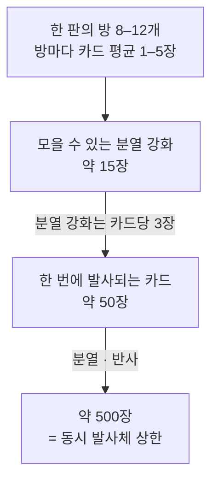

<small>방 수와 방마다 얻는 카드에서 출발해 따라가면, 한 번에 쏘는 약 50장이 분열과 반사로 약 500장이 됩니다. 4.1의 그림이 이 50장을 쏜 장면입니다. 레벨 디자인 전에 러프하게 잡은 값이라 레벨 디자인에 따라 바뀔 수 있습니다.</small>

다음은 성능입니다. 처음에는 AI가 더 큰 상한을 제안했지만, **발사할 때 잠깐 생기는 프레임 하락이 불편해서 제가 500으로 줄였습니다.** 피해 상한은 AI가 제안한 값을 그대로 두었습니다. 피해는 레벨 디자인과 맞물리는 값인데, 아직 몬스터가 그 균형을 따질 단계까지 오지 않아 검증하지 못했습니다.

대가로 받아들인 단점은 실제로는 드러나지 않았습니다.

| 감수한 것 | 실제로는 |
|---|---|
| 카드 수가 압도적으로 늘어나는 모습이 흐려짐 | 상한 가까이 가는 공격은 이미 "충분히 많다"를 넘어선 상태라 개수 차이가 눈에 보이지 않음 |
| 분열만 잔뜩 강화하면 프레임이 떨어짐 | 1차 프로토타입 플레이테스트에서 FPS가 110대 → 80\~90대로 떨어졌지만 게임을 방해하지 않음 |
| 강화한 만큼 카드가 나오지 않음 | 참가자는 "분열을 강화했다"는 경험을 그대로 가져갔고, 카드 수가 줄었다는 것도 알아채지 못함 |

### 4.3 이펙트는 몇 개까지 그릴까?

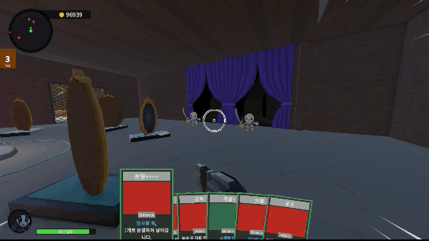

<small>첫 충돌에서 폭발 이펙트가 터진 뒤, 반사될 때마다 분열한 카드가 화면을 덮습니다. 이만큼 많아지면 이펙트보다 카드 자체가 먼저 눈에 들어옵니다.</small>

카드 중 파티클 이펙트가 있는 것은 **폭발 카드 하나**입니다. 폭발은 범위 피해라 터진 범위를 보여 줄 이펙트가 꼭 필요하고, 카드 수가 적을 때는 화려한 색과 연출이 단순한 사각형 카드의 빈약함을 채워 줍니다.

이펙트 최적화는 일부러 미뤘습니다. 이펙트 같은 무거운 요소 없이 성능 시험을 해도, 파티클을 넣으면 다시 해야 한다고 봤기 때문입니다. 그래서 기반만 갖춰 두고 무거운 요소가 들어온 뒤에 시험했습니다. 같은 이유로 카드의 꼬리선도 AI로 만든 임시 스크립트로 대신해 두었습니다.

시험에는 이펙트가 가장 많이 나오는 **분열 + 폭발 + 반사** 조합을 썼습니다. 3장이 반사될 때마다 분열해 9장, 27장으로 불어나며 이펙트를 터뜨립니다.

| 분열 단계 | 카드 수 | 관찰한 결과 |
|---|---:|---|
| 3⁵ | 243 | 측정값에서 프레임 하락이 보임 (플레이 중 체감되지는 않음) |
| 3¹⁰ | 59,049 | 약 5초 멈췄다가 복구 |
| 3¹⁵ | 14,348,907 | 10\~60초 멈췄다가 복구 (편차가 커서 확실한 값은 아님) |

| | [A] 개수 제한 (제 제안) ✓ | [B] 가까운 이펙트 합치기 (AI 추천) | [C] 종류마다 파티클 하나로 몰아 뿜기 (AI 추천) |
|---|---|---|---|
| 방식 | 넘으면 이펙트만 생략 | 가까운 곳의 같은 이펙트를 하나로 크게 | 오브젝트 대신 입자만 방출 |
| 장점 | 가장 간단하고 효과가 큼 | 많이 터진 느낌이 남음 | 가장 가벼움 |
| 단점 | 일부 이펙트가 보이지 않음 | - | 여러 파티클을 겹친 에셋 프리팹은 구조를 맞춰야 해서 작업이 많음 |

**[A]를 골랐습니다.** 프로토타입 단계이고 A만으로 부족함을 느끼지 못했기 때문입니다. B와 C는 A로 부족할 때만 하기로 했습니다.

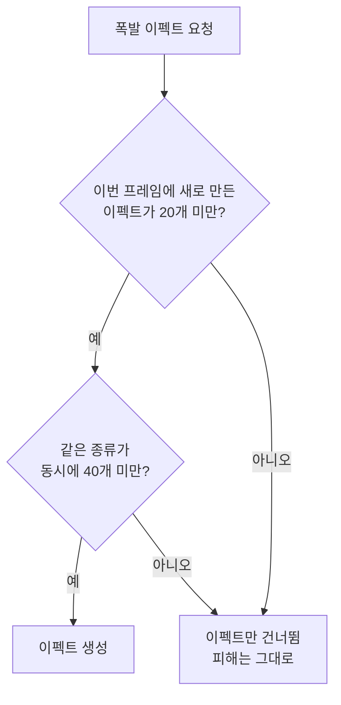

<small>20은 한 프레임에 새로 만드는 이펙트 수, 40은 같은 종류가 동시에 살아 있는 수입니다. 둘 중 하나라도 넘으면 건너뛰는 것은 이펙트뿐이고, 피해는 그대로 들어갑니다.</small>

40은 플레이하며 정했습니다. 이펙트가 40개를 넘는 상황이면 이미 **카드 수 자체가 이펙트를 대신할 만큼 강한 볼거리**였기 때문입니다. 수치는 피드백을 보며 고칠 수 있게 바꾸기 쉬운 형태로 두었고, 플레이테스트에서 이펙트가 부족하다는 지적은 없었습니다(8.1).

같은 기준으로 함께 정리한 것도 있습니다.

- **몬스터가 맞을 때의 이펙트에도 같은 개수 제한을 걸었습니다.** 강조할 대상이 아니어서, 어색하지 않을 만큼만 남겼습니다.
- **꼬리선 에셋이 찍는 점을 줄였습니다.** 임시 스크립트를 준비해 둔 에셋으로 바꾸면서, 라인 렌더러의 점을 지나치게 많이 찍던 것을 줄였습니다.
- **맵 밖으로 나간 카드는 지웁니다.** 파티클을 달고 계속 날아가던 카드를, 맵을 감싸는 경계를 벗어나면 지우게 했습니다. 경계의 크기는 맵 생성기가 방들의 범위로 계산합니다.

분열 상한과 이펙트 예산은 따로 정했지만 같은 결론에 닿았습니다. **카드가 충분히 많으면, 그 개수가 다른 볼거리를 대신합니다.**

### 4.4 이펙트가 40개 뒤로 나오지 않던 문제

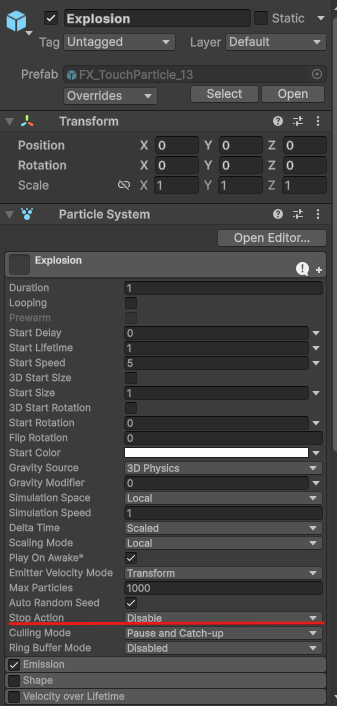

<small>Looping은 꺼져 있고, 종료 동작(Stop Action)이 Disable입니다. AI가 짚은 Looping이 아니라 이 Disable이 진짜 원인이었습니다.</small>

| 항목 | 내용 |
|---|---|
| 문제 | 이펙트 예산을 넣고 시험하자, 발사체 100개 중 처음 40개만 폭발 이펙트가 나오고 그 뒤로는 이펙트가 꺼진 뒤에도 다시 나오지 않음 |
| AI의 첫 진단 | 이펙트 프리팹의 반복 재생(Looping) 때문에 풀로 돌아가지 않는다 |
| 제가 되물은 근거 | Looping은 이미 꺼져 있었고, 재생 시간도 약 2초로 짧음 → AI가 원인을 잘못 짚었다고 인정 |
| 원인 | 파티클의 종료 동작이 Disable이라, 끝나는 순간 Unity가 오브젝트를 먼저 끔 → 풀 반환을 확인하던 `Update`가 돌지 않음 → 풀에는 "사용 중"으로 남아 40개가 자리를 계속 차지 |
| 해결 | 이펙트가 꺼질 때(`OnDisable`) 풀로 돌려보냄. 정상적으로 돌려보낼 때도 `OnDisable`이 불리므로, 이미 풀에 있으면 다시 넣지 않는 확인을 추가 |
| 결과 | 이펙트가 정상적으로 돌아가며 쓰임. 예산을 넣기 전에는 풀이 비면 새로 만들었기 때문에 드러나지 않았던, **꺼진 이펙트가 풀 밖에 쌓이던 누수**도 함께 해결 |

이 일로 **확인한 뒤에 판단하는 것**을 기준으로 삼았습니다. AI의 진단은 그럴듯해도 실제 설정과 다를 수 있었고, 제가 직접 확인한 사실을 근거로 되물었기 때문에 진짜 원인에 닿았습니다. 반대로 파티클이 가려진다는 AI의 판단에 반박했다가, 확인해 보니 AI가 맞았던 적도 있습니다.

---

## 5. 킬 그래프: 한 방이 몇을 쓰러뜨렸나

4장까지가 한 번의 공격을 크게 만드는 일이었다면, 이 장은 그 공격이 얼마나 컸는지 보여 주는 일입니다. **한 방의 쾌감**을 눈으로 확인시켜 주려고 만든 화면 장치입니다.


<small>여러 적을 연달아 쓰러뜨렸을 때 화면 가운데에 크게 뜨는 알림입니다. 이런 확실한 피드백을 이 게임에도 주고 싶었습니다. (출처: 리그 오브 레전드, Riot Games)</small>

### 5.1 무엇을 어디에 띄울까?


<small>화면 오른쪽 위 막대를 봐 주세요. 막대 하나가 공격 하나이고, 맨 위 줄이 지금까지 가장 많이 처치한 공격입니다. 처치 수가 기준을 넘으면 막대 색이 바뀝니다.</small>

처음에는 두 안이 있었습니다. 무엇을 기준으로 처치 수를 보여 줄지 정해야 했습니다.

| | [A] 가장 높은 값 하나 | [B] 시간에 따라 흐르는 막대 | [A + B] 막대 하나가 공격 하나 ✓ |
|---|---|---|---|
| 방식 | 쏠 때 카드에 번호를 새겨 처치 수를 세고, 가장 높은 값 하나를 이미지로 띄움 | 프로파일러처럼 시간에 따라 흘러가는 막대그래프 | 공격마다 막대 하나 |
| 재는 대상 | 공격 단위 | 시간 단위 | 공격 단위 |
| 화면에 남는 것 | 가장 높은 값 하나 | 흘러가는 막대 | 강한 공격이 나오면 그 막대 하나만 길게 늘어남 |

**두 안을 합쳤습니다.** AI가 "A는 공격 단위, B는 시간 단위라 재는 대상이 다르다"고 비교해 주었고, 저는 A의 공격 단위와 B의 막대 모양을 합쳐 **막대 하나가 공격 하나**를 뜻하게 했습니다.

표시 규칙은 제가 정했습니다.

| 규칙 | 이유 |
|---|---|
| 화면 오른쪽 위, 막대는 오른쪽에서 왼쪽으로 길어짐 | 강한 공격일수록 그래프가 화면 안쪽으로 자라 임팩트가 생김 |
| 처치 수가 가장 많은 공격은 맨 위에 고정, 나머지는 쏜 순서대로 아래에 | 지금 가장 강한 한 방이 무엇인지 보여 줌 |
| 최대 5줄 | 손패는 6장이지만, 플레이로 재 보니 동시에 4줄을 넘지 않아 한 줄 여유를 둠 |
| 줄이 모자라면 처치 수가 가장 낮고 오래된 줄부터 비움 (아래 그림) | 그래프는 가장 많이 처치한 공격만 제대로 보여 주면 됨 |
| 공격이 끝나면 막대를 떨게 해 확정을 알리고, 2초 뒤 지움 | 플레이어가 몇 킬인지 확인할 시간을 줌 |
| 한 번에 일정 수 이상 처치하면 막대 색을 바꿔 강조 | 강한 공격을 한눈에 보이게 함. 기준 값은 1차 프로토타입의 임시 값이라 2차에서 밸런스와 함께 조정할 예정 |

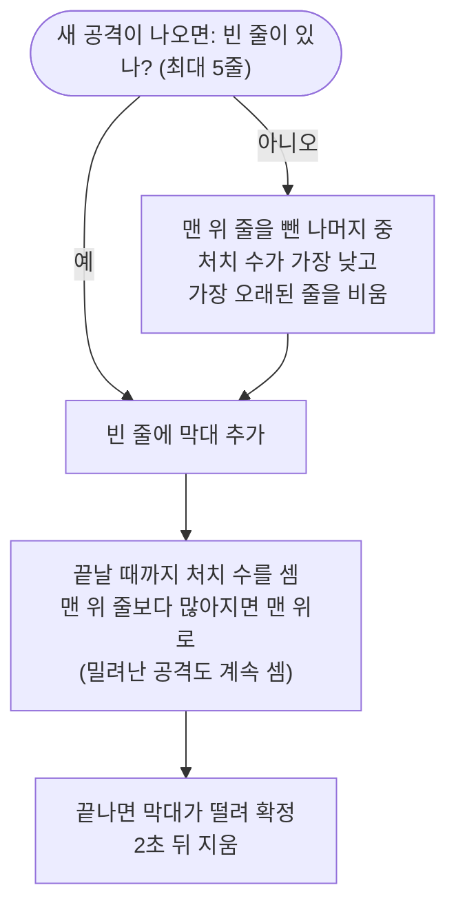

<small>맨 위 줄은 언제나 지금까지 가장 많이 처치한 공격입니다. 밀려난 공격도 처치 수는 계속 세므로, 소멸할 때 터지는 폭발처럼 늦게 끝나는 공격이 나중에 맨 위로 올라올 수 있습니다.</small>

표의 배치와 줄 규칙은 **처음 만든 그래프에서 드러난 문제를 고친 결과**입니다.

| 가운데에 두면 (연출) | 줄을 제한하기 전 | 6번째 공격이 빠짐 (연출) |
|---|---|---|
|  | 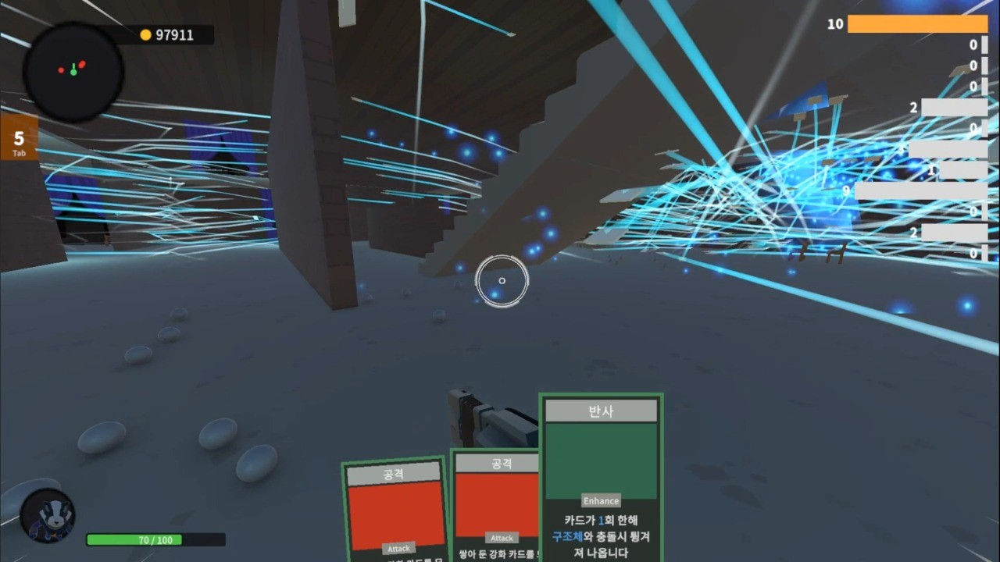 | 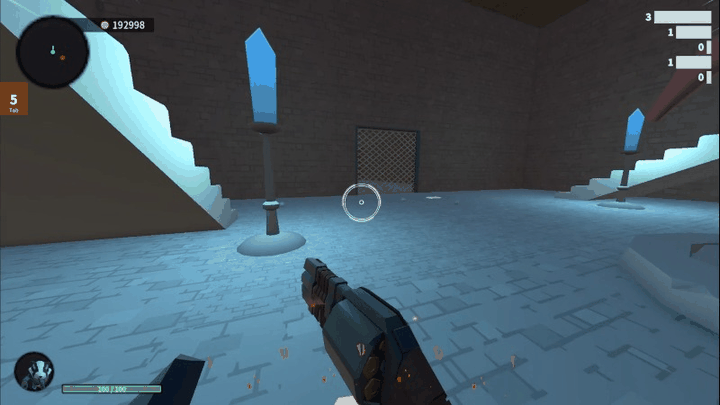 |

<small>왼쪽: 가운데 위쪽에 놓인 그래프가 처치 수가 늘수록 아래로 길어져 조준점 바로 위의 시야를 차지합니다. 가운데: 처치 수 0인 공격까지 한 줄씩 차지해, 막대가 화면 오른쪽을 길게 덮습니다. 오른쪽: 마지막 공격이 적을 쓰러뜨렸는데도 새 막대가 생기지 않습니다. 줄이 다 찼을 때 비울 줄을 정하는 규칙이 여기서 나왔습니다.
*왼쪽은 처음 걱정한 배치를 보여 주려고 그래프를 가운데로 옮겨 찍었고, 실제 게임에서는 오른쪽 위에 있습니다. 가운데는 줄 수를 제한하기 전 빌드에서 찍었습니다. 오른쪽은 현상이 보이도록 그래프 유지 시간을 늘려 찍었으며, 실제 플레이에서는 손패 6장이 한 바퀴 돌기 전에 줄이 비워져 6번째까지 쌓이는 일이 드뭅니다.*</small>

### 5.2 분열한 카드까지 어떻게 셀까?

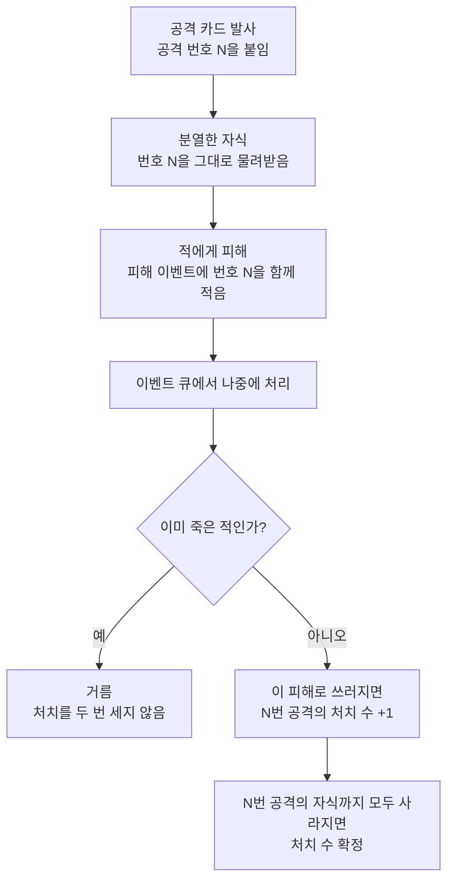

<small>번호는 발사체가 아니라 피해 이벤트에 적혀 있습니다. 그래서 큐를 처리하기 전에 발사체가 풀로 돌아가 다른 공격에 다시 쓰여도, 처치는 처음 쏜 공격으로 정확히 돌아갑니다.</small>

- **분열해도 같은 공격으로 셉니다.** 쏠 때마다 공격 번호를 붙이고, 분열한 자식은 그 번호를 물려받습니다. 분열한 자식까지 모두 사라지면 그 공격의 처치 수가 확정됩니다.
- **피해를 보내는 순간 공격 번호를 피해 이벤트에 적어 둡니다.** 피해는 이벤트 큐에 넣었다가 나중에 처리하는데, 그 사이 발사체가 풀로 돌아가 다른 공격에 다시 쓰일 수 있습니다. 코드를 확인하던 AI가 짚어 준 함정입니다.
- **이미 죽은 적은 걸러 냅니다.** 그래서 폭발과 직접 충돌이 한꺼번에 맞아도 처치가 두 번 세어지지 않습니다.

---

## 6. 방과 통로를 이어 붙이는 맵

방의 적을 모두 쓰러뜨리면 문이 열리고, 보상을 받은 뒤 다음 방으로 넘어갑니다(2.1). 그래서 **방과 방을 끊김 없이 이어 붙이는 맵**이 필요했습니다. 맵은 미리 만든 방을 문 위치에 맞춰 이어 붙여 만듭니다.

### 6.1 방을 이으면 방 전체가 겹치던 문제

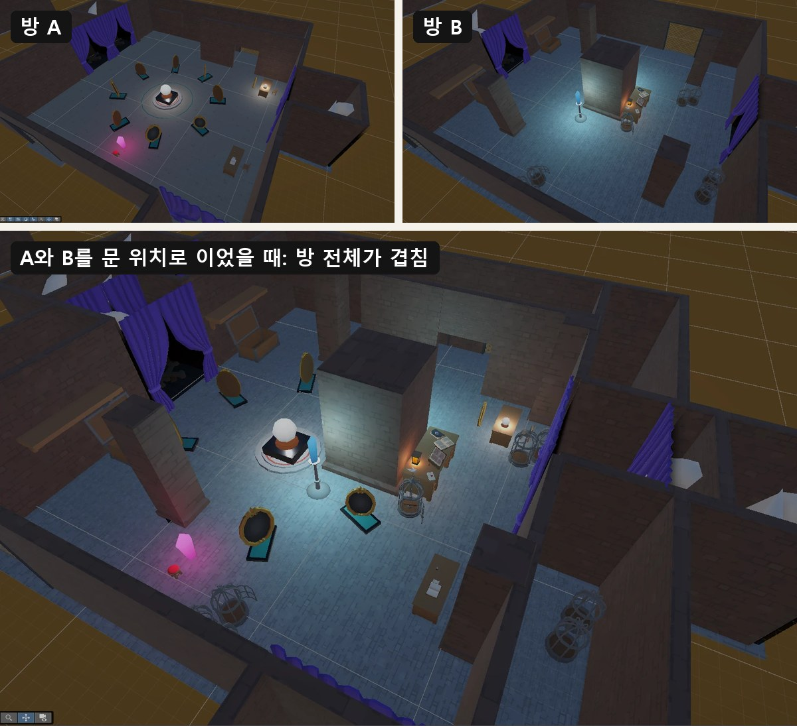

<small>두 방이 문에서 맞닿지 않고 한 자리에 통째로 포개졌습니다.</small>

| 항목 | 내용 |
|---|---|
| 문제 | 앞 방의 출구 문과 새 방의 입구 문을 겹치도록 이었더니, 문이 아니라 방 전체가 겹침 |
| 원인 | 입구 문과 출구 문이 모두 방 안쪽을 보게 두어, 두 문의 회전값이 서로 달랐음 |
| 해결 | 코드에서 방을 돌려 맞추는 대신, **문 에셋의 기준을 맞춤.** 시작 문과 끝 문의 회전을 -90/90에서 90으로 통일하고 태그(`StartGateway`, `EndGateway`)로만 구분 |
| 결과 | 위치만 다르고 나머지는 완전히 같은 문 에셋이 되어, 위치만 맞추면 방이 정확히 이어짐 |

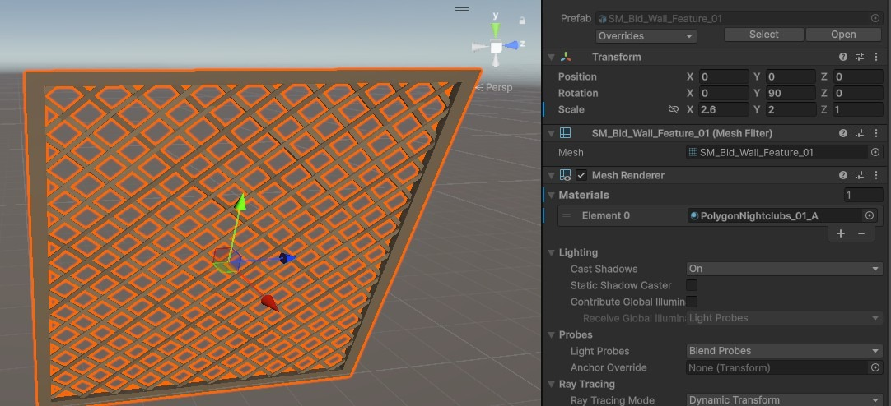

<small>Transform의 Rotation Y 값이 90입니다. 시작 문과 끝 문 모두 이 값 하나로 맞췄습니다.</small>

코드가 아니라 에셋을 고친 이유는 **방을 만드는 사람이 프로그래머가 아닐 수 있기 때문**입니다. 여럿이 작업한다면, 코드가 방을 어떻게 돌리는지 몰라도 방을 만들 수 있는 기준이 필요하다고 봤습니다.

이제 방을 만드는 사람은 "**문은 정확히 똑같이 겹쳐진다**"는 기준 하나만 알면 되고, AI에게도 "시작 방의 EndGateWay와 새로 붙을 방의 StartGateWay의 위치만 맞춘다"는 한 줄짜리 규칙만 넘겼습니다.

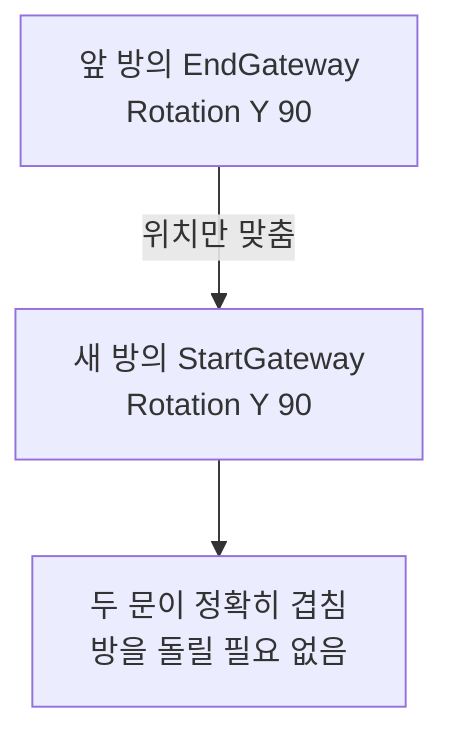

<small>두 문은 회전이 같으므로 위치만 맞추면 정확히 겹칩니다. 방을 만드는 사람도, 코드도 이 한 가지만 지키면 됩니다.</small>

플레이테스트에서 다음 문제가 나왔습니다. **두 방의 문 메시가 같은 자리에 완전히 겹쳐, 깜빡이는 노이즈(Z-파이팅)처럼 보였습니다.**

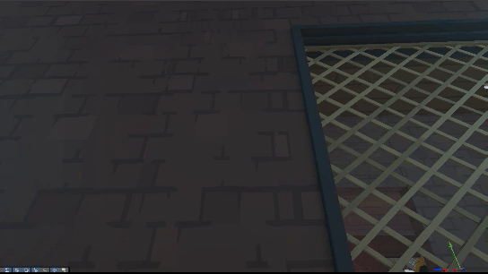

<small>문 주변 벽의 벽돌 무늬가 두 겹으로 섞이며 깜빡이는 부분을 봐 주세요.</small>

그래서 **문이 없는 방을 따로 만들어 통로(`Path`)로 쓰고**, 방과 방 사이를 이 통로로 이었습니다. 방은 문 기준만 지켜 만들면 되고 사이는 통로가 이어 주므로, 이후로는 문 문제가 없었습니다.

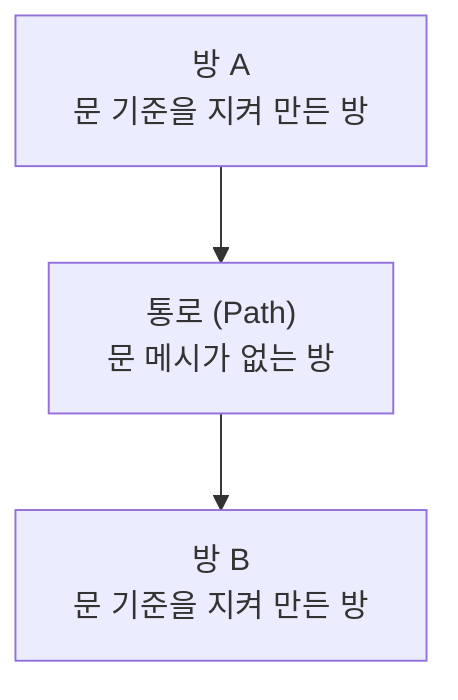

| 통로 끝에서 이어지는 방 | 통로만 놓았을 때 |
|---|---|
| 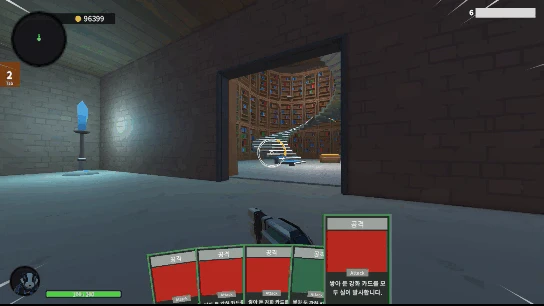 | 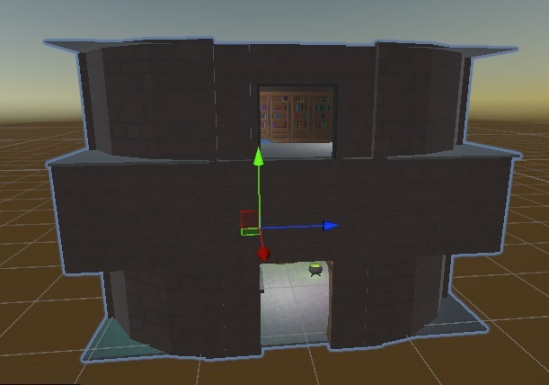 |

<small>왼쪽: 통로 끝에 문 메시가 없어, 다음 방의 문과 겹칠 일이 없습니다. 오른쪽: 통로를 혼자 놓으면 위아래 입구가 비어 이상한 방처럼 보입니다. 통로는 언제나 두 방 사이에만 놓이므로 혼자 보일 일이 없어, 이 점은 감수했습니다.</small>

플레이테스트에서도 "맵 구조를 보고 생성 방식인 걸 눈치챘는데 … 실제로 구현해보신 걸 보니 인상깊었음"이라는 반응이 있었습니다.

### 6.2 책 1,574권을 어떻게 줄일까?

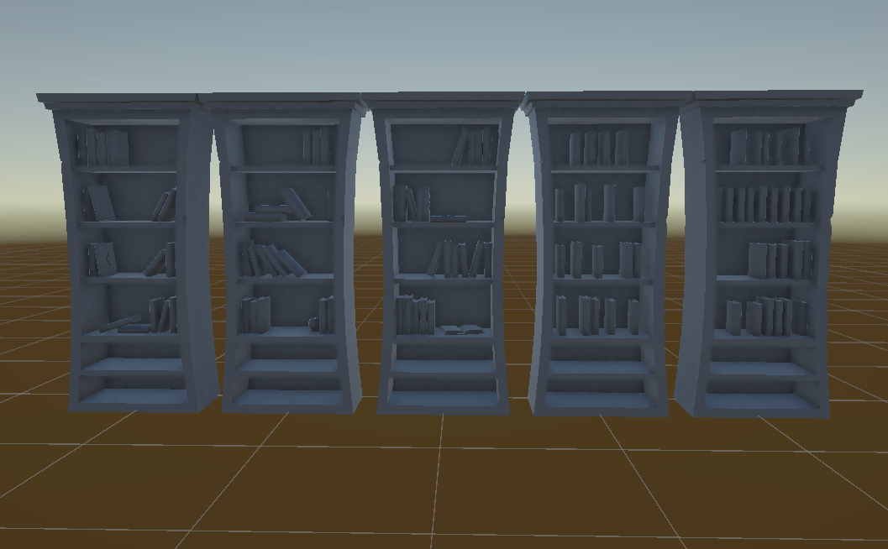

<small>책 배치가 서로 다른 책장 5종입니다. 이 5종을 돌려 가며 놓아, 맞붙은 93쌍 가운데 같은 패턴끼리 붙은 쌍이 0쌍이 되게 했습니다.</small>

통로의 책장을 책이 꽂힌 것처럼 꾸미려고, AI에게 책 모델 9종을 선반마다 무작위로 놓게 했습니다. 책장을 3층으로 쌓아 78개로 늘리자 **책 1,574권이 각각 오브젝트가 되어 책장과 책의 Renderer가 1,652개**가 됐습니다.

통로는 방이 이어질 때마다 생기는 조각이라, 조각 하나의 오브젝트 수가 맵 전체에서는 몇 배로 늘어납니다. 그래서 책을 어떻게 그릴지 다시 정해야 했습니다.

| | [A] 책을 하나씩 놓고 GPU Instancing | [B] 책장과 책을 한 메시로 합친 패턴 반복 ✓ |
|---|---|---|
| 방법 | 같은 메시·머티리얼의 책을 한 번에 묶어 그림 | 책이 꽂힌 책장 몇 종을 미리 한 메시로 만들어 돌려 가며 배치 |
| 줄어드는 것 | 그리기 호출 | 그리기 호출 + 만들고 관리할 오브젝트·Renderer 수 |
| 단점 | 방을 만들 때마다 책 1,574개도 함께 만들어짐 | 같은 책장이 반복돼 보일 수 있음. 책 한 권씩 고칠 수 없음 |

**[B]를 골랐고, A의 GPU Instancing도 그대로 두었습니다.** 그리기 호출만이 아니라, 방을 만들 때마다 생기는 책 오브젝트 자체를 없애고 싶었기 때문입니다.

패턴은 5종입니다. 책장이 위아래·좌우로 맞붙으므로, 가운데 책장과 맞닿은 네 책장이 모두 다른 패턴이 되려면 최소 5종이 필요합니다.

| 단계 | 맡은 사람 |
|---|---|
| 책장 배치 5개 고르기·다듬기 | 저 (Unity 씬) |
| 책장과 책을 한 메시로 합치기, 겹치는 점 병합, 가려지는 면 제거 | AI (Blender) |
| 작업 기준 정하기 | 저 — ① "겹친다"는 **지웠을 때 바깥에서 보이는 모습이 바뀌는가**로 판단 ② 머티리얼 점검 ③ 완성 모델을 원본과 비교해 차이를 보고하고, 고칠 수 있는 차이는 고친 뒤 기록 |
| 원본과 비교해 확인 | AI가 위 기준으로 비교 렌더링해, 책장 모서리의 음영 차이를 찾아 원래 노멀을 되살림 |

| 항목 | 이전 | 이후 |
|---|---:|---:|
| 통로 책장·책 Renderer (같은 3층 78개 기준) | 1,652개 | **78개** |
| 패턴 5종 합계 삼각형 | 15,920 | 14,821 |
| FPS (같은 조건 아님) | 1층 약 30개일 때 20\~30 | 3층 78개일 때 약 113 |

이 작업만의 효과로 확실히 말할 수 있는 것은 **Renderer 1,652 → 78**입니다. FPS는 이전 값을 같은 조건으로 잰 것이 아니고 그 사이 다른 변경도 있었으므로, 오른 것을 모두 이 작업 덕분으로 보지는 않습니다.

대신 합친 프리팹은 Unity에서 책 한 권씩 옮길 수 없고, 고치려면 Blender 원본을 고쳐 다시 내보내야 합니다. 이 점은 감수했습니다.

- **모델을 점과 메시 단위로 해석하고 요청할 때 결과가 좋았습니다.** "이런 모델을 만들어 줘"라고 결과만 요청하는 것보다 나았습니다.
- **작업을 단계로 나누고 단계마다 기준을 정해 AI와 나눠 맡는 방법**도 여기서 배웠습니다.
- **Unity의 Static Batching은 작업이 끝난 뒤에야 알아 비교하지 못했습니다.** 그래도 답을 먼저 알았다면 모델을 점과 메시로 뜯어보는 과정을 거치지 않았을 것이라, 이 경험이 헛되었다고 보지는 않습니다.

---

## 7. AI와 일한 방식

앞의 네 장은 모두 AI와 함께 만들었습니다. AI로 개발이 빨라진다는 말이 많지만, 제 주변에는 AI를 경계하는 사람이 더 많았고 저도 이전 2D 프로젝트에서는 AI를 거의 쓰지 않았습니다. 그래서 이번에는 **AI와 함께 만들었을 때 제 역량을 어디까지 끌어낼 수 있는지** 시험해 보기로 했습니다(1장).

### 7.1 제가 한 것과 AI가 한 것

| 제가 한 것 | AI가 한 것 |
|---|---|
| 목적과 플레이어 경험 정하기 | 코드 작성 |
| 구조 설계, 판단 기준 세우기 | 대안을 내고 비교하기 |
| 게임이 규칙을 봐줘야 하는 판단 (관통·반사를 역할로 나눈 것, 3.3) | 제가 정한 구조에 맞춰 세부 수치 정하기 (4.2 · 4.3) |
| 플레이어 경험을 정하는 규칙 (킬 그래프 표시 규칙, 5.1) | 정해 둔 기준에 따른 점검 |
| 결과 확인과 수정 요청: 고치기 전 승인, 코드를 시작점부터 함수 하나씩 읽기, 직접 플레이, 원본과 비교 렌더링 (6.2) | 이미지 생성과 3D 모델 합치기 |

한 기능은 대체로 이렇게 만들었습니다.

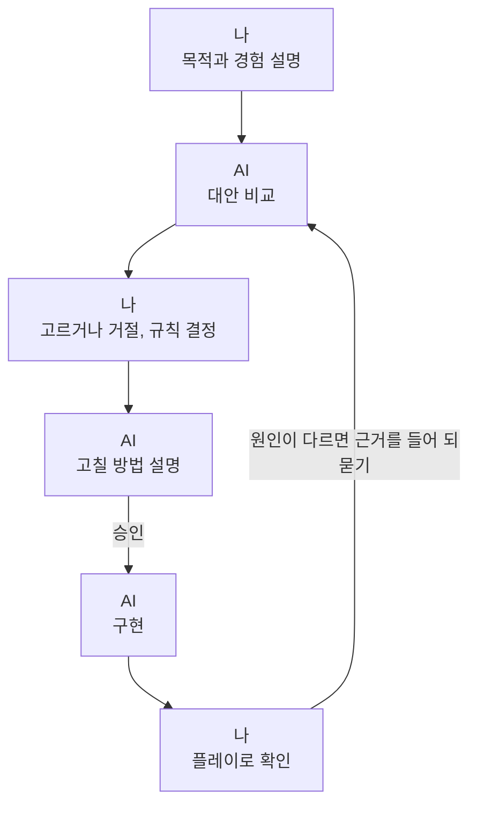

<small>AI가 일하는 칸(대안 비교, 방법 설명, 구현) 사이마다 제 칸(결정, 승인, 확인)이 끼어 있습니다. 승인 없이 구현으로 넘어가는 화살표는 없습니다.</small>

결정마다 누가 정했는지는 이렇습니다.

| 결정 | 누가 정했나 | § |
|---|---|---|
| 관통·반사 문제를 운동량 문제로 다시 정의 | 저. 그것을 "역할" 축으로 정리한 것은 AI | 3.3 |
| 실행 순서는 쌓은 순서대로 | 저 (AI의 "종류 먼저" 제안을 거절) | 3.3 |
| 발사체를 한곳에서 갱신 | AI가 짚어 줌 → 받아들임 | 4.1 |
| 동시 발사체 상한 500 | AI가 더 큰 값을 제안 → 제가 500으로 줄임 | 4.2 |
| 피해 상한 | AI 제안 값 그대로 (아직 검증 못 함) | 4.2 |
| 이펙트는 개수 제한만 | 저 (합치기·몰아 뿜기는 AI 추천, 보류) | 4.3 |
| 이펙트가 나오지 않던 원인 | AI의 첫 진단을 제가 확인한 사실로 바로잡음 | 4.4 |
| 킬 그래프는 막대 하나가 공격 하나 | AI가 두 안을 비교 → 제가 합침 | 5.1 |
| 공격 번호를 피해 이벤트에 적기 | AI가 함정을 짚어 줌 | 5.2 |
| 문 에셋의 회전 기준 통일, 통로 끼우기 | 저 | 6.1 |
| 책장을 패턴으로 합치기 | 저. 합치는 작업은 AI (Blender) | 6.2 |
| 길찾기 구조 | 목표만 제가 주고 구조는 AI가 쌓음 → 손을 떠남 | 8.2 |

AI의 제안이 맞아서 받아들인 대표적인 예가 발사체 갱신입니다. 수업에서 배운 FSM 코드는 상태마다 `Update`를 두지 않고, 상태 머신이 현재 상태의 `Tick`을 대신 불러 주는 구조였습니다. 같은 원칙을 발사체에도 쓸 수 있었는데, **발사체를 하나하나의 객체로만 생각하고 풀로 묶으면서 놓쳤습니다.**

### 7.2 함께 일하며 정한 규칙

| 규칙 | 이유 |
|---|---|
| 고치기 전에 방법을 설명받고 승인하며, 이해한 부분만 코드로 남김 | AI가 "이렇게 고칠까요?"가 아니라, 필요해 보여 이미 고쳤다고 알리는 일이 몇 번 되풀이됐습니다. 경계하던 "개발 주도권을 뺏기는 상황"이라고 보고, 번거롭더라도 고칠 내용을 먼저 확인하게 했습니다 |
| 이름으로 찾지 않고 인스펙터에서 연결 | 인스펙터로 지정할 수 있는 곳이었고, 어떤 오브젝트와 이어졌는지 바로 보여 오류를 고치기도 쉬웠습니다 |
| 사람이 읽기 좋은 문법으로 (여러 줄을 압축한 람다·튜플 반환은 되도록 쓰지 않음) | 저는 코드를 시작점부터 함수 하나씩 따라가며 읽습니다. 압축한 람다는 이 순서로 읽히지 않고, 튜플은 돌려주는 값이 여러 가지라 읽기 어렵습니다. 코드가 1\~10줄 늘지만 성능 차이는 없는 수준이라 감수했습니다 |
| 복잡한 동작은 코드보다 애니메이션으로 | 몬스터가 공격할 때 콜라이더를 켜는 것처럼 복잡한 것은 Unity 애니메이션 화면에서 보며 고치는 편이 읽기 좋습니다. 보상 상자가 떨리거나 열리는 단순한 움직임은 코드로 만들었습니다 |

코드를 따라 읽는 순서는 예를 들면 이렇습니다. 카드가 나가지 않으면 `Weapon.Fire`에 들어가는 값 → 갈라지는 함수 → 나가는 값 → 최종 결과 순으로 봅니다.

### 7.3 모델링을 맡길 때의 요청 규칙

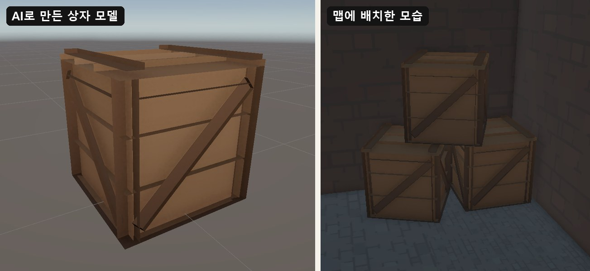

<small>요청문의 규칙대로 만든 상자(왼쪽)가 기존 맵의 분위기에 맞게 놓여 있습니다(오른쪽).</small>

모델링은 제가 약한 분야라, 책장 패턴 합치기(6.2)와 장애물 모델 제작에 AI를 썼습니다. 결과만 요청하면 AI가 제가 생각한 것과 다른 사물을 떠올리거나, AI가 좋아하는 디자인으로 바꿔 만들었습니다.

그래서 **AI가 제가 떠올린 것과 같은 모델을 떠올리게 하는 요청문(프롬프트)** 을 직접 설계했고, 이 요청문을 다른 AI에게 검토받기도 했습니다.

| 규칙 | 내용 |
|---|---|
| 시작 조건 | 모델 수준·세부 디테일·재현 수준·사용 조건 네 가지를 사용자가 정하거나 맡기기 전에는 초안도 만들지 않음 — "AI가 정하지 않는다" |
| 추측과 결정 나누기 | 꼭 필요한 결정은 사용자가 하고, 말하지 않은 부분은 AI가 상식으로 채우되 "AI 임시 가정"으로 표시 |
| 참고 이미지의 역할 | 이미지마다 형태 / 재질 / 무늬 / 분위기 중 어떤 역할인지 정함. 재질 사진에서 형태를 가져오지 않음 |
| 단계별 승인 | 형태 → 세부 형상 → 재질 → 최적화·Unity 반입. 단계마다 결과를 보고 승인한 뒤 진행 |
| 프로젝트 스타일 분석 | 기존 에셋의 폴리곤 규모·텍스처·셰이더를 읽고, "기존 방식에 맞춤"을 첫 선택지로 제안 |
| 사실만 보고 | 실행하지 않은 코드, 확인하지 않은 결과를 다 됐다고 말하지 않음 |

관통·반사에서 얻은 교훈, 곧 **"기준을 설계자가 먼저 정해야 AI도 분명하게 구현한다"(3.5)를 다시 쓸 수 있는 규칙으로 만든 것**입니다.

---

## 8. 회고

### 8.1 목표한 경험은 전달됐나

1차 개발 2주 동안 카드 덱, 강화 쌓기, 카드 조합 발사체, 모듈러 맵, 방 단위 전투, 보상과 가마솥 강화, 보스방까지 이어지는 1차 프로토타입을 완성했습니다. 이 프로토타입을 공개해 플레이테스트 피드백을 받았습니다.

| 목표 (1장) | 구현 | 플레이테스트 반응 |
|---|---|---|
| **한 방의 쾌감** | 강화 쌓기 · 카드 조합 발사체 (3장), 킬 그래프 (5장) | "강화를 중첩해서 한방에 쏘는 재미는 확실하다", "모디파이어 중첩으로 말도 안되는 카드를 만들어서 사기치는 재미가 있었습니다" |
| **압도적인 물량** | 분열 상한과 흡수, 이펙트 예산 (4장) | 분열만 강화한 플레이에서도 게임을 방해하지 않았고, 카드 수가 줄었다는 지적은 없었음 (4.2) |
| 카드 조합 슈터라는 컨셉 | 공격·강화·재료 카드 (2.4) | "3D 형태로 카드 강화 게임을 한다는 게 신선했습니다", "카드 슈팅은 신선하고 조합의 경험이 재밌습니다" |
| 참고한 게임의 조작감 | 1인칭 조작 (2.2 · 2.5) | "FPS 자체의 시원시원한 조작감은 훌륭히 구현되어있다고 느꼈습니다" |

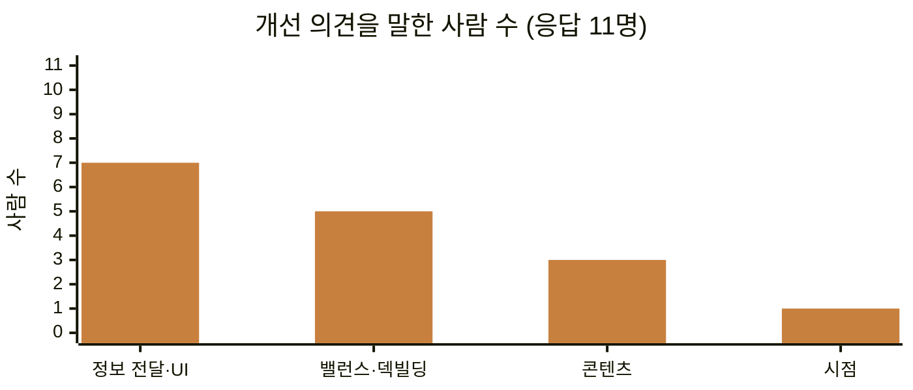

<small>응답 11명이 남긴 개선 의견을 주제별로 나눠, 그 주제를 말한 사람 수를 셌습니다. 정보 전달·UI가 7명으로 가장 많습니다. 한 사람이 같은 주제를 여러 번 말해도 한 번으로 셌습니다.</small>

**강화 방식과 카드 정보 전달(UI)에 대한 의견이 가장 많았습니다.** 1차 프로토타입에서는 시스템을 먼저 갖추느라 UI를 임시로 넣어 둔 상태였고, 이미 알고 있던 부분입니다.

| 아쉬운 점 | 원인 | 2차 개발에서 |
|---|---|---|
| 카드 정보 전달(UI)이 부족함 | 일정 — 시스템을 먼저 갖추느라 임시로 둠 | UI 그래픽을 갖춰 완성도를 높임 |
| 길찾기가 무겁고 제 손을 떠남 | 구조 — 기준 없이 방향만 맡김 (8.2) | 제가 다룰 수 있는 수준으로 가볍게 새로 작성 |
| 피해 상한·강조 색 기준이 임시 값 | 기획 — 몬스터 균형을 따질 단계 전 | 밸런스와 함께 조정 |

### 8.2 길찾기에서 설계의 주인 자리를 놓친 일

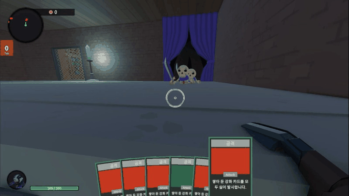

<small>2층에 있던 몬스터가 경사로를 따라 돌지 않고, 바닥을 뚫고 곧장 아래층으로 가려고 합니다.</small>

몬스터 이동(길찾기)은 핵심 기능이 아니어서 본문에서 따로 설명하지 않았습니다. 하지만 **AI와 일하며 가장 크게 배운 일**이라 여기에 남깁니다.

길찾기는 Unity 내비게이션을 쓸지, 직접 만들지부터 정해야 했습니다.

| | [A] Unity 내비게이션 | [B] 직접 만든 단순 추적 ✓ |
|---|---|---|
| 방식 | 내비 메시 위에서 A\* 기반으로 경로 계산 | 다수의 몬스터를 위한, 가장 단순하고 가벼운 추적 |
| 장점 | 내비 메시는 쓸 만함 | 몬스터가 많아도 가벼울 것으로 봄 |
| 단점 | 플레이어를 쫓는 몬스터가 많으면, 목적지가 바뀔 때마다 마리마다 경로를 다시 계산 | 알고리즘을 직접 정해야 함 (이 일의 대가, 아래) |

**[B]를 골랐습니다.** TreeHouse에서 A\*를 직접 구현하며 여러 마리의 길찾기가 얼마나 무거운지 겪었고, 이 게임은 몬스터를 많이 둘 계획이었기 때문입니다.

그런데 목표만 정했을 뿐, 어떤 알고리즘을 어떻게 만들지는 생각해 두지 않았습니다. 카드에서 얻은 자신감에 기대 방향만 주었고, AI가 기법을 하나씩 더해 갔습니다.

새 기법이 들어올 때마다 무게를 따져 쳐냈어야 했는데 그러지 못해, **길찾기는 무거워졌지만 기능은 플레이어를 쫓는 수준에 머물렀습니다.** 오히려 제가 AI에게 수업을 받는 듯한 개발이 이어졌습니다.

결정적인 순간은 위 그림의 문제였습니다. 저는 "이 부분이 문제다"라고 먼저 짚지 못하고 "어디가 문제일까?"를 먼저 물었고, 원인은 AI가 찾았습니다. 관통·반사(3.3)에서 제가 해결책을 내고 AI가 평가했던 것과 정반대였고, **이 구조는 제 것이 아니라고 느꼈습니다.**

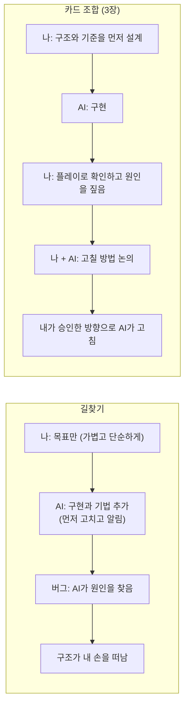

<small>두 작업 모두 코드는 AI가 썼습니다. 갈린 곳은 첫 칸, 곧 누가 기준을 먼저 정했느냐입니다.</small>

기능은 제대로 돌아가서 그대로 써도 큰 문제는 없습니다. 하지만 이 구조는 이미 제 손을 떠나, 나중에 문제가 생기면 제가 해결책을 내지 못합니다. "이해한 부분만 코드로 남긴다"는 규칙(7.2)도 바로 이 작업 중에 만들었지만, 그것만으로는 막지 못했습니다.

> 지금이라면, 설명을 듣고 이해하기 전에 먼저 **이 구현이 이 기능에 맞는 무게인지 판단할 기준**부터 세우겠습니다.

다음 단계로 길찾기를 제가 직접 다룰 수 있는 수준까지 가볍게 만들어 새로 작성할 계획입니다.

### 8.3 AI와 함께 만들 때의 기준

개인 목표는 AI와 함께 만들었을 때 제 역량을 어디까지 끌어낼 수 있는지 확인하는 것이었습니다(1장). 같은 AI를 썼는데 결과가 갈린 이유는 하나였습니다.

| 작업 | 기준을 먼저 세운 사람 | 결과 |
|---|---|---|
| 관통·반사 (3.3) | 저 | AI가 그 안에서 구조를 정리함 |
| 이펙트 원인 (4.4) | 저 (확인한 사실로 되물음) | 진짜 원인에 닿음 |
| 길찾기 (8.2) | 없음 (방향만 줌) | 구조가 제 손을 떠남 |

**AI가 구현을 맡더라도, 문제가 생겼을 때 어디를 봐야 하는지 제가 먼저 말할 수 있어야 그 설계는 제 것입니다.**
