# TreeHouse 프로젝트 문서

> 새가 되어 낮에는 하늘을 탐험하고, 밤에는 모은 깃털로 둥지를 지키는 2D 탐험 + 디펜스 게임

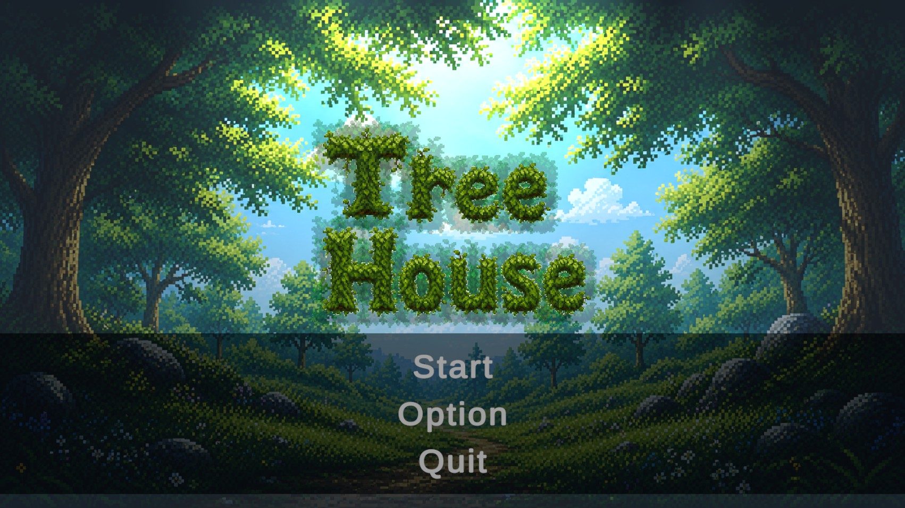

| 항목 | 내용 |
|---|---|
| 장르 | 2D 탐험 + 디펜스 |
| 개발 기간 | 2주 |
| 개발 인원 | 1인 (개인 프로젝트) |
| 개발 환경 | Unity 6000.3.15f1 (URP 2D, New Input System, TextMeshPro) |
| 링크 | [GitHub](https://github.com/KooHoo-Dev/3rd-2D-Project-SaGiKun4) · [시연 영상](https://youtu.be/rVk8w-42GYg) |

---

## 들어가며

이 문서는 TreeHouse를 만들며 부딪힌 고민 네 가지와, 그것을 어떻게 풀었는지를 설명합니다.

1. **A\*로 직접 만든 길찾기가 여러 마리에서 무거워진 문제** — 구역마다 그리드를 나누고 멀리 있는 새는 쉬게 해, 가장 오래 걸린 프레임을 207.90ms → 62.87ms로 줄였습니다 (1장)
2. **주운 깃털을 언제 내 것으로 확정할 것인가** — 바로 반영하면 일부러 죽어서 깃털을 해금할 수 있어, 귀환해야 확정되게 했습니다 (2장)
3. **데이터를 미리 나눈 상속이 오히려 가독성을 떨어뜨린 문제** — 깃털을 세 단계로 상속해 나눴다가, 돌려줄 때 짝을 맞추는 스크립트가 필요해져 하나의 아이템으로 합쳤습니다 (3장)
4. **날갯짓을 멈추지 않고 쪼는 공격** — 머리와 몸통이 한 장인 스프라이트로는 만들 수 없어 둘을 나눴고, 예상한 50·20프레임보다 적은 10프레임으로 만들었습니다 (4장)

---

## 이 게임은

TreeHouse는 플레이어가 **새가 되어 하늘을 누비는 2D 게임**입니다. 낮에는 하늘을 탐험하며 다른 새를 사냥해 깃털을 모으고, 밤에는 그 깃털로 유닛을 강화해 둥지를 노리는 야생동물을 막습니다. 낮에는 바다에 잠수하고 밤에는 초밥집을 운영하는 *Dave the Diver*의 두 모드 구조를, 바다 대신 하늘과 둥지로 옮겨 온 개인 프로젝트입니다.

**중심은 탐험입니다.** 플레이어가 "위험을 감수하며 낯선 하늘을 개척하고, 그 끝에서 새로운 깃털을 발견하는 경험"을 하기를 바랐습니다. 디펜스는 탐험에서 얻은 깃털로 전략을 짜 보는, 탐험을 넓혀 주는 쪽에 두었습니다.

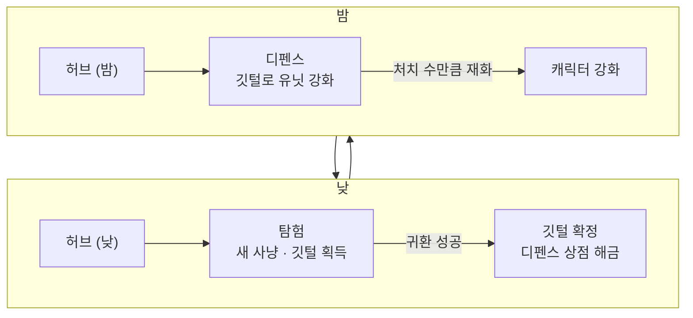

참고한 게임과 바꾼 점, 조작은 [부록](#참고한-게임과-조작)에 있습니다.

---

## 1. A\*로 직접 만든 길찾기가 여러 마리에서 무거워진 문제

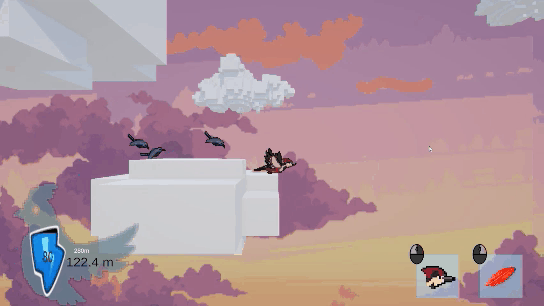

<small>구역 안을 돌던 새가 플레이어를 보고 벽을 돌아 쫓아오는 장면. 이 움직임을 A\*로 만들었습니다.</small>

### 이론으로만 알던 A\*를 실제 게임에 넣어 보고 싶었습니다

탐험이 살아 있으려면 **하늘의 새들이 하나의 생태계처럼 움직여야** 했습니다. 자기 구역을 돌다가 플레이어를 보면 벽을 돌아 쫓아오거나 달아나는 움직임입니다.

그 방법으로 A\*(에이스타: 출발점에서 목표까지 가장 짧은 길을 찾는 대표적인 길찾기 방법)를 골랐습니다. 게임 몬스터의 길찾기는 A\*로 한다는 이야기를 가장 많이 들었지만, **실제 게임에 넣어 본 적은 없었습니다.**

그래서 Unity의 길찾기 기능(내비게이션)을 가져다 쓰지 않고 A\*를 직접 구현했습니다. **이론으로 배운 A\*가 실제 게임에서 얼마나 무거운지**, 그 무게를 감수할 수 있는지 직접 확인해 보는 것이 이 프로젝트의 개인 목표였습니다.

### 참새 10마리에 화면이 0.7초 멈췄습니다

공부할 때 작성한 A\* 코드를 거의 그대로 가져와, 맵 전체를 하나의 그리드(맵을 바둑판처럼 나눈 칸. 길찾기는 이 칸을 따라 길을 찾습니다)로 덮었습니다. **모든 새가 이 한 장의 그리드에서 길을 찾았습니다.**

**참새 10마리만 넣어도 화면이 1초에 30\~50번밖에 그려지지 않았고**, 15\~20마리를 넘기자 게임이 아예 움직이지 않았습니다.

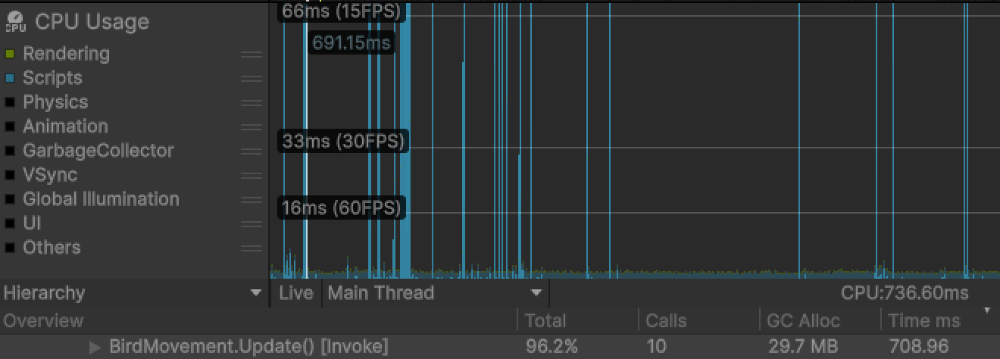

<small>그림에서 볼 것은 아래 줄입니다. 맵 전체를 그리드 하나로 두고 참새 10마리를 넣었을 때, 가장 오래 걸린 프레임(736.60ms, 약 0.7초 멈춤)의 96.2%(708.96ms)를 새 10마리의 이동·길찾기(`BirdMovement.Update`)가 썼습니다. 위 그래프에서 높이 솟은 파란 막대가 그 순간입니다.</small>

### 모든 새가 맵 전체를 뒤질 필요가 있을까

계산을 줄이는 방법을 찾다가 질문을 바꿨습니다. 알고리즘을 빠르게 만들기 전에, **새 한 마리가 실제로 길을 찾아야 하는 범위가 어디까지인가**를 먼저 물었습니다.

| | 그리드와 경로를 함께 쓰기 | 구역마다 그리드를 따로 두기 |
|---|---|---|
| 방식 | 하나의 그리드와 경로를 여러 새가 나눠 씀 | 맵을 구역으로 나누고, 새는 자기 구역의 그리드만 탐색 |
| 좋은 점 | 계산량이 줄어듦 | 탐색하는 범위 자체가 줄어듦 |
| 대가 | 새들이 같은 길로 뭉쳐 움직여 부자연스러움 | 새가 구역 밖까지 플레이어를 쫓지 못함 |

A\*를 넣은 이유가 새들의 자연스러운 움직임이었으므로, **경로를 함께 쓰지 않고 구역마다 그리드를 따로 두는 쪽을 골랐습니다.**

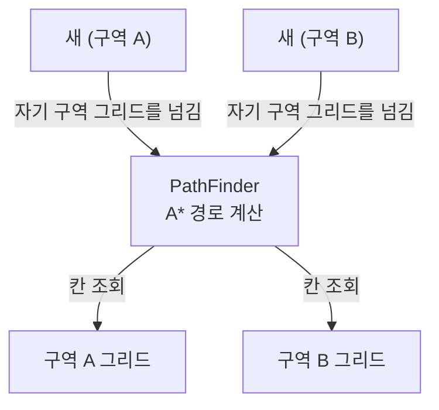

<small>그림에서 볼 것은 그리드가 구역마다 따로 있다는 점입니다. 새는 자기 구역의 그리드만 넘기므로, 탐색은 그 구역 안에서 끝납니다.</small>

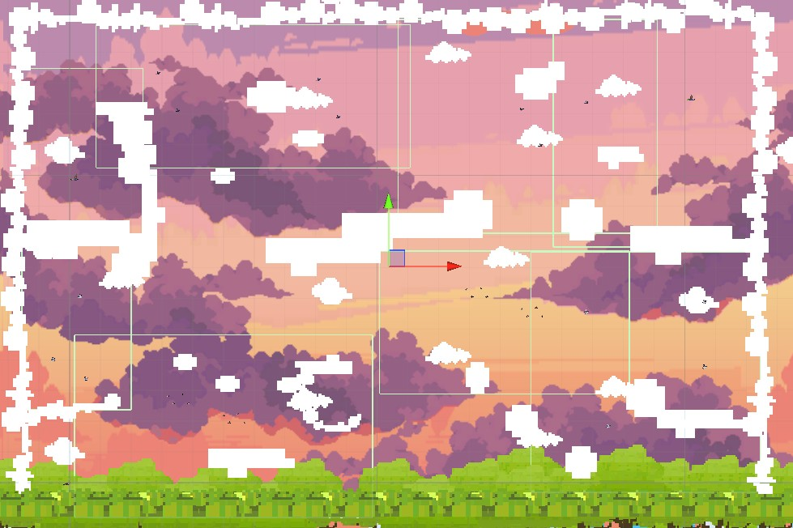

<small>그림에서 볼 것은 맵 곳곳의 연두색 사각형입니다. 사각형 하나가 구역 하나의 그리드이고, 새는 자기 사각형 안에서만 길을 찾습니다.</small>

### 그래도 남은 순간의 멈칫: 멀리 있는 새는 쉬게 했습니다

구역별 그리드로 바꾼 뒤에는 탐험 씬 전체의 32마리를 넣어도 평소 약 120FPS가 나왔습니다. 그런데 특정 순간마다 20\~30FPS로 떨어졌고, 가끔은 한 자릿수까지 내려가 화면이 멈칫하는 것이 플레이 중에도 느껴졌습니다. **여러 새의 길찾기가 같은 순간에 몰려 실행됐기 때문입니다.**

그래서 **플레이어와 25 이상 떨어진 새는 쉬게** 했습니다. 길찾기와 이동을 멈추는 휴면 상태입니다. 25는 플레이어의 시야(10)보다 일부러 넓게 잡은 값입니다. 화면 밖에서도 새들이 계속 움직이고 있었다는 느낌을 남기기 위해서입니다.

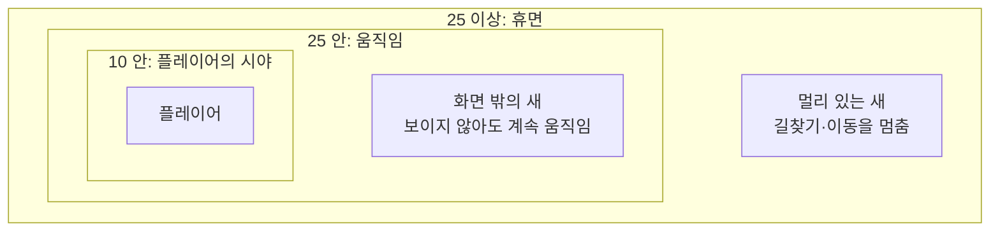

<small>그림에서 볼 것은 시야(10)와 휴면 거리(25) 사이의 띠입니다. 이 띠의 새는 화면에 보이지 않아도 계속 움직이므로, 시야 안으로 들어올 때 이미 움직이고 있습니다.</small>

| Unity Profiler (32마리) | 휴면 전 | 휴면 후 | 줄어든 비율 |
|---|---|---|---|
| 가장 오래 걸린 프레임 | 207.90ms | 62.87ms | 약 70% |
| 그 프레임에서 새 32마리의 처리 | 197.32ms | 53.76ms | 약 73% |
| 그 프레임의 GC 할당 | 17.1MB | 3.6MB | 약 79% |

두 측정의 조건은 같지 않고, 휴면 후 쪽이 더 불리합니다. 휴면 전은 플레이어가 멈춘 채 새들이 A\*만 쓰는 가벼운 상황이고, 휴면 후는 플레이어가 맵을 돌아다니며 새를 깨워야 해서 상호작용이 더해진 무거운 상황입니다. 그래서 **실제로 줄어든 폭은 표보다 큽니다.** 휴면 후 평소 프레임은 약 9ms(8.72ms)이고, 이때 새 32마리의 처리는 0.09ms입니다.

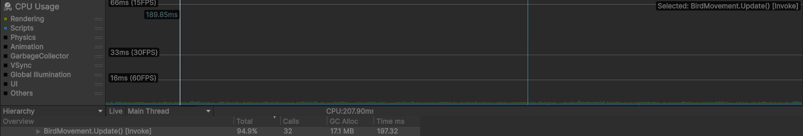

<small>휴면 전: 구역별 그리드 + 32마리, 플레이어가 멈춰 있는 상황. 그림에서 볼 것은 아래 줄입니다. 가장 오래 걸린 프레임(207.90ms)의 94.9%(197.32ms)를 새 32마리의 처리(`BirdMovement.Update`)가 썼습니다.</small>

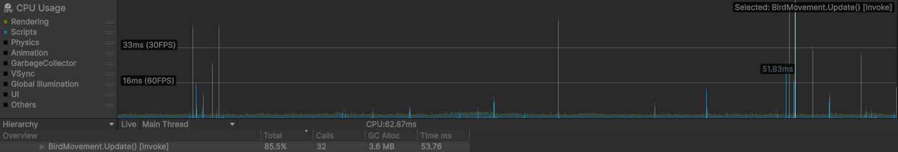

<small>휴면 후: 구역별 그리드 + 32마리, 맵을 돌아다니며 새를 깨우는 상황. 그림에서 볼 것은 아래 줄입니다. 가장 오래 걸린 프레임이 62.87ms로 줄었고, 새 32마리의 처리는 53.76ms, GC 할당은 3.6MB입니다.</small>

### 단점이라 여기지 않은 것, 그리고 남은 것

구역을 나누면 플레이어가 그리드 밖으로 벗어났을 때 새가 더 이상 길을 찾지 못합니다. 처음에는 이것을 감수해야 할 단점으로 봤습니다. 하지만 원작에서도 물고기는 자기 영역 밖까지 플레이어를 쫓지 않습니다. 게다가 새에게는 원래 자기 영역이 있으니, 오히려 '새가 자기 구역을 지킨다는 느낌'을 줄 수 있었습니다. 그래서 **감수한 단점이라기보다 게임의 특징이 됐다**고 봅니다.


<small>그림에서 볼 것은 화면 가운데 위쪽의 회색 비둘기입니다. 플레이어(갈색 새)가 오른쪽으로 구역을 벗어나자, 쫓아오던 비둘기가 따라오지 못하고 복귀합니다.</small>

다만 순간 하락이 완전히 사라지지는 않았습니다(약 70\~80FPS까지). **원인은 알고리즘 자체보다 이론에서는 다루지 않던 곳에 있었습니다.** 갈 수 없는 목표를 향한 탐색의 실패 비용, 여러 새가 한꺼번에 하는 탐색, 반복해서 부를 때 남는 상태와 새로 만드는 메모리입니다. 자세한 내용과 다음에 바꿀 방법은 [부록](#길찾기를-자세히)에 정리했습니다.

알고리즘이 맞게 동작하는지만이 아니라, **여러 번 반복해서 불릴 때의 비용까지 봐야 한다**는 것을 배웠습니다. 길찾기는 게임에 맞춰 가볍게 고쳐 써야 한다는 것도 알게 됐습니다.

---

## 2. 주운 깃털을 언제 내 것으로 확정할 것인가

### 두 모드를 하나의 게임으로 잇는 것은 깃털이었습니다

TreeHouse의 낮(탐험)과 밤(디펜스)을 잇는 것은 깃털 하나입니다. 탐험에서 새를 사냥해 깃털을 줍고, 밤에는 그 깃털을 유닛에 달아 둥지를 지킵니다. 그래서 탐험의 결과가 디펜스에 그대로 이어지도록, **탐험에서 무사히 돌아와야만 그때 모은 깃털이 디펜스에 쓰이게** 하고 싶었습니다.

### 줍는 순간 내 것이 되면, 일부러 죽는 쪽이 이득이었습니다

가장 단순한 방법은 깃털을 줍는 즉시 인벤토리에 넣고 해금하는 것입니다. 그런데 그러면 탐험에 실패한 판의 깃털도 해금됩니다. 까마귀 깃털을 줍고 죽은 뒤, 다음 판에 참새 깃털을 들고 돌아와도 두 깃털이 모두 해금됩니다. 높은 등급의 깃털을 한 번 건드리고 일부러 죽는 식으로, **살아 돌아오든 말든 상관없는 게임이 됩니다.**

### 깃털은 언제 내 것이 되어야 할까

그래서 질문을 "어떻게 저장할까"가 아니라 **"깃털은 언제 내 것이 되어야 할까"** 로 바꿨습니다. 답은 탐험에 성공한 순간이었습니다.

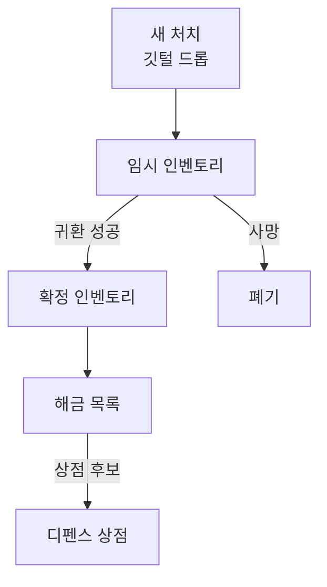

<small>그림에서 볼 것은 해금 목록까지 가는 길이 귀환 성공 하나뿐이라는 점입니다. 죽으면 임시 인벤토리의 깃털은 바로 버려집니다.</small>

탐험에서 주운 깃털은 임시 인벤토리에만 들어가고, **귀환 지점(Pod)까지 돌아오면 확정 인벤토리에 합쳐지면서 해금 목록에 오릅니다.** 디펜스 상점은 이 해금 목록에서만 후보를 고릅니다.

| 줍고 귀환했을 때 | 줍고 죽었을 때 |
|---|---|
| 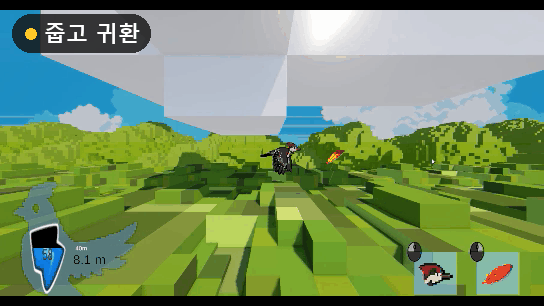 | 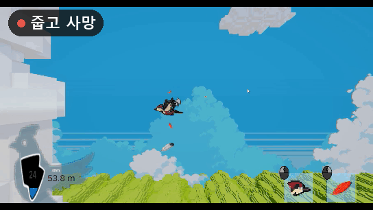 |

<small>그림에서 볼 것은 두 장의 마지막 화면입니다. 깃털을 줍고 귀환하면(왼쪽) 허브가 밤으로 바뀌고 그 깃털이 인벤토리에 확정됩니다. 깃털을 줍고 죽으면(오른쪽) 허브는 낮 그대로이고, 주운 깃털은 인벤토리에 남지 않습니다.</small>

### 인벤토리를 두 개 두는 수고를 받아들였고, 원작과 달리 하나도 남기지 않았습니다

탐험 중에 얻은 것과 확정된 것을 인벤토리 두 개로 나눴고, **대가는 인벤토리를 두 개 관리하는 수고였습니다.** 왜 하나가 아니라 두 개였는지는 아래에서 다시 돌아봅니다.

죽었을 때 깃털을 '하나도 남기지 않는 것'도 같은 이유로 원작과 다르게 정했습니다. *Dave the Diver*는 죽어도 아이템 하나를 지켜 주지만, 여기서 하나라도 남긴다면 "최대한 높이 올라가 가장 높은 단계의 새만 잡고 죽는" 플레이가 가장 이득이 됩니다. **그것은 제가 바란 탐험의 재미와 거리가 멀었습니다.**

예외는 하나 두었습니다. 아직 해금된 깃털이 하나도 없는데 빈손으로 돌아오면 **귀환에 성공해도 실패로 처리합니다.** 디펜스를 하려면 해금된 깃털이 적어도 하나는 있어야 하기 때문입니다.

### 모든 문제를 구조로 미리 막을 필요는 없었습니다

사실 인벤토리를 하나만 두고, 이번 탐험에서 얻은 깃털 목록을 따로 적어 두었다가 귀환할 때 더하는 방법도 가능했습니다. 그래도 두 개로 나눈 데는 이유가 있었습니다. **가장 큰 이유는 확장에 대비하고 싶었기 때문입니다.** 첫 프로젝트라 제가 어디까지 만들 수 있을지 가늠하지 못해, 이것저것 확장 가능성을 넓혀 두던 때였습니다. 탐험 중 공격당하면 깃털을 빼앗기는 기능 같은 것을 나중에 넣게 되면, 인벤토리 하나로는 여러 문제가 생기리라 예상했습니다.

| | 인벤토리 하나 + 이번 탐험 목록 | 인벤토리 두 개 (고른 쪽) |
|---|---|---|
| 방식 | 이번 탐험에서 얻은 깃털 목록을 따로 적어 두었다가 귀환할 때 더함 | 탐험 중의 것(임시)과 확정된 것을 나눠 담음 |
| 해금 처리 | 더 복잡해졌을 것 | 더 직관적 |
| 확장 (깃털을 빼앗는 기능) | 여러 문제가 생기리라 예상 | 대비해 둠 (결국 만들지 못함) |
| 대가 | | 인벤토리를 두 개 관리하는 수고 |

결국 깃털을 빼앗는 몬스터까지는 만들지 못했습니다. 3장에서 다시 이야기할 "필요한 만큼 만든다"는 기준으로 보면 지키지 못한 셈입니다. 그래도 이 구조에는 나름 만족합니다. 인벤토리를 하나로 썼다면 해금 처리가 오히려 더 복잡해졌을 것이기 때문입니다. 다만 **오지 않은 문제까지 모두 구조로 미리 해결할 필요는 없다**는 것은 이때 알게 됐습니다.

## 3. 데이터를 미리 나눈 상속이 오히려 가독성을 떨어뜨린 문제

### 나중에 문제가 될 바에는 미리 나누자고 생각했습니다

**깃털 정보는 크게 두 갈래입니다.** 탐험에서는 "어느 새가 떨어뜨리는가" 정도로 단순하고, 디펜스에서는 "무엇으로 변신하는가(행동 방식·데미지)"와 "얼마인가(상점)"로 뚜렷하게 나뉩니다.

디펜스 쪽을 나누는 것은 맞다고 봤습니다. 그리고 "나중에 문제가 될 바에는 미리 나누자"는 생각으로 **탐험 쪽까지 나눠, 상속으로 세 단계를 만들었습니다.** 2장에서 말한 것처럼 확장 가능성을 넓혀 두던 때였습니다.

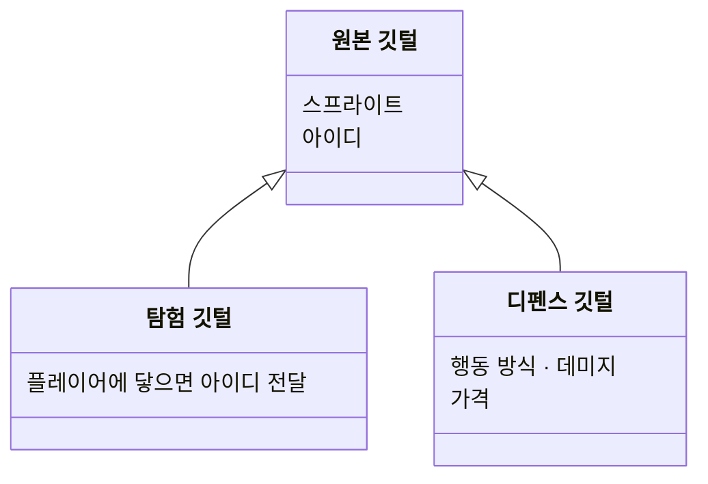

<small>그림에서 볼 것은 아이디가 맨 위 '원본 깃털'에만 있다는 점입니다. 이것이 다음 절의 걸림돌이 됩니다.</small>

### 쓰지 않은 깃털을 돌려주려다 막혔습니다

문제는 디펜스가 끝난 뒤에 드러났습니다. 디펜스에서 쓰지 않은 깃털은 인벤토리로 돌려줘야 하는데, 아이디가 위 단계(원본 깃털)에 있어서 **디펜스 깃털의 값만으로는 어느 깃털인지 알 수 없었습니다.** 돌려주려면 이 디펜스 깃털이 어느 원본 깃털과 짝인지 판단하는 스크립트가 새로 필요했습니다.

### 무엇을 위해 나눴던가

여기서 처음으로 돌아가 물었습니다. 나눈 목적은 가독성이었습니다. 그런데 짝을 맞추는 스크립트가 늘어나면, 가독성은 오히려 떨어집니다. **처음 기대한 장점과 멀어졌다면, 나눈 것을 되돌리는 편이 낫다**고 판단했습니다.

### 짝을 맞추는 스크립트를 쓰기 전에 하나로 합쳤습니다

짝을 맞추는 스크립트를 실제로 쓰기 전에 방향을 바꿔, **깃털을 하나의 아이템(`Item`)으로 다시 합쳤습니다.** 지금은 아이디·이름·아이콘·스프라이트·등급과 디펜스 정보(행동 방식·데미지·사거리·애니메이션), 가격이 모두 한 곳에 있습니다.

원본과 디펜스 깃털에 공통 아이디를 두는 방법은 그때는 떠올리지 못했습니다. 다만 돌아보면 맨 위 단계가 아이디를 두 개 쓰게 되어 역시 가독성이 떨어지므로, **알았더라도 고르지 않았을 것입니다.**

합친 깃털 하나에 겉모습부터 행동까지 다 들어 있으니, **디펜스의 유닛도 종류마다 나눌 필요가 없었습니다.** 유닛은 하나만 두고, 깃털을 끌어다 놓으면 그 깃털의 새로 통째로 바뀝니다.

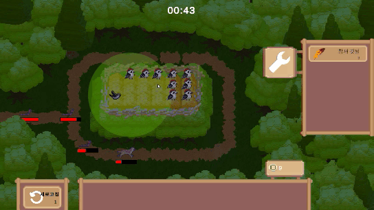

<small>그림에서 볼 것은 깃털을 끌어다 놓는 순간 유닛이 그 깃털의 새로 바뀐다는 점입니다. 겉모습과 함께 공격 방식·사거리·공격력도 바뀝니다.</small>

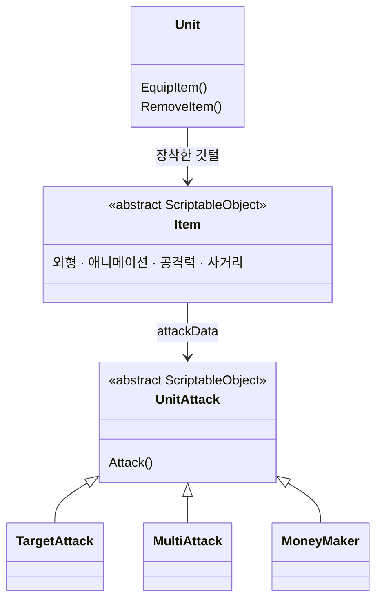

<small>그림에서 볼 것은 유닛마다 다른 것이 장착한 `Item` 하나뿐이고, 공격 방식은 `UnitAttack`의 자식 셋 중 하나라는 점입니다. 장착 코드는 [부록](#깃털-장착과-기본-유닛)에 있습니다.</small>

### 나누는 정도는 목적과 데이터의 흐름을 보고 정합니다

나누는 정도는 '무엇을 위해 나누는지'(여기서는 가독성)를 기준으로 정해야 한다는 것을 배웠습니다. 미리 나누는 것이 늘 좋은 것은 아니고, 데이터가 실제로 어떻게 흐르는지를 먼저 보고, **필요한 만큼만 나눠야 합니다.**

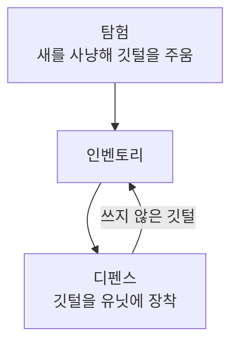

<small>그림에서 볼 것은 디펜스에서 인벤토리로 돌아오는 화살표입니다. 깃털은 한 방향으로 흐르지 않고 되돌아오므로, 어느 단계에서든 같은 깃털로 알아볼 수 있어야 했습니다.</small>

이 프로젝트에는 반대 방향의 비용도 남았습니다. 매니저끼리의 연결은 기간 때문에 나누지 않아, 다른 클래스를 직접 부르는 곳이 30여 개 파일, 130여 곳입니다. 자세한 내용과 다음 계획은 [부록](#매니저끼리의-연결)에 있습니다. 두 경험에서 얻은 기준은 같습니다. **나누는 정도는 목적과 상황(기간, 실력, 데이터의 흐름)을 근거로 정해야 합니다.**

## 4. 날갯짓을 멈추지 않고 쪼는 공격

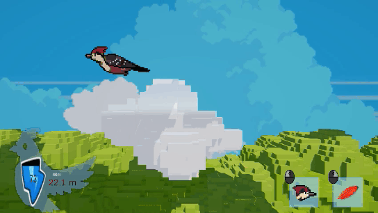

<small>그림에서 볼 것은 날갯짓이 끊기지 않는 동안 머리만 앞으로 나갔다 돌아오는 움직임입니다.</small>

### 눈에 보이는 이동부터 만들고, 그 위에 공격을 붙이려 했습니다

저는 **가장 눈에 먼저 보이고 바로 구현할 수 있는 부분부터 만들고**, 거기에 살을 붙이듯 기능을 더하는 편입니다. 플레이어 새도 이동을 먼저 완성하고, 그 위에 공격을 붙이려 했습니다. 이동에는 머리와 몸통이 한 장에 그려진 날갯짓 스프라이트(약 10프레임)를 쓰고 있었습니다.

### 공격을 붙이려고 보니, 한 장짜리 스프라이트로는 쪼게 할 수 없었습니다

공격 상태로 바뀔 때는 히트박스(공격이 닿았는지 판정하는 영역)와 함께 공격 애니메이션이 나오는 것이 자연스럽습니다. 그런데 머리와 날갯짓이 한 장에 담긴 스프라이트로는 **날갯짓을 유지한 채 공격 애니메이션을 넣을 수 없었습니다.** 문제를 겪었다고 하기도, 미리 예상했다고 하기도 애매한, 조금 늦은 때에 알아챘습니다.

### 새는 날면서 쫀다: 날갯짓과 쪼기가 따로 움직여야 했습니다

**새는 날면서 공격합니다.** 그러니 날갯짓과 쪼기가 '동시에, 따로' 움직여야 했습니다. 이 조건으로 세 방법을 비교했습니다.

| | 날갯짓 타이밍마다 공격 이미지 | 공격할 때 머리를 옮긴 이미지로 교체 | 머리와 몸통을 분리 |
|---|---|---|---|
| 방법 | 날갯짓 10프레임마다 머리 위치별 공격 이미지를 그려 두고 타이밍을 맞춤 | 날갯짓은 그대로 두고, 공격할 때 머리를 최종 위치로 옮긴 이미지를 씀 | 몸통(날갯짓)과 머리(쪼기)를 따로 그려 동시에 재생 |
| 필요한 프레임 (예상) | 약 50 | 약 20 | 10 (몸통 5 + 머리 5) |
| 대가 | 프레임이 가장 많고, 날갯짓과 공격 타이밍을 하나하나 맞춰야 함 | 머리가 부자연스럽게 움직임 | 기존 이동 스프라이트에 맞춰 위치와 피벗(회전·기준점)을 다시 잡아야 함 |

### 머리와 몸통을 나누고, 위치와 피벗을 다시 잡는 수고를 받아들였습니다

머리와 몸통을 나누는 쪽을 골랐습니다. 위치와 피벗을 다시 잡는 수고가 들지만, **결과물이 자연스러운 쪽이 더 중요하다고 판단했습니다.** 그때는 디펜스에서 쓸, 가만히 서서 쪼는 동작도 계획하고 있어서 쪼는 머리를 따로 두는 편이 더 유리했습니다. 이 동작은 나중에 기본 유닛이 공격 대신 디펜스 포인트를 만들도록 바뀌면서 쓸 곳이 없어져 지웠습니다.

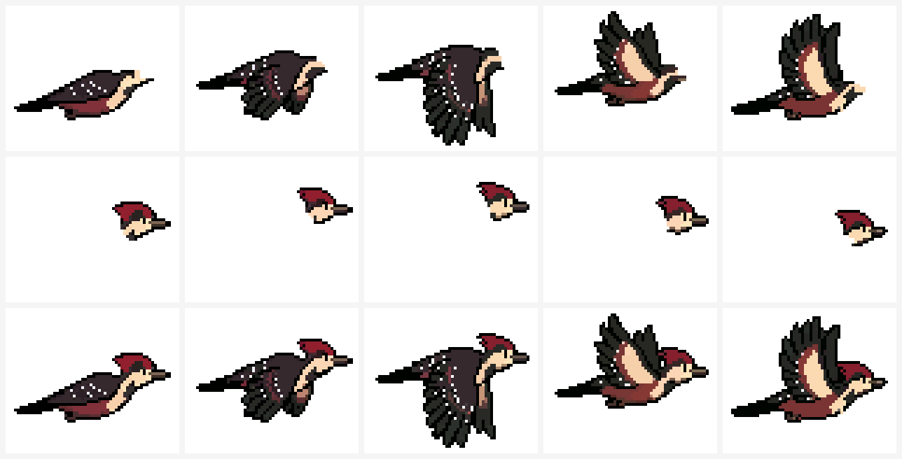

<small>그림에서 볼 것은 맨 아래 줄입니다. 위의 몸통 5프레임과 가운데 머리 5프레임을 겹치면, 머리가 앞으로 나간 프레임에서도 목에 빈틈이 없습니다.</small>

기존 날갯짓 스프라이트를 Affinity로 머리와 몸통으로 나누고, 겹쳐 보이는 불필요한 프레임을 줄여 **몸통 5프레임과 머리 5프레임을 새로 만들었습니다.** 목에 빈틈이 생기지 않도록, 머리가 앞으로 나간 때를 기준으로 몸통의 목 부분을 먼저 늘려 두고, 머리가 돌아왔을 때 튀어나오는 부분을 다시 다듬었습니다. 오브젝트 구조와 히트박스는 [부록](#쪼는-공격의-구조)에 있습니다.

### 모든 문제를 프로그래머의 시선으로만 볼 필요는 없었습니다

**날갯짓이 끊기지 않은 채 머리만 앞으로 쪼는 공격을 만들었습니다.** 스프라이트는 몸통 5 + 머리 5 = 10프레임으로, 다른 두 방법에서 예상했던 약 50·20프레임보다 적습니다.

이 문제는 코드가 아니라 그림을 고쳐서 풀었습니다. 멀티미디어학과에서 포토샵 같은 그래픽 도구를 배우지 않았다면, 스프라이트를 직접 나누고 목을 다듬는 방법은 떠올리지도 못했을 것입니다. 알고 있던 것을 실제로 옮겨 보면서, **모든 문제를 프로그래머의 시선으로만 볼 필요는 없다**는 것을 느꼈습니다.

---

## 맺으며

2주 동안 탐험과 디펜스 두 모드를 만들고, **깃털로 이어지는 순환(획득 → 확정·해금 → 장착 → 재화 → 강화)을 끝까지 완성했습니다.**

**바란 탐험의 경험은 절반쯤 전해졌다고 봅니다.** 위험을 감수하며 낯선 하늘로 나아가 새로운 깃털을 발견하는 경험을 새들을 통해 주고 싶었지만, 기간과 리소스가 부족해 새는 4종류만 만들었습니다. 맵은 그보다 먼저 넓게 짜 두었기 때문에, 넓은 하늘에 비해 발견할 거리가 적었습니다. 대신 새를 더하기 쉬운 구조는 갖춰 두었습니다. 새의 정보는 깃털 데이터 하나에 모여 있고(3장), 몬스터 스킬은 컴포넌트로 붙이므로, 리소스만 더해지면 새의 종류를 쉽게 늘릴 수 있습니다.

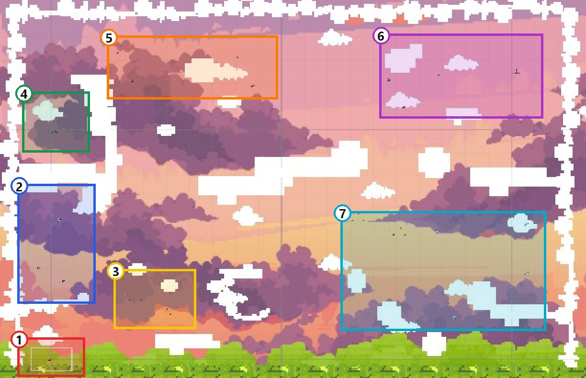

<small>그림에서 볼 것은 넓은 하늘에 비해 서식지 상자가 작고 드문드문하다는 점입니다. ① 플레이어 시작점 ② 비둘기 ③ 참새 ④ 공작 ⑤ 까마귀 ⑥ 까마귀와 공작 ⑦ 비둘기와 참새. 새는 맵에 비해 아주 작게 보여, 네 종류가 나는 모습을 아래에 원본 스프라이트로 두었습니다.</small>

| 비둘기 | 참새 | 공작 | 까마귀 |
|---|---|---|---|
| 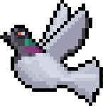 | 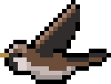 | 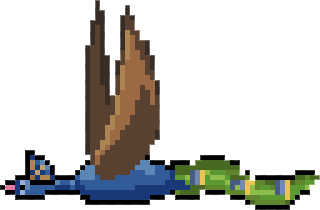 | 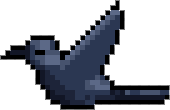 |

네 이야기를 돌아보면 같은 질문이 반복됩니다. **지금 이 게임에 무엇이 얼마나 필요한가**를 먼저 묻는 것, 그것이 이 프로젝트에서 얻은 기준입니다.


<small>그림에서 볼 것은 네 이야기가 모두 아래의 한 질문으로 모인다는 점입니다.</small>

---

## 부록

### 길찾기를 자세히

**쫓을 때와 도망칠 때.** 둘 다 경로를 따라 움직이지만, 경로를 다시 계산하는 때가 다릅니다.

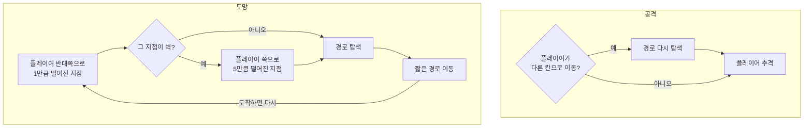

- 쫓을 때는 플레이어가 다른 칸으로 옮겼을 때만 경로를 다시 계산합니다.
- 도망칠 때는 플레이어 반대쪽으로 1만큼 떨어진 가까운 지점까지만 경로를 잡고, 도착할 때마다 방향을 다시 정합니다.
- 도망칠 지점이 벽이면 플레이어 쪽으로 5만큼 떨어진 지점을 목표로 삼습니다. *Dave the Diver*에서 벽에 몰린 물고기가 플레이어 쪽으로 돌진해 빠져나가는 움직임입니다.

**구역 그리드.** 그리드는 구역마다 하나씩(`GridManager`) 두고, 새(`BirdMovement`)는 인스펙터에서 자기 구역의 그리드를 지정받아 경로를 요청할 때 넘깁니다. 그리드의 범위는 그 구역의 콜라이더(`area`)이고, 칸마다 중심에서 벽 레이어와 겹치는지 검사해 지나갈 수 있는 칸인지 정합니다.

```csharp
// 그리드와 시작·목표 좌표를 넘기면 경로(노드 목록)를 돌려준다.
// 갈 수 없으면 null
List<Node> path = PathFinder.Instance.FindPath(
    gridManager, transform.position, target);

// class GridManager — CreateGrid() 안
Bounds bounds = area.bounds;
// ... 구역 범위 안의 칸마다
bool walkable = !Physics2D.OverlapBox(
    nodeWorldPoint, Vector2.one * cellSize, 0f, wallLayer);
grid[x, y] = new Node(walkable, nodeWorldPoint, x, y);
```

**길찾기 코드 안에 남겨 둔 것.** 다음에 살펴볼 칸의 목록(열린 목록)을 `List`로 두어, 칸을 하나 꺼낼 때마다 목록 전체를 훑어 비용이 가장 작은 칸을 찾습니다. 인덱스를 직접 다루고 안을 들여다보기 쉬워서 고른 방식입니다.

```csharp
// class PathFinder — FindPath() 안
while (openSet.Count > 0)
{
    Node currentNode = openSet[0];

    for (int i = 1; i < openSet.Count; i++)
    {
        if (openSet[i].totalCost < currentNode.totalCost)
        {
            currentNode = openSet[i];
        }
    }

    openSet.Remove(currentNode);
    closedSet.Add(currentNode);
    // ...
}
```

| 구분 | 내용 | 다음에 바꿀 방법 |
|---|---|---|
| 일부러 남긴 것 | 길찾기를 따로 떨어진 `PathFinder`(`Instance`로 호출)에 둠. 이론에서 배운 구조를 그대로 넣었을 때 무슨 문제가 생기는지 보려고 유지함 | 경로 계산을 그리드 쪽으로 옮기거나 상태 없는 클래스로 |
| 알고 받아들인 것 | 목표가 벽이면 전부 탐색한 뒤 실패하고 다음 프레임에 다시 탐색. 활동 영역 콜라이더를 볼록하게 만들어 확률을 낮춤 | 가장 가까운 갈 수 있는 칸으로 옮기기, 또는 실패 후 기다리기 |
| 편해서 고른 것 | 열린 목록을 `List`로 두고 매번 전체를 훑음 | 우선순위 큐(최소 힙) |
| 놓친 것 | 탐색마다 칸의 비용을 초기화하지 않음 · 이웃 칸을 구할 때마다 새 `List` 생성 | 탐색 번호로 초기화 · 이웃 목록 재사용 |

전체 코드: [GitHub](https://github.com/KooHoo-Dev/3rd-2D-Project-SaGiKun4)

### 깃털 장착과 기본 유닛

장착은 깃털 데이터 하나로 행동 방식·외형·애니메이션·사거리·공격력을 한 번에 바꿉니다. 렌치(`Infinite` 등급)는 따로 입력을 만들지 않고, 같은 장착 경로를 그대로 써서 해제로 처리했습니다.

```csharp
public void EquipItem(Item item)
{
    if (item.Tier == ItemTier.Infinite)
    {
        RemoveItem();
        return;
    }
    // ...
    attackBehaviour = item.attackData;
    sprite.sprite = item.BirdSprite;
    animator.runtimeAnimatorController = item.overrideController;
    detectedObject.localScale = item.detectedArea;
    damage = item.damage;
    mobType = item.Key;
    // ...
}
```

깃털이 없는 기본 유닛은 공격 대신 디펜스 포인트를 만듭니다(`MoneyMaker`). 디펜스는 탐험을 넓혀 주는 쪽이라, 디펜스가 어려워서 탐험이 막히는 일이 없도록 난이도를 낮게 잡았습니다. 행동 방식을 `UnitAttack`으로 떼어 두었기 때문에, "공격하지 않는 행동"도 다른 공격과 같은 틀에 그대로 넣을 수 있었습니다.

### 상점에는 발견한 깃털만

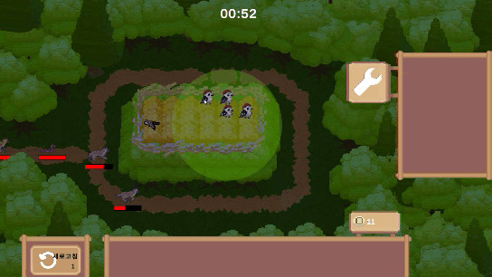

<small>그림에서 볼 것은 리롤을 누를 때마다 아래 상점 후보가 바뀐다는 점입니다.</small>

밤의 디펜스에서는 디펜스 포인트로 상점에서 유닛을 소환하거나 깃털을 사고, 포인트 1을 내고 상점 후보를 다시 뽑을(리롤) 수 있습니다. 유닛 소환은 언제나 후보에 들어가고, 깃털은 **탐험에서 해금한 것만** 들어갑니다(2장).

```csharp
foreach (Item defenceItem in allItems)
{
    if (defenceItem.Tier != ItemTier.Unit
        && !UnlockManager.Instance.IsUnlocked(defenceItem))
        continue;
    // ... 등급별 후보 목록에 추가
}
```

- 상점을 둔 이유: *운빨존많겜*처럼 완전히 무작위로 소환하면 운의 비중이 너무 컸습니다. 그래서 *전략적 팀 전투*처럼 어느 정도의 운에 재화를 쓰는 판단을 더한 상점을 붙였습니다. 또 탐험 결과만으로 디펜스 전략이 정해지면, 탐험이 "발견"이 아니라 특정 깃털을 모으는 반복 작업으로 바뀝니다.
- 해금한 깃털만 나오게 한 이유: 아직 발견하지 않은 깃털이 상점에 나오면, 탐험에서 그 깃털을 발견하는 가치가 사라지기 때문입니다.

### 쪼는 공격의 구조

- **구조**: 몸통이 부모, 머리가 자식 오브젝트라 이동할 때는 함께 움직입니다. Animator는 몸통과 머리에 따로 있고, 앞뒤 순서는 SpriteRenderer의 Sorting Order로 맞췄습니다.
- **공격**: 트리거로 머리의 공격 애니메이션을 재생합니다. 애니메이션이 머리에 단 작은 콜라이더(히트박스)를 켜면서 머리를 앞으로 조금 옮깁니다. 히트박스가 머리에 붙어 있으므로 판정도 쪼는 머리를 따라 움직입니다.

### 그 밖의 기능

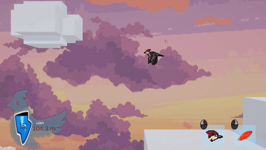

| 기능 | 플레이에서 보이는 것 | 이렇게 정한 이유 |
|---|---|---|
| 체력 = 산소 | 탐험 중 체력이 시간에 따라 줄어듦. 기본 초당 1/3, 달리는 중 1, 한계 고도를 넘으면 2. 한계 고도는 허브 강화로 늘어남 | 탐험에는 위험이 따라야 한다고 보고, 플레이어를 계속 재촉하는 장치로 원작의 산소를 가져옴. 시간제한만 두면 운 좋게 높은 곳의 새를 잡는 경우가 생겨 고도에 따라 구간을 나누고, 사냥을 어렵게 하려고 달릴 때도 더 줄게 함 |
| 조준하면 멈춤 | 우클릭으로 조준하는 동안 이동이 멈추고, 마우스 쪽으로 카메라가 옮겨 가 주변을 볼 수 있음 | 움직이면서 멀리 볼 수 있으면 손해 없이 늘 쓰는 기능이 됨. "멈춰야 볼 수 있다"는 비용을 붙여, 전투처럼 목적이 있을 때는 주변을 살피는 정도로만 쓰고 목적 없이 탐험할 때만 주변을 탐색하는 수단이 되게 함 |
| 몬스터 스킬 | 공격 상태의 몬스터는 쓸 수 있는 스킬이 있으면 쓰고, 없으면 추격함. 지금은 까마귀의 돌진(3초 모으기 → 직선 돌진 → 쿨타임 8초) 하나 | 스킬을 몬스터에 컴포넌트로 붙여, Unity 에디터에서 몬스터가 어떤 스킬을 쓰는지 바로 보이게 함 |

### 매니저끼리의 연결

다른 클래스의 인스턴스를 직접 부르는 곳이 30여 개 파일, 130여 곳입니다. 예를 들어 디펜스 포인트를 바꾸는 다섯 곳(처치, 생산, 구매 2종, 리롤)이 각자 UI 갱신 함수를 직접 부릅니다. 그래서 몬스터·유닛 같은 게임 로직이 UI를 알아야 하고, 값을 바꾸는 곳이 늘수록 갱신을 빠뜨릴 위험이 커집니다. 이벤트(옵저버) 방식은 알고 있었지만, 2주라는 기간과 그때의 실력으로는 원하는 대로 적용하기 어렵다고 보고 빠르게 작업할 수 있는 직접 참조를 골랐습니다. 개발하는 동안 실제로 갱신이 빠지는 문제는 생기지 않았습니다.

다음에는 포인트를 바꾸는 일을 한 곳(추가·사용 메서드)으로 모으고, 값이 바뀌면 이벤트를 내보내 UI는 그 이벤트만 구독하게 하겠습니다. 이벤트 방식은 수업에서 직접 구현해 봤지만, 아직 제 프로젝트에 적용하지는 못했습니다.

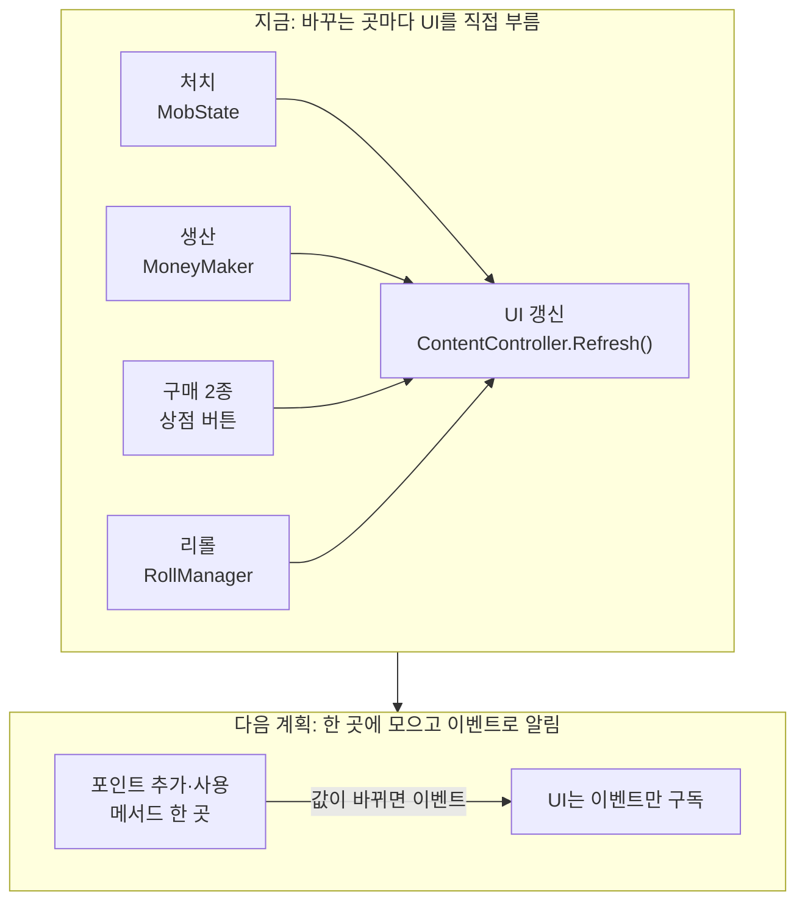

<small>그림에서 볼 것은 위쪽의 화살표 네 개입니다. 포인트를 바꾸는 곳이 하나 늘 때마다 UI로 가는 화살표도 하나 늘어납니다. 아래쪽 계획에서는 UI로 가는 화살표가 하나뿐입니다.</small>

### 참고한 게임과 조작

| 참고한 게임 | 가져온 것 | 바꾼 것 |
|---|---|---|
| *Dave the Diver* | 낮과 밤 두 모드, 산소(체력)가 줄어드는 압박, 작살 조준 | 바다를 하늘로. 작살로 끌어오는 대신 깃털을 쏘는 공격. 죽으면 아이템 1개를 지키던 규칙을 전부 잃도록 (2장) |
| *운빨존많겜* | 몬스터가 필드 가장자리를 돌아 나가는 디펜스 판 | 완전히 무작위인 유닛 소환을 상점 구매로 (부록 「상점에는 발견한 깃털만」) |
| *전략적 팀 전투* | 운과 재화 활용이 섞인 상점과 리롤 | 상점에는 탐험에서 해금한 깃털만 나오도록 (부록 「상점에는 발견한 깃털만」) |

| 장면 | 입력 | 동작 |
|---|---|---|
| 허브 | A·D / ←·→ | 좌우 이동 |
| 허브·탐험 | Space | 입장 지점·귀환 지점(Pod)과 상호작용 |
| 탐험 | WASD / 방향키 | 이동 |
| 탐험 | Left Shift | 달리기 (체력이 더 빨리 줄어듦) |
| 탐험 | 좌클릭 | 근접 공격 |
| 탐험 | 우클릭 유지 + 좌클릭 | 멈춰서 조준하고 깃털 발사 |
| 디펜스 | 좌클릭 | 유닛 선택 (사거리 표시) |
| 디펜스 | 우클릭 | 선택한 유닛을 다른 칸으로 옮기거나 맞바꿈 |
| 디펜스 | 깃털을 유닛에 드래그 | 깃털 장착 (렌치를 드래그하면 해제) |
| 공통 | ESC | 옵션 (일시정지) |
