# WeGotOne 프로젝트 문서

> 서로 붙잡고 끌어올리며 함께 물고기를 모아야 다음 스테이지로 갈 수 있는 물리 기반 협동 멀티플레이 게임

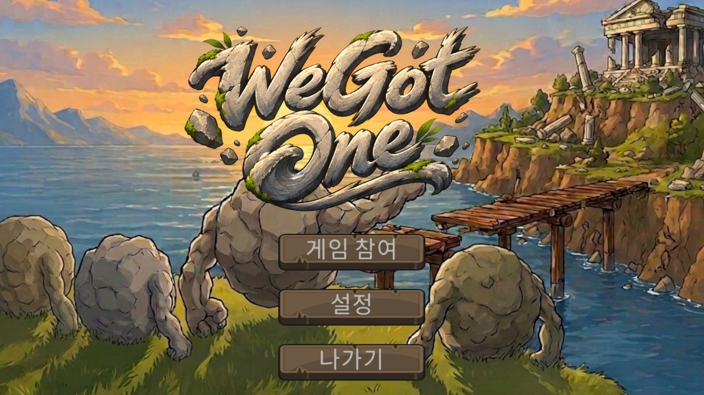

| 항목 | 내용 |
|---|---|
| 장르 | 물리 기반 협동 멀티플레이 |
| 개발 기간 | 2026.08.18 \~ 2026.09.08 (3주) |
| 개발 인원 | 4인 (팀 프로젝트) |
| 개발 환경 | Unity 6000.3.15f1, WebSocket 서버, Git |
| 링크 | [GitHub](https://github.com/KooHoo-Dev/3rd-TeamProject-HS) · [시연 영상](https://youtu.be/mJrIw3XvcAM) |

---

## 들어가며

이 문서는 WeGotOne에서 제가 맡은 플레이어 조작과 그 서버 연결을 만들며 부딪힌 고민을 설명합니다.

1. **물리로 흔들리는 몸을 토크로 돌리려니 잡은 상태마다 회전축이 바뀌었다** — 축을 정하지 않는 힘(`AddForce`)으로 밀고, 강한 힘을 잡은 사람을 따라 전달했다 (1장)
2. **여럿이 함께 건드리는 래그돌이 화면마다 다르게 보일 수 있었다** — 호스트 한 명이 물리를 계산하고, 몸통·상완·하완 다섯 조각의 상태를 모두 보냈다 (2장)
3. **손에 세 개 이상의 대상이 동시에 닿았다** — 닿은 대상을 목록으로 들고, 먼저 닿은 것을 계속 잡게 했다 (3장)


---

## 이 게임은

'WeGotOne'은 여러 플레이어가 각자 팔과 손이 따로 움직이는 캐릭터를 조작해, **서로 붙잡고 끌어올리며 물고기를 모으는 협동 게임**입니다. 함께 물고기를 잡아 자원을 다 모으면 다리를 놓아 다음 스테이지로 넘어가고, 산소(스태미나)가 줄어들기 전에 해내야 합니다.

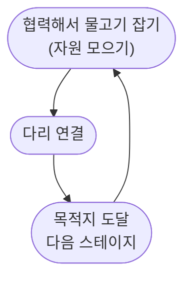

<small>그림에서 볼 것은 한 스테이지가 "함께 물고기를 모아 다리를 놓는다"는 고리로 이어진다는 점입니다.</small>

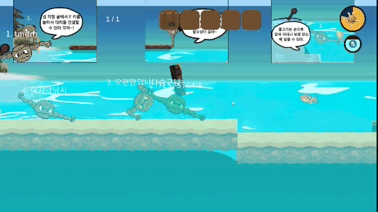

<small>시작 스테이지 장면입니다. 플레이어들이 각자 조작을 익히며 물고기를 모으는, 위 고리의 첫 단계입니다.</small>

팀원 모두가 *Heave Ho*의 "불편한 조작 속에서 서로 붙잡고 끌어올리는" 방식을 재미있게 했고, 그것을 가져오되 물고기를 함께 모아야만 나아가게 바꿔 협력이 중심이 되게 했습니다. 플레이어가 마음대로 움직이지 않는 몸 때문에 서로 도울 수밖에 없고, **그렇게 우스꽝스러운 모습으로 협동하는 것 자체를 즐기기를** 바랐습니다.

학원에서 무작위로 짠 4인 팀이었고, 팀장도 서로의 실력을 아직 몰라 일을 큰 파트로 나눴습니다. 저는 **플레이어 조작과, 그 움직임을 서버로 연결하는 일**을 맡았습니다.

| 파트 | 담당 |
|---|---|
| 서버 | 팀원 A (팀장) |
| **플레이어 핵심 조작** | **본인** |
| 인벤토리·다리 건설 등 게임 흐름 | 팀원 B |
| 물고기와 레벨 디자인 | 팀원 C |

참고한 게임은 [부록](#참고한-게임), 조작은 [부록](#조작)에 있습니다.

---

## 1. 물리로 흔들리는 몸을 토크로 돌리려니 잡은 상태마다 회전축이 바뀌었다

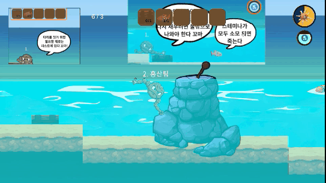

<small>손으로 잡은 곳은 그 자리에 고정되고, 팔을 움직이면 그곳을 축으로 몸이 돌아가며 나아갑니다. 이 움직임을 만드는 것이 제 파트였습니다.</small>

### Joint와 토크면 금방 끝날 줄 알았습니다

플레이어 파트는 게임의 중심이면서 물리로 움직이는 몸을 다뤄야 해서, 다들 선뜻 맡지 못했습니다. 저는 Unity를 써 본 경험이 있었고 *Heave Ho* 덕분에 어떤 움직임이 나와야 하는지 분명했기에, **Joint로 잇고 `AddTorque`로 팔을 돌리면 금방 끝나겠다**고 생각해 이 파트를 맡았습니다.

**몸은 관절로 이어진 일곱 조각**(몸통 1 · 상완 2 · 하완 2 · 손 2)으로 나눴습니다. 이렇게 조각들이 물리 법칙대로 흔들리며 움직이는 캐릭터를 '래그돌'이라고 부릅니다. 팔이 한 토막이면 원하는 위치로 옮기기 어려워, 위팔(상완)과 아래팔(하완)로 나눴습니다.

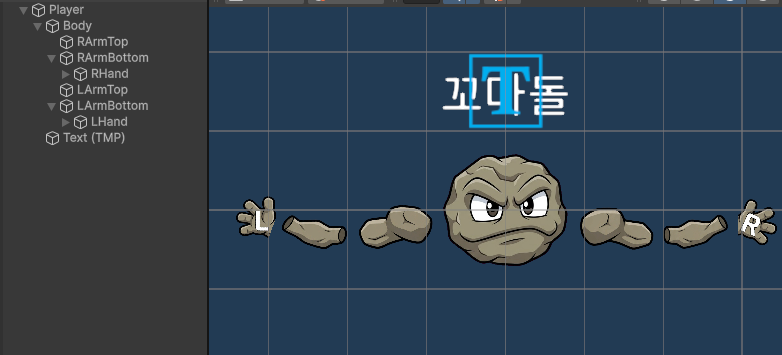

<small>그림에서 볼 것은 왼쪽 계층입니다. Body 아래에 좌우 상완(ArmTop) · 하완(ArmBottom) · 손(Hand)이 이어져 있어, 몸통까지 모두 일곱 조각입니다.</small>

### 잡은 상태마다 돌릴 축이 달라졌습니다

처음에는 팔이 돌지 않는 것이 힘이 모자라서라고 보고 회전량만 조절했습니다. 그러다 잡은 상태에 따라 돌리는 방향이 반대로 바뀌어야 한다는 것을 깨달았습니다. 토크(물체를 한 축을 중심으로 돌리는 힘)는 무엇을 축으로 돌지 제가 정해 줘야 하는데, **그 축이 상황마다 바뀌었습니다.**

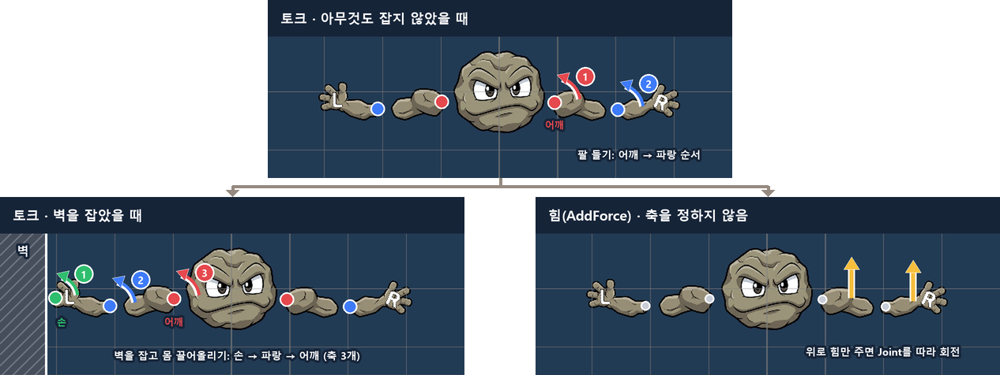

<small>그림에서 볼 것은 잡은 상태가 바뀔 때마다 돌릴 축과 순서가 늘어난다는 점입니다. 아무것도 잡지 않으면 어깨 → 파랑 두 단계, 벽을 잡으면 손 → 파랑 → 어깨 세 단계입니다. 힘(AddForce)은 위로 밀기만 하면 Joint를 따라 돕니다.</small>

### 축을 꼭 제가 정해야 할까

**돌리지 않고 '밀면' 어떨까** 생각했습니다. 힘(`AddForce`, 한 방향으로 미는 힘)으로 밀면 Joint(두 조각을 한 점에서 이어 주는 관절)가 회전축 역할을 해서, 축이 저절로 생깁니다.

### 힘으로 밀기로 하고, 정확함을 내려놓았습니다

**기간이 3주였고, 조작은 팀원들이 기다리는 핵심 기능**이라 빨리 공유해야 했습니다. 첫 커밋 주석에도 "토크로 하니 회전축을 두 개 구현해야 하는 문제가 생김. 힘 기반이 더 편하고 깔끔해서 AddForce 사용."이라고 남겼습니다. 대가는 물리적으로 더 정확한 토크를 포기한 것입니다.

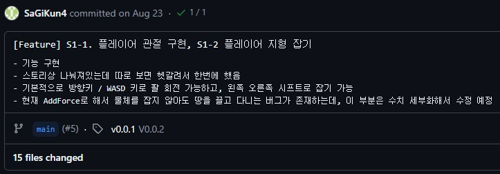

<small>힘(AddForce)으로 바꿔 올린 첫 커밋(8월 23일)입니다. 그림에서 볼 것은 마지막 줄입니다. 이때 이미 "AddForce 때문에 물체를 잡지 않아도 땅을 끌고 다니는 버그"를 적고, 수치를 세부화해 고치겠다고 남겼습니다.</small>

### 미는 힘이 만든 두 번째 문제

늘 같은 세기로 밀자 물체를 잡은 채 공중을 날아다닐 수 있었습니다. 그래서 잡은 대상에 따라 힘을 나눴습니다([부록](#잡은-대상에-따라-달라지는-힘)). 그러자 이번에는 **A가 바닥과 블록을, B가 같은 블록을 잡으면 둘 다 움직이지 못했습니다.** A의 힘은 자신과 블록만 들 수 있었고, B는 스스로를 띄울 힘이 없었기 때문입니다.

그래서 바닥을 잡은 사람이 강한 힘을 쓰고, 그 힘이 **잡은 사람을 따라 한 칸씩 올라가게** 했습니다(사다리형 힘 전달).

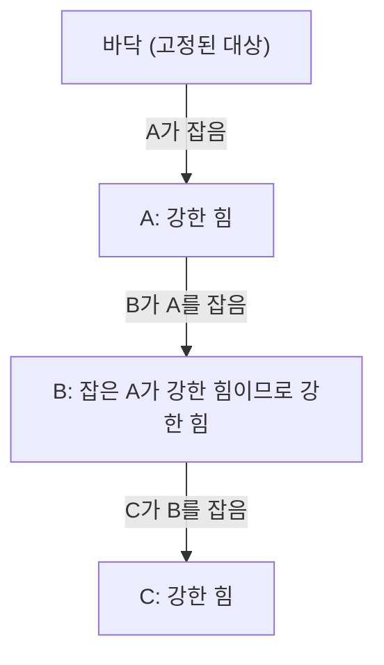

<small>그림에서 볼 것은 강한 힘이 바닥을 잡은 사람에서 시작해, 그 사람을 잡은 사람에게 차례로 넘어간다는 점입니다. 코드는 [부록](#사다리형-힘-전달-코드)에 있습니다.</small>

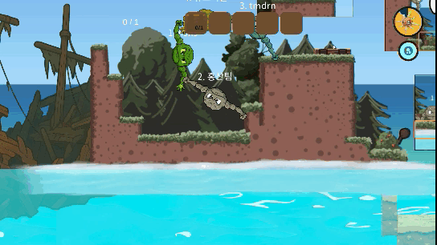

<small>잡은 대상이 플레이어여도 힘이 전달되므로, 다른 플레이어를 잡아 날릴 수도 있습니다.</small>

### 남은 것

서로 붙잡고 있으면, 처음 바닥을 잡았던 사람이 **손을 놓아도 강한 힘이 남아 다시 공중에 뜰 수 있습니다.** 실제 플레이에서는 거의 생기지 않았지만 규칙에 남은 논리 오류이고, 끝까지 풀지 못했습니다.

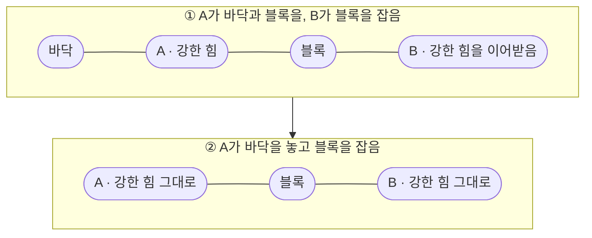

<small>그림에서 볼 것은 ②에서 바닥을 잡은 사람이 아무도 없는데도 강한 힘이 남는다는 점입니다. 그래서 둘이 그대로 공중에 뜰 수 있습니다.</small>

**직관적인 방법이 빠른 방법은 아니었습니다.** 토크가 어려워 바로 이해되는 힘을 골랐지만, 그 때문에 예상하지 못한 오류가 많았습니다. 다시 한다면 시간이 넉넉할 때는 토크로 바꾸고, 그렇지 않으면 이어진 플레이어들을 한 묶음으로 보고 큰 힘 하나를 나눠 주겠습니다.

---

## 2. 여럿이 함께 건드리는 래그돌이 화면마다 다르게 보일 수 있었다

### 서버에서 계산할 수는 없었습니다

이 게임에서 화면에 보이는 것은 거의 전부 물리로 움직이는 래그돌이고, 그중에서도 손의 위치가 가장 중요합니다. 그래서 **모든 플레이어의 화면이 정확히 같아야 했습니다.**

수업에서 배운 멀티 게임 서버 구조를 바탕으로, 서버를 맡은 팀장과 이 게임에 맞는 구조를 이야기했습니다. 이 게임은 Unity 물리를 쓰므로 계산 대부분이 클라이언트(플레이어마다 실행하는 게임 프로그램)에서 끝납니다. Unity가 없는 서버로 값을 올렸다가 다시 받는 것은 잘못된 구조라고 보고, **서버 계산은 처음부터 고려하지 않았습니다.**

### 각자 계산하면, 누구 화면이 정답일까

물체마다 계산할 사람을 정하는 방법도 생각했지만, **판자를 계산하는 A에게 같은 판자를 잡은 B가 끌려다닐 것**이라 판단했습니다.

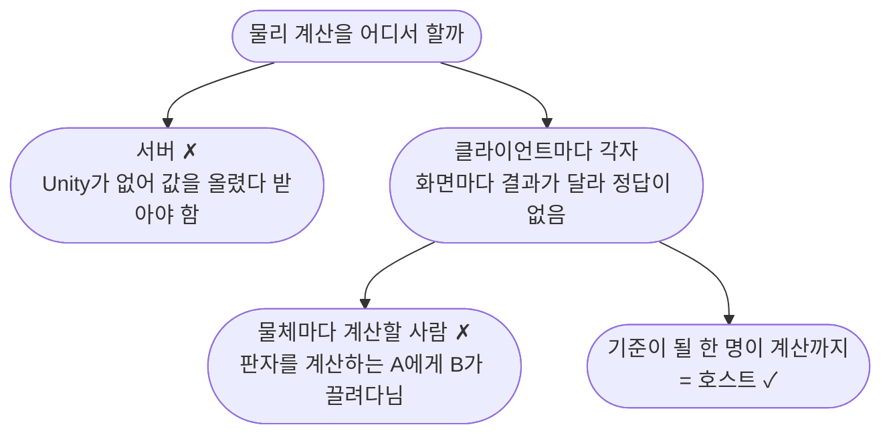

<small>그림에서 볼 것은 후보가 하나씩 걸러지는 순서입니다. 서버는 Unity가 없어 빠지고, 각자 계산하면 정답을 정할 사람이 결국 필요해서, 그 한 명이 계산까지 맡는 호스트로 이어집니다. 물체마다 계산할 사람을 정하는 방법은 만들어 보지 않고 판단만 했습니다.</small>

어차피 기준이 될 클라이언트를 하나 정해야 한다면, **그 한 명이 물리 계산까지 맡는 편이 더 정확하다**고 보고 호스트(기준으로 삼은 클라이언트 하나) 방식을 제안했습니다. 세 후보를 나란히 비교한 표는 [부록](#물리-계산을-어디서-할까-세-후보)에 있습니다.

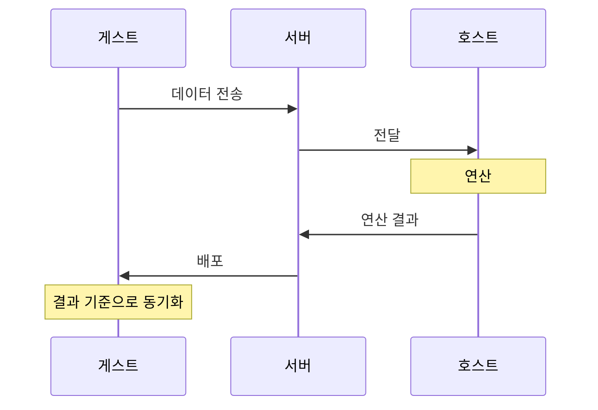

<small>그림에서 볼 것은 계산이 서버가 아니라 호스트에서 일어난다는 점입니다. 호스트가 아닌 플레이어(게스트)는 입력을 보내고 결과를 받아 화면을 맞춥니다.</small>

**대가는 게스트의 반응 속도입니다.** 게스트의 입력은 서버와 호스트를 거쳐 돌아오므로 인터넷이 나쁘면 딜레이가 느껴질 수 있습니다. 다만 인터넷이 나쁘면 다른 방식에도 감수할 단점이 따로 생기는 것은 같아서 받아들였습니다. 학원에서, 그리고 팀원들이 각자 집에서 테스트했을 때 딜레이는 느껴지지 않았습니다.

구조를 정한 뒤에는 플레이어 조작에 필요한 프로토콜(클라이언트와 서버가 주고받는 데이터의 약속)을 **서버 코드까지 제가 직접 고쳤습니다.** 조작 코드를 제가 짰으니 무엇이 오가야 하는지 가장 잘 알았고, 당시 서버 담당이 팀장이라 문서 작업도 밀려 있었기 때문입니다.

### 몸통만 보내면 될 줄 알았는데, 손이 어긋났습니다

처음에는 몸통의 상태만 보냈습니다. 호스트가 몸통을 기준으로 계산해 뿌려 주면 다른 화면은 위치만 맞추면 된다고 생각했습니다. 그런데 화면마다 손의 위치가 달랐습니다. 이 게임에서 **반드시 같아야 하는 것은 몸통이 아니라 손이었습니다.**

그래서 **손을 움직이는 조각을 모두** 보내도록 바꿨습니다.

| 조각 | 보내는 것 | 이유 |
|---|---|---|
| 몸통 · 상완 2 · 하완 2 | 위치(X, Y)와 회전 | 물리로 움직이는 조각이라 화면마다 달라질 수 있음 |
| 손 2 | 잡았는지 여부만 | 리지드바디와 Joint 없이 닿았는지만 감지하고 하완에 붙어 움직여서, 하완이 맞으면 손도 맞음 |

바꾼 뒤 **클라이언트 사이의 손 위치가 맞았습니다.** 주고받는 데이터 형식은 [부록](#주고받는-플레이어-상태)에 있습니다.

### 남은 것

웹을 배울 때는 앞단과 뒷단이 데이터를 주고받기만 하면 됐는데, 게임에서는 **화면에서 무엇이 같아야 하는지에 따라 데이터를 어떻게 나눠 보낼지**를 정해야 한다는 것을 알게 됐습니다.

---

## 3. 손에 세 개 이상의 대상이 동시에 닿았다

### 손은 닿은 것을 잡기만 하면 될 줄 알았습니다

손은 범위에 들어온 판자·물고기·벽·다른 플레이어를 잡습니다. 그런데 게임 중에는 벽돌 두 개와 바닥, 물고기처럼 **세 개 이상이 동시에 손에 닿는 일이 자주 생겼습니다.**

### 무엇을 잡을지 하나로 정하면 모순이 생겼습니다

잡을 대상을 하나만 기억하면, 판자를 옮기다 다른 플레이어와 부딪혔을 때 대상이 그 플레이어로 바뀌거나, 그 플레이어가 빠져나간 뒤 대상이 비어 **판자를 놓칠 수 있습니다.**

### "지금 무엇을 잡을 것인가"

그래서 질문을 "무엇이 닿았나"에서 "지금 무엇을 잡을 것인가"로 바꿨고, **답은 "먼저 닿은 것"으로 정했습니다.** 닿은 대상을 모두 목록으로 들고, 언제나 목록의 맨 앞을 잡습니다.

| 순서 | 손에 닿은 목록 | 잡는 대상 |
|---|---|---|
| 물고기, 판자, 플레이어 순으로 닿음 | 물고기 · 판자 · 플레이어 | 물고기 |
| 판자가 먼저 빠져나감 | 물고기 · 플레이어 | 물고기 (그대로) |

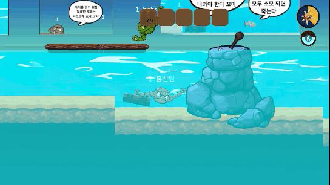

<small>그림에서 볼 것은 판자를 옮기던 손이 다른 플레이어와 부딪혀도, 판자를 놓치지도 그 플레이어를 잡지도 않고 계속 옮긴다는 점입니다. 판자가 목록의 맨 앞에 있기 때문입니다.</small>

먼저 들어온 것을 먼저 쓰는 것만 보면 큐가 편합니다. 하지만 대상이 들어온 순서대로 나간다는 보장이 없어서, **중간의 대상을 바로 뺄 수 있는 리스트**가 제게는 더 편했습니다. 코드는 [부록](#먼저-닿은-것을-잡는-코드)에 있습니다.

### 두 번째 막힘: 물고기가 "내가 잡혔나"를 알아야 했습니다

잡는 책임은 플레이어에게 있어서, 팀원 C가 맡은 물고기는 자기가 잡혔는지 알려면 플레이어 코드를 봐야 했습니다. 팀장이 핵심 기능별로 일을 나누고 세부 작업은 각자에게 맡긴 상황이었습니다. 저는 잡기 상태를 나중에 쓸 수 있게 자리만 열어 두고 요청이 오면 건넬 생각이었고, **팀원 C는 묻는 대신 직접 고치는 쪽을 택했습니다.**

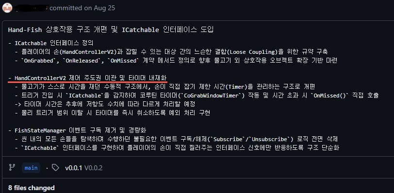

<small>팀원 C가 8월 25일에 올린 커밋입니다. 그림에서 볼 것은 밑줄 친 "HandControllerV2 제어 주도권 이관" 부분입니다. 물고기가 재던 잡기 제한 시간을 손(HandControllerV2)이 직접 관리하도록 플레이어 코드를 고쳤습니다. 그 결과 물고기와 손이 서로의 내부까지 주고받는 구조가 되었습니다.</small>

다음 날 학원에서 보니 플레이어 코드가 고쳐져 있었고, 물고기가 손의 내부까지 알아야 하는 구조가 되어 있었습니다. 팀원 C에게 의도를 물었고, "잡기 위해 필요한 부분"이라는 답을 들었습니다. **제가 보기에는 필요 없는 부분이어서 하나씩 짚어 고쳤습니다.** 결과적으로 팀원 C가 고친 부분은 사라지고 제 쪽을 조금 바꿨고, 학원에서 팀원 C의 계정으로 바로 커밋했습니다.

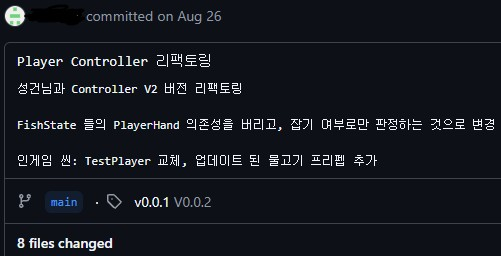

<small>다음 날(8월 26일) 함께 고친 커밋입니다. 그림에서 볼 것은 "성건님과"와 "PlayerHand 의존성을 버리고, 잡기 여부로만 판정"이라는 두 줄입니다.</small>

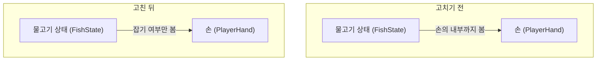

<small>그림에서 볼 것은 물고기가 손에서 보는 것이 잡기 여부 하나로 줄었다는 점입니다.</small>

### 남은 것

팀원 C의 잘못이 아니었습니다. 잡기·놓기가 필요했던 것도 맞고, 저도 필요하다고 생각해 자리를 열어 두었습니다. 문제는 "플레이어와 물고기 모두 이것으로 잡기 여부를 판단한다"는 **하나의 약속이 없었던 것**이고, 이 프로젝트에서 가장 크게 와닿은 부분입니다. 다음에는 파트 사이에서 쓸 API를 시작할 때 먼저 합의하겠습니다.

---

## 맺으며

팀원들의 피드백은 전체적으로 긍정적이었고, 레벨 디자인이 어렵다는 것 말고는 큰 문제가 없었습니다. 그중 제가 맡은 플레이어 조작과 서버 연결에 대한 **제 평가는 조금 불만족**입니다. 서로 붙잡으면 강한 힘이 남는 문제(1장)를 풀지 못하고 끝냈기 때문입니다.

**바란 경험은 지켰다고 봅니다.** 그 문제가 어떤 상황에서 생기는지 찾아냈고 실제 플레이에서는 거의 생기지 않아서, 서로 붙잡고 끌어올리며 협동하는 경험이 플레이 중에 눈에 띄게 깨지지는 않았습니다. 다만 이것은 플레이 경험만 본 평가이고, 규칙에 남은 논리 오류이므로 고쳐야 할 문제입니다.

세 이야기를 돌아보면 같은 질문이 반복됩니다.

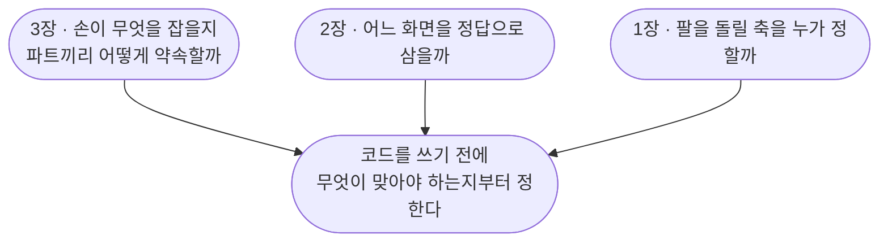

<small>그림에서 볼 것은 세 이야기의 질문이 모두 "코드를 쓰기 전에 무엇이 맞아야 하는지"로 모인다는 점입니다.</small>

**코드를 쓰기 전에, 무엇이 맞아야 하는지부터 정하는 것**, 그것이 이 프로젝트에서 얻은 기준입니다.

---

## 부록

### 참고한 게임

| 게임 | 가져온 것 | 바꾼 것 |
|---|---|---|
| *Heave Ho* | 불편한 조작 속에서 서로 붙잡고 끌어올리는 방식, 좌우 키로 움직이는 방식 | 직접 해 보니 각자 목표 지점에 도착하면 되는 퍼즐에 가까워, 한 번 힘을 합친 뒤에는 혼자 하는 게임처럼 느껴졌습니다. 그래서 물고기를 함께 모아야만 다음 스테이지로 갈 수 있게 바꾸고, 산소(스태미나)가 줄어드는 제한을 더했습니다 |

### 조작

| 입력 | 결과 |
|---|---|
| WASD / 방향키 | 팔을 뻗는 방향. 양팔이 함께 움직입니다 |
| 마우스 왼쪽 / 오른쪽 버튼 | 누르고 있는 동안 왼손 / 오른손으로 잡기 |
| F | 다리 건설 |

### 몸과 입력의 구조

조각은 일곱 개지만, 플레이어의 입력은 한 곳으로만 들어옵니다. 그림에서 볼 것은 입력은 `PlayerController` 한 곳이 받고, 각 조각은 넘겨받은 입력으로 자기 일만 한다는 점입니다.

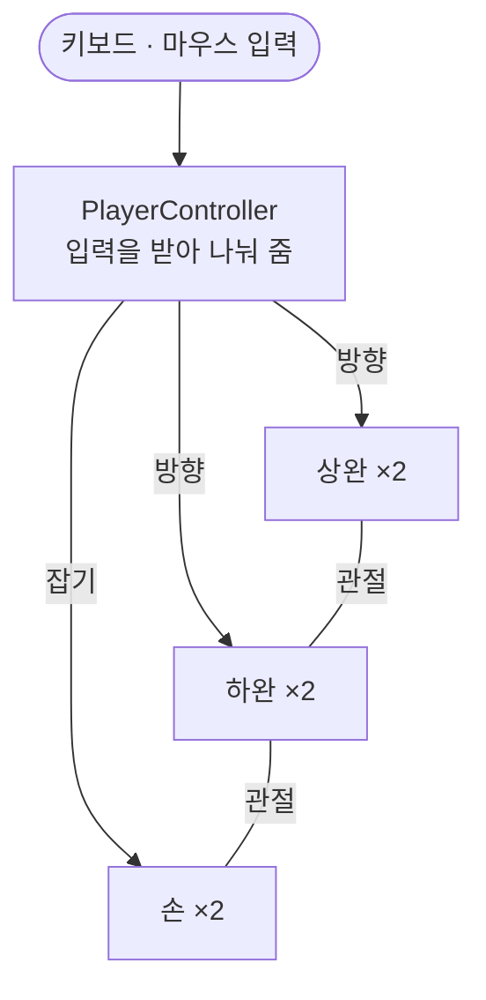

- 팔이 힘의 방향을 바꾸면 손이 움직이고, 손이 어딘가에 고정되면 힘이 몸통 쪽으로 옮겨 가 몸 전체가 움직입니다. 결국 이동 방향은 팔이 정합니다. 그래서 입력은 `PlayerController`가 받고, 그 아래의 팔이 입력을 넘겨받아 방향을 정하게 했습니다.
- 잡기 입력도 같은 이유로 `PlayerController`가 받아 손에 넘깁니다. 손은 범위에 들어온 대상을 잡는 일만 합니다(3장).
- `PlayerController`는 기본 힘·체력 같은 플레이어 정보와, 몸 전체가 어느 세기의 힘을 쓸지 정하는 일(1장)도 맡습니다. 다른 코드가 "이것이 플레이어인가"를 알아보는 표시 역할도 겸합니다.

### 팔을 움직이는 방식이 바뀐 네 단계

| 단계 | 방식 | 결과 |
|---|---|---|
| 1 | 토크(`AddTorque`)로 팔을 돌림 | 상황마다 회전축을 새로 정해야 해서 다루기 어려움 |
| 2 | 힘(`AddForce`)을 늘 같은 세기로 줌 | 원하던 움직임은 나왔지만, 물체를 잡은 채 공중을 날아다닐 수 있음 |
| 3 | 잡은 대상마다 힘의 세기를 계산 | 혼자 할 때는 정상 |
| 4 | 강한 힘을 잡은 대상을 따라 전달 | 여럿이 함께 잡아도 움직일 수 있게 설계 (사다리형 힘 전달) |

### 잡은 대상에 따라 달라지는 힘

늘 같은 세기로 밀자 물체를 잡은 채 공중을 날아다닐 수 있어, 지금 쓸 힘의 세기를 정하는 계산을 넣고(3단계) 정한 값을 상완과 하완 모두에 적용했습니다. 이 계산은 4단계의 사다리형 힘 전달로 대체되었습니다.

| 잡은 대상 | 쓰는 힘 | 이 값을 쓰는 이유 |
|---|---|---|
| 아무것도 잡지 않음 | **기본 힘** | 팔은 움직이지만 공중에 떠오르는 움직임은 나오지 않는 값 |
| 지형처럼 고정된 대상 | **강한 힘** | 플레이어 자신을 옮길 만큼 충분하고, 조작이 바로 반영되는 값 |
| 움직일 수 있는 물체 | 기본 힘 + 질량 × 배율 (강한 힘을 넘지 않음) | 그 물체를 들 정도의 힘만 — 무거운 물체는 함께 들어야 함 |

기본 힘과 강한 힘의 값은 플레이테스트를 거쳐 정했습니다.

### 사다리형 힘 전달 코드

```csharp
private void UpdateArmForce()
{
    if (leftBottomArm.UseForce || rightBottomArm.UseForce)
    {
        currentArmForce = highArmForce;
    }
    else
    {
        // 왼팔을 먼저 보고, 왼팔이 강한 힘을 받지 못했을 때만 오른팔을 확인
        bool receivesHighForce = IsHoldingHighForcePlayer(leftBottomArm) || IsHoldingHighForcePlayer(rightBottomArm);
        currentArmForce = receivesHighForce ? highArmForce : defaultArmForce;
    }
    // (생략) 정한 힘을 상완·하완 네 곳에 같은 값으로 적용 — SetCurrentForce(currentArmForce)
    // 이 팔이 잡은 대상이 강한 힘을 쓰고 있는 플레이어인지
    bool IsHoldingHighForcePlayer(BottomArmController arm)
    {
        PlayerController targetPlayer = GetTargetPlayer(arm.GrabbedTarget);
        return targetPlayer != null && targetPlayer.CurrentArmForce == targetPlayer.HighArmForce;
    }
}
```

먼저 내 팔 중 하나라도 고정된 대상을 잡고 있는지(`UseForce`) 봅니다. 그렇다면 내가 사다리의 맨 아래이므로 강한 힘을 씁니다. 아니라면 내가 잡은 플레이어가 강한 힘을 쓰고 있는지 보고, 그렇다면 나도 강한 힘을 씁니다. `GetTargetPlayer()`가 잡은 조각의 부모까지 찾아보는 이유는, 몸이 일곱 조각이라 다른 플레이어의 팔이나 손을 잡으면 `PlayerController`가 그 조각이 아니라 부모에 있기 때문입니다.

### 1장의 남은 문제를 고친다면

| 상황 | 다음에는 |
|---|---|
| 시간이 넉넉하고 프로젝트 책임이 온전히 나에게 있을 때 | **토크로 바꿉니다.** 직관적이지 않더라도, 조금 더 확실한 구조를 잡는 편이 유리합니다 |
| 시간이 넉넉하지 않고 지금 구조를 크게 바꾸지 않아야 할 때 | **서로 이어진 플레이어들을 한 묶음으로 보고, 큰 힘 하나를 전체에 나눠 줍니다.** 지금 구조에서는 플레이어 한 명이 가질 수 있는 힘(물건을 잡았을 때 · 벽이나 바닥을 잡았을 때 · 아무것도 잡지 않았을 때)이 분명하므로, 하나하나 계산하지 않고 묶음 전체를 큰 힘 하나로 다루는 것이 가장 빠를 것 같습니다. 아직 만들어 보지 않아 정확한 결과는 모릅니다 |

### 물리 계산을 어디서 할까: 세 후보

| | A. 서버가 계산 | B. 호스트가 계산 ✓ | C. 클라이언트가 각자 계산 |
|---|---|---|---|
| 계산하는 곳 | 서버 | 기준으로 삼은 클라이언트 하나 | 모든 클라이언트 |
| 이 게임에서 걸리는 점 | 서버에 Unity가 없어, 물리 계산을 하려면 값을 서버로 올렸다가 다시 내려받아야 함 | 호스트가 아닌 플레이어는 입력을 올리고 결과를 내려받으므로, 인터넷이 느리면 반응이 늦게 느껴질 수 있음 | 래그돌이나 판자처럼 여럿이 함께 건드리는 물체의 결과가 화면마다 달라지고, 누구 값을 정답으로 할지 기준이 없음 |

### 주고받는 플레이어 상태

```csharp
// 서버 Protocol.cs — 플레이어 한 명의 상태 (조각과 잡기 부분)
public class PlayerState
{
    public PartState Body { get; set; }
    public PartState LeftArmTop { get; set; }
    public PartState RightArmTop { get; set; }
    public PartState LeftArmBottom { get; set; }
    public PartState RightArmBottom { get; set; }
    public bool IsLeftGrab { get; set; }
    public bool IsRightGrab { get; set; }
}

// 조각 하나의 상태 (조각과 관계없는 값은 생략)
public class PartState
{
    public float X { get; set; }
    public float Y { get; set; }
    public Rotation Rotation { get; set; }   // 쿼터니언 X·Y·Z·W
}
```

- `PartState`는 조각 하나의 월드 위치(X, Y)와 회전을 담습니다. 호스트가 다섯 조각의 `PartState`를 보내면, 다른 클라이언트는 직전 값과 새 값 사이를 부드럽게 채워(보간) 적용합니다. 보간 방법은 수업에서 배운 내용입니다.
- 손은 조각으로 나뉘어 있지만, 리지드바디(물리 몸체)와 Joint 없이 닿았는지만 감지하는 역할이고 하완에 붙어 움직입니다. 따로 위치를 맞출 필요가 없어 보내지 않습니다.
- 같은 구조로 시작할 때의 자세를 저장해 두고, 리스폰이나 납치 때 처음 자세로 되돌리는 데도 씁니다.

### 먼저 닿은 것을 잡는 코드

```csharp
private void OnTriggerEnter2D(Collider2D other)
{
    // (필터 조건 생략)
    targets.Add(other);
    currentTarget = targets[0];
    ...
}

private void OnTriggerExit2D(Collider2D other)
{
    if (targets.Contains(other))
    {
        targets.Remove(other);
        currentTarget = targets.Count != 0 ? targets[0] : null;
        ...
    }
}
```

손에 닿으면 목록 끝에 넣고, 떨어지면 그 대상만 지웁니다. 잡을 대상은 언제나 목록의 맨 앞(`targets[0]`)이므로, 나중에 닿은 것이 먼저 잡은 것을 밀어내지 않습니다.

### 그 밖에 맡은 것

| 항목 | 무엇을 | 이렇게 한 이유 · 출처 |
|---|---|---|
| 매달리기와 스태미나 | 지형에 매달려 있는 것만으로는 스태미나가 더 줄지 않음 | 매달리기는 서로 끌어올려 주거나 팔이 닿는 범위를 넓히는 선택지라, 협동의 재미에 꼭 필요한 행동이기 때문 |
| 심장박동 소리 | 위급할수록 심장박동 효과음이 나오는 간격이 짧아짐 | 물리로 움직이다 보니 급박한 상황이 자주 생기고, 게이지를 보지 않고도 그것을 알려 줄 무언가가 필요했기 때문 |
| 오디오 매니저 | 효과음 채널을 일부러 넉넉하게 잡음. 실제 플레이 중 효과음이 버려지거나 거슬리는 사운드 버그는 없었음 | 개인 공부 중 유튜브 '골드메탈' 강좌를 보고 따라 만든 코드로, 익숙해서 그대로 가져옴 |
| 플레이어 색상 선택 | 컬러피커로 플레이어 색을 고름 | 인터넷 코드에서 필요한 부분만 뽑아 Unity 버전에 맞게 조금 고침 |

### 물고기 먹이사슬

처음의 물고기는 물속을 돌아다니다 플레이어에게 잡히는 "물체"에 가까웠습니다. 그런데 플레이어의 협동을 중심에 두려면 물고기가 더 다채로워야 한다는 의견이 나와, 물고기를 급히 확장하게 되었습니다. 물고기의 행동은 팀원 C의 몫이고, 저는 그중 **먹이사슬 판정**을 맡았습니다.

모든 물고기는 먹이사슬에 속합니다. 다만 문어나 갯가재처럼 플레이어를 방해하기만 하고 물고기를 먹지 않는 종류와, 상어처럼 다른 물고기를 잡아먹어 먹이사슬에 직접 영향을 주는 종류가 있습니다. 먹는 물고기는 배고픔이 일정량 아래로 내려가면 먹이를 쫓아가 먹습니다. 물고기마다 크기를 정해 두고, 물고기 본체(상위 계층)에서 서로의 크기를 비교해 먹을 수 있는지(`CanEat`) 판단합니다.

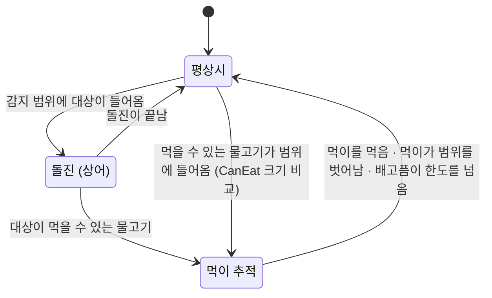

그림에서 볼 것은 상어에게 **돌진**과 **먹이 추적**이라는 두 행동이 있고, 둘 다 평상시에서 들어간다는 점입니다. 아래 문제는 이 두 행동 사이에서 생겼습니다.

**돌진과 먹이 추적을 끝없이 오가던 문제**


| 항목 | 내용 |
|---|---|
| 문제 | 상어가 플레이어에게 돌진하는 것과 먹이를 쫓는 것 사이를 끝없이 오감 |
| 원인 | 배고픔에 따라 먹이를 쫓는 기능이, 상어처럼 플레이어에게 돌진하는 패턴과 부딪침 |
| 해결 | 먹이 판정을 물고기 본체(상위 계층)로 옮기고, 상태 사이를 오가는 조건(FSM)을 조절 |
| 결과 | 상어는 배고프면 물고기를 먹으러 다니지만, 플레이어에게 돌진하는 동안에는 먹이를 쫓지 않음 |

FSM은 정해 둔 몇 가지 상태 가운데 하나에 머물다가, 조건이 맞으면 다른 상태로 넘어가는 방식입니다.

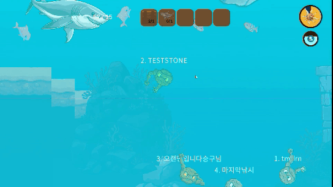

### 출처

서버의 기본 흐름은 수업 중 배운 내용을 활용했습니다. WebSocket으로 데이터를 받아 나누고, 필요한 계산을 한 뒤 다시 나눠 보내는 형식이며, 그 뒤의 수정은 팀이 함께 했습니다. 오디오 매니저와 색상 선택에 쓴 컬러피커는 외부 코드를 가져와 썼습니다(위 그 밖에 맡은 것). 물고기의 행동, 다리 건설, 레벨은 팀원의 작업이라 제 파트를 설명하는 데 필요한 만큼만 언급합니다.
