# MagiCard 프로젝트 문서

> 총알 대신 카드를 쏘고, 쌓아 둔 강화 카드의 조합으로 한 발의 위력을 키우는 1인칭 덱빌딩 카드 슈터

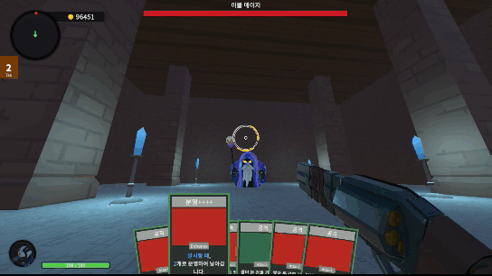

| 항목 | 내용 |
|---|---|
| 장르 | 3D 덱빌딩 카드 슈터 (1인칭, 싱글 플레이) |
| 개발 기간 | 1차 개발 2주 (1차 프로토타입) · 2차 개발 3주 (진행 중) |
| 개발 인원 | 1인 (개인 프로젝트) |
| 개발 환경 | Unity 6000.3.15f1 (URP, New Input System) · 코드 구현과 모델 작업에 AI 활용 |
| 링크 | [GitHub](https://github.com/KooHoo-Dev/3rd_3D_1-3D-Project-SaGiKun4) |

---

## 들어가며

이 문서는 MagiCard를 만들며 부딪힌 고민을 설명합니다.

1. **관통과 반사를 함께 쌓으면 같은 면에서 정반대로 움직였다** — 실행 순서를 다투게 하는 대신 반응·조향·효과라는 역할로 나눠, 충돌 한 번은 반응 카드 한 장만 맡게 했다 (1장)
2. **분열 카드 수만 장에 FPS가 한 자릿수로 떨어졌다** — 동시 발사체 500을 넘는 분열은 위력으로 바꾸고, 이펙트는 같은 종류 40개까지만 그렸다 (2장)
3. **킬 표시가 시야를 가리거나 강한 한 방을 묻었다** — 표시를 화면 가장자리로 옮기고, 가장 많이 처치한 공격을 맨 위에 고정했다 (3장)
4. **AI에게 맡긴 길찾기에서 설계의 주인 자리를 놓쳤다** — 고치기 전에 승인받는 규칙을 만들고, 길찾기는 제가 다룰 수 있는 수준으로 새로 쓰기로 했다 (4장)
5. **문 위치로 방을 이으면 방 전체가 겹쳤다** — 코드가 아니라 문 에셋의 회전 기준을 통일하고, 방 사이에 문 없는 통로를 끼웠다 (5장)

---

## 이 게임은

MagiCard는 총알 대신 카드를 쏘는 1인칭 슈터입니다. 카드는 두 종류입니다. 강화 카드를 쏘면 그 강화가 최대 3개까지 쌓이고, 공격 카드를 쏘면 쌓인 강화를 모두 싣고 날아간 뒤 쌓인 것이 비워집니다. 그래서 같은 공격 카드라도 **어떤 강화를 어떤 순서로 쌓았느냐에 따라 결과가 달라집니다.**

이 게임으로 보여 주고 싶었던 것은 **카드 조합으로 만들어 내는 압도적인 물량과 강력함**입니다.

플레이어가 **한 번의 공격으로 여러 적을 한꺼번에 쓰러뜨리는 쾌감**을 느끼기를 바랐습니다. 그래서 정확히 조준하는 실력보다, 어떤 카드로 덱을 꾸리고 그 자리에서 어떤 순서로 쓸지 판단하는 것이 플레이의 중심이 되도록 했습니다.

이 목표에는 풀어야 할 과제가 따라왔습니다. 강화가 쌓인 공격 한 번에서 카드가 수만 장까지 쏟아질 수 있어서, **게임이 그 양을 버텨야 했습니다**(2장).

개인적인 목표도 있었습니다. AI로 개발이 빨라진다는 말이 많지만, 제 주변에는 AI를 경계하는 사람이 더 많았고 저도 이전 2D 프로젝트에서는 AI를 거의 쓰지 않았습니다. 이번에는 **AI와 함께 만들었을 때 제 역량을 어디까지 끌어낼 수 있는지** 시험해 보기로 했습니다.

**목적과 구조 설계, 판단과 결과 확인은 제가 맡고, 코드 작성은 AI에게 맡겼습니다**(4장).

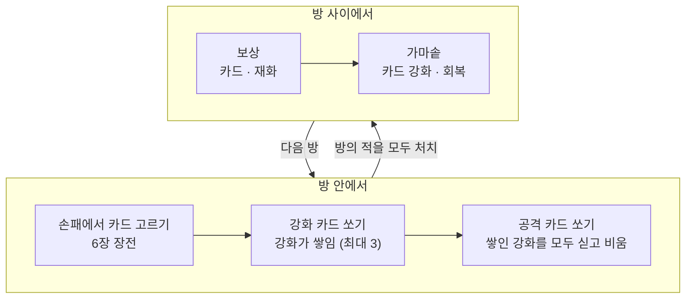

<small>그림에서 볼 것은 두 개의 반복입니다. 방 안에서는 강화를 쌓아 공격 카드 한 장에 싣는 일을 되풀이하고, 방을 비우면 보상과 가마솥에서 덱을 키워 다음 방으로 갑니다. 방은 작은 방, 중간 방, 큰 방을 거쳐 보스방으로 이어집니다.</small>

[한 판의 흐름을 담은 화면과 조작](#한-판의-흐름과-조작), [참고한 게임](#참고한-게임)은 부록에 있습니다.

---

## 1. 관통과 반사를 함께 쌓으면 같은 면에서 정반대로 움직였다

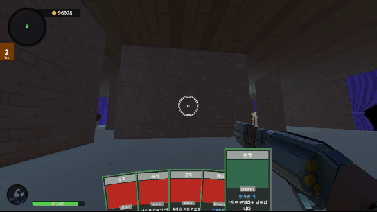

<small>그림에서 볼 것은 손패 맨 앞 카드가 분열 → 폭발 → 공격으로 바뀌는 순서입니다. 강화 카드 두 장은 쌓이기만 하고, 마지막 공격 카드가 둘을 싣고 날아가 벽에서 터집니다.</small>

### 쏜 순서가 그대로 결과가 되게 하고 싶었습니다

MagiCard에서 강화 카드를 쏘면 강화가 최대 3개까지 쌓이고, 공격 카드를 쏘면 쌓인 강화를 모두 싣고 날아갑니다. 같은 공격 카드라도 **어떤 강화를 어떤 순서로 쌓았느냐에 따라 결과가 달라지는 것**이 이 게임의 재미입니다.

그래서 처음부터 한 가지는 정해 두었습니다. **실행 순서는 플레이어가 쌓은 순서**입니다. 당시 AI에게도 "실행 순서는 스택에 넣은 순서로 하려고 해. 그래야 사용자에게 직관적이니까."라고 말했습니다.

### 관통한 카드가 몬스터 몸 안에서 반사됐습니다

처음 강화 카드는 분열·폭발·관통·반사 네 종류였습니다. 그런데 관통과 반사를 함께 쌓자 예상과 다른 움직임이 자주 나왔습니다. 관통으로 몬스터 몸 안에 들어간 카드가 그 안에서 반사되는 식이었습니다. 관통은 면을 무시하고 지나가고 반사는 면에 닿으면 방향을 꺾으니, 두 카드는 **같은 면을 만났을 때 정반대로** 움직입니다. 논리만 따지면 틀린 동작도 아니었습니다.

처음에는 **두 카드가 다투지 않게 하는 규칙을 더했습니다.**

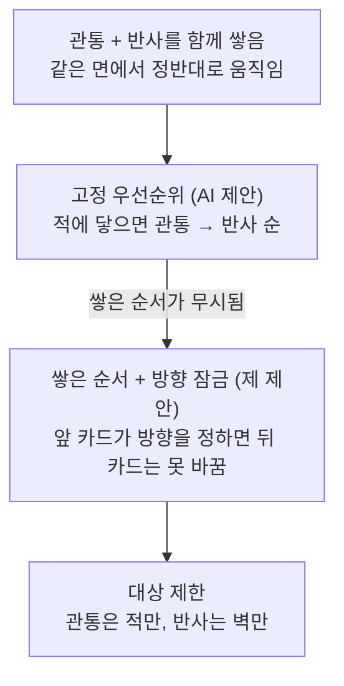

<small>그림에서 볼 것은 세 시도가 모두 "두 카드가 어떻게 다투지 않게 할까"라는 같은 질문 안에 있다는 점입니다. 대상 제한으로 두 카드가 같은 면에서 만날 일은 사라졌지만, 다툼을 막는 규칙만 늘어났습니다.</small>

### 두 카드가 꼭 논리로 맞아떨어져야 할까

대상을 제한해 둔 상태에서, 우선순위를 더 다듬기 전에 문제를 처음부터 다시 짚어 봤습니다.

> "지금의 문제는 충돌하는 구조의 문제가 아니라, 운동량이 정반대가 되는 물리적 현상을 억지로 끼워 맞추고 있는 게 아닐까?"

관통은 운동량을 그대로 두고, 반사는 면에 부딪혀 방향을 꺾습니다. 이 의문을 AI에게도 "지금 문제가 충돌 카드가 서로 경쟁하는 구조에 있는게 아니라 관통과 반사가 운동량의 변화가 정 반대라서 그런거 같아"라고 전하며 문제를 다시 제시했습니다. AI는 반사가 정반대가 아니라 면에 수직인 성분만 뒤집는다고 바로잡으며, 두 카드가 "부딪힌 순간 운동량이 어떻게 되는가"라는 **같은 질문에 서로 다른 답을 내는 것이 원인**이라고 정리했습니다.

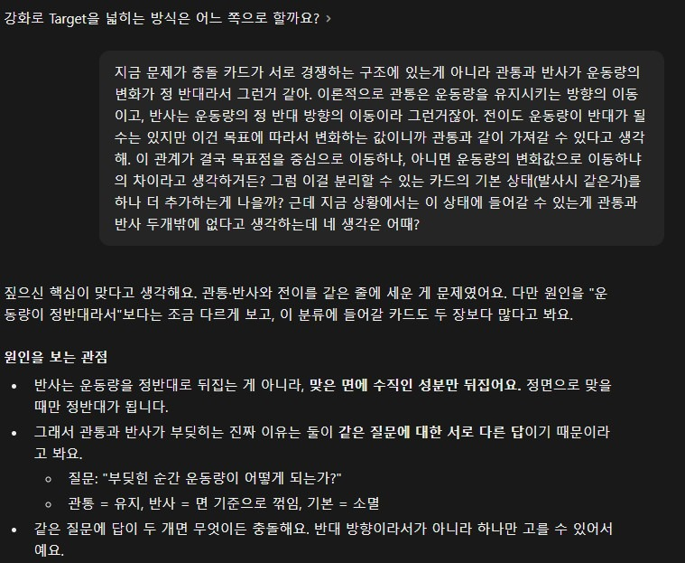

<small>그림에서 볼 것은 위쪽 말풍선입니다. 문제를 "카드끼리 경쟁하는 구조"가 아니라 "관통과 반사의 운동량 변화가 다르다"로 다시 제시했습니다. 아래는 그 말을 받아 원인을 다시 정리한 AI의 답입니다.</small>

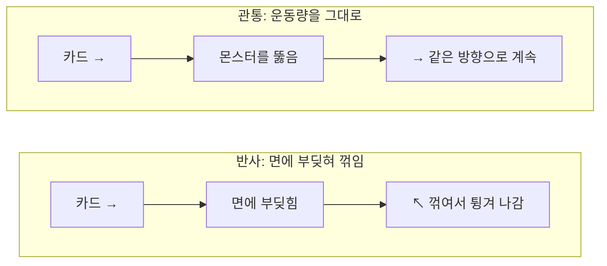

<small>그림에서 볼 것은 같은 충돌 한 번에 관통은 "그대로 통과", 반사는 "면에서 꺾임"이라는 서로 다른 답을 낸다는 점입니다. 그래서 한 면에서 두 카드를 함께 적용하면, 어느 쪽 순서를 정해도 한쪽이 사라집니다.</small>

한 번의 충돌에 서로 다른 답을 내는 동작이라 논리로는 풀리지 않는다고 판단했고, 질문을 바꿨습니다. **두 카드를 함께 쌓은 플레이어는 무엇을 기대할까?** 관통 뒤 반사를 쌓았다면 뚫고 지나간 뒤 튕기기를, 반사 뒤 관통이라면 튕긴 뒤 뚫기를 기대합니다.

### 카드를 '역할'로 나눴습니다

카드를 나누는 기준을 하나 더 두자고 제안했고, AI가 이것을 발동 시점과는 별개인 '역할' 축으로 정리했습니다. **문제를 다시 정의한 것은 저였고, 그것을 구조로 옮긴 것은 AI였습니다.**

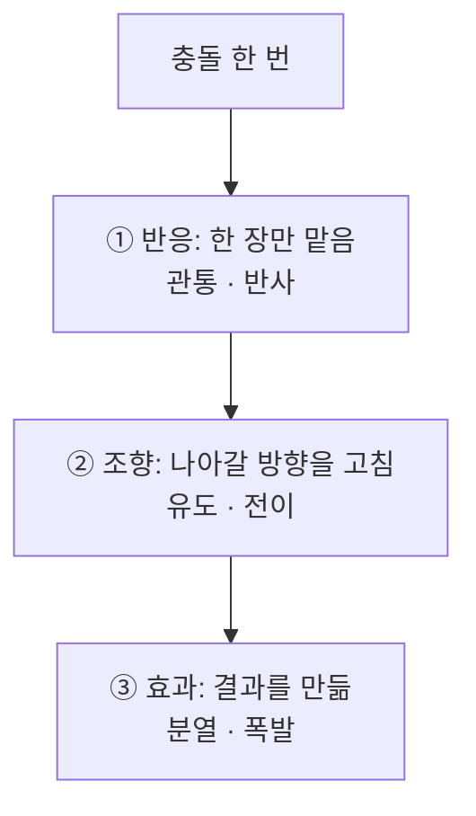

<small>그림에서 볼 것은 충돌 한 번에 운동량을 정하는 반응 카드가 한 장뿐이라는 점입니다. 같은 역할 안에서는 쌓은 순서를 그대로 지키고, 앞 카드의 횟수가 다 떨어지면 다음 카드가 이어받습니다.</small>

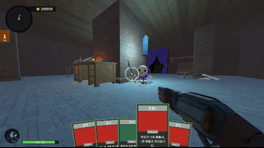

<small>관통 다음 반사를 쌓은 공격 카드가 몬스터를 뚫고 지나간 뒤, 뒤쪽 벽에 맞아 바닥 쪽으로 튕겨 나오는 장면(푸른 꼬리선)입니다.</small>

그 결과 **관통 뒤 반사, 반사 뒤 관통이 모두 기대한 대로 움직였고**, 한쪽 강화가 사라진 듯한 느낌도 없어졌습니다.

이 결정으로 감수한 것도 있습니다. 반사는 관통의 횟수가 '다 떨어진 뒤에야' 이어받으므로, **관통하자마자 바로 튕기게 할 수는 없습니다.** 관통이 의미 없어지는 경험을 막으려고 일부러 둔 제약입니다. 물리 법칙을 그대로 따르지 않는 '게임적 허용'이기도 합니다.

역할로 두 카드가 구분되자 대상 제한은 필요 없어졌습니다. 그래서 그냥 없애지 않고 '플레이어가 고를 수 있는 강화', 곧 대상 변경 카드로 다시 만들었습니다. **충돌을 막으려고 둔 제한이 조합의 재료가 된 것입니다.** 유도·전이처럼 나중에 더한 카드도 새 규칙 없이 같은 틀에 들어갔습니다.

AI의 제안 중 받아들이지 않은 것도 있습니다. 관통할 때마다 피해를 30% 줄이자는 제안은, 이미 횟수 제한이 있는데 불리한 조건을 더하면 제약이 지나치다고 보고 거절했습니다. 발사 시점 관통처럼 의미 없는 조합을 코드로 막자는 제안은, **어떤 카드를 언제 쓸 수 있게 할지는 설계자가 정할 일**이라 카드 표의 칸으로 조정했습니다. [구현 코드](#관통반사를-자세히)와 [카드 데이터 구조](#카드-데이터-구조)는 부록에 있습니다.

### 게임적 허용은 사람이 정해야 했습니다

게임을 만들 때는 논리를 그대로 따르기보다, **플레이어가 무엇을 기대하는지와 그 기대를 채우려면 어디까지 규칙을 봐줘야 하는지**를 먼저 생각해야 했습니다.

AI는 주어진 규칙 안에서 맞는 답을 찾는 데는 강했습니다. 하지만 우선순위·잠금·대상 제한처럼 논리 안의 해법을 계속 내놓을 뿐, 게임적 허용의 기준은 스스로 세우지 못했습니다. **그 기준을 제가 먼저 정하자 AI도 분명하게 구현했습니다.** 같은 AI와 일하면서 이 기준을 세우지 못한 곳에서는 결과가 정반대였습니다(4장).

---

## 2. 분열 카드 수만 장에 FPS가 한 자릿수로 떨어졌다

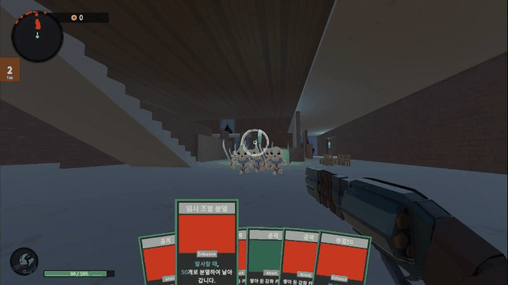

<small>그림에서 볼 것은 발사하는 순간과, 그 카드들이 분열·반사로 맵에 흩어져 화면을 가득 채운 순간입니다. 카드 약 50장이 발사된 뒤 약 500장까지 늘어납니다. 한 판에서 모을 수 있는 강화를 어림해 쏜 장면으로, 동시 발사체 상한 500도 이 양을 기준으로 정했습니다.</small>

### 쏟아지는 물량이 이 게임의 재미였습니다

MagiCard가 보여 주려는 것은 카드 조합으로 만들어 내는 압도적인 물량입니다. 분열 카드를 강화할수록 한 번의 공격에서 나오는 카드가 늘어나고, **그 카드들이 적을 한꺼번에 쓸어 버리는 것이 이 게임의 쾌감**입니다.

**많은 발사체를 다룰 준비는 처음부터 해 두었습니다.** 발사체를 매번 새로 만들지 않고 돌려 쓰는 오브젝트 풀링은 1발만 쏘던 프로토타입 직후 바로 넣었습니다. 발사체마다 `Update`를 두지 않고 한곳에서 갱신하는 방식은 AI가 짚어 주어 바꿨습니다.

### 분열만 강화하자 게임이 멈췄습니다

첫 프로토타입에서 분열만 15장 정도 강화해 시험해 보니, 카드가 5\~6만 장 발사될 때 FPS가 한 자릿수로 떨어졌고 10만 장대에서는 게임이 동작하지 않았습니다. 강화 수치상 나오기 어려운 극단적인 조합이지만, **나올 수 있는 이상 게임 안정성을 크게 해치는 문제**였습니다.

그렇다고 **카드 수를 무작정 줄일 수는 없었습니다.** 물량 자체가 이 게임의 목적이기 때문입니다.

### 얼마나 많아야 충분히 많을까

그래서 먼저 "어디까지 줄여도 되는가"를 정해야 했습니다. 숫자로 정할 수 있는 기준이 아니어서, **목적에 비추어 직접 플레이하며 정했습니다**.

분열 카드는 정해진 각도 안에서 무작위 방향으로 퍼지므로, 장수가 늘수록 그 범위가 빈틈없이 채워집니다. 결국 얼마나 많은지는 얼마나 퍼지는지를 통해 느낄 수 있습니다. **퍼진 카드가 화면을 가득 채우면 충분히 많다**고 봤고(맨 위 그림), 여기에 "만든 내가 재미있는가"를 함께 따졌습니다.

### 넘는 분열은 위력으로, 넘는 이펙트는 생략했습니다

이 기준으로 두 가지를 정했습니다.

**하나는 동시에 날아다닐 수 있는 발사체의 상한입니다.** 상한에 걸려 만들지 못한 분열을 어떻게 처리할지 두 가지를 비교했습니다.

| | A. 상한을 넘으면 만들지 않음 | B. 넘은 만큼을 위력으로 흡수 |
|---|---|---|
| 장점 | 단순함 | 성능을 지키면서 플레이어가 손해 보지 않음 |
| 단점 | 강화한 만큼 손해 보는 느낌 | 카드 수가 압도적으로 늘어나는 모습이 조금 흐려짐 |

B를 골랐습니다. 상한은 500이고, **만들지 못한 자식 수만큼 남은 카드의 위력을 키웁니다.**

500이라는 수는 **실제 플레이에서 나올 수 있는 양을 어림해 정했습니다.**

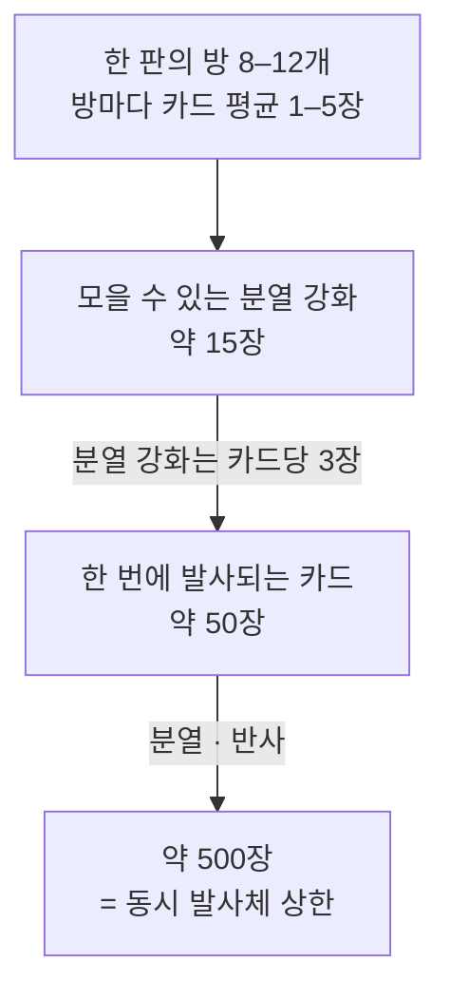

<small>그림에서 볼 것은 상한 500이 한 판에서 모을 수 있는 강화를 따라가 어림한 값이라는 점입니다. 레벨 디자인이 본격적으로 들어가기 전에 러프하게 잡은 값이라, 레벨 디자인에 따라 바뀔 수 있습니다. 맨 위 그림이 이 50장을 쏜 장면입니다.</small>

그보다 많은 양까지 만들면 생성 비용이 너무 커져, 게임이 아니라 컴퓨터가 멈출 위험이 있었습니다. 처음에는 AI가 더 큰 상한을 제안했지만, **발사할 때 잠깐 생기는 프레임 하락이 불편해서 제가 500으로 줄였습니다.**

**다른 하나는 이펙트의 개수입니다.** 이펙트가 있는 카드는 폭발 카드 하나입니다. 이펙트 최적화는 일부러 미뤘다가, 파티클이 들어온 뒤 이펙트가 가장 많이 나오는 분열 + 폭발 + 반사 조합으로 시험했습니다. 분열이 3¹⁰ 단계(59,049장)에 이르자 약 5초씩 멈췄습니다.

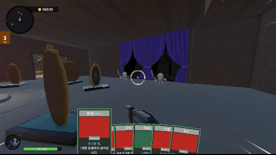

<small>그림에서 볼 것은 첫 충돌에서 폭발 이펙트가 터진 뒤, 분열한 카드가 반사를 거듭하며 화면을 가득 채우는 모습입니다. 카드가 이만큼 많아지면 이펙트보다 카드 자체가 먼저 눈에 들어옵니다.</small>

| | A. 개수 제한 (제 제안) | B. 가까운 이펙트 합치기 (AI 추천) | C. 종류마다 파티클 하나로 몰아 뿜기 (AI 추천) |
|---|---|---|---|
| 방식 | 넘으면 이펙트만 생략 | 가까운 곳의 같은 이펙트를 하나로 크게 | 오브젝트 대신 입자만 방출 |
| 장점 | 가장 간단하고 효과가 큼 | 많이 터진 느낌이 남음 | 가장 가벼움 |
| 단점 | 일부 이펙트가 보이지 않음 | - | 여러 파티클을 겹친 에셋 프리팹은 구조를 맞춰야 해서 작업이 많음 |

프로토타입 단계이고 A만으로 부족함을 느끼지 못해서 **A를 골랐고, B와 C는 A로 부족할 때만 하기로 했습니다.** 예산은 이렇게 정했습니다.

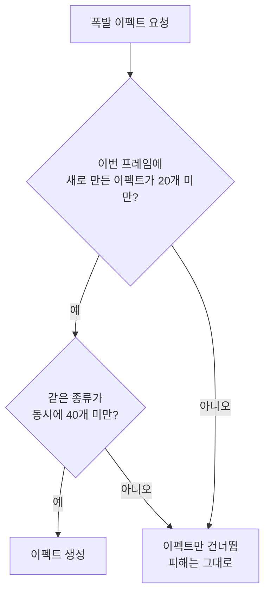

<small>그림에서 볼 것은 예산을 넘어도 건너뛰는 것은 이펙트뿐이라는 점입니다. 게임 결과(피해)와 화면 연출을 떼어 놓았습니다.</small>

**두 결정으로 감수한 것은 실제로는 드러나지 않았습니다.**

| 감수한 것 | 실제로는 |
|---|---|
| 카드 수가 압도적으로 늘어나는 모습이 흐려짐 | 상한 가까이 가는 공격은 이미 "충분히 많다"를 넘어선 상태라 개수 차이가 보이지 않음 |
| 일부 이펙트가 보이지 않음 | 40은 플레이하며 정한 수. 이펙트가 40개를 넘는 상황이면 카드 수 자체가 이펙트를 대신할 만큼 강한 볼거리가 됨 |

1차 프로토타입 플레이테스트에서 한 참가자가 분열만 잔뜩 강화해 쐈을 때 FPS는 110대에서 80\~90대로 떨어졌지만 게임을 방해할 정도는 아니었습니다. 참가자는 "분열을 강화했다"는 경험을 그대로 가져갔고, **카드 수가 줄었다는 것도, 이펙트가 부족하다는 것도 알아채지 못했습니다.**

### 예산을 넣자 이펙트가 40개 뒤로 다시 나오지 않았습니다

개수 제한을 넣고 시험하자, 발사체 100개 중 처음 40개만 폭발 이펙트가 나오고 그 뒤로는 이펙트가 꺼진 뒤에도 다시 나오지 않았습니다. AI는 처음에 이펙트의 반복 재생(Looping) 때문이라고 진단했습니다. 하지만 Looping은 이미 꺼져 있었고 재생 시간도 약 2초로 짧았습니다. **이 사실을 근거로 되묻자 AI도 원인을 잘못 짚었다고 인정했습니다.**

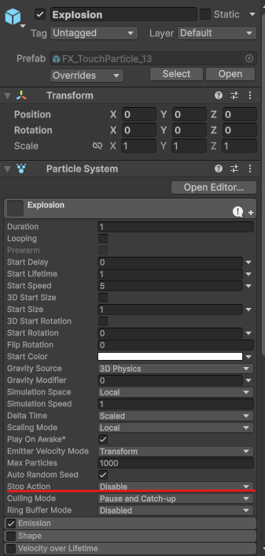

<small>그림에서 볼 것은 Looping이 꺼져 있고, 종료 동작(Stop Action)이 Disable로 되어 있다는 점입니다. 진짜 원인은 이 Disable에 있었습니다.</small>

진짜 원인은 파티클의 종료 동작이었습니다. 끝나는 순간 Unity가 오브젝트를 먼저 꺼 버려서, 풀로 돌려보내는 확인이 돌지 못했습니다. 이펙트가 꺼질 때 풀로 돌려보내게 고치자 정상으로 돌아왔고, 예산을 넣기 전에는 드러나지 않던 누수도 함께 풀렸습니다. AI의 진단은 그럴듯해도 실제 설정과 다를 수 있었습니다. 반대로 제가 반박했다가 AI가 맞았던 적도 있어서, 무조건 거절하는 것이 아니라 **확인한 뒤에 판단**하는 것을 기준으로 삼았습니다.

### 카드가 충분히 많으면, 개수가 볼거리를 대신합니다

분열 상한과 이펙트 예산은 따로 정했지만 같은 결론에 닿았습니다. **카드가 충분히 많으면, 그 개수가 다른 볼거리를 대신합니다.** 최적화를 어디까지 할지는 성능 숫자만이 아니라, 플레이어가 무엇을 보고 즐기는지로 정해야 했습니다.

남은 것도 있습니다. 위력이 커질 때 값이 넘치지 않게 둔 **피해 상한은 AI가 제안한 값을 그대로 두었습니다.** 레벨 디자인과 맞물리는 값인데, 아직 몬스터가 그 균형을 따질 단계까지 오지 않아 검증하지 못했습니다. 이펙트 수 40도 1차 프로토타입 값이라, 합치기와 몰아 뿜기는 개수 제한으로 부족해질 때 다시 보기로 했습니다. 측정표와 구현 코드는 [부록](#물량을-버티는-장치-2장)에 있습니다.

---

## 3. 킬 표시가 시야를 가리거나 강한 한 방을 묻었다

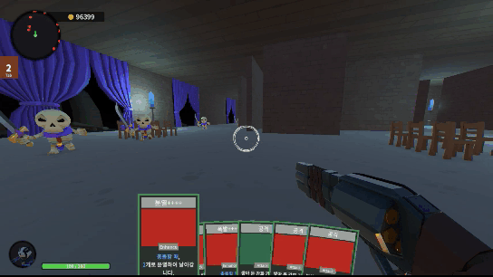

<small>그림에서 볼 것은 화면 오른쪽 위의 막대입니다. 막대 하나가 공격 하나이고, 가장 많이 처치한 공격이 맨 위에 남아 있습니다.</small>

### 멀티킬 같은 피드백을 주고 싶었습니다

MagiCard가 주려는 쾌감은 한 번의 공격으로 여러 적을 쓰러뜨리는 것입니다. 그래서 **지금 공격이 얼마나 강했는지를 화면에서 바로 보여 주는 장치가 필요했습니다.** 참고한 것은 서든어택이나 리그 오브 레전드 같은 PvP 게임의 멀티킬 알림입니다. 여러 명을 연달아 쓰러뜨리면 화면 정중앙에 "트리플킬" 같은 글자가 효과음과 함께 떠서, 확실한 피드백으로 쾌감을 줍니다.


<small>그림에서 볼 것은 여러 적을 연달아 쓰러뜨렸을 때 화면 가운데에 크게 뜨는 알림입니다. 이런 확실한 피드백을 이 게임에도 주고 싶었습니다. (출처: 리그 오브 레전드, Riot Games)</small>

처음에는 두 안이 있었습니다.

- A. 처치 수에 따라 화면 중앙에 이미지를 띄워 피드백을 주는 방식 (멀티킬 알림과 같은 방식)
- B. 화면 중앙 위쪽에 프로파일러처럼 시간에 따라 흘러가는 막대그래프를 두고, 처치 수가 높아지면 그래프가 치솟게 하는 방식

AI가 "A는 공격 단위, B는 시간 단위라 재는 대상이 다르다"고 비교해 주었습니다. 저는 B의 비중을 크게 두고 A를 섞어, **막대 하나가 공격 하나**를 뜻하는 그래프로 정했습니다. 강한 공격이 나오면 그 막대 하나만 길게 늘어납니다.

### 화면 가운데는 플레이어의 시야였습니다

그런데 FPS에서는 화면 가운데가 가장 중요한 자리라, **그래프가 그 자리를 가리지 않을까 하는 걱정이 들었습니다.** PvP 게임과 달리 MagiCard는 많은 적과 쉬지 않고 싸우기 때문에, 화면 가운데를 가리면 다음 적을 봐야 할 시야를 막을 수 있었습니다.

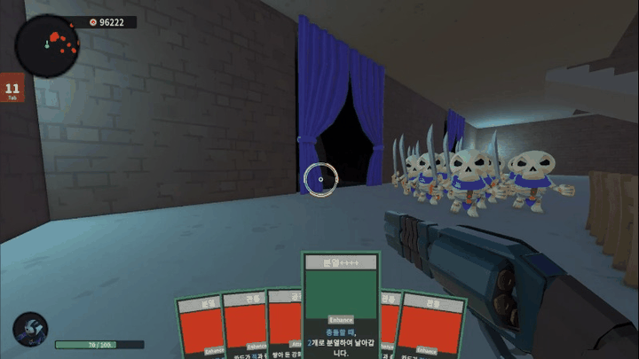

<small>그림에서 볼 것은 화면 가운데 위쪽에 놓인 그래프가, 처치 수가 늘수록 아래로 길어져 조준점 바로 위의 시야를 차지하는 모습입니다. (연출: 처음 걱정한 배치를 보여 주려고 그래프를 가운데로 옮겨 찍었습니다. 실제 게임에서는 오른쪽 위에 있습니다.)</small>

그래서 **그래프를 화면 오른쪽 위 가장자리로 옮기고**, 막대가 오른쪽에서 왼쪽으로 길어지게 했습니다. 강한 공격일수록 막대가 화면 안쪽으로 자라 임팩트가 생깁니다.

옮긴 뒤에는 다른 문제가 생겼습니다. 공격마다 쏜 순서대로 번호(1, 2, 3…)를 붙이고, 그 공격이 적을 처치할 때마다 처치 수를 올려 띄웠습니다. 그런데 무한 관통과 무한 반사를 강화한 카드라면 한 발이 오래 살아남아 많은 적을 공격합니다. 1번도, 2번도, 3번도 계속 살아 있으면 **막대가 화면 오른쪽을 다 차지합니다.**

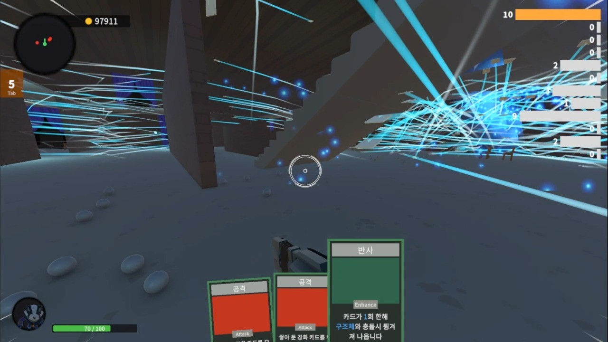

<small>그림에서 볼 것은 처치 수 0인 공격까지 줄을 차지해, 막대가 화면 오른쪽을 길게 덮는 모습입니다. (줄 수를 제한하기 전 빌드에서 찍었습니다.)</small>

처음에는 단순히 표시하는 개수만 제한했습니다. 그러자 AI가 "이렇게 하면 1번부터 5번까지만 보이고 6번부터는 거의 나오지 않는다"고 짚어 주었습니다. **개수 제한만으로는 나중에 쏜 강한 한 방이 보이지 않았습니다.**

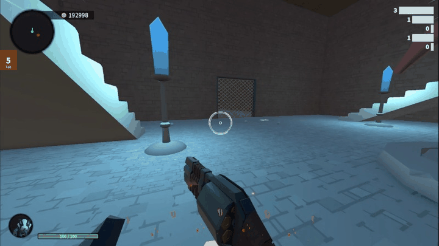

<small>그림에서 볼 것은 마지막 공격이 적을 쓰러뜨렸는데도 오른쪽 위 그래프에 새 막대가 생기지 않는 순간입니다. (연출: 현상이 보이도록 그래프 유지 시간을 늘려 찍었습니다. 실제 플레이에서는 손패 6장이 한 바퀴 돌기 전에 줄이 비워져 6번째까지 쌓이는 일이 드뭅니다.)</small>

### 보여 줄 것은 가장 강한 한 방이었습니다

질문을 둘로 나눴습니다. '무엇을 띄울 것인가'와 '언제까지 띄울 것인가'입니다. 둘 다 "**플레이어가 강한 공격을 확실히 확인할 수 있는가**"로 판단했습니다.

### 가장 강한 공격은 맨 위에, 약하고 오래된 줄부터 비웠습니다

**처치 수가 가장 많은 공격은 맨 위에 고정하고**, 나머지는 쏜 순서대로 아래에 놓았습니다. 그래프가 움직이는 순서는 아래 그림과 같고, 규칙마다 정한 이유는 이렇습니다.

- **최대 5줄:** 손패가 6장이라 6줄도 생각했지만 그래프가 너무 길어졌습니다. 손패에는 분열·폭발처럼 한 번 발동하고 사라지는 카드도 많아, 플레이로 재 보니 동시에 4줄을 넘지 않았습니다. 그래서 한 줄 여유를 두었습니다.
- **끝난 뒤 2초 유예:** 처치 수가 바로 사라지면 이번 공격으로 몇 마리를 쓰러뜨렸는지 확인하기 어렵고, 너무 오래 남기면 많이 처치한 공격을 제대로 보지 못합니다.
- **약하고 오래된 줄부터 비우기:** 이런 줄은 끝까지 가도 처치 수가 가장 낮을 가능성이 큽니다.
- **밀려난 공격도 계속 세기:** 소멸할 때 터지는 폭발처럼 끝나지 않은 공격이 나중에 가장 많이 처치할 수도 있습니다.

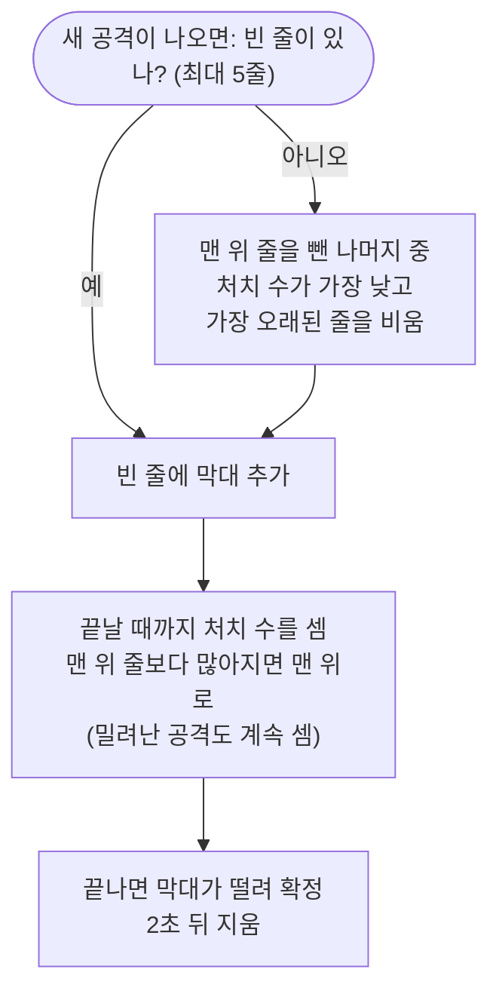

<small>그림에서 볼 것은 맨 위 줄이 언제나 지금까지 가장 많이 처치한 공격이라는 점입니다. 줄이 모자라면 끝까지 가도 가장 약할 줄부터 비우고, 밀려난 공격도 처치 수는 계속 세어 다시 맨 위로 올라올 수 있습니다.</small>

감수한 것도 있습니다. **처치 수가 낮은 공격은 확인할 틈 없이 지워질 수 있습니다.** 그래프는 가장 강한 한 방을 보여 주는 장치라고 정했기 때문에 받아들였습니다.

### 연출도 플레이를 가리면 안 됐습니다

다른 게임에서 좋았던 연출을 그대로 가져오기보다, **그 연출이 내 게임의 플레이에서 어디에 놓여야 하는지를 먼저 봐야 했습니다.** 멀티킬 알림은 화면 한가운데에 있어서 좋았지만, 쉬지 않고 싸우는 이 게임에서는 같은 자리가 방해가 됐습니다.

남은 것은 강조 색의 기준입니다. 한 번에 일정 수 이상 처치하면 막대 색을 바꿔 강한 공격을 한눈에 보이게 하는데, **이 기준 값은 1차 프로토타입의 임시 값**이라 2차 개발에서 밸런스와 함께 조정할 예정입니다. 분열한 카드까지 한 공격으로 세는 방법은 [부록](#킬-그래프가-공격을-세는-방법-3장)에 있습니다.

---

## 4. AI에게 맡긴 길찾기에서 설계의 주인 자리를 놓쳤다

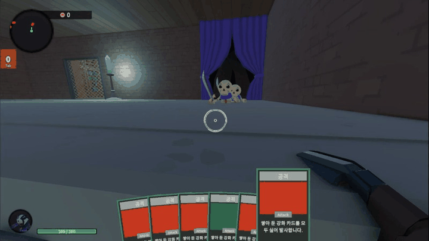

<small>그림에서 볼 것은 2층에 있던 몬스터가 경사로를 따라 돌지 않고, 바닥을 뚫고 곧장 아래층으로 가려는 움직임입니다.</small>

### 카드에서 얻은 자신감으로 길찾기를 맡겼습니다

이 프로젝트의 개인 목표는 AI와 함께 만들었을 때 제 역량을 어디까지 끌어낼 수 있는지 시험하는 것이었습니다. 목적과 구조 설계, **판단과 결과 확인은 제가 맡고, 코드 작성은 AI에게 맡겼습니다.**

카드 조합은 프로젝트를 시작하기 전부터 어떻게 풀지 계속 고민해 왔기 때문에, **구조를 분명히 설계해 AI에게 넘길 수 있었습니다.** AI가 구현한 것을 받아 검토하고, 플레이로 확인하며 고칠 방법을 함께 논의한 뒤, 제가 승인한 방향으로 고쳐 가며 완성했습니다(1장). 이 경험으로 AI를 쓰는 데 자신감이 붙었습니다.

몬스터 길찾기는 Unity 내비게이션 대신 직접 만들기로 했습니다. 내비게이션의 내비 메시는 쓸 만하지만 길찾기가 A\* 기반이라, 플레이어를 쫓는 몬스터가 많아지면 목적지가 바뀔 때마다 마리마다 경로를 다시 계산해야 합니다. TreeHouse에서 A\*를 직접 구현하며 여러 마리의 길찾기가 얼마나 무거운지 겪었고, 이 게임은 몬스터를 많이 둘 계획이었습니다. 목표는 "**다수의 몬스터를 위한, 가장 단순하고 가벼운 추적**"이었습니다.

### 원인을 찾은 것은 제가 아니라 AI였습니다

그런데 길찾기는 목표만 정했을 뿐, 어떤 알고리즘을 어떻게 만들지는 생각해 두지 않았습니다. 카드에서 얻은 자신감에 기대 목적과 경험을 추상적으로만 던졌고, 대안을 제대로 비교해 고르는 과정 없이 AI의 구현이 먼저 나왔습니다. 가벼움이 목표였으니 새 기법이 들어올 때마다 무게를 따져 보고 이 프로젝트에 비해 무거운 것은 쳐냈어야 했는데, 그러지 못했습니다. 그렇게 판단할 일이 하나씩 AI에게 넘어가면서, **길찾기의 전권이 점점 AI에게 넘어갔습니다.** 길찾기는 점점 무거워졌지만 기능은 플레이어를 쫓아오는 수준에 머물렀고, 제가 이해해야 할 수준만 너무 높아져 오히려 제가 AI에게 질문하며 수업을 받는 듯한 개발이 이어졌습니다.

그 사이 AI가 고쳐도 될지 묻지 않고, 필요해 보여서 고쳤다고 알리는 일도 몇 번 되풀이됐습니다.

결정적인 순간은 2층의 몬스터가 바닥을 뚫고 경사로로 가려던 문제였습니다(맨 위 그림). 저는 "이 부분이 문제다"라고 먼저 짚지 못하고 "어디가 문제일까?"를 먼저 물었고, **원인은 AI가 찾았습니다.** 관통·반사에서 제가 해결책을 내고 AI가 평가했던 것과 정반대였습니다.

### 어디까지 맡겨야 제 설계라고 할 수 있을까

기능은 제대로 돌아가서 그대로 써도 큰 문제는 없었습니다. 하지만 이 구조는 이미 제 손을 떠나, 나중에 문제가 생기면 제가 해결책을 내지 못합니다. 처음에 경계하던 "개발 주도권을 뺏기는 상황"이 바로 이것이었습니다. 코드를 AI가 썼다는 것은 문제가 아니었습니다. 카드도 코드는 AI가 썼습니다. 차이는 **무엇을 기준으로 판단할지를 누가 먼저 정했는가**에 있었습니다.

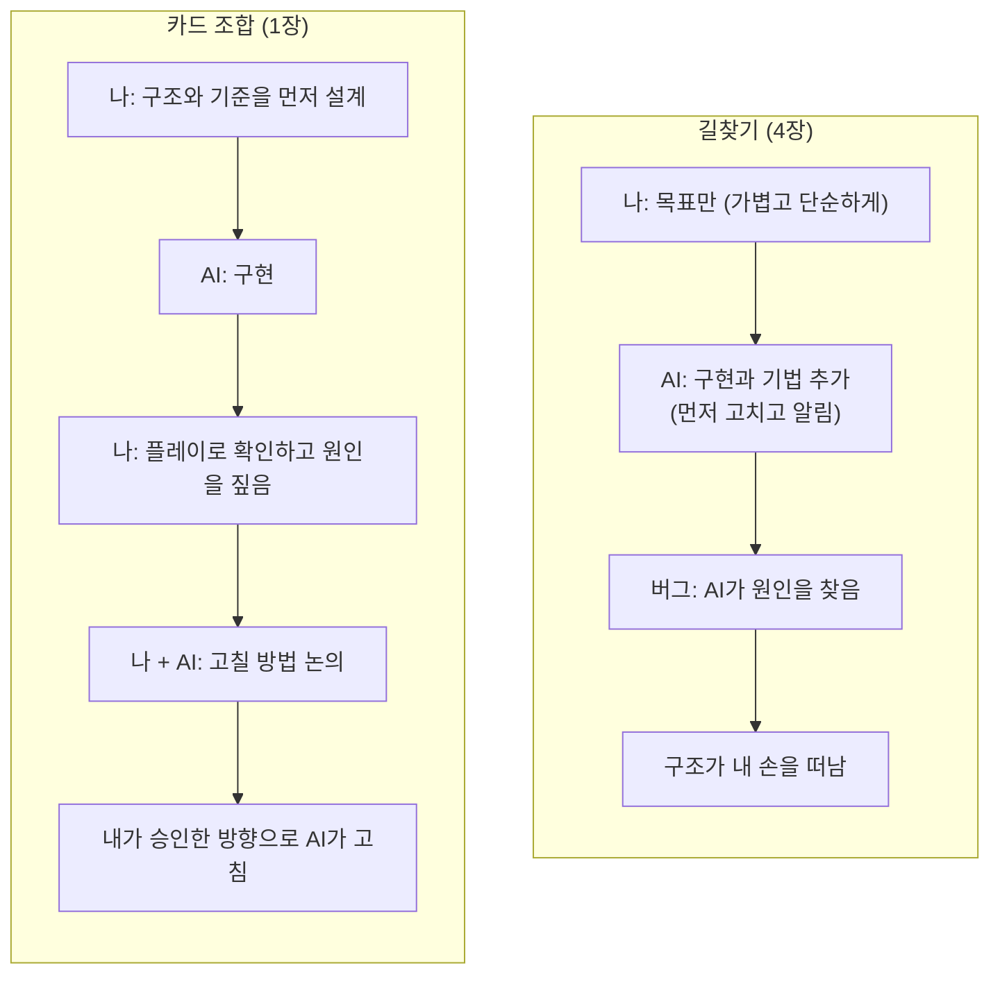

<small>그림에서 볼 것은 두 작업 모두 코드는 AI가 썼다는 점, 그리고 갈린 곳이 첫 칸(누가 기준을 먼저 정했나)이라는 점입니다.</small>

### 고치기 전에 승인받고, 이해한 것만 남겼습니다

그래서 AI와 일하는 규칙을 만들었습니다. 가장 중요한 것은 **고치기 전에 방법을 설명받고 승인하며, 이해한 부분만 코드로 남기는 것**입니다. 조금 번거롭더라도 고칠 내용을 먼저 확인하게 했고, 이미 혼자 만들어진 코드는 설명을 듣고 이해한 부분만 남겼습니다.

모델링을 맡길 때도 같은 기준을 지켰습니다. 모델링은 제 주력 기술이 아니어서 부족한 부분을 AI로 채웠지만, **방향까지 넘기지는 않았습니다.** 요청문을 직접 설계해, "상자를 만들어 줘"처럼 모호한 요청이 와도 AI가 바로 만들지 않고 어떤 사물인지, 어느 정도로 구현할지, 어디에 쓰는지를 먼저 묻고 자기가 이해한 내용이 맞는지 확인받게 했습니다. 각 파츠에는 이름을 붙이게 해서, 어느 부분이 깨지면 "이 파츠를 이렇게 고쳐 줘"라고 제가 짚을 수 있게 했습니다.

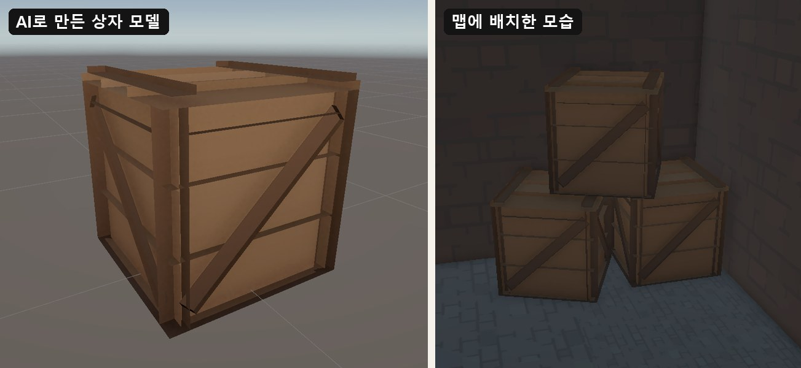

<small>그림에서 볼 것은 요청문의 규칙대로 만든 상자가 기존 맵의 분위기에 맞게 놓인 모습입니다.</small>

다만 "이해한 부분만 코드로 남긴다"는 규칙은 바로 길찾기 작업 중에 만들었는데, 그것만으로 길찾기를 되찾지는 못했습니다. 설명을 듣고 이해하기보다 먼저, **이 구현이 이 기능에 맞는 무게인지 판단할 기준**이 있어야 했습니다.

### 설계의 주인은 기준을 먼저 말하는 사람이었습니다

같은 AI를 썼는데 카드와 길찾기의 결과가 갈린 이유는 하나였습니다. AI가 구현을 맡더라도, 문제가 생겼을 때 **어디를 봐야 하는지 제가 먼저 말할 수 있어야 그 설계는 제 것입니다.**

2차 개발에서는 길찾기를 **제가 직접 다룰 수 있는 수준까지 가볍게 만들어 새로 작성할 계획**입니다. 다익스트라 기반의 맵을 두고, 몬스터는 플레이어를 따라가는 것만 하도록 줄일 생각입니다. [AI와 정한 규칙 전체](#ai와-나눈-역할과-정한-규칙-4장)와 [모델링 요청 규칙](#모델링을-맡길-때의-요청-규칙-4장)은 부록에 있습니다.

---

## 5. 문 위치로 방을 이으면 방 전체가 겹쳤다

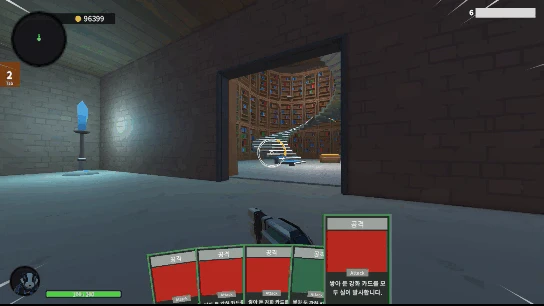

<small>그림에서 볼 것은 방과 방 사이에 끼운, 문이 없는 통로입니다. 이 통로가 이 장의 마지막 결론입니다.</small>

### 미리 만든 방을 문 위치로 이어 붙이려 했습니다

맵은 미리 만든 방을 문 위치에 맞춰 이어 붙여 만듭니다. 처음에는 입구 문과 출구 문이 모두 방 안쪽을 보게 두고, 코드에서 **앞 방의 출구 문과 새 방의 입구 문을 겹치는 식으로 이었습니다.**

### 문이 아니라 방 전체가 겹쳤습니다

그런데 두 문의 회전값이 서로 달라서, **문이 아니라 방 전체가 겹쳐 버렸습니다.**

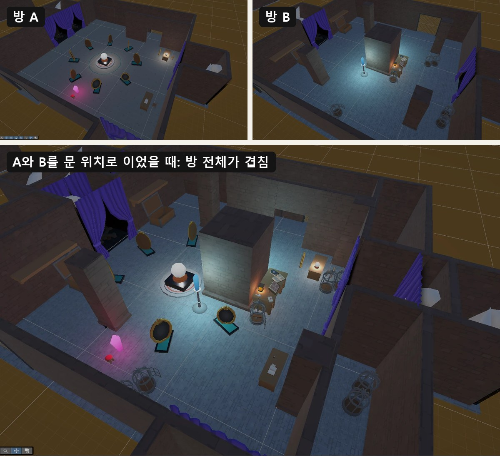

<small>그림에서 볼 것은 두 방이 문에서 만나지 않고 한 자리에 포개진 모습입니다.</small>

### 방을 만드는 사람이 코드를 몰라도 될까

코드에서 방을 돌려 맞추는 방법도 있었습니다. 하지만 팀이나 회사처럼 여럿이 작업한다면 방을 만드는 사람이 프로그래머가 아닐 수도 있습니다. 그 사람이 **코드가 방을 어떻게 돌리는지 몰라도 방을 만들 수 있는 기준**이 필요하다고 봤습니다.

### 코드가 아니라 문 에셋의 기준을 맞췄습니다

그래서 **코드가 아니라 에셋의 기준을 맞췄습니다.** 시작 문과 끝 문의 회전을 -90/90에서 90으로 통일해, 위치만 다르고 나머지는 완전히 같은 문 에셋으로 만들었습니다. 시작과 끝은 각 방에서 문이 달릴 자리에 붙인 태그(`StartGateway`, `EndGateway`)로 구분합니다. 이제 방을 만드는 사람은 "문은 정확히 똑같이 겹쳐진다"는 기준 하나만 알면 되고, AI에게도 "시작 방의 EndGateWay와 새로 붙을 방의 StartGateWay의 위치만 맞춘다"는 한 줄짜리 규칙만 넘겼습니다.

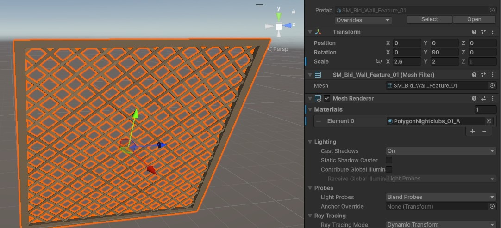

<small>그림에서 볼 것은 Transform의 Rotation Y가 90이라는 점입니다. 시작 문과 끝 문 모두 이 값 하나로 맞췄습니다.</small>

플레이테스트에서 다음 문제가 나왔습니다. 두 방의 문 메시가 같은 자리에 완전히 겹쳐, **깜빡이는 노이즈(Z-파이팅)처럼 보였습니다.**

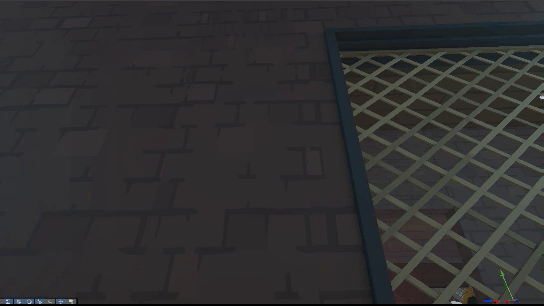

<small>그림에서 볼 것은 문 주변 벽의 벽돌 무늬가 두 겹으로 섞이며 깜빡이는 부분입니다.</small>

그래서 문이 없는 방을 따로 만들어 통로(`Path`)로 쓰고, **방과 방 사이를 이 통로로 이었습니다.** 방은 문 기준만 지켜 만들면 되고 사이는 통로가 이어 주므로, 이후로는 문 문제가 없었습니다. 플레이테스트에서도 "맵 구조를 보고 생성 방식인 걸 눈치챘는데 … 실제로 구현해보신 걸 보니 인상깊었음"이라는 반응이 있었습니다.

감수한 것도 있습니다. 통로는 모든 방을 이어 주는 필수 부품이라, 이어질 방에 맞춰 입구 주변을 비워 두었습니다. 그래서 **통로만 따로 놓고 보면 어색한 방 하나처럼 보입니다.** 하지만 방과 방을 잇는 부품이라 따로 보일 일이 없다고 보고 받아들였습니다.

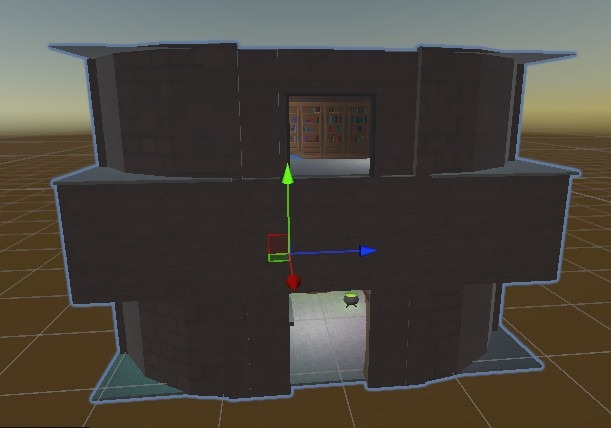

<small>그림에서 볼 것은 통로를 혼자 놓았을 때 비어 있는 위아래 입구입니다.</small>

### 통로가 늘자 책장이 무거워졌습니다

통로의 책장을 책이 꽂힌 것처럼 꾸미려고, AI에게 책 모델 9종을 선반마다 무작위로 놓게 했습니다. 책장을 3층으로 쌓아 78개로 늘리자 책 1,574권이 각각 오브젝트가 되어 **책장과 책의 Renderer가 1,652개**가 됐습니다. 통로는 방이 이어질 때마다 생기는 조각이라, 조각 하나의 오브젝트 수가 맵 전체에서는 몇 배로 늘어납니다.

| | 대안 A. 책을 하나씩 놓고 GPU Instancing | 대안 B. 책장과 책을 한 메시로 합친 패턴 반복 |
|---|---|---|
| 줄어드는 것 | 그리기 호출 | 그리기 호출 + 만들고 관리할 오브젝트·Renderer 수 |
| 단점 | 방을 만들 때마다 책 1,574개도 함께 만들어짐 | 같은 책장이 반복돼 보일 수 있음. 책 한 권씩 고칠 수 없음 |

**대안 B를 고르고, A의 GPU Instancing도 그대로 두었습니다.** 그리기 호출만이 아니라, 방을 만들 때마다 생기는 책 오브젝트 자체를 없애고 싶었기 때문입니다. 패턴은 5종입니다. 책장이 위아래·좌우로 맞붙으므로, 가운데 책장과 맞닿은 네 책장이 모두 다른 패턴이 되려면 최소 5종이 필요합니다. 그 결과 맞붙은 93쌍 가운데 같은 패턴끼리 붙은 쌍은 0쌍입니다.

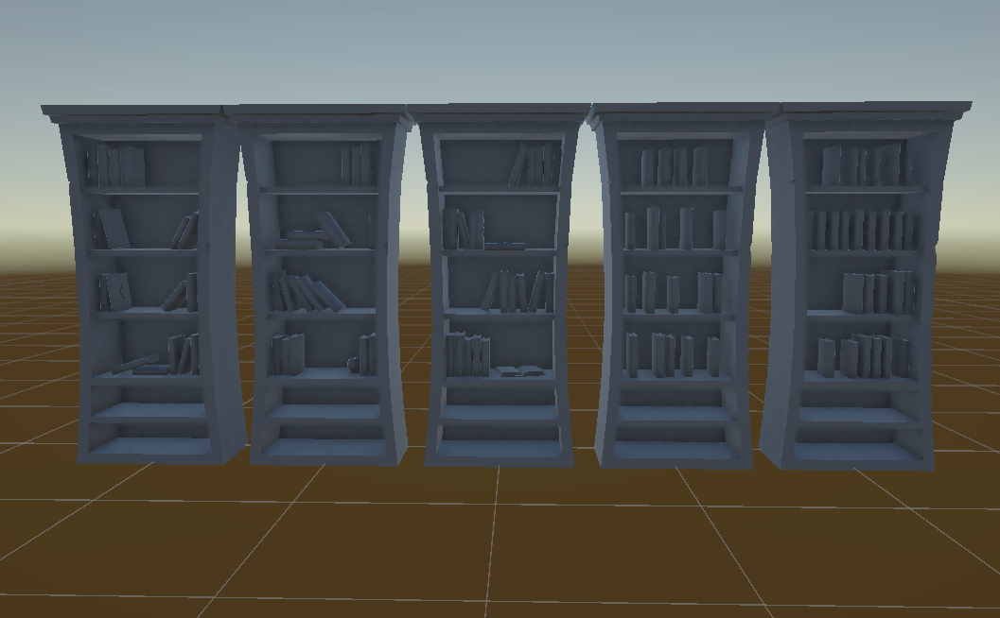

<small>그림에서 볼 것은 책의 배치가 서로 다른 책장 5종입니다. 이 5종을 돌려 가며 놓아 맞붙은 책장이 겹쳐 보이지 않게 했습니다.</small>

이 작업만의 효과로 **확실히 말할 수 있는 것은 Renderer 1,652 → 78**입니다. 책장이 1층(약 30개)일 때는 FPS 20\~30 정도로 렉이 느껴졌고, 배치량이 약 2.6배인 3층(78개)인 지금은 약 113FPS입니다. 다만 이전 값은 같은 조건으로 잰 것이 아니고 그 사이 다른 변경도 있었으므로, FPS가 오른 것을 모두 이 작업 덕분으로 보지는 않습니다. 합친 프리팹은 Unity에서 책 한 권씩 옮길 수 없고, 고치려면 Blender 원본을 고쳐 다시 내보내야 한다는 점은 감수했습니다.

### 문제를 코드 밖에서 푸는 편이 나을 때가 있었습니다

방이 겹친 문제는 코드가 아니라 에셋의 기준으로, 책장의 무게는 오브젝트를 다루는 코드가 아니라 모델을 합치는 것으로 풀었습니다. "이런 모델을 만들어 줘"라고 결과만 요청하기보다, 모델을 **점과 메시 단위로 직접 해석하고 그 해석을 기준으로 요청할 때 결과가 좋았습니다.**

남은 것도 있습니다. **Unity의 Static Batching은 작업이 끝난 뒤에야 알아 비교하지 못했습니다.** 그래도 답을 먼저 알았다면 모델을 점과 메시로 뜯어보는 과정을 거치지 않았을 것이라, 이 경험이 헛되었다고 보지는 않습니다. 책장을 합친 작업을 누가 어떻게 나눠 맡았는지는 [부록](#책장을-합친-작업-5장)에 있습니다.

---

## 맺으며

1차 개발 2주 동안 카드 덱, 강화 쌓기, 카드 조합 발사체, 모듈러 맵, 방 단위 전투, 보상과 가마솥 강화, **보스방까지 이어지는 1차 프로토타입을 완성했습니다.** 이 프로토타입을 공개해 플레이테스트 피드백을 받고, 목표한 경험이 전해졌는지를 기준으로 정리했습니다.

| 목표 | 플레이테스트 반응 |
|---|---|
| 한 번의 공격으로 여럿을 쓰러뜨리는 쾌감 | "강화를 중첩해서 한방에 쏘는 재미는 확실하다", "모디파이어 중첩으로 말도 안되는 카드를 만들어서 사기치는 재미가 있었습니다" |
| 카드 조합 슈터라는 컨셉 | "3D 형태로 카드 강화 게임을 한다는 게 신선했습니다", "카드 슈팅은 신선하고 조합의 경험이 재밌습니다" |
| 참고한 게임의 조작감 | "FPS 자체의 시원시원한 조작감은 훌륭히 구현되어있다고 느꼈습니다" |
| 카드가 쏟아질 때의 안정성 | 분열만 강화한 플레이에서도 게임을 방해하지 않았고, 카드 수가 줄었다는 지적은 없었음 (2장) |

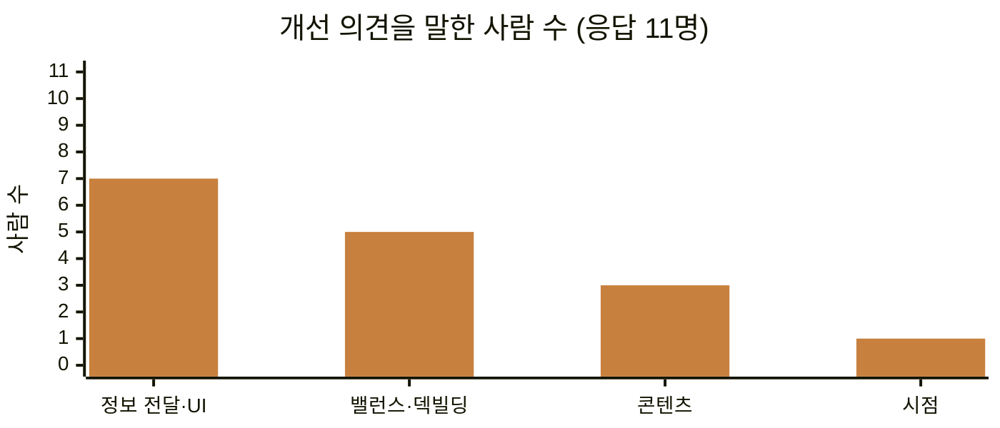

<small>그림에서 볼 것은 응답 11명이 남긴 개선 의견을 주제별로 나눠, 그 주제를 말한 사람 수를 센 결과입니다. 한 사람이 같은 주제를 여러 번 말해도 한 번으로 셌습니다.</small>

**강화 방식과 카드 정보 전달(UI)에 대한 의견이 가장 많았습니다.** 1차 프로토타입에서는 시스템을 먼저 갖추느라 UI를 임시로 넣어 둔 상태였고, 이미 알고 있던 부분입니다.

2차 개발에서는 길찾기를 전면 개편하고(4장), 카드 구조가 합리적인지 다시 따져 보며, **게임의 완성도를 올릴 계획입니다.** 완성도에는 아직 구현하지 않은 UI 같은 그래픽 작업과, 캐릭터에 따라 시작 카드를 나누는 것, 맵 확장 등이 들어갑니다.

다섯 이야기 모두 AI와 함께 만들었습니다. 관통과 반사는 논리보다 플레이어의 기대로 풀었고(1장), 물량은 성능 숫자보다 화면을 채우는 정도로 정했고(2장), 킬 표시는 다른 게임의 연출을 이 게임의 플레이에 맞춰 옮겼고(3장), 맵은 코드 밖에서 기준을 세워 풀었습니다(5장). 이 네 이야기에서는 게임을 어떤 방향으로 만들지가 분명했고, 문제마다 그 방향에 비추어 고민한 뒤 그 고민을 AI와 나눠 해결했습니다. 길찾기(4장)는 달랐습니다. "가볍고 빠르게 만들어지면 된다"는 전제만 두고 문제를 분석하지 않았고, AI가 만든 것을 검토하지 않은 채 넘겼습니다. 그래서 이 프로젝트에서 얻은 결론은 이렇습니다. **AI는 제가 세운 방향 안에서 고민을 함께 나눌 때 가장 잘 쓰였고, 방향을 세우는 일까지 맡기자 설계가 제 손을 떠났습니다.**

---

## 부록

### 한 판의 흐름과 조작

방에 들어가면 손패에서 카드를 골라 쏩니다. 강화 카드로 쌓아 두었다가 공격 카드 한 장에 모두 실어 보내는 것이 전투의 반복입니다.

| 입력 | 하는 일 |
|---|---|
| 숫자키 · 마우스 휠 | 리볼버에 장전된 카드 고르기 |
| 좌클릭 | 고른 카드 쏘기 |
| R | 재장전. 버린 카드를 다시 뽑을 카드로 돌림 (손패가 비면 저절로 재장전) |

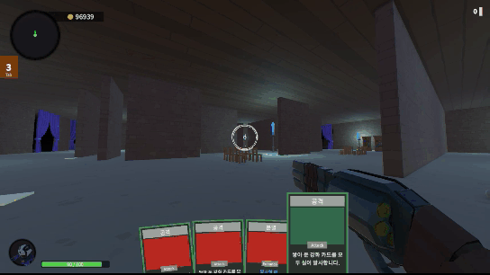

<small>그림에서 볼 것은 공격 → 분열 → 공격 순서로 쏘아, 분열 강화가 다음 공격 카드에 실려 나가는 모습입니다.</small>

방의 적을 모두 쓰러뜨리면 문이 열리고, 보상을 받은 뒤 다음 방으로 넘어갑니다. 방은 작은 방, 중간 방, 큰 방을 거쳐 보스방으로 이어집니다.

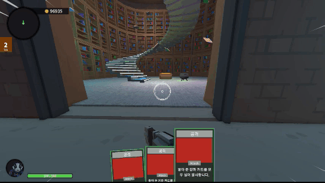

<small>그림에서 볼 것은 통로를 지나 들어간 방에 보상 상자와 가마솥이 놓여 있는 모습입니다.</small>

가마솥에서는 카드를 강화할지, 요리로 회복할지 하나를 고릅니다.

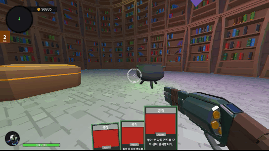

<small>그림에서 볼 것은 가마솥과 상호작용하면 뜨는 선택 창입니다. 카드 강화와 요리(회복) 중 하나만 고를 수 있습니다.</small>

강화에서는 강화 카드 여러 장을 한 장으로 합칠 수 있습니다. 합친 카드는 강화를 쌓을 때 한 칸만 차지하지만, 쏘면 재료가 된 카드들이 순서대로 실립니다. 합친 카드를 다시 재료로 넣을 수도 있습니다.

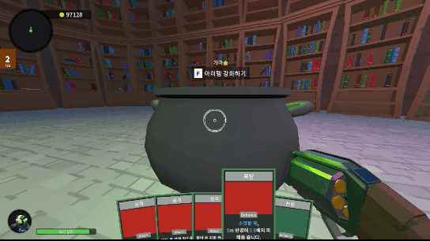

<small>그림에서 볼 것은 강화 화면에서 카드를 골라 칸에 넣고 강화를 진행하는 과정입니다.</small>

### 참고한 게임

| 게임 | 가져온 것 | 이 프로젝트에서 |
|---|---|---|
| *Gunfire Reborn* | 1인칭 조작과 이동, 기타 UI | 그대로 참고 |
| *Slay the Spire* | 카드를 조합해 강한 덱을 만드는 재미 | 그대로 참고 |
| *The Binding of Isaac* | 아이템으로 발사체를 강화하는 아이디어 | 아이템 대신 **카드 조합**으로 발사체를 강화 |

### 카드 종류

카드는 하는 일에 따라 공격과 강화 두 종류로 나뉩니다.

| 종류 | 카드 | 하는 일 |
|---|---|---|
| 공격 | 공격 카드 | 쌓인 강화를 모두 싣고 날아감 |
| 강화 | 분열 · 폭발 · 관통 · 반사 · 유도 · 전이 · 합친 카드 | 쏘면 쌓였다가 다음 공격 카드에 실림 |

여기에 이 카드들의 성질을 바꾸는 **재료 카드**(시점 변경 · 대상 변경 · 스펙 강화)가 따로 있습니다. 재료 카드는 손패로 뽑히지 않고, 다른 카드가 **언제 발동할지**(시점), **무엇에 반응할지**(대상)를 바꾸거나 수치 단계를 하나 올리는 데만 씁니다.

### 카드 데이터 구조

여러 발사체가 **같은 카드 객체를 함께 씁니다.** 분열한 자식 발사체도 부모의 카드를 그대로 물려받습니다. 그래서 카드에는 "관통한다", "충돌할 때 발동한다" 같은 성질만 두고, 남은 관통 횟수처럼 날아가는 동안 바뀌는 값은 발사체가 따로 들고 있게 했습니다. 발사체는 앞으로 곧게 날아가기만 하는 한 종류이고, 실린 카드 목록이 그 성질을 정합니다.

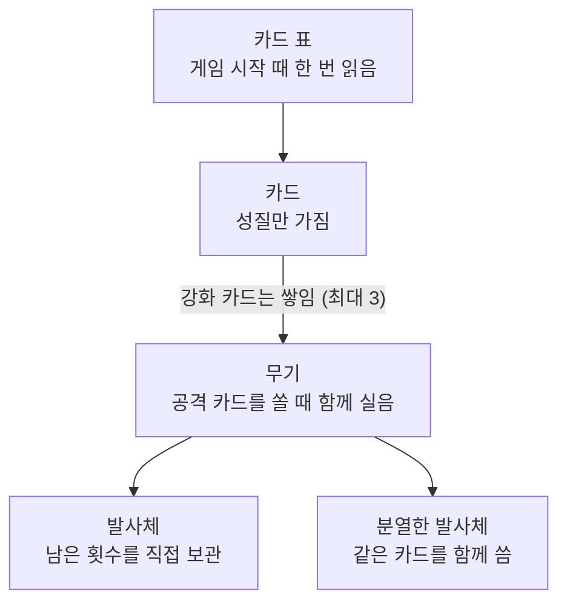

카드의 수치도 같은 원칙입니다. 카드 정보는 표 두 개에 나눠 두었습니다. `cards.tsv`는 카드 한 장에 한 줄로 동작 종류(Kind)와 발동 시점(Timing)을 갖고, `card_specs.tsv`는 카드 하나의 레벨마다 한 줄로 그 레벨의 수치(장수·반경·각도 등)를 갖습니다.

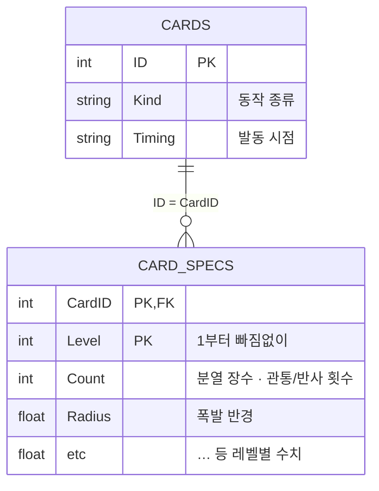

그림에서 볼 것은 **카드 하나에 레벨 줄이 여러 개** 붙는다는 점입니다. 예를 들어 분열 카드는 레벨마다 한 줄씩 있고, 레벨이 오를수록 그 줄의 `Count`(분열 장수)가 커집니다. 폭발 카드라면 `Radius`(폭발 반경)가 커집니다. 한 카드의 레벨 줄 수가 곧 그 카드의 최대 레벨이고, 레벨 줄이 없는 카드는 강화할 수 없습니다. 카드 객체는 수치를 복사해 두지 않고, 쓸 때마다 카드 ID와 레벨로 표에서 찾습니다. 스펙 강화는 레벨만 하나 올린 복제본을 만드는 것이라, 복제본은 바뀐 레벨로 수치를 다시 찾습니다.

카드 데이터는 처음에 ScriptableObject 에셋으로 만들었다가 표(TSV)와 일반 클래스로 옮겼습니다. 맵은 그대로 두었습니다. 둘의 성격이 달랐기 때문입니다.

| | 카드 | 맵 |
|---|---|---|
| 성격 | 능력치 위주로 단순하고, 새로 추가하는 일이 비교적 잦음 | 고정적. 고치더라도 Unity 씬에서 만들어 프리팹으로 저장 |
| 저장 방식 | ScriptableObject → **TSV 표 + 일반 클래스** | ScriptableObject·프리팹 유지 |
| 이유 | 외부 표로 떼어 내 추가·수정에 대비 | 밖에서 고칠 일이 없음 |

### 관통·반사를 자세히

역할은 같은 시점에 발동하는 카드들 사이의 실행 순서입니다.

| 순서 | 역할 | 하는 일 | 카드 (기본 시점) |
|---|---|---|---|
| 1 | 반응 | 부딪힌 순간 운동량을 정함. 한 번의 충돌은 한 장만 맡음 | 관통 · 반사 (충돌) |
| 2 | 조향 | 나아갈 방향을 바꿈. 반응 뒤에 실행되므로 반사로 꺾인 방향도 다시 고침 | 유도 (비행) · 전이 (충돌) |
| 3 | 효과 | 피해·분열처럼 결과를 만듦 | 분열 (발사) · 폭발 (소멸) |

효과 카드도 시점 변경으로 충돌 시점에 옮길 수 있어서, 세 역할이 모두 모이는 곳은 충돌입니다. 같은 역할 안에서는 플레이어가 쌓은 순서를 그대로 지킵니다.

발사체 하나는 발사 → 비행 → 충돌 → 소멸의 한 주기를 거칩니다. 카드의 발동 시점이 바로 이 네 단계입니다.

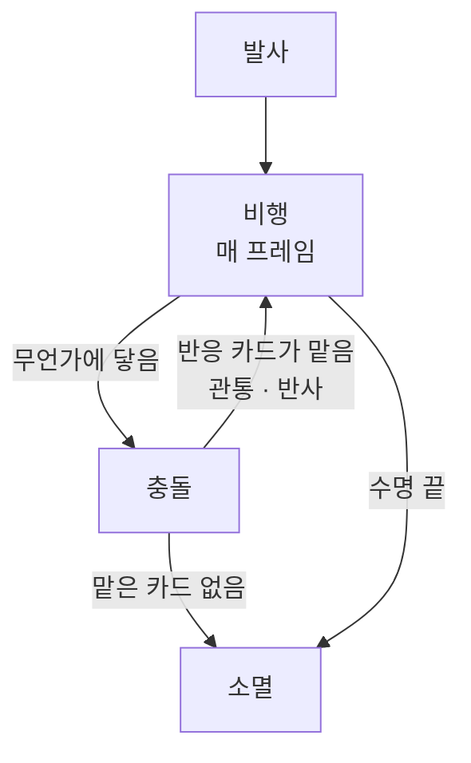

충돌에서 반응 카드가 계속 날게 하면 다시 비행으로 돌아가고, 맡은 카드가 없으면 사라집니다.

발사할 때 카드 목록을 시점별로 한 번만 나눠 둡니다. 역할 순서대로 바깥 반복을 돌기 때문에, 같은 역할 안에서는 쌓은 순서가 그대로 남습니다. 충돌할 때마다 카드 전체를 다시 훑을 필요도 없습니다.

```csharp
private void BuildTimingSlots()
{
    foreach (List<int> slots in timingSlots) slots.Clear();
    // 역할마다 한 바퀴씩 돌며 담으므로, 같은 역할 안의 쌓은 순서가 그대로 유지됩니다.
    foreach (CardRole role in RoleOrder)
    {
        for (int i = 0; i < cards.Count; i++)
        {
            if (cards[i].Role == role)
                timingSlots[(int)cards[i].Timing].Add(i);
        }
    }
}
```

"한 번의 충돌은 한 장만 맡는다"는 규칙은 권리를 먼저 가져가는 방식으로 만들었습니다. 충돌마다 권리를 비워 두고, 반응 카드가 하나도 권리를 가져가지 않으면 발사체는 사라집니다.

```csharp
// 이번 충돌의 반응(관통, 반사 등)을 정할 권리를 가져갑니다. 앞의 반응 카드가 이미 정했으면 false
public bool TryClaimResponse()
{
    if (responseClaimed)
        return false;

    responseClaimed = true;
    keepFlying = true;
    return true;
}
```

관통 카드는 횟수가 남아 있을 때만 권리를 가져갑니다. 그래서 횟수가 다 떨어지면 따로 규칙을 쓰지 않아도 **뒤에 쌓인 반사 카드가 자연스럽게 이어받습니다.** 남은 횟수(`context.Count`)는 카드가 아니라 발사체 쪽 칸에 저장됩니다(위 「카드 데이터 구조」).

```csharp
// 관통 카드: 횟수가 남아 있고 반응 권리를 얻었을 때만 통과
protected override void OnHit(CardContext context)
{
    if (context.Count <= 0)
        return;
    if (TryRespond(context) == false)
        return;

    context.Count--;
    context.Projectile.PassThrough();
}
```

분열로 생긴 자식 발사체는 부모의 카드 목록과 위력, 공격 번호를 물려받아 출발하므로, 쌓은 순서가 자식에게도 그대로 이어집니다.

### 받아들이지 않은 AI 제안 (1장)

| AI의 제안·구현 | 받아들이지 않은 이유 |
|---|---|
| 종류를 먼저 따지고, 같은 종류 안에서만 쌓은 순서대로 | 플레이어는 사용 순서를 기준으로 카드를 조합합니다. 이 순서를 시스템이 정해 버리면 플레이어가 원하는 조합을 만들 수 없어 플레이 경험을 해치고, 직관적이지 않은 구조가 됩니다 |
| 발사 시점 관통처럼 의미 없는 조합은 코드 구조로 막기 | 쓸모없는 조합이라는 데는 동의했지만, 어떤 카드를 어느 시점에 쓸 수 있게 할지는 설계하는 사람이 정할 일이라고 봤습니다. 카드 표의 시점 제한 칸(`BlockedTimings`)으로 조정했습니다 |
| 관통할 때마다 피해 30% 감소 | 관통에는 이미 횟수 제한이 있습니다. 플레이어는 불리한 조건을 싫어하는데, 피해 감소까지 더하면 제약이 지나치게 많아집니다 |
| 카드마다 횟수 변수(`splitCount`, `pierceCount`)를 두는 기존 구현 | 카드가 늘어날수록 변수도 함께 늘어납니다 |

반대로 제 제안이 철회된 경우도 있습니다. "부딪히면 같은 카드를 반대 방향으로 새로 만들어 쏘자"고 했을 때, AI가 "원본이 매번 사라지므로 소멸할 때 터지는 폭발이 반사할 때마다 터진다"고 짚었고, 저도 그 지적이 맞다고 보고 거둬들였습니다.

### 물량을 버티는 장치 (2장)

| 장치 | 하는 일 |
|---|---|
| 오브젝트 풀링 | 발사체를 매번 새로 만들지 않고 돌려 씀. 1발만 쏘던 프로토타입 직후 바로 도입 — 생성 비용과 GC 부담을 줄이려고 |
| 한곳에서 갱신 | 발사체마다 `Update`를 두지 않고, `ProjectileManager`가 살아 있는 발사체의 `Tick`을 한곳에서 호출 (AI가 짚어 준 방식) |
| 동시 발사체 상한 | 넘는 분열은 만들지 않고 위력으로 바꿈 |
| 이펙트 예산 | 넘는 이펙트는 그리지 않고 피해는 그대로 |

동시 발사체 상한은 500이고, 상한에 걸려 만들지 못한 자식 수만큼 `위력 × (1 + 흡수 수)`로 키웁니다. 크기는 위력의 세제곱근만큼, 최대 2배까지 커지며, 피해 상한을 두어 값이 넘치지 않게 했습니다.

```csharp
int count = CeilMultiply(ExtraCount, context.Multiplier.Effect);
int absorbed = 0;
for (int i = 0; i < count; i++)
{
    // ... 퍼지는 각도 계산
    if (context.Projectile.SpawnSplit(context, childRotation) == false)
        absorbed++;
}

// 발사체 상한 때문에 만들지 못한 자식은 원본의 화력으로 바꿉니다.
context.Projectile.AbsorbSplits(context, absorbed);
```

이펙트가 가장 많이 나오는 **분열 + 폭발 + 반사** 조합으로 잰 결과입니다. 카드 3장이 반사될 때마다 분열해 9장, 27장으로 불어나며 이펙트를 터뜨립니다.

| 분열 단계 | 카드 수 | 관찰한 결과 |
|---|---:|---|
| 3⁵ | 243 | 측정값에서 프레임 하락이 보임 (플레이 중 체감되지는 않음) |
| 3¹⁰ | 59,049 | 약 5초 멈췄다가 복구 |
| 3¹⁵ | 14,348,907 | 10\~60초 멈췄다가 복구 (편차가 커서 확실한 값은 아님) |

```csharp
public static bool TryUse(string poolKey)
{
    ResetCountIfNewFrame();
    if (spawnedThisFrame >= MaxSpawnsPerFrame)
        return false;

    if (IsKindFull(poolKey))   // 같은 풀에서 꺼낸 이펙트가 40개 이상 살아 있으면
        return false;

    spawnedThisFrame++;
    return true;
}
```

이펙트를 만드는 쪽은 `TryUse`가 `false`를 돌려주면 **이펙트만 건너뛰고 피해는 그대로** 줍니다. 게임 결과와 화면 연출을 떼어 놓은 것입니다.

같은 기준으로 함께 정리한 것도 있습니다. 몬스터가 맞을 때의 이펙트는 강조할 대상이 아니어서, 어색하지 않을 만큼만 폭발 이펙트와 같은 개수 제한을 걸었습니다. 꼬리선은 임시 스크립트를 준비해 둔 에셋으로 바꾸면서, 에셋이 라인 렌더러의 점을 지나치게 많이 찍던 것을 줄였습니다. 맵 밖으로 나간 카드가 파티클을 달고 계속 날아가던 문제는, 맵을 감싸는 경계를 두고 벗어나면 지우는 방식으로 풀었습니다. 경계의 크기는 맵 생성기가 방들의 범위로 계산합니다.

### 이펙트가 40개 뒤로 나오지 않던 문제 (2장)

| 항목 | 내용 |
|---|---|
| 문제 | 이펙트 예산을 넣고 시험하자, 발사체 100개 중 처음 40개만 폭발 이펙트가 나오고 그 뒤로는 이펙트가 꺼진 뒤에도 다시 나오지 않음 |
| AI의 첫 진단 | 이펙트 프리팹의 반복 재생(Looping) 때문에 풀로 돌아가지 않는다 |
| 제가 되물은 근거 | Looping은 이미 꺼져 있었고, 재생 시간도 약 2초로 짧음 → AI가 원인을 잘못 짚었다고 인정 |
| 원인 | 파티클의 종료 동작이 Disable이라, 끝나는 순간 Unity가 오브젝트를 먼저 끔 → 풀 반환을 확인하던 `Update`가 돌지 않음 → 풀에는 "사용 중"으로 남아 40개가 자리를 계속 차지 |
| 해결 | 이펙트가 꺼질 때(`OnDisable`) 풀로 돌려보냄. 정상적으로 돌려보낼 때도 `OnDisable`이 불리므로, 이미 풀에 있으면 다시 넣지 않는 확인을 추가 |
| 결과 | 이펙트가 정상적으로 돌아가며 쓰임. 예산을 넣기 전에는 풀이 비면 새로 만들었기 때문에 드러나지 않았던, **꺼진 이펙트가 풀 밖에 쌓이던 누수**도 함께 해결 |

### 킬 그래프가 공격을 세는 방법 (3장)

- 쏠 때마다 공격 번호를 붙이고, 분열한 자식은 그 번호를 물려받습니다. 몇 번을 분열해도 같은 공격으로 셉니다. 분열한 자식까지 모두 사라지면 그 공격의 처치 수가 확정됩니다.
- 피해는 이벤트 큐에 넣었다가 나중에 처리합니다. 그 사이 발사체가 풀로 돌아가 다른 공격에 다시 쓰일 수 있어서, **피해를 보내는 순간 공격 번호를 피해 이벤트에 함께 적어 둡니다.** 코드를 확인하던 AI가 짚어 준 함정입니다.
- 이미 죽은 적은 걸러 내므로, 폭발과 직접 충돌이 한꺼번에 맞아도 처치가 두 번 세어지지 않습니다.

### AI와 나눈 역할과 정한 규칙 (4장)

| | 내용 |
|---|---|
| 직접 판단한 것 | 목적과 플레이어 경험 정하기, 구조 설계, 판단 기준 세우기, 결과 확인과 수정 요청. 특히 게임이 규칙을 봐줘야 하는 판단(관통·반사를 역할로 나눈 것, 1장)과 플레이어 경험을 정하는 규칙(킬 그래프 표시 규칙, 3장)은 맡기지 않았습니다 |
| 맡긴 것 | 코드 작성, 대안을 내고 비교하기, 제가 정한 구조에 맞춰 세부 수치 정하기(2장), 정해 둔 기준에 따른 점검, 이미지 생성과 3D 모델 합치기 |
| 확인한 방법 | 고치기 전에 방법을 설명받고 승인, 코드를 시작점부터 함수 하나씩 따라 읽기, 직접 플레이해 보기, 원본과 비교 렌더링(5장) |

AI의 제안이 맞아서 받아들인 경우도 있습니다. 수업에서 배운 FSM 코드는 상태마다 `Update`를 두지 않고, 상태 머신이 현재 상태의 `Tick`을 대신 불러 주는 구조였습니다. 같은 원칙을 발사체에도 쓸 수 있었는데, 발사체를 하나하나의 객체로만 생각하고 풀로 묶으면서 놓쳤습니다. 이것을 AI가 짚어 주어 발사체를 한곳에서 갱신하게 바꿨습니다(2장).

| 규칙 | 이유 |
|---|---|
| 고치기 전에 방법을 설명받고 승인하며, 이해한 부분만 코드로 남김 | AI가 "이렇게 고칠까요?"가 아니라 "필요해 보여서 고쳤습니다"라고 알리는 일이 몇 번 되풀이됐습니다. 경계하던 "개발 주도권을 뺏기는 상황"이라고 보고, 조금 번거롭더라도 고칠 내용을 먼저 확인하게 했습니다. 이미 혼자 만들어진 코드는 설명을 듣고 이해한 부분만 남겼습니다 |
| 이름으로 찾지 않고 인스펙터에서 연결 | 이름으로 찾아야만 하는 곳이 아니라 인스펙터로 지정할 수 있는 곳이었습니다. 인스펙터 연결은 어떤 오브젝트와 이어졌는지 바로 보여 읽기 쉽고 오류를 고치기도 쉬워서, 비용이 더 큰 이름 찾기를 고집할 이유가 없었습니다 |
| 사람이 읽기 좋은 문법으로 (여러 줄을 압축한 람다·튜플 반환은 되도록 쓰지 않음) | 저는 코드를 시작점부터 함수 하나씩 따라가며 읽습니다(예: 카드가 나가지 않으면 `Weapon.Fire`에 들어가는 값 → 갈라지는 함수 → 나가는 값 → 최종 결과). 2\~3줄을 압축한 람다는 값이 맨 위 선언에서 정해져 이 순서로 읽히지 않고, 튜플은 돌려주는 값이 여러 가지라 읽기 어렵습니다. 코드가 1\~10줄 정도 늘지만 성능 차이는 없는 수준이라 감수했습니다 |
| 복잡한 동작은 코드보다 애니메이션으로 | 몬스터가 공격할 때 콜라이더를 켜는 것처럼 복잡한 것은 Unity 애니메이션 화면에서 보며 고치는 편이 읽기 좋습니다. 보상 상자가 떨리거나 열리는 것 같은 단순한 회전·이동은 코드로 만들었습니다 |

### 모델링을 맡길 때의 요청 규칙 (4장)

모델링은 제 주력 기술이 아니어서, 책장 패턴 합치기(5장)와 장애물 모델 제작에 AI를 썼습니다. 이때 쓸 요청문(프롬프트)을 직접 설계했습니다. 이 요청문을 함께 넣으면 AI는 요청을 받자마자 모델을 만들지 않습니다. "상자를 만들어 줘"처럼 모호한 요청이 와도, 먼저 어떤 사물인지, 어느 정도로 구현할지(로우폴리·하이폴리 등), 어디에 쓰는지를 묻고, 자기가 이해한 내용이 맞는지 확인받은 뒤에 만듭니다. **AI가 모호한 방향을 스스로 정해 진행하지 않고, 사용자에게 계속 묻고 검토하며 같은 모델을 떠올리게 하는 것**이 이 요청문의 목적입니다. 이 요청문은 다른 AI에게 검토받기도 했습니다.

| 규칙 | 내용 |
|---|---|
| 시작 조건 | 모델 수준·세부 디테일·재현 수준·사용 조건 네 가지를 사용자가 정하거나 맡기기 전에는 초안도 만들지 않음 — "AI가 정하지 않는다" |
| 추측과 결정 나누기 | 꼭 필요한 결정은 사용자가 하고, 말하지 않은 부분은 AI가 상식으로 채우되 "AI 임시 가정"으로 표시 |
| 참고 이미지의 역할 | 이미지마다 형태 / 재질 / 무늬 / 분위기 중 어떤 역할인지 정함. 재질 사진에서 형태를 가져오지 않음 |
| 단계별 승인 | 형태 → 세부 형상 → 재질 → 최적화·Unity 반입. 단계마다 결과를 보고 승인한 뒤 진행 |
| 프로젝트 스타일 분석 | 기존 에셋의 폴리곤 규모·텍스처·셰이더를 읽고, "기존 방식에 맞춤"을 첫 선택지로 제안 |
| 파츠 라벨링 | 모델의 각 파츠에 이름을 붙여, 문제가 생기면 "이 파츠를 이렇게 고쳐 줘"라고 짚을 수 있게 함 |
| 사실만 보고 | 실행하지 않은 코드, 확인하지 않은 결과를 다 됐다고 말하지 않음 |

길찾기에서 배운 것(4장)과 같은 원칙입니다. 방향은 사용자가 정하고, AI는 그 방향이 맞는지 묻고 확인하며 구현합니다.

### 책장을 합친 작업 (5장)

| 단계 | 맡은 사람 |
|---|---|
| 책장 배치 5개 고르기·다듬기 | 저 (Unity 씬) |
| 책장과 책을 한 메시로 합치기, 겹치는 점 병합, 가려지는 면 제거 | AI (Blender) |
| 작업 기준 정하기 | 저 — ① "겹친다"는 **지웠을 때 바깥에서 보이는 모습이 바뀌는가**로 판단 ② 머티리얼 점검 ③ 완성 모델을 원본과 비교해 차이를 보고하고, 고칠 수 있는 차이는 고친 뒤 기록 |
| 원본과 비교해 확인 | AI가 위 기준으로 비교 렌더링해, 책장 모서리의 음영 차이를 찾아 원래 노멀을 되살림 |

| 항목 | 이전 | 이후 |
|---|---:|---:|
| 통로 책장·책 Renderer (같은 3층 78개 기준) | 1,652개 | **78개** |
| 패턴 5종 합계 삼각형 | 15,920 | 14,821 |
