# TreeHouse 프로젝트 문서

> 새가 되어 낮에는 하늘을 탐험하고, 밤에는 모은 깃털로 둥지를 지키는 2D 탐험 + 디펜스 게임

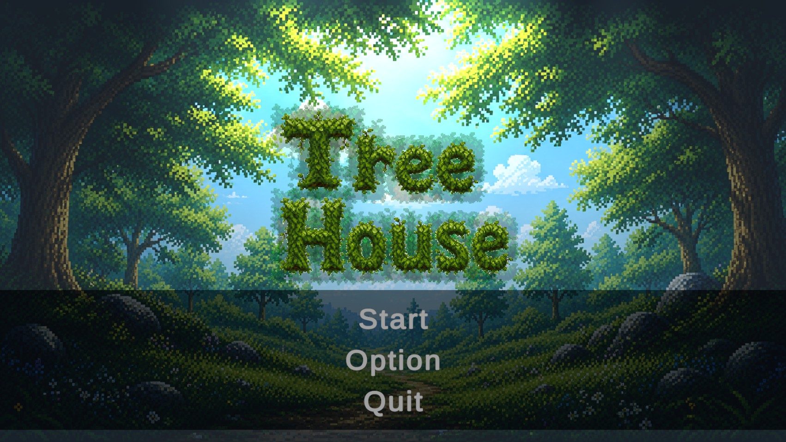

| 항목 | 내용 |
|---|---|
| 장르 | 2D 탐험 + 디펜스 |
| 개발 기간 | 2주 |
| 개발 인원 | 1인 (개인 프로젝트) |
| 개발 환경 | Unity 6000.3.15f1 (URP 2D, New Input System, TextMeshPro) |
| 주요 기술 | A\* 길찾기 직접 구현 · 구역별 그리드 · ScriptableObject · Unity Profiler |
| 링크 | [GitHub](https://github.com/KooHoo-Dev/3rd-2D-Project-SaGiKun4) · [시연 영상](https://youtu.be/rVk8w-42GYg) |

---

## 1. 개요

TreeHouse는 플레이어가 새가 되어 하늘을 누비는 2D 게임입니다. 낮에는 하늘을 탐험하며 다른 새를 사냥해 깃털을 모으고, 밤에는 그 깃털로 유닛을 강화해 둥지를 노리는 야생동물을 막습니다.

낮에는 바다에 잠수하고 밤에는 초밥집을 운영하는 게임 *Dave the Diver*의 두 모드 구조를, 바다 대신 하늘과 둥지로 옮겨 온 개인 프로젝트입니다. 두 모드 가운데 중심은 탐험이고, 디펜스는 탐험에서 얻은 깃털로 전략을 짜 보는, 탐험을 넓혀 주는 쪽에 두었습니다.

목표한 경험은 **개척과 발견**입니다. 플레이어가 위험을 감수하며 낯선 하늘을 개척하고, 그 끝에서 새로운 깃털을 발견하기를 바랐습니다. 그래서 탐험에서 무사히 돌아와야만 그때 모은 깃털이 디펜스에 쓰이게 했습니다.

개발자로서의 목표는 이론으로만 알던 A\*(에이스타: 출발점에서 목표까지 가장 짧은 길을 찾는 대표적인 길찾기 방법)를 직접 구현해, **실제 게임에서 얼마나 무거운지 확인하는 것**이었습니다.

| 핵심 기능 | 부딪힌 문제 | 이렇게 풀었다 |
|---|---|---|
| [몬스터 길찾기](#3-몬스터-길찾기) | 직접 만든 A\*가 여러 마리에서 무거워졌다 | 구역마다 그리드를 두고 멀리 있는 새는 쉬게 해, 가장 오래 걸린 프레임을 207.90ms → 62.87ms로 줄였다 |
| [날면서 쪼는 공격](#4-날면서-쪼는-공격) | 머리와 몸통이 한 장인 그림으로는 날갯짓을 유지한 채 쫄 수 없었다 | 머리와 몸통을 나눠, 예상한 50·20프레임보다 적은 10프레임으로 만들었다 |
| [귀환해야 확정되는 깃털](#5-귀환해야-확정되는-깃털) | 주운 깃털을 바로 반영하면 일부러 죽어서도 해금할 수 있었다 | 귀환해야 확정되게 했다 |
| [깃털 하나로 바뀌는 유닛](#6-깃털-하나로-바뀌는-유닛) | 미리 세 단계로 나눈 깃털 상속 탓에 쓰지 않은 깃털을 돌려줄 수 없었다 | 깃털을 하나의 아이템으로 합쳤다 |

---

## 2. 플레이

### 2.1 낮의 탐험과 밤의 방어

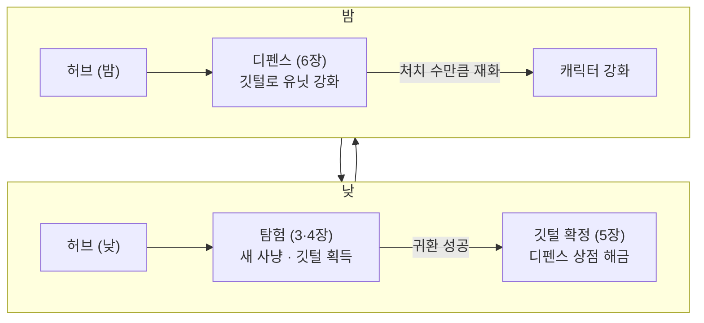

<small>낮의 탐험에서 귀환 지점(Pod)까지 돌아와야 깃털이 확정되고, 밤에는 그 깃털로 디펜스를 치른 뒤 받은 재화로 캐릭터를 강화해 다시 탐험에 나섭니다.</small>

### 2.2 원작에서 가져온 것과 바꾼 것

| 참고한 게임 | 가져온 것 | 바꾼 것 |
|---|---|---|
| *Dave the Diver* | 낮과 밤 두 모드, 산소(체력)가 줄어드는 압박, 작살 조준 | 바다를 하늘로. 작살로 끌어오는 대신 깃털을 쏘는 공격. 죽으면 아이템 1개를 지키던 규칙을 전부 잃도록 (5.1) |
| *운빨존많겜* | 몬스터가 필드 가장자리를 돌아 나가는 디펜스 판 | 완전히 무작위인 유닛 소환을 상점 구매로 (5.2) |
| *전략적 팀 전투* | 운과 재화 활용이 섞인 상점과 리롤 | 상점에는 탐험에서 해금한 깃털만 나오도록 (5.2) |

### 2.3 조작

| 장면 | 입력 | 동작 |
|---|---|---|
| 허브 | A·D / ←·→ | 좌우 이동 |
| 허브·탐험 | Space | 입장 지점·귀환 지점(Pod)과 상호작용 |
| 탐험 | WASD / 방향키 | 이동 |
| 탐험 | Left Shift | 달리기 (체력이 더 빨리 줄어듦) |
| 탐험 | 좌클릭 | 근접 공격 |
| 탐험 | 우클릭 유지 + 좌클릭 | 멈춰서 조준하고 깃털 발사 |
| 디펜스 | 좌클릭 | 유닛 선택 (사거리 표시) |
| 디펜스 | 우클릭 | 선택한 유닛을 다른 칸으로 옮기거나 맞바꿈 |
| 디펜스 | 깃털을 유닛에 드래그 | 깃털 장착 (렌치를 드래그하면 해제) |
| 공통 | ESC | 옵션 (일시정지) |

---

## 3. 몬스터 길찾기

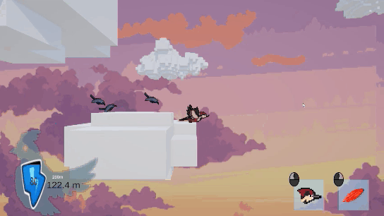

<small>자기 구역을 돌던 새가 플레이어를 발견하고, 사이를 가로막은 벽을 돌아서 쫓아옵니다.</small>

개척할 하늘이 살아 있으려면 하늘의 새들이 하나의 생태계처럼 움직여야 했습니다. 새들은 자기 구역 안을 돌아다니다가, 플레이어를 보면 벽을 돌아 쫓아오거나 반대쪽으로 달아납니다.

이 움직임을 A\*로 만들었습니다. Unity에 들어 있는 길찾기 기능(내비게이션)도 A\*를 바탕으로 한다고 들었지만, 그 기능을 가져다 쓰는 대신 A\*를 직접 구현했습니다. 이미 짜인 구조를 쓰는 것보다, 그 구조가 어떻게 돌아가는지 직접 만들어 보며 이해하고 싶었기 때문입니다.

A\*를 쓴다는 이야기는 많이 들었고 이론도 공부했지만, 실제 게임에 넣어 본 적은 없었습니다. 그래서 직접 만든 A\*가 **얼마나 무거운지 확인**하는 것을 개인 목표로 삼았습니다(1장).

### 3.1 새마다 맵 전체를 뒤져야 할까

처음에는 공부할 때 작성한 A\* 코드를 그대로 가져와, 맵 전체를 그리드 하나(맵을 바둑판처럼 나눈 칸. 길찾기는 이 칸을 따라 길을 찾습니다)로 덮었습니다.

참새 10마리만 넣어도 화면이 1초에 30\~50번밖에 그려지지 않았고(30\~50FPS), 15\~20마리를 넘기자 게임이 아예 움직이지 않았습니다.

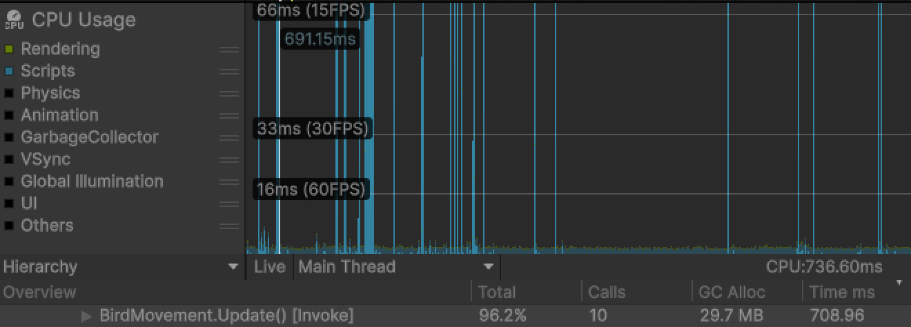

<small>맵 전체 그리드 하나 + 참새 10마리의 Unity Profiler(성능 측정 도구). 위 그래프에서 높이 솟은 파란 막대가 화면이 약 0.7초 멈춘 프레임(736.60ms)이고, 아래 줄을 보면 그 96.2%를 새의 이동·길찾기(`BirdMovement.Update`)가 차지합니다.</small>

계산을 줄이는 방법은 두 가지를 놓고 비교했습니다.

| | 대안 A. 그리드와 경로를 함께 쓰기 | 대안 B. 구역마다 그리드를 따로 두기 ✓ |
|---|---|---|
| 방식 | 하나의 그리드와 경로를 여러 몬스터가 나눠 씀 | 맵을 구역으로 나누고, 몬스터는 자기 구역의 그리드만 탐색 |
| 장점 | 계산량이 줄어듦 | 탐색하는 범위 자체가 줄어듦. 원작처럼 활동 범위를 정하고 벗어나면 돌아오게 하는 구조와 맞음 |
| 단점 | 몬스터들이 같은 길로 한곳에 뭉쳐 움직여 부자연스러움 | 몬스터가 구역 밖까지 플레이어를 쫓지 못함 |

대안 B를 골랐습니다. A\*를 넣은 이유가 새들의 자연스러운 움직임이었는데, 대안 A는 바로 그 움직임을 해치기 때문입니다. 구역을 벗어난 새는 *Dave the Diver*처럼 시작 위치로 돌아가게 했고, 구역 밖으로 쫓아오지 못한다는 단점은 고치는 대신 **"자기 구역을 지키는 새"라는 게임의 특징**으로 삼았습니다.


<small>화면 가운데 위쪽의 회색 비둘기가 플레이어(갈색 새)를 쫓다가, 플레이어가 오른쪽으로 구역을 넘어가자 더 따라오지 않고 제자리로 돌아갑니다.</small>

그리드는 구역마다 하나씩(`GridManager`) 두고, 새(`BirdMovement`)는 인스펙터에서 자기 구역의 그리드를 지정받습니다. A\* 계산은 `PathFinder`가 맡고, 그리드는 직접 갖지 않습니다.

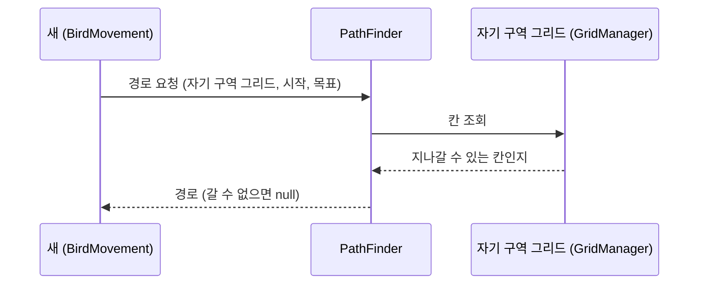

<small>새는 길이 필요할 때마다 자기 구역의 그리드를 넘겨 경로를 받습니다. `PathFinder` 하나를 모든 구역이 함께 쓰지만, 탐색하는 칸은 넘겨받은 구역 안뿐입니다.</small>

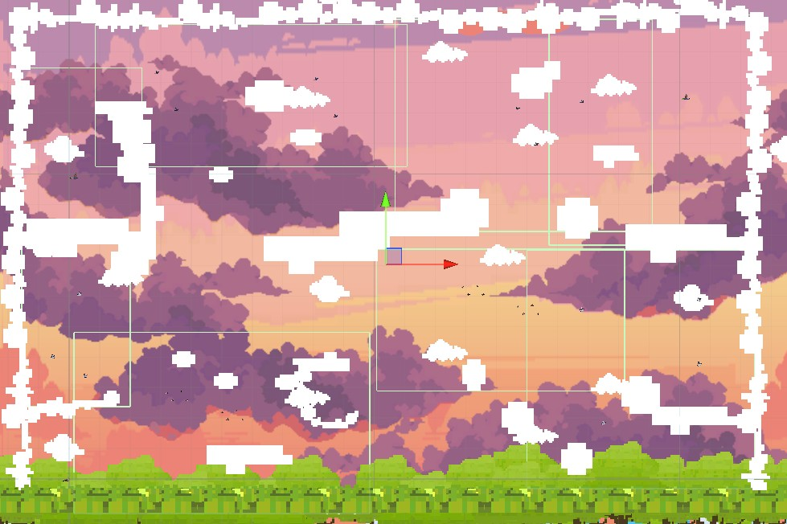

<small>맵 위 연두색 사각형마다 그리드가 하나씩 있습니다. 그리드는 맵 전체가 아니라 그 구역의 콜라이더 안에만 깔리고, 칸마다 중심이 벽 레이어와 겹치는지 검사해 지나갈 수 있는 칸인지 정합니다.</small>

※ 목표 지점이 벽이면 A\*는 갈 수 있는 칸을 모두 뒤진 뒤에야 실패하고, 다음 프레임에 같은 탐색을 되풀이합니다. 이 위험은 코드가 아니라 **레벨 구성**으로 줄였습니다. 활동 영역의 콜라이더를 볼록한 사각형에 가깝게 만들어, 무작위로 고른 목표가 벽에 떨어질 확률을 낮췄습니다. 맵 디자인 때문에 1\~2곳은 남았지만, 그곳의 새는 5마리 안팎이고 동시에 일어나도 프레임이 크게 떨어지지 않는 것을 테스트로 확인하고 받아들였습니다.

구역을 나누자 탐험 씬 전체의 32마리를 넣어도 평소에는 약 120FPS가 나왔습니다. 그런데 특정 순간마다 프레임이 크게 떨어졌습니다.

### 3.2 순간마다 프레임이 떨어지던 문제

| 항목 | 내용 |
|---|---|
| 문제 | 특정 순간마다 20\~30FPS로 떨어지고, 가끔 한 자릿수까지 내려가 화면이 멈칫함 |
| 원인 | 여러 새의 길찾기가 같은 순간에 몰려 실행됨 |
| 해결 | 플레이어와 25 이상 떨어진 새는 휴면 상태로 바꿔 길찾기와 이동을 멈춤 |
| 결과 | 순간 하락이 약 70\~80FPS 수준으로 줄어든 것을 확인함. 완전히 사라지지는 않음 (8.2) |

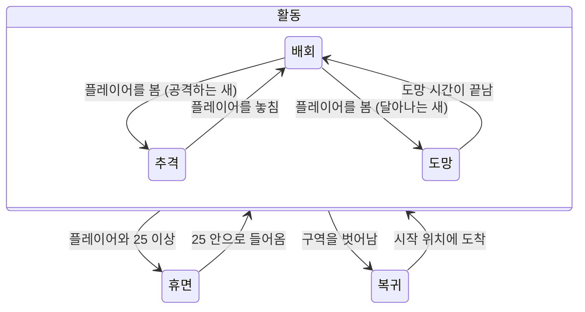

<small>휴면은 새의 상태 중 하나입니다. 플레이어와 25 이상 떨어지면 활동 중 어느 상태에서든 휴면으로 가고, 25 안으로 들어오면 배회부터 다시 시작합니다. 구역을 벗어났을 때의 복귀는 다른 상태보다 먼저 정해집니다.</small>

휴면 거리 25는 플레이어의 시야(10)보다 일부러 넓게 잡은 값입니다. 화면 밖에서도 새들이 계속 움직이고 있었다는 느낌을 남기기 위해서입니다.

| Unity Profiler (32마리) | 휴면 전 | 휴면 후 | 줄어든 비율 |
|---|---|---|---|
| 가장 오래 걸린 프레임 | 207.90ms | 62.87ms | 약 70% |
| 그 프레임에서 새 32마리의 처리 (`BirdMovement.Update`) | 197.32ms | 53.76ms | 약 73% |
| 그 프레임의 GC 할당 | 17.1MB | 3.6MB | 약 79% |

두 측정의 조건은 같지 않고, 휴면 후 쪽이 더 불리합니다. 휴면 전은 플레이어가 가만히 있는 가벼운 상황이고, 휴면 후는 플레이어가 돌아다니며 새를 깨우는 무거운 상황입니다. 그래서 **실제로 줄어든 폭은 표보다 큽니다.**

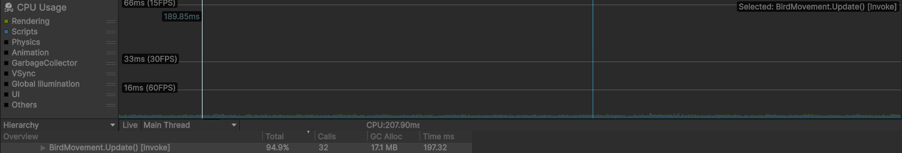

<small>휴면 전(구역별 그리드 + 32마리, 플레이어는 멈춤). 아래 줄의 가장 오래 걸린 프레임은 207.90ms(약 0.2초 멈춤)이고, 그중 197.32ms(94.9%)가 새 32마리의 처리입니다.</small>

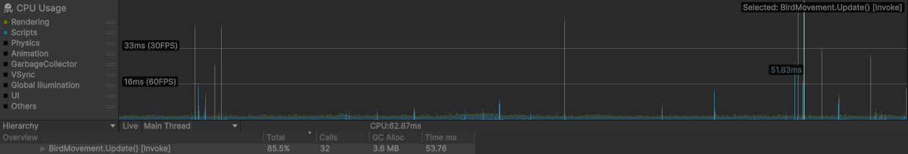

<small>휴면 후(같은 32마리, 플레이어가 돌아다니며 새를 깨움). 가장 오래 걸린 프레임이 62.87ms로 줄었고, 그 안에서 새의 처리는 53.76ms, GC 할당은 3.6MB입니다. 평소 프레임은 약 9ms(8.72ms)이고, 이때 새 32마리의 처리는 0.09ms입니다.</small>

휴면은 멀리 있는 새의 계산을 멈춥니다. 남은 것은 플레이어 가까이에서 활동하는 새들이 경로를 얼마나 자주 다시 계산하느냐였습니다.

### 3.3 쫓을 때와 도망칠 때

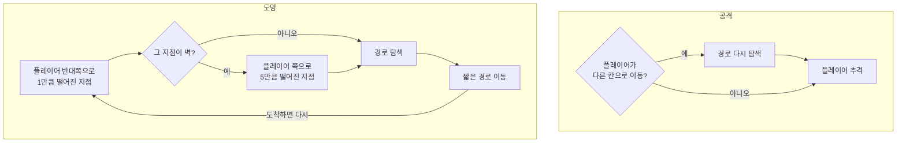

플레이어를 발견한 새는 공격하거나 도망칩니다. 둘 다 경로를 따라 움직이지만, **언제 경로를 다시 계산하는지**는 다르게 정했습니다.

- **쫓을 때**는 플레이어가 **다른 칸으로 옮겼을 때만** 경로를 다시 계산합니다. 같은 칸 안에서 움직이는 동안에는 이미 구한 경로를 그대로 씁니다.
- **도망칠 때**는 플레이어 반대쪽으로 **1만큼 떨어진 가까운 지점**까지만 경로를 잡습니다. 짧은 경로를 다 갈 때마다 그때의 플레이어 위치를 보고 방향을 다시 정하므로, 도망치는 방향이 플레이어의 움직임을 따라 바뀝니다.
- 도망칠 지점이 벽이면 오히려 **플레이어 쪽으로 5만큼 떨어진 지점**을 목표로 삼습니다. *Dave the Diver*에서 벽에 몰린 물고기가 플레이어 쪽으로 빠르게 돌진해 빠져나가는 움직임을 옮겨 온 것입니다.

### 3.4 A\*는 얼마나 무거웠나

| | 평소 | 순간 하락 | 가장 오래 걸린 프레임 |
|---|---|---|---|
| 맵 전체 그리드 하나 · 참새 10마리 | 30\~50FPS (15\~20마리부터 멈춤) | | 736.60ms |
| 구역마다 그리드 (3.1) · 32마리 | 약 120FPS | 20\~30FPS | 207.90ms |
| + 멀리 있는 새 휴면 (3.2) · 32마리 | 프레임 약 9ms | 약 70\~80FPS | 62.87ms |

개인 목표였던 "A\*가 실제 게임에서 얼마나 무거운가"는 새의 수와 그리드 구성을 바꿔 가며 이렇게 수치로 확인했습니다. 무거움은 알고리즘 자체보다, 이론에서는 다루지 않던 곳에서 왔습니다.

| 무거웠던 곳 | 줄인 방법 | 어디서 |
|---|---|---|
| 갈 수 없는 목표를 향한 탐색의 실패 비용 | 활동 영역을 볼록하게 만드는 레벨 구성 | 3.1 ※ |
| 여러 새가 한꺼번에 하는 탐색 | 구역별 그리드, 멀리 있는 새 휴면 | 3.1, 3.2 |
| 반복해서 부를 때 남는 상태와 새로 만드는 메모리 | 아직 줄이지 못함 | 8.2 |

참새 10마리에 0.7초씩 멈추던 하늘에서, 이제는 **새 32마리가 자기 구역을 돌며 쫓고 달아나도 가장 오래 걸린 프레임이 62.87ms**에 머뭅니다.

---

## 4. 날면서 쪼는 공격

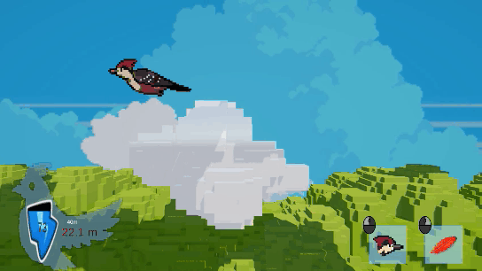

<small>몸통의 날갯짓은 한 번도 끊기지 않고, 머리만 앞으로 나갔다가 제자리로 돌아옵니다.</small>

이렇게 구역을 돌며 쫓고 달아나는 새들을 사냥하려면, 플레이어 새에게도 공격이 필요했습니다. 새는 날면서 공격하므로, 날갯짓을 멈추지 않은 채 머리만 앞으로 내밀어 쪼게 하고 싶었습니다.

### 4.1 머리와 몸통을 나눌 것인가

저는 눈에 먼저 보이고 바로 만들 수 있는 것부터 완성한 뒤, 그 위에 기능을 하나씩 더하는 편입니다. 그래서 플레이어 새도 날아다니는 모습부터 만들었고, 그때 쓴 스프라이트는 머리와 몸통이 한 장에 그려진 날갯짓 그림(약 10프레임)이었습니다. 날아다니기만 할 때는 이 한 장으로 충분했습니다.

공격을 붙이려고 보니, 한 장짜리 그림으로는 날갯짓을 유지한 채 공격 애니메이션을 넣을 수 없었습니다. 날갯짓과 쪼기가 동시에, 따로 움직이도록 그림을 어떻게 준비할지 정해야 했습니다.

| | 대안 A. 공격 이미지 추가 | 대안 B. 머리만 옮긴 이미지 | 대안 C. 머리·몸통 분리 ✓ |
|---|---|---|---|
| 방법 | 날갯짓 10프레임마다 공격 이미지를 그려 타이밍을 맞춤 | 공격할 때 머리를 옮긴 이미지로 바꿈 | 몸통(날갯짓)과 머리(쪼기)를 따로 재생 |
| 프레임 (예상) | 약 50 | 약 20 | 10 (몸통 5 + 머리 5) |
| 단점 | 프레임이 가장 많고, 타이밍을 하나하나 맞춰야 함 | 머리가 부자연스럽게 움직임 | 위치와 피벗(회전 기준점)을 다시 잡아야 함 |

대안 C를 골랐습니다. 위치와 피벗을 다시 잡는 수고가 들더라도, 결과물이 자연스러운 쪽이 더 중요했습니다(4.2).

※ 그때는 디펜스에서 쓸, 가만히 서서 쪼는 동작도 계획하고 있어 머리를 따로 두는 편이 더 유리했습니다. 이 동작은 기본 유닛이 공격 대신 디펜스 포인트를 만들도록 바뀌면서(6.2) 쓸 곳이 없어져 지웠습니다.

### 4.2 나눈 스프라이트 맞추기

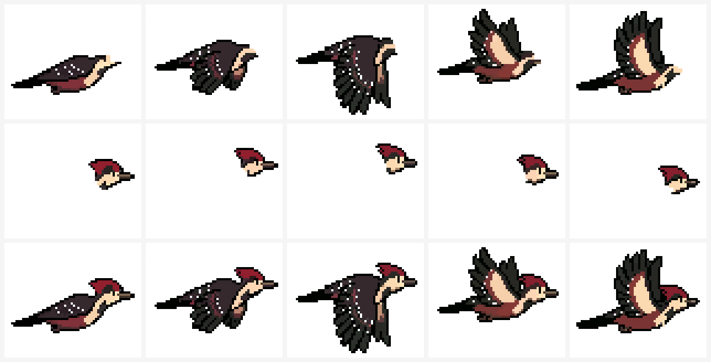

<small>위 줄이 몸통 5프레임, 가운데 줄이 머리 5프레임이고, 맨 아래 줄이 둘을 겹친 결과입니다. 머리가 가장 멀리 나간 프레임에서도 목이 끊기지 않습니다.</small>

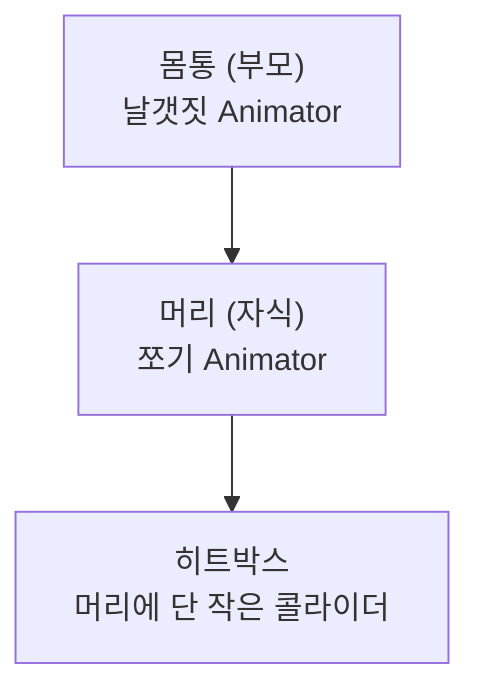

<small>머리가 몸통의 자식이라 이동할 때는 함께 움직이고, 애니메이션은 각자 재생합니다. 히트박스는 머리에 붙어 있어 쪼는 머리를 따라갑니다.</small>

- **구조**: Animator는 몸통과 머리에 따로 있고, 앞뒤 순서는 SpriteRenderer의 Sorting Order로 맞췄습니다.
- **공격**: 트리거로 머리의 공격 애니메이션을 재생합니다. 애니메이션이 머리에 단 히트박스를 켜면서 머리를 앞으로 조금 옮깁니다.
- **스프라이트 나누기**: Affinity로 기존 날갯짓 스프라이트를 머리와 몸통으로 나누고, 겹쳐 보이는 불필요한 프레임을 줄여 몸통 5프레임과 머리 5프레임을 새로 만들었습니다.
- **목 이음새**: 머리가 앞으로 나간 때를 기준으로 몸통의 목 부분을 먼저 늘려 두고, 머리가 돌아왔을 때 튀어나오는 부분을 다시 다듬었습니다. 그래서 공격하는 동안에도 목에 빈틈이 생기지 않습니다.

그 대가로, 이미 이동에 쓰던 한 장짜리 스프라이트에 맞춰 나눈 스프라이트의 위치를 다시 맞춰야 했고, 머리가 자연스럽게 움직이도록 머리 스프라이트의 부분별 피벗을 조정해야 했습니다.

이 문제는 코드가 아니라 그림을 고쳐서 풀었습니다. 멀티미디어학과에서 포토샵 같은 그래픽 도구를 배우지 않았다면, 스프라이트를 직접 나누고 목을 다듬는 방법은 떠올리지 못했을 것입니다. **모든 문제를 프로그래머의 시선으로만 볼 필요는 없다**는 것을 느꼈습니다.

날갯짓은 한 번도 끊기지 않고 머리만 앞으로 쪼는 공격이, 몸통 5 + 머리 5 = **10프레임**으로 완성됐습니다. 대안 A(약 50)와 대안 B(약 20)를 예상했던 것보다 적은 수입니다.

---

## 5. 귀환해야 확정되는 깃털

새들이 쫓아오고 체력(산소)은 계속 줄어(7.1), 탐험에는 위험이 따릅니다. 그 위험을 감수할 이유로, 살아서 돌아와야만 주운 깃털이 확정되게 했습니다.

### 5.1 주운 깃털을 언제 확정할까

| 깃털을 줍고 귀환 | 깃털을 줍고 사망 |
|---|---|
| 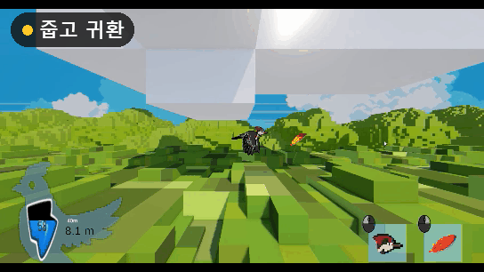 | 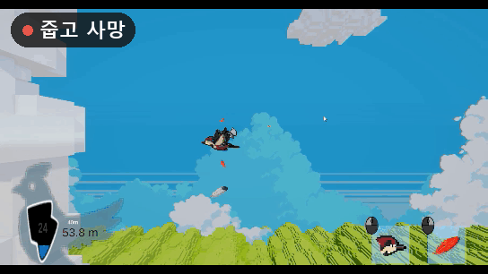 |

<small>둘 다 깃털을 주운 뒤의 장면입니다. 끝 화면을 보면, 귀환한 쪽은 허브가 밤으로 바뀌고 깃털이 남아 있지만, 죽은 쪽은 허브가 낮 그대로이고 깃털도 없습니다.</small>

탐험에서 주운 깃털을 언제 내 것으로 확정할지 정해야 했습니다.

| | 대안 A. 줍는 즉시 반영 | 대안 B. 임시로 보관했다가 귀환하면 확정 ✓ |
|---|---|---|
| 장점 | 구조가 단순함 | "탐험에 성공해야 디펜스에 반영된다"는 규칙이 지켜짐 |
| 단점 | 실패한 판의 깃털도 해금됨. 높은 등급의 깃털을 한 번 건드리고 일부러 죽는 식으로 여러 깃털을 해금할 수 있음 | 인벤토리를 두 개 관리해야 함 |

대안 B를 골랐습니다. 대안 A에서는 실패한 판에서 주운 깃털까지 해금되어, 탐험에서 살아 돌아오든 말든 상관없는 구조가 됩니다.

| | 1판: 까마귀 깃털을 줍고 사망 | 2판: 참새 깃털을 들고 귀환 | 해금된 깃털 |
|---|---|---|---|
| 대안 A | 까마귀 해금 | 참새 해금 | 까마귀 + 참새 |
| 대안 B | 버려짐 | 참새 해금 | 참새만 |

그래서 탐험 중에 얻은 것과 확정된 것을 나눴고, 인벤토리를 두 개 관리하는 수고를 그 대가로 받아들였습니다.

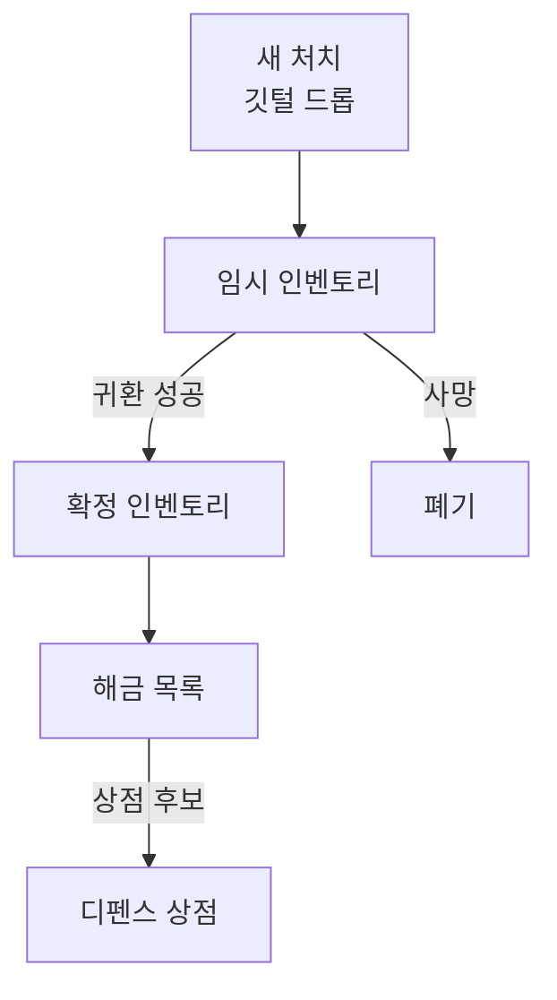

<small>해금 목록으로 이어지는 화살표는 '귀환 성공' 하나뿐입니다. 도중에 죽으면 임시 인벤토리에 있던 깃털은 그대로 폐기됩니다.</small>

탐험에서 주운 깃털은 임시 인벤토리에만 들어갑니다. 귀환에 성공하면 확정 인벤토리에 합쳐지고, 합치는 순간 해금 목록에도 올라갑니다.

죽었을 때 깃털을 **하나도 남기지 않는 것**도 같은 이유로 원작과 다르게 정했습니다. 원작처럼 하나라도 남긴다면 "최대한 높이 올라가 가장 높은 단계의 새만 잡고 죽는" 플레이가 가장 이득인 방법이 될 것이라고 봤습니다. 그것은 제가 바란 탐험의 재미와 거리가 멀었습니다.

※ 아직 해금된 깃털이 하나도 없는데 빈손으로 돌아오면 귀환에 성공해도 실패로 처리합니다. 디펜스를 하려면 해금된 깃털이 적어도 하나는 있어야 하기 때문입니다.

해금 목록은 밤의 상점으로 이어집니다.

### 5.2 상점에는 발견한 깃털만

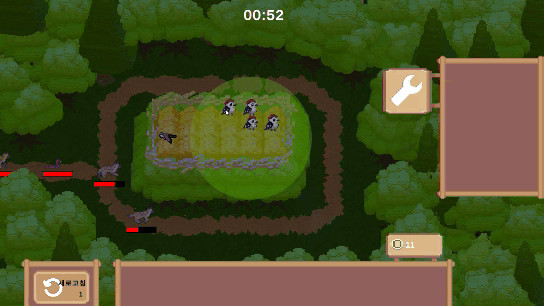

밤의 디펜스에서는 디펜스 포인트로 상점에서 유닛을 소환하거나 깃털을 사고, 포인트 1을 내고 상점 후보를 다시 뽑을(리롤) 수 있습니다. 전투가 진행되는 중에도 구매·장착·배치를 바로 바꿀 수 있습니다.

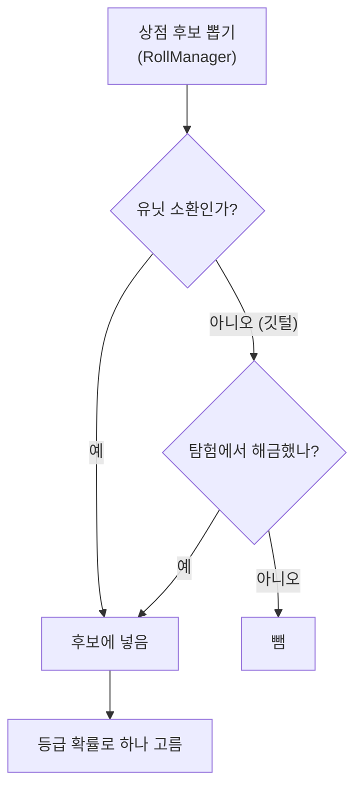

유닛 소환은 언제나 후보에 들어가고, 깃털은 **탐험에서 해금한 것만** 들어갑니다. 등급 확률을 굴려 후보 중 하나를 고릅니다.

- 상점을 둔 이유: *운빨존많겜*처럼 완전히 무작위로 소환하면 운의 비중이 너무 컸습니다. 그래서 *전략적 팀 전투*처럼 어느 정도의 운에 재화를 쓰는 판단을 더한 상점을 붙였습니다. 또 탐험 결과만으로 디펜스 전략이 정해지면, 탐험이 "발견"이 아니라 특정 깃털을 모으는 반복 작업으로 바뀝니다. 그래서 디펜스 안에서도 전략을 넓힐 수단으로 상점을 두었습니다.
- 해금한 깃털만 나오게 한 이유: 아직 발견하지 않은 깃털이 상점에 나오면, 탐험에서 그 깃털을 발견하는 가치가 사라지기 때문입니다.

결국 밤의 상점에 오르는 깃털은 위험을 감수하고 살아 돌아온 탐험에서 주운 것뿐입니다. 낮에 낯선 하늘로 더 멀리 나가 돌아올수록, 밤에 고를 수 있는 깃털이 늘어납니다.

---

## 6. 깃털 하나로 바뀌는 유닛

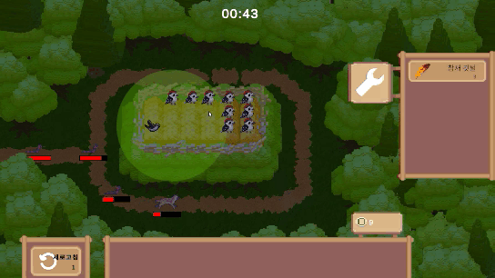

<small>같은 유닛에 깃털만 끌어다 놓았을 뿐인데, 유닛이 그 깃털의 새로 모습을 바꿉니다.</small>

확정된 깃털은 밤의 디펜스에서 쓰입니다. 탐험에서 발견한 새가 그대로 내 유닛이 되어야, 발견한 가치가 밤까지 이어집니다.

깃털을 유닛에 끌어다 놓으면 겉모습과 애니메이션뿐 아니라 공격 방식·사거리·공격력까지 함께 바뀝니다. 유닛 하나에는 깃털을 하나만 달 수 있고, 렌치를 끌어다 놓으면 깃털이 빠집니다.

### 6.1 유닛을 종류마다 나눌 것인가

| | 대안 A. 유닛 종류마다 클래스와 프리팹 | 대안 B. 유닛은 하나, 깃털 데이터로 바꿔 끼움 ✓ |
|---|---|---|
| 장점 | 유닛마다 따로 고칠 수 있음 | 클래스·프리팹이 늘지 않음. 깃털만 바꾸면 유닛이 바뀜 |
| 단점 | 행동 구조가 같은데도 클래스·프리팹이 깃털 수만큼 늘어남 | 유닛마다 완전히 다른 행동 구조가 필요해지면 맞지 않음 |

대안 B를 골랐습니다. 모든 유닛은 "사거리 안의 적에게 행동한다"는 같은 구조이고, 다른 것은 겉모습과 행동 방식뿐이었습니다. 그래서 깃털(`Item`)에 겉모습·애니메이션·행동 방식·수치를 담아 두고, 장착할 때 통째로 바꿔 끼우는 편이 낫다고 판단했습니다.

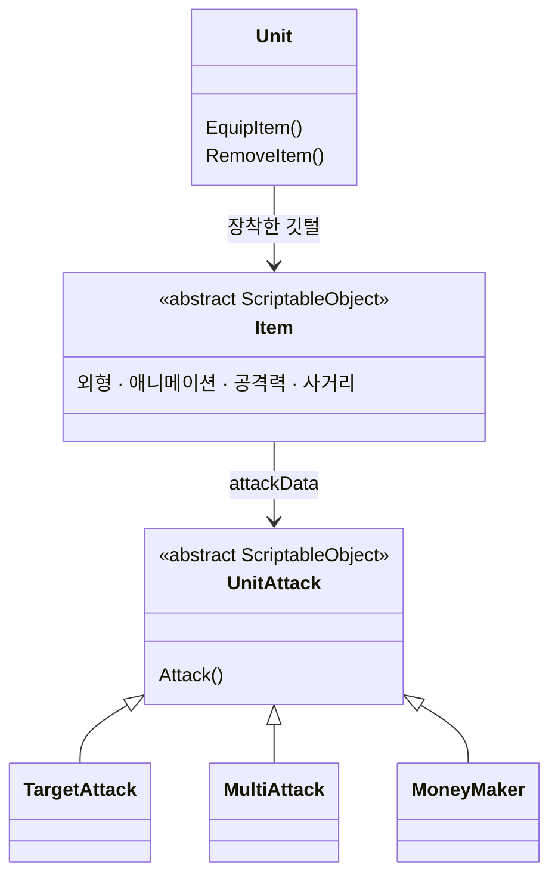

<small>유닛은 모두 같은 `Unit` 하나이고, 유닛마다 다른 것은 장착한 `Item` 하나뿐입니다. 행동 방식은 `Item`이 가리키는 `UnitAttack`(단일 공격 `TargetAttack`·범위 공격 `MultiAttack`·재화 생산 `MoneyMaker`)이 정합니다.</small>

```csharp
// Unit.cs (발췌) — 깃털 하나로 유닛을 통째로 바꾸기
public void EquipItem(Item item)
{
    if (item.Tier == ItemTier.Infinite)
    {
        RemoveItem();
        return;
    }
    // ...
    attackBehaviour = item.attackData;
    sprite.sprite = item.BirdSprite;
    animator.runtimeAnimatorController = item.overrideController;
    detectedObject.localScale = item.detectedArea;
    damage = item.damage;
    mobType = item.Key;
    // ...
}
```

장착은 깃털 데이터 하나로 행동 방식·외형·애니메이션·사거리·공격력을 한 번에 바꿉니다. 렌치(`Infinite` 등급)는 따로 입력을 만들지 않고, 같은 장착 경로를 그대로 써서 해제로 처리했습니다.

### 6.2 공격하지 않는 기본 유닛

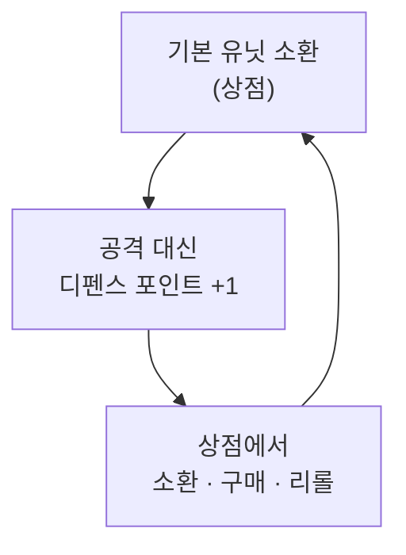

<small>기본 유닛은 적을 공격하는 대신 디펜스 포인트를 1씩 만들고, 그 포인트는 다시 상점에서 쓰입니다. 이 행동은 `UnitAttack`을 이은 `MoneyMaker`가 맡습니다.</small>

대부분의 디펜스 게임에서 기본 유닛은 전투에 직접적인 도움을 주기보다는 간접적으로 재화를 늘려주거나, 특정 강화 유닛의 재료로 사용되곤 합니다. 이 게임의 기본 유닛도 공격 대신 디펜스 포인트를 만들어, 전투보다 성장을 돕습니다.

디펜스는 탐험을 넓혀 주는 쪽이므로, 디펜스가 어려워서 탐험이 막히는 일이 없도록 난이도를 낮게 잡았습니다. 몬스터는 특별한 기믹 없이 판을 돌고, 유닛은 오토배틀러처럼 알아서 싸웁니다.

기본 유닛이 포인트를 만드는 것도 같은 방향이라, 기본 유닛을 많이 소환할수록 게임이 쉬워집니다. 행동 방식을 `UnitAttack`으로 떼어 두었기 때문에, **"공격하지 않는 행동"도 다른 공격과 같은 틀에 그대로 넣을 수 있었습니다.**

이렇게 유닛은 깃털 하나로 정해집니다. 남은 문제는 그 깃털이 디펜스가 끝난 뒤 어디로 가느냐였습니다.

### 6.3 미리 나눈 깃털을 돌려줄 수 없던 문제

깃털 정보는 크게 두 갈래입니다. 탐험에서는 "어느 새가 떨어뜨리는가" 정도로 단순하고, 디펜스에서는 "무엇으로 변신하는가(행동 방식·데미지)"와 "얼마인가(상점)"로 뚜렷하게 나뉩니다.

처음에는 상속으로 세 단계로 나눴습니다. 디펜스 쪽을 나누는 것은 맞다고 봤고, "나중에 문제가 될 바에는 미리 나누자"는 생각으로 탐험 쪽까지 나눴습니다.

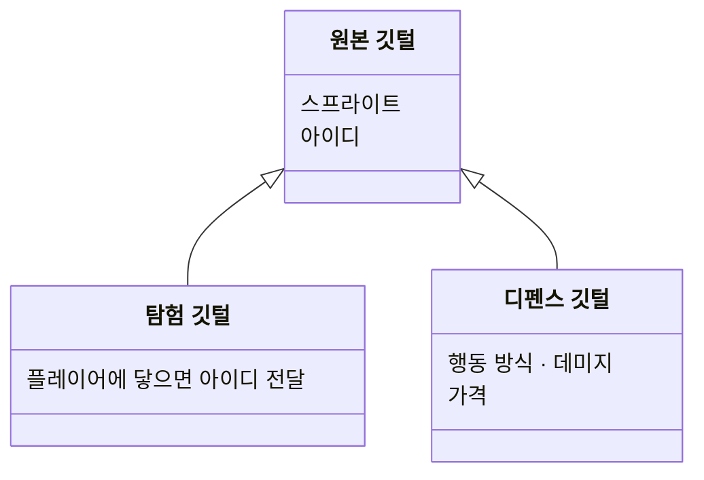

<small>처음 구조. 아이디는 맨 위 '원본 깃털'에만 있고, 디펜스 깃털에는 없습니다.</small>

그런데 깃털은 디펜스에서 끝나지 않습니다.

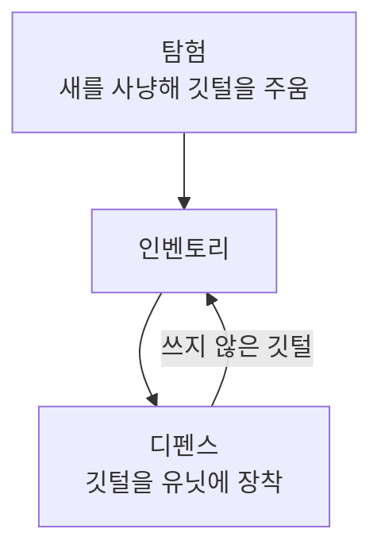

<small>쓰지 않은 깃털은 디펜스가 끝나면 인벤토리로 되돌아옵니다. 그래서 탐험·인벤토리·디펜스 어디에서든 같은 깃털로 알아볼 수 있어야 했습니다.</small>

| 항목 | 내용 |
|---|---|
| 문제 | 디펜스가 끝나면 쓰지 않은 깃털을 인벤토리로 돌려줘야 하는데, 디펜스 깃털의 값만으로는 돌려줄 수 없음 |
| 원인 | 아이디가 위 단계(원본 깃털)에만 있어서, 어느 원본 깃털과 짝인지 판단하는 스크립트가 새로 필요해짐. 가독성을 높이려고 나눴는데 오히려 가독성이 떨어짐 |
| 해결 | 짝을 맞추는 스크립트를 쓰기 전에 방향을 바꿔, 깃털을 하나의 아이템(`Item`)으로 다시 합침 |
| 결과 | 아이디·디펜스 정보·가격이 한 곳에 있어, 돌려줄 때 짝을 찾을 필요가 없어짐 |

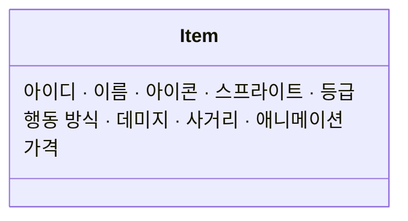

<small>합친 구조. 위의 세 단계 그림과 달리, 아이디가 디펜스 정보·가격과 한 곳에 있습니다.</small>

※ 원본과 디펜스 깃털에 공통 아이디를 두는 방법은 그때는 떠올리지 못했습니다. 다만 그러면 맨 위 단계가 아이디를 두 개 쓰게 되어 역시 가독성이 떨어지므로, 알았더라도 고르지 않았을 것입니다.

지금은 탐험에서 주운 깃털 하나가 그대로 밤의 유닛이 되고, 그 밤에 쓰지 않은 깃털은 같은 아이템 그대로 인벤토리에 돌아갑니다. 낮에 발견한 새가 밤의 유닛으로, 다시 다음 날의 인벤토리로 이어집니다.

---

## 7. 그 밖의 기능

### 7.1 체력·조준·몬스터 스킬

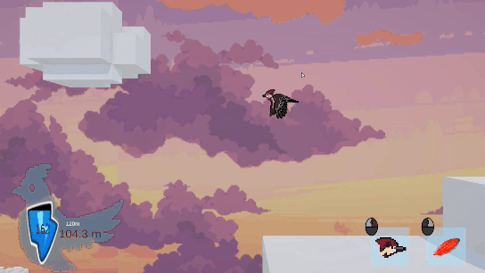

| 기능 | 플레이에서 보이는 것 | 이렇게 정한 이유 |
|---|---|---|
| 체력 = 산소 | 탐험 중 체력이 시간에 따라 줄어듦. 기본 초당 1/3, 달리는 중 1, 한계 고도를 넘으면 2. 한계 고도는 허브 강화로 늘어남 | 탐험에는 위험이 따라야 한다고 보고, 플레이어를 계속 재촉하는 장치로 원작의 산소를 가져옴. 시간제한만 두면 운 좋게 높은 곳의 새를 잡는 경우가 생겨 고도에 따라 구간을 나누고, 사냥을 어렵게 하려고 달릴 때도 더 줄게 함 |
| 조준하면 멈춤 | 우클릭으로 조준하는 동안 이동이 멈추고, 마우스 쪽으로 카메라가 옮겨 가 주변을 볼 수 있음 | 움직이면서 멀리 볼 수 있으면 손해 없이 늘 쓰는 기능이 됨. "멈춰야 볼 수 있다"는 비용을 붙여, 전투처럼 목적이 있을 때는 주변을 살피는 정도로만 쓰고 목적 없이 탐험할 때만 주변을 탐색하는 수단이 되게 함 |
| 몬스터 스킬 | 공격 상태의 몬스터는 쓸 수 있는 스킬이 있으면 쓰고, 없으면 추격함. 지금은 까마귀의 돌진(3초 모으기 → 직선 돌진 → 쿨타임 8초) 하나 | 스킬을 몬스터에 컴포넌트로 붙여, Unity 에디터에서 몬스터가 어떤 스킬을 쓰는지 바로 보이게 함 |

---

## 8. 회고

2주 동안 탐험과 디펜스 두 모드를 만들고, 깃털로 이어지는 순환(획득 → 확정·해금 → 장착 → 재화 → 강화)을 끝까지 완성했습니다.

### 8.1 목표한 경험은 전해졌나

| 목표 (1장) | 구현 | 어디서 |
|---|---|---|
| **개척과 발견** — 위험을 감수하며 낯선 하늘을 개척하고, 새로운 깃털을 발견 | 위험(쫓아오는 새, 줄어드는 체력)과 귀환해야 확정되는 깃털은 만들었지만, 새가 4종뿐이라 발견할 거리가 적었음 | 3장, 5장, 7.1 |
| A\*가 실제 게임에서 얼마나 무거운지 확인 | 새의 수와 그리드 구성을 바꿔 가며 수치로 확인함 | 3.4 |

기간과 리소스가 부족해 새는 4종류만 만들었습니다. 맵은 그보다 먼저 넓게 짜 두었기 때문에, 넓은 하늘에 비해 발견할 거리가 적어 탐험의 경험은 다소 부족했습니다.

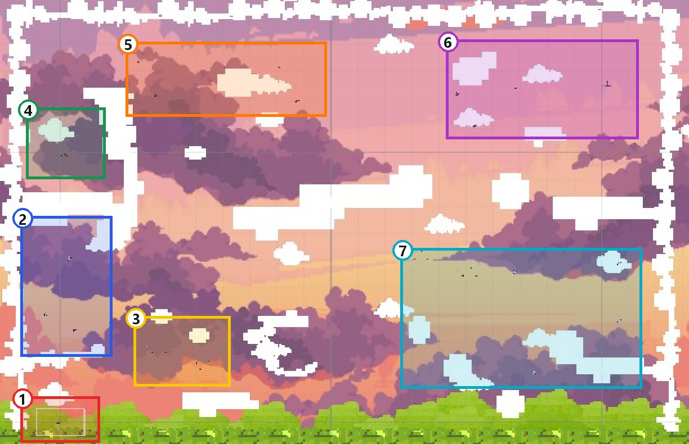

<small>탐험 맵 전체와 새가 사는 곳(①\~⑦)입니다. 이 넓은 맵에서 만날 수 있는 새는 아래 4종뿐입니다.</small>

| 비둘기 | 참새 | 공작 | 까마귀 |
|---|---|---|---|
| 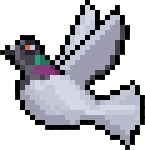 | 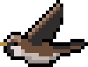 | 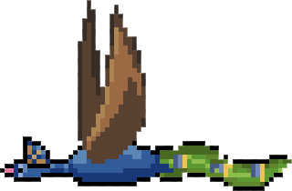 | 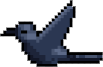 |

대신 새를 더하기 쉬운 구조는 갖춰 두었습니다. 새의 정보는 깃털 데이터 하나에 모여 있고(6.1, 6.3), 몬스터 스킬은 컴포넌트로 붙입니다(7.1). 그래서 리소스만 더해지면 새의 종류를 쉽게 늘릴 수 있습니다.

| 아쉬운 점 | 원인 | 다음에는 |
|---|---|---|
| 넓은 맵에 비해 새가 4종뿐 | 일정 (기간·리소스) | 깃털 데이터와 스킬 컴포넌트로 새를 더함 (6.1, 7.1) |
| 열린 목록·칸 비용·이웃 목록에서 생기는 비용 | 구현 | 우선순위 큐, 탐색 번호, 이웃 목록 재사용 (8.2) |
| 매니저끼리 직접 부르는 곳 130여 곳 | 구조 (기간·실력) | 바꾸는 곳을 한 곳에 모으고 이벤트로 알림 (8.3) |

### 8.2 길찾기 코드 안에 남겨 둔 것

A\* 코드 안쪽에는 일부러 남겨 둔 것, 알고 받아들인 것, 편해서 고른 것, 놓친 것이 섞여 있습니다. 휴면을 넣은 뒤에도 순간 하락이 완전히 사라지지 않은 것(3.2)은 이 부분과 관계가 있습니다.

```csharp
// PathFinder.cs (발췌) — 열린 목록에서 비용이 가장 작은 칸 꺼내기
while (openSet.Count > 0)
{
    Node currentNode = openSet[0];
    for (int i = 1; i < openSet.Count; i++)
        if (openSet[i].totalCost < currentNode.totalCost)
            currentNode = openSet[i];

    openSet.Remove(currentNode);
    closedSet.Add(currentNode);
    // ...
}
```

다음에 살펴볼 칸의 목록(열린 목록)을 `List`로 두어, 칸을 하나 꺼낼 때마다 목록 전체를 훑어 비용이 가장 작은 칸을 찾습니다. 인덱스를 직접 다루고 안을 들여다보기 쉬워서 고른 방식입니다.

| 구분 | 내용 | 다음에 바꿀 방법 |
|---|---|---|
| 일부러 남긴 것 | 길찾기를 따로 떨어진 `PathFinder`(`Instance`로 호출)에 둠. 책임만 보면 몬스터나 그리드 쪽이 갖는 편이 자연스럽지만, 이론에서 배운 구조를 그대로 게임에 넣었을 때 무슨 문제가 생기는지 보려고 유지함 | 경로 계산을 그리드 쪽으로 옮기거나 상태를 갖지 않는 클래스로 만들어, 몬스터가 자기 그리드에서 바로 경로를 받게 함 |
| 알고 받아들인 것 | 목표가 벽이면 전부 탐색한 뒤 실패하고 다음 프레임에 다시 탐색 (3.1) | 목표가 벽이면 가장 가까운 갈 수 있는 칸으로 옮기기, 또는 실패하면 다시 시도하기 전에 기다리기 |
| 편해서 고른 것 | 열린 목록을 `List`로 두고 매번 전체를 훑음 | 비용 순으로 꺼내는 우선순위 큐(최소 힙)로 교체 |
| 놓친 것 | 탐색할 때마다 칸의 비용을 초기화하지 않아 이전 탐색 값이 남음 | 탐색 번호를 매겨 칸의 비용 초기화 |
| 놓친 것 | 이웃 칸을 구할 때마다 새 `List`를 만들어 GC 부담이 생김 | 이웃 칸 목록을 재사용 |

**알고리즘이 맞게 동작하는지만이 아니라, 여러 번 반복해서 불릴 때의 비용까지 봐야 한다**는 것을 배웠습니다.

### 8.3 나눌 것인가, 합칠 것인가

이 프로젝트에서는 나누는 정도 때문에 반대 방향으로 두 번 비용을 치렀습니다. 깃털 데이터는 필요 이상으로 나눠서 비용이 생겼고(6.3), 매니저끼리의 연결은 기간 때문에 나누지 않아서 비용이 남았습니다.

필요 이상으로 나눈 쪽은 성향에서 나왔습니다. 첫 프로젝트라 제가 어디까지 만들 수 있을지 가늠하지 못해, 이것저것 확장 가능성을 넓혀 두던 때였습니다. 탐험 중 깃털을 빼앗기는 기능 같은 확장에 대비해 인벤토리를 둘로 나눴고(결국 만들지 못했습니다), "나중에 문제가 될 바에는 미리 나누자"는 생각으로 깃털 데이터도 세 단계로 나눴습니다.

깃털 데이터에서는 나누는 정도를 **무엇을 위해 나누는지(여기서는 가독성)**를 기준으로 정해야 한다는 것을 배웠습니다. 미리 나누는 것이 늘 좋은 것은 아니고, 데이터가 실제로 어떻게 흐르는지를 먼저 보고 정해야 합니다.

이 프로젝트의 결정을 "나눌 것인가, 합칠 것인가"로 모으면 다음과 같습니다.

| 결정 | 기준 | 얻은 것 | 대가 |
|---|---|---|---|
| 그리드를 구역마다 나눔 (3.1) | 새들의 자연스러운 움직임 | 탐색 범위가 줄어듦 | 구역 밖으로 쫓지 못함 |
| 머리·몸통을 나눔 (4.1) | 자연스러운 결과물 | 끊기지 않는 쪼기, 10프레임 | 위치·피벗을 다시 잡음 |
| 인벤토리를 임시·확정으로 나눔 (5.1) | 귀환해야 반영되는 규칙 | 일부러 죽어 해금하는 길을 막음 | 인벤토리 두 개 관리 |
| 유닛을 하나로 합침 (6.1) | 같은 행동 구조 | 깃털만 바꾸면 유닛이 바뀜 | 완전히 다른 행동에는 맞지 않음 |
| 깃털 데이터를 나눴다가 합침 (6.3) | 가독성 | 짝 맞추기 없이 깃털을 돌려줌 | 다시 합치는 수고 |
| 매니저 연결을 나누지 않음 | 2주라는 기간 | 빠른 작업 | 직접 참조 130여 곳 |

매니저끼리의 연결에서는 다른 클래스의 인스턴스를 직접 부르는 곳이 30여 개 파일, 130여 곳입니다. 디펜스 포인트가 그 예입니다.

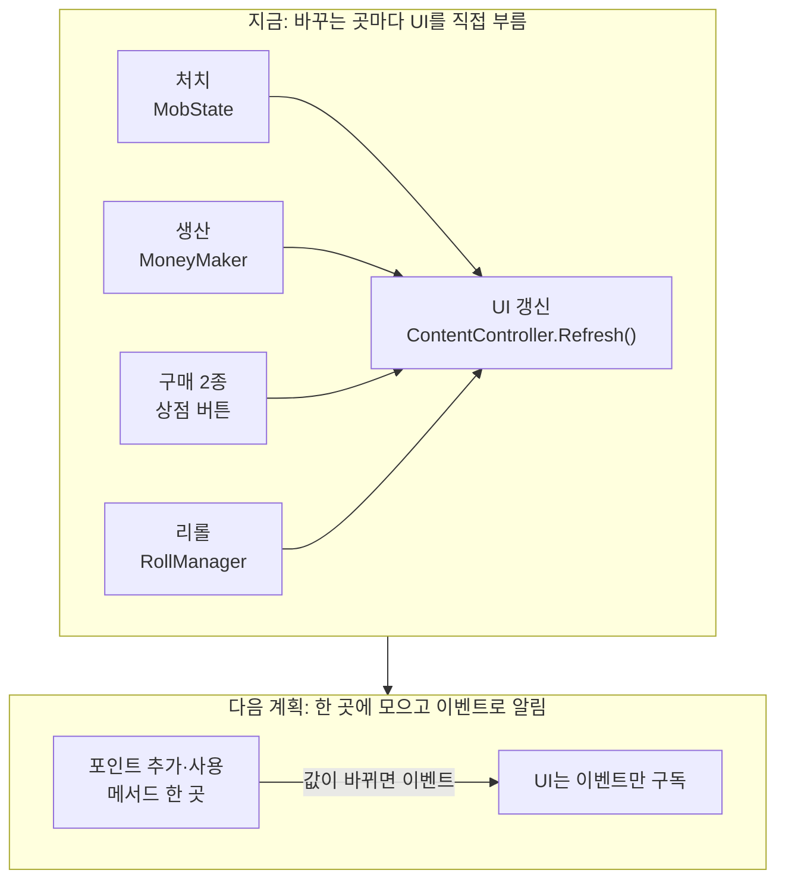

<small>포인트를 바꾸는 다섯 곳(처치, 생산, 구매 2종, 리롤)이 저마다 UI 갱신을 직접 부릅니다. 구매 2종은 상자 하나로 묶어 화살표는 넷입니다. 몬스터·유닛 같은 게임 로직이 UI를 알아야 하고, 바꾸는 곳이 늘수록 화살표도 늘어 갱신을 빠뜨릴 위험이 커집니다. 아래 계획에서는 UI로 가는 화살표가 하나뿐입니다.</small>

이벤트(옵저버) 방식은 알고 있었지만, 2주라는 기간과 그때의 실력으로는 원하는 대로 적용하기 어렵다고 보고 빠르게 작업할 수 있는 직접 참조를 골랐습니다. 개발하는 동안 실제로 갱신이 빠지는 문제는 생기지 않았습니다.

다음에는 포인트를 바꾸는 일을 한 곳(추가·사용 메서드)으로 모으고, 값이 바뀌면 이벤트를 내보내 UI는 그 이벤트만 구독하게 하겠습니다. 이벤트 방식은 수업에서 직접 구현해 봤지만, 아직 제 프로젝트에 적용하지는 못했습니다.

두 경험에서 얻은 기준은 같습니다. **나누는 정도는 목적과 상황(기간, 실력, 데이터의 흐름)을 근거로 정해야 합니다.**
